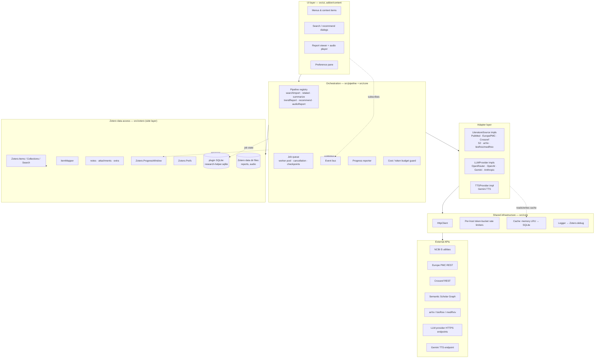
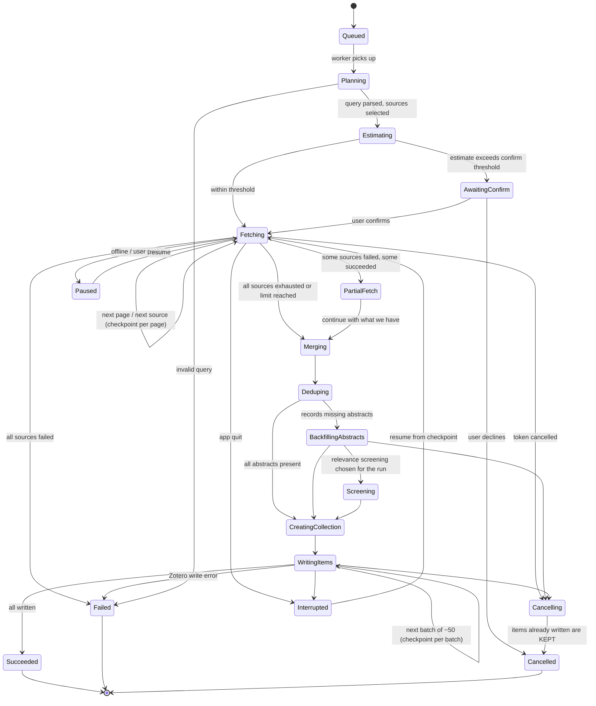
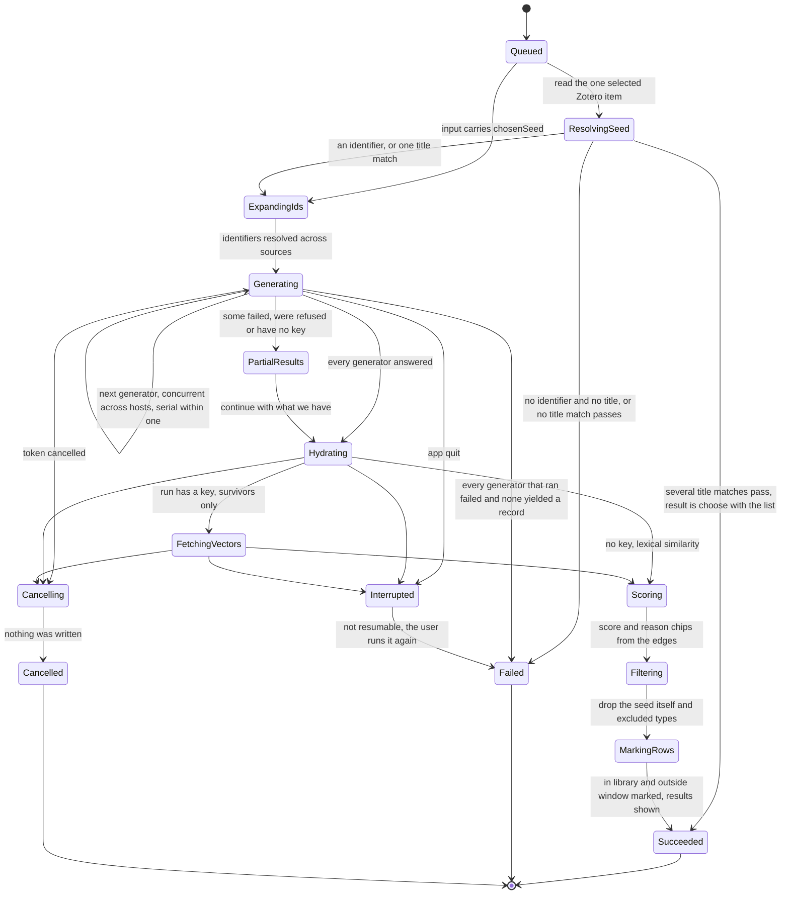
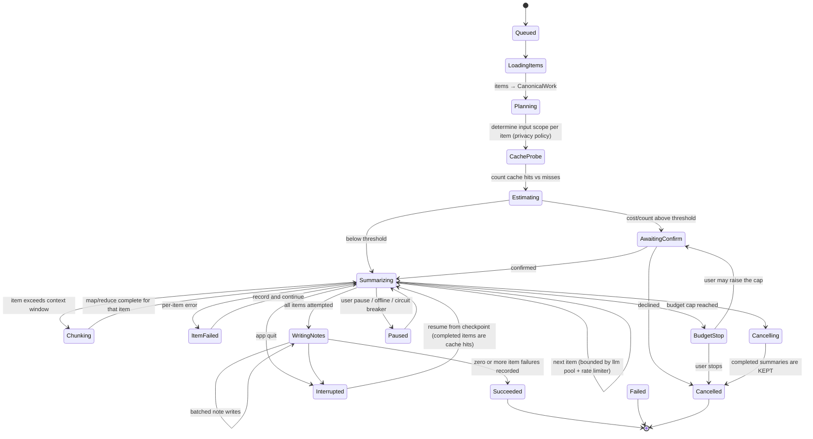
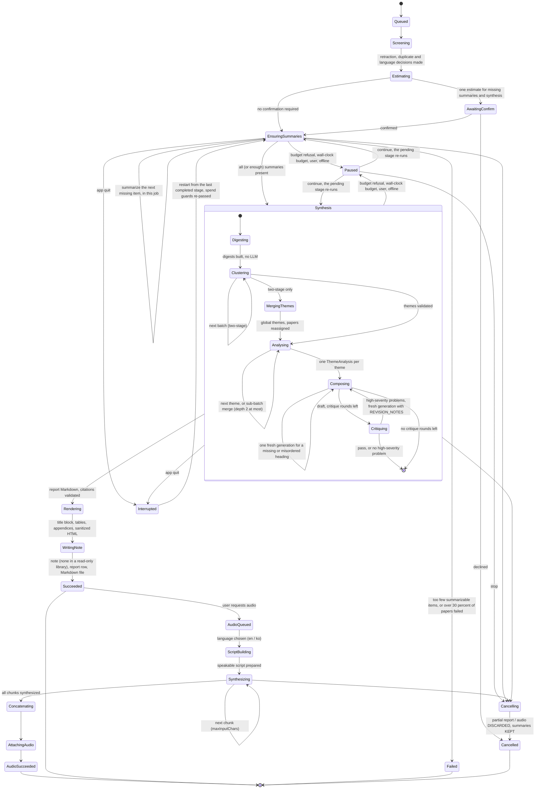
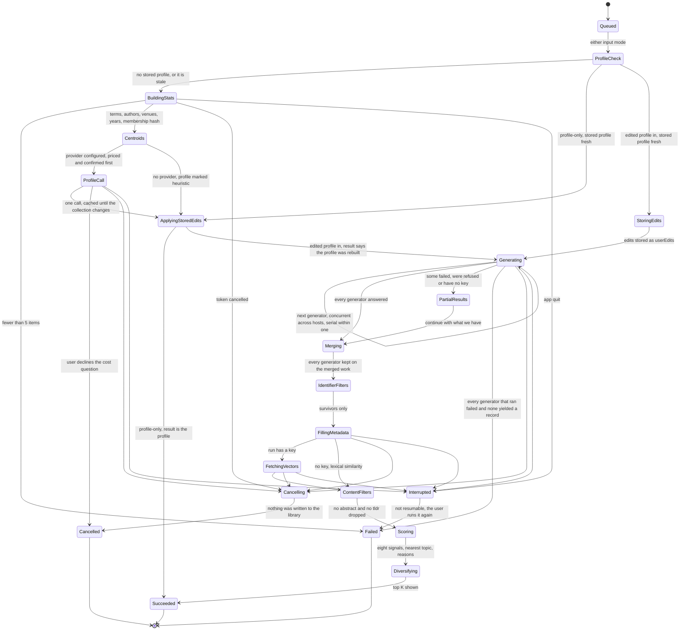

# 07 — Architecture and Data Model

**Document owner:** systems architecture
**Scope:** cross-cutting system design for the `research_helper` Zotero plugin
**Target platform:** Zotero 10.x (user runs 10.0.1), bootstrapped plugin, privileged JS context, fully client-side (no backend)
**Status:** design specification (pre-implementation)

Related documents (do not duplicate — cross-reference):

| Document | Owns |
|---|---|
| `01-zotero-plugin-platform.md` | Zotero plugin runtime, bootstrap lifecycle, XUL/HTML UI hosting, build/release |
| `02-literature-database-apis.md` | Per-API endpoints, query syntax, response schemas, field-level quirks |
| `03-llm-provider-integration.md` | Per-provider request/response formats, model IDs, token accounting |
| `04-audio-report-tts.md` | Gemini TTS specifics, audio encoding, playback |
| `05-related-work-discovery.md` | Similarity/recommendation algorithms |
| `06-summarization-and-trend-report.md` | Summarization strategy, clustering, report composition |
| `08-ui-ux-spec.md` | Screens, dialogs, interaction flows |
| `09-security-privacy-and-api-keys.md` | Threat model, key storage, egress policy |
| `12-prompt-library.md` | Prompt text, versioning conventions |

---

## 1. Platform baseline and what it constrains

### 1.1 Confirmed platform facts

Zotero 10.0 was released 2026-08-17 and 10.0.1 on 2026-08-24 ([Zotero Version History](https://www.zotero.org/support/changelog)). Zotero has moved to a rapid major-release cadence (7 → 8 → 9 → 10 in relatively quick succession), which has direct architectural consequences discussed in §1.3.

Facts that shape this architecture, from [Zotero 10 for Developers](https://www.zotero.org/support/dev/zotero_10_for_developers) and [Zotero 7 for Developers](https://www.zotero.org/support/dev/zotero_7_for_developers):

1. **Plugins run privileged.** "Zotero 7 plugins continue to provide full access to platform internals (XPCOM, file access, etc.)" ([Zotero 7 for Developers](https://www.zotero.org/support/dev/zotero_7_for_developers)). There is no WebExtension sandbox, no CORS enforcement on `Zotero.HTTP` requests, and no permission prompt model. Everything the plugin does is done with the full authority of the Zotero process. This is what makes a fully client-side design possible at all — the plugin can talk to PubMed, Crossref, OpenAI and Google directly from the desktop app.
2. **`zotero.sqlite` now runs in WAL mode** in Zotero 10, and the docs explicitly warn: "If your plugin or external tool reads zotero.sqlite directly (which it probably shouldn't — use the local API instead!), it must account for the `-wal` and `-shm` files" ([Zotero 10 for Developers](https://www.zotero.org/support/dev/zotero_10_for_developers)). **Architectural rule: `research_helper` never touches `zotero.sqlite` directly.** All Zotero data access goes through the `Zotero.Items` / `Zotero.Collections` / `Zotero.Search` JS API.
3. **Full-text search was rewritten on SQLite FTS5**; the `fulltextWords` and `fulltextItemWords` tables are gone ([Zotero 10 for Developers](https://www.zotero.org/support/dev/zotero_10_for_developers)). Any design that assumed those tables is dead. We do not depend on them.
4. **Multi-selection API change.** Singular selection getters were replaced by plural ones: `ZoteroPane.getSelectedCollection()` → `getSelectedCollections()`, `getSelectedSavedSearch()` → `getSelectedSavedSearches()`, plus a new `ZoteroPane.getSelectedLibraryIDs()`. `ItemTree#collectionTreeRow` no longer exists; use the new `viewMode` property ([Zotero 10 for Developers](https://www.zotero.org/support/dev/zotero_10_for_developers)). Our UI layer must assume *sets*, not single objects — see §3.4.
5. **`Zotero.CookieSandbox` is removed**; use `Zotero.HTTP.newCookieContext()`, which "creates an isolated cookie jar backed by a Mozilla `userContextId`" ([Zotero 10 for Developers](https://www.zotero.org/support/dev/zotero_10_for_developers)). Relevant if we ever fetch publisher pages; we default to *not* doing so (see `09-security-privacy-and-api-keys.md`).
6. **Plugin `prefs.js` files are now loaded with the script cache disabled**, so changed default prefs take effect after a plugin update rather than requiring an app restart ([Zotero 10 for Developers](https://www.zotero.org/support/dev/zotero_10_for_developers)). We can therefore ship new default prefs in an update and rely on them being live.
7. **Local HTTP server hardening**: requests must send a `Host` header of `localhost`, `127.0.0.1` or `[::1]`, and browser-like requests need a `Zotero-Allowed-Request` header unless they come from the connector ([Zotero 10 for Developers](https://www.zotero.org/support/dev/zotero_10_for_developers)). We do not expose an HTTP endpoint, so this only matters if a future version adds one.

### 1.2 The compatibility tax

Zotero uses the application version as the plugin compatibility boundary: a plugin is disabled if its `strict_max_version` has not been raised, even when it would work fine. The Zotero 10 developer notes say that if no code changes are required, "you can simply update `strict_max_version` in your plugin's update manifest without releasing a new version." Community discussion of decoupling plugin API versioning from app versioning was redirected to zotero-dev, and Zotero staff noted there is already an "API freeze and testing period before each compatibility-breaking release" ([forums.zotero.org/discussion/133127](https://forums.zotero.org/discussion/133127/frequent-major-version-changes-and-the-current-plugin-compatibility-model)).

> **Unverified:** Search results referenced "new sandboxed APIs" intended to stay stable across major versions. We could not confirm the exact shape, names, or availability of such a stable/sandboxed plugin API surface in Zotero 10.0.1. Treat it as a possible future migration target, not something to build on now.

**Resolved 2026-09-10 by measurement (`P0-T09`): `"10.0.*"` is accepted.** A packaged XPI declaring `strict_min_version: "10.0"` / `strict_max_version: "10.0.*"` was installed into a Zotero 10.0.1 profile from `<profile>/extensions/`. The profile's `extensions.json` then recorded `active: true`, `userDisabled: false`, **`appDisabled: false`** — the field Zotero sets when it rejects a version range — and `targetApplication: {"id":"zotero@zotero.org","minVersion":"10.0","maxVersion":"10.0.*"}`. `startup` was then called with reason `APP_STARTUP`, so the plugin was enabled and not merely present. `signedState: 0` in the same record confirms §11.5's claim that Zotero does not require signing. Re-check the string when Zotero 11 ships; the earlier note that the Zotero 8 docs use `8.*` and the Zotero 9 docs `9.0.*` is why this could not be inferred.

### 1.2.1 The Gecko baseline and the Zotero 8 break

Version-to-platform mapping, from the per-version developer pages:

| Zotero | Gecko base | Developer impact |
|---|---|---|
| 7 | Firefox 115 ESR | Bootstrapped plugins, privileged context established |
| 8 | Firefox 115 → 140 | **Largest break.** See below. |
| 9 | Firefox 140 ESR | *"introduced various new features but did not include any major developer-facing changes"* ([Zotero 9 for Developers](https://www.zotero.org/support/dev/zotero_9_for_developers)) — bump `strict_max_version` only |
| 10 | Firefox 140 ESR | *"Zotero 10 uses the same Firefox 140 ESR base as Zotero 9, so there are no changes to the Mozilla platform itself"* ([Zotero 10 for Developers](https://www.zotero.org/support/dev/zotero_10_for_developers)) |

**Zotero 8 changes that this architecture must respect** ([Zotero 8 for Developers](https://www.zotero.org/support/dev/zotero_8_for_developers)):

- **All JSMs became ESMs.** `ChromeUtils.import("resource://gre/modules/X.jsm")` is dead; use `ChromeUtils.importESModule("resource://gre/modules/X.sys.mjs")`. Manual `Services.jsm` imports were removed (`Services` is a global).
- **Bluebird was removed.** Only standard Promises remain. `Zotero.Promise.delay()` and `Zotero.Promise.defer()` survive, but `Zotero.Promise.map()`, `.filter()`, `.isResolved()`, `.cancel()` and `Zotero.spawn()` are gone. **This is why `src/core/concurrency.ts` implements its own `mapWithConcurrency` and `Semaphore` rather than leaning on any Zotero promise helper**, and why `CancellationToken` (§4.1) is a first-class plugin concept rather than a Bluebird cancellable promise.
- **`Zotero.MenuManager`** is the supported API for menu items — `src/ui/menus/` must use it rather than injecting DOM nodes.
- **Preference panes run in isolated global scopes**, which is why `src/ui/prefs/` is a thin controller that talks to the addon through an explicit bridge rather than reaching for plugin globals.
- `nsIScriptableUnicodeConverter` and `Services.appShell.hiddenDOMWindow` were removed.

Practical consequence: **most Zotero plugin tutorials and blog posts online target Zotero 7 and are actively misleading.** The template's own README still carries a "Zotero target version: 7" badge. Treat Zotero 7-era sample code — including the official [sample plugin page](https://www.zotero.org/support/dev/sample_plugin), which is dated to the Zotero 5 era — as historical.

**Architectural response.** Concentrate every call into Zotero's internals behind one thin layer (`src/zotero/`). When Zotero 11 renames another getter, exactly one directory changes. The rest of the plugin — adapters, pipelines, data model — is plain TypeScript with no Zotero dependency and is unit-testable in Node.

### 1.3 The "no backend" consequence

Everything a server would normally do must be done in-process, on a machine that can be closed at any moment:

- **Rate limiting** is our responsibility (§7.3). There is no shared quota broker; each installation must independently obey NCBI's 3/sec, arXiv's delay, Crossref's polite pool, etc.
- **Secrets live on the user's disk**, encrypted with the OS credential store via
  `Zotero.OSKeyStore.encrypt()` → `Services.logins` — never in `Zotero.Prefs`
  (decision D5; see `09-security-privacy-and-api-keys.md` §1).
- **Long jobs must survive app restart** or be explicitly resumable, because there is no server to keep them going (§7.6).
- **Retries and backoff** are local and must be persistent across restarts to avoid hammering an API after a crash loop.
- **Cost is the user's**, per token. Caching is not an optimization; it is a core feature (§8).

---

## 2. Module decomposition

### 2.1 Toolchain baseline

We build on the [`zotero-plugin-template`](https://github.com/windingwind/zotero-plugin-template) layout driven by [`zotero-plugin-scaffold`](https://github.com/zotero-plugin-dev/zotero-plugin-scaffold), with [`zotero-plugin-toolkit`](https://github.com/windingwind/zotero-plugin-toolkit) as the helper library. The template's canonical shape is:

```
addon/           # static assets: bootstrap.js, manifest.json, content/, locale/, prefs.js
src/             # TypeScript: index.ts, addon.ts, hooks.ts, modules/, utils/
build/           # compiled output; scaffold zips this into the .xpi in production mode
typings/         # TypeScript definitions
```

The scaffold compiles `src/index.ts` with **esbuild**, copies `addon/` with placeholder substitution, renames locale files with an addon prefix, prefixes preference keys, and in production compresses to XPI. It also handles hot reload during development, version bumping, and GitHub release automation ([zotero-plugin-template README](https://github.com/windingwind/zotero-plugin-template)).

The lifecycle chain is: `addon/bootstrap.js` `startup()` → loads compiled `index.js` → `src/index.ts` constructs the addon and calls `onStartup` → `src/hooks.ts` dispatches to feature modules.

`research_helper` keeps that skeleton but replaces the flat `modules/` bag with a layered tree, because we have five pipelines, seven external adapters and a job queue.

### 2.2 Directory tree

```
research_helper/
├── addon/
│   ├── bootstrap.js                  # thin: startup/shutdown/install/uninstall,
│   │                                 #   onMainWindowLoad/onMainWindowUnload → src
│   ├── manifest.json                 # id, version, applications.zotero.strict_min/max_version,
│   │                                 #   update_url (HTTPS)
│   ├── prefs.js                      # default preference values (see §8.2, §8.3)
│   ├── content/                      # one file per UI surface. The surface NAMES are
│   │                                 #   08-ui-ux-spec.md §10.1's — that section owns the
│   │                                 #   surface set and each surface's localization home;
│   │                                 #   do not coin a name here. There is deliberately no
│   │                                 #   mainWindow.xhtml: the main window is Zotero's own
│   │                                 #   and the plugin only injects into it, which is why
│   │                                 #   §10.1 lists mainWindow.ftl with no file here. The
│   │                                 #   Phase 3 run-time dialogs (cost confirmation, the
│   │                                 #   egress disclosure, summarize) add fragments here
│   │                                 #   but NOT surfaces: §10.1's main-window rule keeps
│   │                                 #   their strings in mainWindow.ftl. There is also no
│   │                                 #   jobCenter.xhtml: the Job Center is out of v1 and
│   │                                 #   deferred to v1.1 (10-… §4 item 18), which is why
│   │                                 #   §10.1 no longer lists that surface. §7.7.1 keeps
│   │                                 #   the deferred design.
│   │   ├── preferences.xhtml         # preference pane markup
│   │   ├── searchDialog.xhtml        # keyword-search dialog
│   │   ├── reportWindow.xhtml        # trend report viewer + audio player. Named for the
│   │   │                             #   reportWindow surface in 08-… §10.1. Earlier
│   │   │                             #   drafts called this file reportViewer.xhtml,
│   │   │                             #   which gave one surface two names.
│   │   └── style/*.css
│   └── locale/                       # per-surface FTL files, FLAT — Zotero 10 drops any
│       ├── en-US/                    #   subdirectory under locale/<locale>/ (01-… §9.1,
│       └── ko-KR/                    #   measured 2026-09-10). Filenames are a namespace
│                                     #   shared with every other plugin, so each is prefixed
│                                     #   `research-helper-`. Per-surface file list is
│                                     #   08-… §10.1's — same names in both locales.
│
├── src/
│   ├── index.ts                      # entry: builds Addon, wires container, exports hooks
│   ├── addon.ts                      # Addon class: holds the DI container + lifecycle state
│   ├── hooks.ts                      # onStartup / onShutdown / onMainWindowLoad / ...
│   │
│   ├── bootstrap/                    # composition root — the ONLY place that news up impls
│   │   ├── container.ts              # tiny DI container (typed service locator)
│   │   ├── registerSources.ts        # LiteratureSource registry population
│   │   ├── registerProviders.ts      # LLMProvider + TTSProvider registry population
│   │   ├── registerPipelines.ts      # Pipeline registry population
│   │   ├── registerUI.ts             # menus, panes, prefs pane, notifier hooks
│   │   └── migrations.ts             # schema/version migrations for plugin-owned storage
│   │
│   ├── core/                         # platform-agnostic infrastructure; NO Zotero imports
│   │   ├── eventBus.ts               # typed pub/sub
│   │   ├── events.ts                 # the event map (single source of truth)
│   │   ├── jobQueue/
│   │   │   ├── queue.ts              # scheduler, worker pool, priority
│   │   │   ├── jobRecord.ts          # JobRecord type + state machine transitions
│   │   │   ├── store.ts              # JobStore interface (persistence-backed)
│   │   │   ├── cancellation.ts       # CancellationToken / CancellationTokenSource
│   │   │   └── progress.ts           # ProgressReporter implementations + aggregation
│   │   ├── rateLimit/
│   │   │   ├── tokenBucket.ts        # TokenBucket implementation
│   │   │   ├── hostLimiter.ts        # per-host registry + policy table
│   │   │   └── backoff.ts            # decorrelated jitter, Retry-After parsing
│   │   ├── cache/
│   │   │   ├── cache.ts              # Cache interface
│   │   │   ├── sqliteCache.ts        # SQLite-backed implementation
│   │   │   ├── memoryCache.ts        # LRU in front of SQLite
│   │   │   └── keys.ts               # cache key construction + versioning
│   │   ├── http/
│   │   │   ├── client.ts             # HttpClient facade over Zotero.HTTP.request
│   │   │   ├── retry.ts              # retry policy composition
│   │   │   └── userAgent.ts          # UA + mailto/tool/email identification (§ TOS)
│   │   ├── logger.ts                 # structured logging → Zotero.debug, with redaction
│   │   ├── provenance.ts             # SearchProvenance record + JSON export (§5.3);
│   │   │                             #   pure, imports only model/ — satisfies §2.3
│   │   ├── errors.ts                 # typed error hierarchy (§10)
│   │   ├── config.ts                 # typed config reader over prefs (no Zotero import;
│   │   │                             #   takes a PrefStore port)
│   │   ├── result.ts                 # Result<T, E> helpers for adapter boundaries
│   │   ├── concurrency.ts            # mapWithConcurrency, Semaphore, Deferred
│   │   └── clock.ts                  # injectable clock (testability)
│   │
│   ├── model/                        # canonical data model — pure types + guards
│   │   ├── canonicalWork.ts          # CanonicalWork, Author, WorkType
│   │   ├── sourceRecord.ts           # SourceRecord, provenance
│   │   ├── summary.ts                # StoredSummary (record); PaperSummary payload is 06-… §6.3
│   │   ├── trend.ts                  # TrendReport and the trend stage outputs (§5.2; was ThemeCluster, TrendReport until 2026-10-26)
│   │   ├── profile.ts                # CollectionProfile, ProfileSeed, ProfileUserEdits (§5.2)
│   │   ├── recommendation.ts         # Recommendation, RecommendationSignals (§5.2)
│   │   ├── related.ts                # RelationKind, RelationEdge (§4.2; added 2026-11-02, P5-T01)
│   │   ├── job.ts                    # JobRecord (re-export from core for convenience)
│   │   ├── ids.ts                    # DOI/PMID/arXiv normalization + branded ID types,
│   │   │                             #   plus ExternalIds and the SourceId / ProviderId unions
│   │   ├── usage.ts                  # Usage (token/cost accounting)
│   │   └── merge.ts                  # deterministic multi-source merge rules
│   │
│   ├── sources/                      # one adapter per literature database
│   │   ├── types.ts                  # LiteratureSource + query/result types
│   │   ├── registry.ts               # SourceRegistry
│   │   ├── pubmed/
│   │   │   ├── pubmedSource.ts       # ESearch → EFetch/ESummary orchestration
│   │   │   ├── mapper.ts             # PubMed XML/JSON → CanonicalWork
│   │   │   ├── query.ts              # query DSL → PubMed syntax
│   │   │   └── idConverter.ts        # PMCID → DOI/PMID via the NCBI ID Converter (02 §3.7;
│   │   │                             #   Strategy B's PMCID route, plan/00 §6 item 214)
│   │   ├── europepmc/
│   │   ├── crossref/
│   │   ├── semanticscholar/
│   │   ├── arxiv/
│   │   ├── biorxiv/                  # bioRxiv + medRxiv share one adapter, two servers
│   │   │                             # NO openalex/ — OpenAlex is out of v1 (D2,
│   │   │                             #   00-… §3; 10-… §4 item 10; 02-… §9.3)
│   │   └── shared/
│   │       ├── dedupe.ts             # cross-source deduplication
│   │       ├── queryParse.ts         # user string → QueryNode (parseUserQuery), and
│   │       │                         #   normalizeForSource against a source's capabilities
│   │       │                         #   (P1-T08, P2-T01; line added 2026-10-15, review row 64)
│   │       └── recency.ts            # "last 3 years" window computation
│   │
│   ├── llm/                          # one adapter per LLM provider
│   │   ├── types.ts                  # LLMProvider, ChatRequest, ChatResponse, Usage
│   │   ├── registry.ts
│   │   ├── openrouter/
│   │   ├── openai/
│   │   ├── anthropic/
│   │   ├── gemini/
│   │   ├── shared/
│   │   │   ├── sse.ts                # server-sent-event stream parsing
│   │   │   ├── tokenEstimate.ts      # pre-flight token/cost estimation
│   │   │   ├── jsonMode.ts           # structured-output coercion + repair
│   │   │   └── chunking.ts           # map/reduce chunking for long inputs
│   │   └── router.ts                 # LLMRouter (§4.3): active provider + per-purpose model chain; never another provider (Corrected 2026-10-21: was "model selection, fallback chain, cost guard")
│   │
│   ├── tts/
│   │   ├── types.ts                  # TTSProvider, SynthesisRequest, AudioArtifact
│   │   ├── geminiTts.ts
│   │   ├── ssml.ts                   # report → speakable script (en / ko)
│   │   └── audioStore.ts             # writes audio into Zotero attachments
│   │
│   ├── pipeline/                     # orchestration — the plugin's actual behaviour
│   │   ├── types.ts                  # Pipeline<TInput, TOutput>, PipelineContext
│   │   ├── registry.ts
│   │   ├── searchImport/             # Feature 1
│   │   │   ├── searchImportPipeline.ts
│   │   │   ├── stages.ts             # plan → fanOut → merge → dedupe → import
│   │   │   └── types.ts
│   │   ├── related/                  # Feature 2
│   │   ├── summarize/                # Feature 3a
│   │   ├── trendReport/              # Feature 3b
│   │   ├── recommend/                # Feature 6
│   │   ├── audioReport/              # Feature 5
│   │   └── shared/
│   │       ├── checkpoint.ts         # per-stage checkpointing for resume
│   │       ├── budget.ts             # token/cost budget enforcement
│   │       └── lexical.ts            # local TF-IDF similarity floor, 05-… §5.5 (added 2026-11-02, P5-T19)
│   │
│   ├── zotero/                       # the ONLY directory allowed to import Zotero globals
│   │   ├── zoteroApi.ts              # narrow facade; everything below uses this
│   │   ├── itemMapper.ts             # CanonicalWork ↔ Zotero item JSON (§6)
│   │   ├── collectionOps.ts          # create/find collections, add/remove items
│   │   ├── notes.ts                  # child-note creation for summaries/reports
│   │   ├── attachments.ts            # PDF/audio attachments, link attachments
│   │   ├── extraField.ts             # structured read/write of the `extra` field
│   │   ├── fulltext.ts               # read attachment text via Zotero's full-text index
│   │   ├── notifier.ts               # Zotero.Notifier observer registration/teardown
│   │   ├── progressWindow.ts         # Zotero.ProgressWindow adapter → ProgressReporter
│   │   ├── prefStore.ts              # PrefStore port implemented on Zotero.Prefs
│   │   ├── keychain.ts               # SecretStore: Zotero.OSKeyStore + Services.logins
│   │   ├── db.ts                     # plugin-owned SQLite; strategy probe (§8.2)
│   │   └── dataDir.ts                # paths under Zotero.DataDirectory.dir
│   │
│   ├── ui/
│   │   ├── menus/                    # item-pane, collection-context, Tools menu entries
│   │   ├── dialogs/                  # search dialog, confirm/cost dialogs
│   │   ├── panes/                    # item pane section, report viewer
│   │   ├── prefs/                    # preference pane controller
│   │   ├── components/               # shared widgets
│   │   └── viewModels/               # UI-facing state, subscribes to eventBus
│   │
│   ├── prefs/
│   │   ├── schema.ts                 # typed pref schema: key, type, default, secret?
│   │   ├── keys.ts                   # pref key constants (single source of truth)
│   │   └── secrets.ts                # API key read/write + redaction helpers
│   │
│   ├── prompts/                      # prompt text as data, never string literals in code;
│   │   ├── index.ts                  #   the file list, the front-matter format and the
│   │   └── schemas/                  #   versioning rules are owned by 12-… §17.3
│   │
│   └── i18n/
│       ├── ftl.ts                    # Fluent lookup helpers
│       └── keys.ts                   # typed message IDs
│
├── test/
│   ├── unit/                         # pure TS, Node, no Zotero — model, core, mappers
│   │   ├── core/
│   │   ├── model/
│   │   ├── sources/                  # mappers tested against recorded fixtures
│   │   └── llm/
│   ├── integration/                  # runs inside Zotero via the scaffold test runner
│   │   ├── zotero/                   # itemMapper round-trips, collectionOps
│   │   └── pipeline/
│   ├── fixtures/                     # recorded API responses (redacted); one directory per
│   │   │                             #   SourceId, per §11.1 step 5 — no abbreviations
│   │   ├── pubmed/ europepmc/ crossref/ semanticscholar/ arxiv/ biorxiv/ medrxiv/
│   │   └── llm/
│   ├── helpers/                      # fake clock, fake HTTP, in-memory Cache/JobStore
│   └── setup/                        # Vitest setupFiles — the minimal Zotero fake,
│                                     #   13-testing-build-and-release.md §2.1
│
├── docs/                             # the design corpus, 00–13 — living documents,
│   │                                 #   edited in place; this file is docs/07
│   └── spikes/                       # dated, IMMUTABLE spike and measurement reports
│                                     #   that the corpus cites — see §2.2.1
├── plan/                             # the execution plan — see plan/README.md. Living
│   │                                 #   documents, edited as work lands. Task cards mark
│   │                                 #   their own state here (P1-T23, P3-T31 modify
│   │                                 #   00-task-index.md), so this tree lists it for the
│   │                                 #   same reason it lists docs/: §2.2.1 owns top-level
│   │                                 #   repository directories, and a card may not write
│   │                                 #   into a directory no document declares.
│   └── decisions/                    # dated records for decisions taken during execution
│                                     #   that no design document owns (P2-T15 writes
│                                     #   D-P2-openalex.md). Unlike docs/spikes/ these are
│                                     #   arguments, not measurements.
├── schema/
│   └── provenance.schema.json        # JSON Schema for SearchProvenance (§5.3)
├── typings/                          # ambient Zotero typings (from zotero-types)
├── scripts/                          # release helpers, fixture recorder
├── .github/workflows/                # CI: lint, unit, build, release
├── package.json
├── tsconfig.json
└── zotero-plugin.config.ts           # scaffold config
```

#### 2.2.1 `docs/`, `docs/spikes/` and `plan/`

**This section declares the documentation and planning directories, because this section owns top-level repository directories.** `13-testing-build-and-release.md` §1.2 draws the same tree annotated for build

`docs/` holds the design corpus, `00-overview.md` through `13-testing-build-and-release.md`. Those are **living documents**: they are edited in place, they always describe the design as it now stands, and a claim in them that stops being true is a defect to be fixed rather than history to be preserved.

`docs/spikes/` holds the opposite kind of file. **A spike report is a record, not a document.** It states what was measured, on what date, on what hardware, against which version of which API, and it is not revised afterwards — if a later measurement disagrees, it becomes a *second* report and the design corpus is updated to cite the newer one. Revising a report in place would destroy the only thing it is for: letting a second developer reproduce a finding without re-running the spike (`11-implementation-roadmap.md` §3 R-21), and letting a reader of a design decision see the evidence as it stood when the decision was made.

What belongs there:

- **Phase-gate spike reports.** The Phase 0 report that answers every `V-*` question in `11-implementation-roadmap.md` §4 with verified / worked-around / blocked, and the equivalent acceptance report at the end of each later phase.
- **Measurement reports that a design decision cites.** The IMRaD summarization-accuracy measurement that decision **D7** (`00-overview.md` §3) created and that risk **R-19b** (`11-implementation-roadmap.md` §3) is tracked against, abstract-coverage counts per source, batch-import timings against NFR-1, and anything else where a number in the corpus came from a run rather than from a vendor's documentation.
- **Nothing else.** Not proposals, not meeting notes, not drafts of design documents. If it is going to be edited again, it belongs in `docs/` proper.

Rules:

1. **Named for what and when**, not for who ran it: `phase-0.md`, `imrad-accuracy-report.md`, `phase-3-acceptance-report.md`. Every report carries its measurement date in its own front matter; the corpus's convention of dating a claim inline applies here too.
2. **Immutable once committed.** Corrections are appended as a dated addendum inside the same file, or land as a new file. Never a silent rewrite.
3. **Redacted like the debug bundle.** No API key, key fragment, or unredacted request body — `09-security-privacy-and-api-keys.md` §2.2's rules apply to a spike report exactly as they do to a bundle the user would send us.
4. **Committed on `main`.** A report that lives in someone's notes application is not a mitigation for R-21.

**How the corpus references them.** A design document never restates a spike's numbers as its own claim; it states the design consequence and cites the report — "abstract coverage is low enough that the backfill pass is on the default path (`docs/spikes/phase-0.md`, V-13)". This is the same non-restatement rule §8.5 applies to preferences: one authority per fact. In the other direction, a report cites the section it settles, so the `> **Unverified:**` markers a spike closes can be found and removed.

> **Resolved 2026-09-09.** The two task cards briefly disagreed on this directory's name — `plan/01`'s `P0-T28` wrote `docs/spike-reports/` while `plan/04`'s `P3-T21` and `P3-T30` wrote `docs/spikes/`. `docs/spikes/` is canonical and `plan/01` was corrected, in its `Files` list and in its `Verify with` command. All three spike-report paths now agree: `docs/spikes/phase-0.md`, `docs/spikes/imrad-accuracy-report.md`, `docs/spikes/phase-3-acceptance-report.md`. A fourth was found on the same round and corrected the same way: `plan/02`'s `P1-T23` wrote its end-of-phase acceptance report to `docs/reports/phase-1-dod.md`, a directory this section does not declare, and now writes `docs/spikes/phase-1-dod.md` — the "equivalent acceptance report at the end of each later phase" named in the list above.

`plan/` holds the execution layer — `plan/README.md`'s task-card schema, the phase files, the
task index, the phases 4–7 outline and the human-gate register. Like `docs/`, these are **living
documents**: cards change state as work lands, and `plan/00-task-index.md` is regenerated from the
cards whenever they move. It is declared here for the same reason `docs/` is — **a task card may
not write into a directory no document declares**, and `P1-T23`, `P2-T15` and `P3-T31` all write
here.

`plan/decisions/` holds dated records for decisions taken *during execution* that no design
document owns — `P2-T15` writes `D-P2-openalex.md` there. The distinction from `docs/spikes/` is
the kind of content, not the timing: **a spike report records a measurement, a decision record
records an argument.** A decision that changes the design belongs in the owning `docs/` file, with
the record citing it; a decision that only ratifies what the corpus already says stays here.

### 2.3 Dependency rule

One rule, mechanically enforceable with an ESLint `no-restricted-imports` config:

```
ui/  →  pipeline/  →  { sources/, llm/, tts/, zotero/ }  →  core/  →  model/
```

- `model/` imports nothing but itself. This is why the `SourceId` / `ProviderId` unions and
  `Usage` are declared in `model/` (`ids.ts`, `usage.ts`) and re-exported by
  `sources/types.ts` and `llm/types.ts`, rather than the other way round: `WorkProvenance`,
  `SourceRecord`, `StoredSummary` and `TrendReport` all reference them (§5), so declaring them
  in an adapter would invert the rule and make `model/ ↔ sources/` circular.
- `core/` imports `model/` only. **No Zotero globals.** Where `core/` needs a platform capability (prefs, files, HTTP, clock) it declares a *port* interface and receives an implementation via the container.
- `sources/`, `llm/`, `tts/` import `core/` and `model/`. They must not import `pipeline/`, `ui/` **or `zotero/`**. (Corrected 2026-09-30, `P1-T07`: this bullet said two directories while §4.2's `LiteratureSource` comment says three — "MUST NOT import anything from `pipeline/`, `ui/` or `zotero/`". §4.2 is the more specific statement and is what `P1-T07`'s criterion 4 requires, so three is correct. The two-directory reading is why `P0-T04`'s ESLint override grouped `zotero/` *with* the adapters and enforced only two arms. **`zotero/` itself keeps importing its own siblings** — the fix is a separate override for the three non-`zotero` adapter directories, not adding `zotero/` to the existing group's forbidden list.)
- `zotero/` is the only directory permitted to reference `Zotero.*`.
- `pipeline/` composes adapters and `zotero/`. It never touches DOM.
- `ui/` never calls an adapter directly — only pipelines and the job queue.

This makes ~80% of the codebase runnable under `vitest` in plain Node with no Zotero instance, which matters enormously given the compatibility tax in §1.2.

---

## 3. Layered architecture

### 3.1 Mermaid



### 3.2 ASCII

```
 ┌───────────────────────────────────────────────────────────────────────────────┐
 │ UI LAYER                        src/ui/ , addon/content/                      │
 │  item-pane section · collection context menu · search dialog                  │
 │  report viewer + audio player · preference pane                               │
 └───────────────┬───────────────────────────────────────────────────────────────┘
                 │ commands (start job, cancel, retry)      ▲ events (progress,
                 ▼                                          │ completion, error)
 ┌──────────────────────────────────────────────────────────┴────────────────────┐
 │ ORCHESTRATION LAYER             src/pipeline/ , src/core/jobQueue/            │
 │  Pipeline<TInput,TOutput> registry                                            │
 │    searchImport · related · summarize · trendReport · recommend · audioReport │
 │  JobQueue: worker pool, priorities, cancellation tokens, checkpoints, resume  │
 │  EventBus · ProgressReporter · Budget guard                                   │
 └───┬───────────────────────────────────────────────────────────┬───────────────┘
     │                                                           │
     │ adapter calls                                             │ Zotero reads/writes
     ▼                                                           │
 ┌──────────────────────────────────────────────────────┐        │
 │ ADAPTER LAYER    src/sources/ · src/llm/ · src/tts/  │        │
 │  LiteratureSource[]      LLMProvider[]   TTSProvider │        │
 └───┬──────────────────────────────────────────────────┘        │
     │ uses                                                      │
     ▼                                                           │
 ┌──────────────────────────────────────────────────────┐        │
 │ INFRASTRUCTURE   src/core/                           │        │
 │  HttpClient → retry → per-host TokenBucket           │        │
 │  Cache (memory LRU → SQLite)   Logger   Errors       │        │
 └───┬──────────────────────────────────────────────────┘        │
     │ HTTPS                                                     │
     ▼                                                           ▼
 ┌──────────────────────────────┐   ┌──────────────────────────────────────────┐
 │ EXTERNAL APIs                │   │ ZOTERO DATA ACCESS (side layer)          │
 │  NCBI E-utilities            │   │  src/zotero/                             │
 │  Europe PMC REST             │   │   zoteroApi facade → Zotero.Items,       │
 │  Crossref REST               │   │     Zotero.Collections, Zotero.Search    │
 │  Semantic Scholar Graph      │   │   itemMapper · notes · attachments       │
 │  arXiv / bioRxiv / medRxiv   │   │   extraField · fulltext · notifier       │
 │  OpenRouter/OpenAI/Gemini/   │   │   progressWindow · prefStore             │
 │    Anthropic                 │   │   ┌──────────────────────────────────┐   │
 │  Gemini TTS                  │   │   │ research-helper.sqlite (owned)   │   │
 └──────────────────────────────┘   │   │ files under Zotero data dir      │   │
                                    │   │ Zotero.Prefs (prefs.js)          │   │
                                    │   └──────────────────────────────────┘   │
                                    └──────────────────────────────────────────┘
```

**Why Zotero is a *side* layer rather than the bottom.** It is not a data-access tier under the adapters; it is a peer system the orchestrator reads from and writes to. The pipelines read Zotero items to build inputs and write Zotero items/notes/attachments as outputs, but the adapters never see Zotero at all. This keeps adapters portable and testable, and it means a future Zotero API break has a blast radius of one directory.

### 3.3 Request path, concretely

A "summarize this collection" click travels:

```
ui/menus/collectionMenu.ts
  → viewModels/summarizeVM.startJob(collectionKey)
  → JobQueue.enqueue({ pipeline: 'summarize', input: { collectionKey, ... } })
  → JobQueue worker picks it up, creates PipelineContext { token, progress, logger, cache, budget }
  → pipeline/summarize/summarizePipeline.run(input, ctx)
      → zotero/collectionOps.getItems(collectionKey)
      → zotero/itemMapper.toCanonical(item)          [per item]
      → cache.get(summaryKey)                        [hit → skip LLM]
      → ctx.llm.resolveModel("standard"), ctx.llm.chat(...) → LLMProvider.chat(...)   [miss]
        (Corrected 2026-10-21: was `llm/router.selectProvider()`; the router is §4.3's `LLMRouter`)
          → core/http/client.request()
              → rateLimit/hostLimiter.acquire('api.openai.com')
              → Zotero.HTTP.request(...)
      → zotero/notes.upsertSummaryNote(item, summary)
      → cache.set(summaryKey, summary)
      → ctx.progress.increment()
  → eventBus.emit('job:progress' | 'job:completed')
  → progressWindow update
```

### 3.4 Multi-selection adaptation

Because Zotero 10 replaced the singular selection getters with plural ones, `src/zotero/zoteroApi.ts` exposes only plural accessors and every UI command is written against a set:

```ts
// src/zotero/zoteroApi.ts (excerpt)
export interface SelectionSnapshot {
  readonly libraryIDs: readonly number[];
  readonly collections: readonly Zotero.Collection[];
  readonly savedSearches: readonly Zotero.Search[];
  readonly items: readonly Zotero.Item[];
}

export function getSelection(win: Window): SelectionSnapshot {
  const pane = (win as any).ZoteroPane;
  return {
    // Zotero 10: plural getters return arrays and are safe with any selection.
    libraryIDs: pane.getSelectedLibraryIDs?.() ?? [pane.getSelectedLibraryID?.()].filter(Boolean),
    collections: pane.getSelectedCollections?.() ?? [pane.getSelectedCollection?.()].filter(Boolean),
    savedSearches: pane.getSelectedSavedSearches?.() ?? [],
    items: pane.getSelectedItems?.() ?? [],
  };
}
```

The `?? [singular]` fallbacks exist purely so the same build can run on a Zotero 9 install during transition; they cost nothing and are removed once `strict_min_version` is 10.0.

Commands then define their own arity policy explicitly, e.g. "Summarize collection" accepts exactly one collection and disables itself otherwise; "Find related" accepts exactly one regular item and disables itself otherwise. *Corrected 2026-11-02 (`P5-T15`; owner, `plan/00` §6 item 321(b)): this read "accepts 1..N items"; a multi-seed "Find papers related to N items" is not built (FR-13's second scenario; `08-ui-ux-spec.md` §2.5).*

---

## 4. Core interfaces

All interfaces live in `src/core/` or the relevant adapter `types.ts`. They are written to be implementable without Zotero.

### 4.1 Cross-cutting primitives

```ts
// src/core/jobQueue/cancellation.ts

/** Cooperative cancellation. Modelled on AbortSignal but decoupled from DOM. */
export interface CancellationToken {
  /** True once cancellation has been requested. */
  readonly isCancellationRequested: boolean;
  /** Why cancellation happened: user action, shutdown, budget, or timeout. */
  readonly reason: CancellationReason | undefined;
  /** Throws OperationCancelledError if cancellation was requested. */
  throwIfCancelled(): void;
  /** Register a callback; returns an unsubscribe function. */
  onCancelled(cb: (reason: CancellationReason) => void): () => void;
  /** Interop with fetch/XHR-style APIs. */
  readonly signal: AbortSignal;
}

export type CancellationReason =
  | { kind: "user" }
  | { kind: "shutdown" }
  | { kind: "budget-exceeded"; limit: number; unit: "usd" | "tokens" | "requests" }
  | { kind: "timeout"; ms: number }
  | { kind: "dependency-failed"; jobId: string };

export interface CancellationTokenSource {
  readonly token: CancellationToken;
  cancel(reason: CancellationReason): void;
  dispose(): void;
}
```

> **Gap recorded 2026-09-30 (`P1-T02` D9, `P1-T07` finding 4): this section declares
> `CancellationToken`, `ProgressReporter`, `RateLimiter` and `Cache` but **not `Clock`**, even
> though §2.3 lists the clock among the ports `core/` must take and §7.3 and §7.7 both consume one.
> Its shape is currently inferred from §7.3's `TokenBucket` constructor call plus `P1-T02` step 3,
> and it ships in `src/core/clock.ts` as `{ now(): number; sleep(ms, token?): Promise<void> }` with
> `createSystemClock()` and `createManualClock()`. Two cards have now had to infer it from a call
> site — `P1-T07` typed its parameter structurally as `{ now(): number }` specifically to avoid
> declaring a second `Clock`. A `Clock` block belongs here so the next card does not invent a third.**

```ts
// src/core/jobQueue/progress.ts

/**
 * Progress reporting. Implementations fan out to:
 *  - the persisted JobRecord (throttled),
 *  - the event bus (for UI subscribers),
 *  - Zotero.ProgressWindow (for the transient popup).
 *
 * A reporter is a *tree*: a pipeline creates child reporters per stage so that a
 * stage reporting 0..1 maps into its slice of the parent's range.
 */
export interface ProgressReporter {
  /** Human-readable current step, e.g. "Fetching PubMed page 3 of 8". */
  setMessage(message: string): void;
  /** Absolute progress. total === undefined means indeterminate. */
  setProgress(completed: number, total?: number): void;
  /** Convenience: completed += n. */
  increment(n?: number): void;
  /**
   * **NOTE (2026-09-30, `P1-T15`): this comment promises weights the signature does not carry.**
   * The parameters are `fromFraction`/`toFraction`; the actual weight carrier is §4.5's
   * `StageDescriptor.weight`, so something must convert a weight list into cumulative fractions.
   * `P1-T16` step 2 is the natural owner and **no card's `Files` list names a home for that helper.**
   *
   * Create a sub-reporter occupying [fromFraction, toFraction] of this
   * reporter's range. Weights let stages of unequal cost divide the bar fairly.
   */
  child(label: string, fromFraction: number, toFraction: number): ProgressReporter;
  /** Non-fatal issue recorded in the JobRecord's warnings, not a popup. */
  warn(message: string, detail?: Record<string, unknown>): void;
  /** Final state; further calls are ignored. */
  done(outcome: "succeeded" | "failed" | "cancelled", message?: string): void;
}
```

```ts
// src/core/rateLimit/tokenBucket.ts

/**
 * Per-host request pacing. `acquire` resolves when a token is available,
 * rejecting early if the token is cancelled.
 */
export interface RateLimiter {
  /** Stable identifier, normally the API host, e.g. "eutils.ncbi.nlm.nih.gov". */
  readonly key: string;
  /**
   * Wait until `cost` tokens are available, then consume them.
   * @param cost number of tokens (default 1); some endpoints count heavier.
   */
  acquire(cost?: number, token?: CancellationToken): Promise<void>;
  /**
   * Run `fn` holding one of the host's `maxConcurrent` slots for its whole
   * lifetime, having first waited for `cost` tokens.
   *
   * The **only** member that enforces `RateLimiterConfig.maxConcurrent`, and the
   * only one `RateLimiterStats.inFlight` counts. The slot is released when `fn`
   * settles either way, and when the call is abandoned before `fn` is reached: a
   * rejecting `fn`, a cancelled token and an impossible `cost` all give it back.
   */
  run<T>(
    fn: () => Promise<T>,
    cost?: number,
    token?: CancellationToken,
  ): Promise<T>;
  /** Non-blocking attempt. Returns false if not enough tokens right now. */
  tryAcquire(cost?: number): boolean;
  /**
   * Apply a server-directed pause (e.g. HTTP 429 `Retry-After`).
   * Blocks all future acquires on this key until the deadline.
   */
  penalize(untilEpochMs: number, reason: string): void;
  /** Runtime reconfiguration, e.g. after the user enters an NCBI API key. */
  reconfigure(config: RateLimiterConfig): void;
  readonly stats: RateLimiterStats;
}

// **`Retry-After` MUST NOT be parsed with a bare `Date.parse` (measured 2026-09-30, `P1-T04`).**
// On this repository's Node 22 / V8, `Date.parse` accepts the delta-seconds form as a *year*:
// `Date.parse("120")` and `Date.parse("+120")` both return `-58380424072000` (year **0119**),
// `Date.parse("120.5")` gives year 0120 and `Date.parse("-5")` gives 2001. **`Number.isNaN` is
// `false` for every one of them**, so the usual
// `if (Number.isNaN(Date.parse(v))) …/* else treat as a date */` guard sends even a **valid**
// delta-seconds header down the date branch, producing a deadline ~1900 years in the past. Clamped
// at zero that means **retry immediately against a host that has just asked us to stop** — which is
// `docs/02` §3.1's stated route to having an IP blocked from NCBI. Gate the date branch on an
// explicit HTTP-date shape check (IMF-fixdate and the obsolete RFC 850 form; **exclude `asctime`**,
// which carries no timezone and would be read in the local zone), and try the integer form first.
// `P3-T05` step 6 re-parses this header and will hit the same trap.

export interface RateLimiterConfig {
  /** Sustained rate. */
  readonly ratePerSecond: number;
  /** Bucket depth = max burst. Set to 1 for strict "no burst" APIs. */
  readonly burst: number;
  /**
   * Hard cap on simultaneous in-flight requests to this host. Enforced by
   * `RateLimiter.run`; `acquire` is paced by rate alone.
   */
  readonly maxConcurrent: number;
  /** Optional minimum spacing between request starts, in ms. */
  readonly minIntervalMs?: number;
}

export interface RateLimiterStats {
  readonly available: number;
  /**
   * Slots currently held by a `run` call — never more than `maxConcurrent`,
   * with one bounded exception. Immediately after `reconfigure()` *lowers* the
   * cap this may read above the new `maxConcurrent`, by at most the calls
   * already admitted under the old cap; it is non-increasing from that instant
   * until it reaches the new cap, because nothing is admitted while it is above
   * it, and it never exceeds the new cap again afterwards. Against the old cap,
   * and at every instant where no cap change is draining, the first sentence
   * holds exactly. The exception comes from `Semaphore.resize`'s draining
   * shrink — see the `P2-T24` correction below this block — and it is the only
   * way a tightening can land without revoking a permit from a request already
   * on the wire. A bare `acquire` is not counted: it has no end that could
   * decrement this. (Narrowed 2026-10-15, `P2-T24`; the shipped comment on
   * `src/core/rateLimit/tokenBucket.ts`'s `RateLimiterStats.inFlight` says the
   * same thing and is the measurement.)
   */
  readonly inFlight: number;
  readonly queued: number;
  readonly penalizedUntilEpochMs: number | undefined;
  readonly totalAcquired: number;
  readonly total429s: number;
}
```

> **Decision recorded 2026-10-01 (`P1-T27`): `maxConcurrent` is enforced by a
> `run()` scope on the limiter, not by an in-flight counter in the HTTP client.**
>
> `P1-T04` measured, and this section confirmed, that the cap was unenforceable as
> written: `acquire` resolves `void`, so **nothing signalled that a request had
> finished**, an `inFlight` counter could never be decremented, and gating
> `acquire` on one would have deadlocked the bucket permanently after
> `maxConcurrent` calls. §7.3's skeleton declared `private inFlight = 0` and
> stopped there. `TokenBucket` therefore paced by rate only and *asserted*
> `inFlight: 0`, so the hole stayed visible in the suite. Phase 2's
> `export.arxiv.org` row is `maxConcurrent: 1`, aggregated across "all of the
> machines under your control as a whole", so the cap is not decoration.
>
> **Why `run()`.** The missing thing was never a counter, it was a *scope*: an
> end. `run(fn, cost?, token?)` takes a permit from
> `src/core/concurrency.ts`'s `Semaphore` — which already models FIFO admission,
> cancellation while parked, and the `unsubscribe()`-before-`resolve()` ordering
> that keeps a permit from leaking — holds it for `fn`'s lifetime, and releases it
> in a `finally`, so a rejecting `fn`, a cancelled token and an impossible `cost`
> all return the slot. The permit is taken **before** the tokens, so a token is
> consumed at the instant work actually starts; the other order would measure
> `minIntervalMs` ("spacing between request *starts*") from an instant at which
> nothing started, which is wrong for precisely the host that has both —
> `export.arxiv.org`, `maxConcurrent: 1` with `minIntervalMs: 3000`. `acquire`
> keeps its contract and stays ungated, which is why the deadlock above cannot
> reappear.
>
> **What the alternative would have cost.** The other honest shape was to leave
> the limiter rate-only and count in-flight requests in `src/core/http/client.ts`,
> the one place that knows when a request ends. It was rejected on four measured
> costs. (1) The cap is **per host**, and §7.3 makes the limiter registry the only
> thing that is — the client would have had to build a second per-host map of
> gates beside it, which is §7.3's "one bucket per host" duplicated under another
> name. (2) The client does not know the number: `RateLimiterPort` named `key`,
> `acquire` and `penalize` and nothing else, and §4.1's `RateLimiter` exposes no
> reader for the config in force, so the cap would have had to be injected
> separately from the policy row that already carries it. (3) The gate would sit *outside* the token queue, so the limiter
> could hand a token to a caller the client was still holding back — the token
> consumed at an instant no request starts, breaking `minIntervalMs` and wasting
> budget. (4) The cap would bind only callers that go through
> `HttpClient.request`; the streaming path `docs/03` §6.5 owns is a different
> response contract that paces through the same limiter, and it would have escaped
> the cap silently. Against that, `run()` costs one new member on an interface with
> exactly one implementation (`TokenBucket`) — adding a method breaks implementers,
> not consumers, and `src/core/rateLimit/hostLimiter.ts` and
> `src/bootstrap/container.ts` only consume it.
>
> **Corrected 2026-10-15 (`P2-T24`): a changed `maxConcurrent` lands at once,
> through `Semaphore.resize`.** Until `P2-T21` (2026-10-06) this paragraph recorded
> a limitation: that `Semaphore`'s permit count was fixed at construction
> "deliberately — resizing it from outside is exactly the 'hand out or revoke a
> permit behind a holder's back' its invariant forbids", and that `reconfigure()`
> therefore adopted a changed `maxConcurrent` only when the host **next went idle**.
> The second half was true of the shipped code until that card; the first half was
> a conflation even before it. The invariant recorded at `Semaphore`'s `handOver`
> forbids changing *who holds a permit now* — settling a parked waiter or
> interrupting a holder behind its back. A resize changes *how many permits will be
> handed out next*, which that invariant does not reach. `P2-T21` showed the two
> apart rather than arguing it: the revoking alternative is a one-line change to
> `resize`, and six tests catch it.
>
> **What the code does, as `src/core/concurrency.ts`'s `resize`, `serveWaiters`
> and `handOver` implement it.** `TokenBucket.reconfigure()` resizes its one gate
> in place, synchronously, so rate, burst, spacing and the slot cap all take effect
> in that call. A **shrink drains and never revokes**: every outstanding holder
> keeps its permit and releases normally, every parked waiter stays parked, and the
> gate's `free` count goes negative by the overshoot — the identity
> `free === permits − held` holds throughout, which is what makes the deficit
> representable. The next `acquire` parks immediately, so the new cap binds
> admissions from the instant of the change; the deficit then drains by attrition,
> each release being absorbed rather than handed to a waiter until the outstanding
> count has fallen to the new cap, and only then is a waiter served again. A
> **growth credits the difference** and serves that many parked waiters at once, in
> FIFO order, through the same `handOver` the release path uses; a growth that
> merely cancels an undrained shrink serves nobody. `RateLimiterStats.inFlight`'s
> bounded exception, above, is the observable face of the drain. Whether a
> *generous* advertised header may raise a cap above §7.3's figure is a separate,
> uncarded owner decision; `resize` takes no view on where its number came from.

```ts
// src/core/cache/cache.ts

export interface CacheEntryMeta {
  readonly key: string;
  readonly namespace: CacheNamespace;
  readonly createdAtEpochMs: number;
  readonly expiresAtEpochMs: number | undefined;
  readonly lastAccessedEpochMs: number;
  readonly hits: number;
  readonly sizeBytes: number;
  /** Opaque tag used for bulk invalidation, e.g. `model:gpt-4o-mini`. */
  readonly tags: readonly string[];
}

export type CacheNamespace =
  | "source-response"   // raw upstream API payloads
  | "canonical-work"    // normalized works keyed by external ID
  | "summary"           // StoredSummary
  | "embedding"         // vectors
  | "llm-completion"    // generic completion cache
  | "recommendation"
  | "report";

export interface Cache {
  get<T>(namespace: CacheNamespace, key: string): Promise<T | undefined>;
  /** Returns entry + metadata; used by cache diagnostics. */
  getWithMeta<T>(namespace: CacheNamespace, key: string):
    Promise<{ value: T; meta: CacheEntryMeta } | undefined>;
  set<T>(
    namespace: CacheNamespace,
    key: string,
    value: T,
    options?: CacheSetOptions,
  ): Promise<void>;
  /** Atomic get-or-compute; concurrent callers for the same key share one computation. */
  getOrCompute<T>(
    namespace: CacheNamespace,
    key: string,
    compute: () => Promise<T>,
    options?: CacheSetOptions,
  ): Promise<T>;
  has(namespace: CacheNamespace, key: string): Promise<boolean>;
  delete(namespace: CacheNamespace, key: string): Promise<void>;
  /** Bulk invalidation by tag, e.g. invalidateByTag("promptVersion:trend-v3"). */
  invalidateByTag(tag: string): Promise<number>;
  clearNamespace(namespace: CacheNamespace): Promise<number>;
  /** Run TTL expiry + size-cap eviction. Called on startup and on a timer. */
  prune(): Promise<CachePruneResult>;
  stats(): Promise<CacheStats>;
}

export interface CacheSetOptions {
  /**
   * Time-to-live in ms; omit for the namespace's §9.2 TTL ("never expires, subject to eviction"
   * for a namespace whose TTL is "none"). Corrected 2026-10-21 (P3-T33): read literally, the old
   * comment made every omitted TTL infinite and left §9.2's per-namespace TTLs to every caller.
   */
  readonly ttlMs?: number;
  readonly tags?: readonly string[];
  /** Skip writing if the serialized value exceeds this many bytes. */
  readonly maxValueBytes?: number;
}

export interface CachePruneResult {
  readonly expiredRemoved: number;
  readonly evictedForSize: number;
  readonly bytesReclaimed: number;
}

export interface CacheStats {
  readonly entries: number;
  readonly bytes: number;
  readonly byNamespace: Readonly<Record<CacheNamespace, { entries: number; bytes: number }>>;
  readonly hitRate: number;
}
```

### 4.2 `LiteratureSource`

```ts
// src/sources/types.ts
// Corrected 2026-09-30 (`P1-T07`): `ExternalIds` is declared in §5.1 in `model/ids.ts`,
// not in `canonicalWork.ts`. `canonicalWork.ts` imports the type without re-exporting it, so
// the previous specifier — `{ CanonicalWork, ExternalIds } from "../model/canonicalWork"` —
// did not resolve. Same defect class as the §2.2 directory-comment mis-attribution.
// Extended 2026-10-13 (`P2-T28`, owner-authorised): `SourceCapabilities.query` added, for
// `P2-T01`'s `normalizeForSource` — the per-source column of `02-literature-database-apis.md`
// §12.3, which adapters had otherwise to pass inline.
// Extended 2026-10-15 (`P2-T34`, owner-authorised, review of 2026-10-14 rows 113 and 131):
// `SourceCapabilities.filters` added — which of `SourceQuery.languages` / `openAccessOnly` an
// adapter really honours, until then an ad-hoc `*_QUERY_FILTER_SUPPORT` table in each adapter's
// `query.ts` — and `citationGraph` given one meaning: "this adapter exposes `findRelated`", not
// "the service has citation endpoints". Europe PMC's declaration became `false` on that day.
// Extended 2026-11-02 (`plan/08` §0.4 lines 18 and 30, decided 2026-11-01 by the coordinator under
// `plan/00` §6 item 313): `citationGraph` reads "relation edges", `findRelated` returns a `RelatedPage`,
// and `RelatedQuery.strategy` names `"recommendations"` and `"similar"`. As built 2026-11-02 (`plan/08`
// `P5-T01`): `src/sources/types.ts` declares all of it; no adapter implemented `findRelated` then.
// As built 2026-11-02 (`plan/08` `P5-T07`): Europe PMC's does, and sets both flags true. What each
// strategy does there, and how it reports a seed it does not hold, is `02-literature-database-apis.md` §4.7.
import type { CanonicalWork } from "../model/canonicalWork";
import type { ExternalIds, SourceId } from "../model/ids";
import type { RelationEdge } from "../model/related";
import type { SourceRecord } from "../model/sourceRecord";
import type { CancellationToken } from "../core/jobQueue/cancellation";
import type { ProgressReporter } from "../core/jobQueue/progress";

/**
 * `SourceId` is declared in `model/ids.ts` (§2.3, §5.1) because model types reference it.
 * Imported above and re-exported here so adapter code has one obvious import.
 */
export type { SourceId };

/** What a given adapter can actually do. The orchestrator plans around this. */
export interface SourceCapabilities {
  /** Free-text/boolean keyword search. */
  readonly keywordSearch: boolean;
  /**
   * The query dialect this source really renders: its column of
   * `02-literature-database-apis.md` §12.3, one member per row. Read by
   * `normalizeForSource` (`src/sources/shared/queryParse.ts`) to name the
   * `QueryNode`s a rendering would lose, so an adapter degrades visibly.
   * Meaningful only when `keywordSearch` is true.
   */
  readonly query: {
    /** §12.3 "OR" row: a real disjunction, not a flattened bag of words. */
    readonly or: boolean;
    /** §12.3 "NOT" row: a real exclusion, not a client-side afterthought. */
    readonly not: boolean;
    /** §12.3 "Phrase" row: quotes keep adjacent words together. */
    readonly phrase: boolean;
    /**
     * §12.3's field rows (Title field, Abstract, Author): the `QueryField`
     * members this source renders. `"any"` is never listed — it is the
     * absence of a field restriction, which every source renders.
     */
    readonly fields: readonly QueryField[];
  };
  /** "More like this" from an identifier or a work. */
  readonly relatedByWork: boolean;
  /** Fetch a work by DOI / PMID / arXiv ID. */
  readonly lookupById: readonly (keyof ExternalIds)[];
  /** Returns abstracts in search results (vs. requiring a second call). */
  readonly abstractsInSearch: boolean;
  /**
   * This adapter exposes `findRelated` and returns relation edges (references,
   * citations, recommendations or similar articles) through it. Describes the
   * adapter, not the service: a database whose API has such endpoints and whose
   * adapter calls none of them declares `false`.
   */
  readonly citationGraph: boolean;
  /** Server-side date filtering (otherwise we filter client-side). */
  readonly dateFilter: boolean;
  /**
   * The two optional `SourceQuery` filters this adapter honours. A member that is
   * `false` is refused by name — a `RangeError` — when a query this adapter
   * renders sets it, never silently dropped; an adapter with `keywordSearch: false`
   * renders no query and declares both `false`. `raw` is not here: it is
   * documented per adapter.
   */
  readonly filters: {
    /** `SourceQuery.languages` is rendered into the request. */
    readonly languages: boolean;
    /**
     * `SourceQuery.openAccessOnly: true` is honoured: rendered into the request,
     * or true of every record the source holds.
     */
    readonly openAccess: boolean;
  };
  /** Max page size the API accepts. */
  readonly maxPageSize: number;
  /** Hard ceiling on total results the API will paginate through, if any. */
  readonly maxTotalResults: number | undefined;
  /** True if an API key materially raises limits (surface this in prefs UI). */
  readonly benefitsFromApiKey: boolean;
}

export interface SourceQuery {
  /** Normalized query AST; each adapter renders it into its own syntax. */
  readonly terms: QueryNode;
  /** Inclusive publication-date lower bound (ISO date). */
  readonly fromDate?: string;
  readonly toDate?: string;
  /** Desired number of results from THIS source. */
  readonly limit: number;
  /** Opaque continuation from a previous page. */
  readonly cursor?: string;
  /**
   * Language filter where supported, as two-letter ISO-639-1 codes (`en`, `ko`).
   * The pipeline carries ONLY this code set; EACH ADAPTER CONVERTS to its own
   * (PubMed's `[la]` takes MEDLINE three-letter codes — `eng`, `kor`) and refuses
   * by name — a `RangeError` naming the code — any code it cannot map, rather than
   * passing it through untranslated. Decided 2026-10-15 (owner review row 114).
   */
  readonly languages?: readonly string[];
  /** Restrict to open-access / free-full-text where supported. */
  readonly openAccessOnly?: boolean;
  /** Source-specific escape hatch; documented per adapter. */
  readonly raw?: Record<string, string | number | boolean>;
}

export type QueryNode =
  | { kind: "term"; value: string; field?: QueryField; phrase?: boolean }
  | { kind: "and"; children: readonly QueryNode[] }
  | { kind: "or"; children: readonly QueryNode[] }
  | { kind: "not"; child: QueryNode };

export type QueryField =
  | "title" | "abstract" | "titleOrAbstract" | "author"
  | "journal" | "affiliation" | "meshTerm" | "any";

export interface SourcePage {
  readonly records: readonly SourceRecord[];
  /** Total matches reported by the server, if it reports one. */
  readonly totalAvailable: number | undefined;
  /** Pass back as SourceQuery.cursor. Undefined = no more pages. */
  readonly nextCursor: string | undefined;
  /** Warnings that should reach the job's warning list but not fail the job. */
  readonly warnings: readonly string[];
}

/**
 * What `findRelated` returns: a page plus one edge per record. `edges[i]` describes
 * `records[i]`, so the two arrays have the same length.
 */
export interface RelatedPage extends SourcePage {
  readonly edges: readonly RelationEdge[];
}

export interface RelatedQuery {
  /** The seed. At least one of `ids` or `work` is required. */
  readonly ids?: Partial<ExternalIds>;
  readonly work?: CanonicalWork;
  readonly limit: number;
  readonly fromDate?: string;
  /** How the caller wants relatedness computed, if the source offers a choice. */
  readonly strategy?:
    | "citations" | "references" | "recommendations" | "similar"
    | "cocitation" | "embedding" | "auto";
}

export interface SourceCallContext {
  readonly token: CancellationToken;
  readonly progress?: ProgressReporter;
  /** Set when the caller wants a fresh fetch regardless of cache. */
  readonly bypassCache?: boolean;
}

/**
 * One literature database. Implementations are stateless apart from injected
 * infrastructure and MUST NOT import anything from `pipeline/`, `ui/` or `zotero/`.
 */
export interface LiteratureSource {
  readonly id: SourceId;
  /** Fluent message ID for the display name; never a hard-coded string. */
  readonly displayNameKey: string;
  readonly capabilities: SourceCapabilities;
  /** Host used to select the shared per-host RateLimiter. */
  readonly rateLimitKey: string;

  /** True if the source is usable right now (e.g. required key present). */
  isConfigured(): boolean;
  /**
   * Lightweight liveness/credential check for the preference pane.
   * Must not consume meaningful quota.
   */
  healthCheck(ctx: SourceCallContext): Promise<SourceHealth>;

  /** Single page of keyword search results. Throws SourceError subclasses. */
  search(query: SourceQuery, ctx: SourceCallContext): Promise<SourcePage>;
  /** Convenience: paginate `search` until `limit` or exhaustion. */
  searchAll(query: SourceQuery, ctx: SourceCallContext): AsyncIterable<SourceRecord>;

  /** Only meaningful when capabilities.relatedByWork is true. */
  findRelated?(query: RelatedQuery, ctx: SourceCallContext): Promise<RelatedPage>;

  /** Batch lookup by external identifier. Order of results is not guaranteed. */
  lookup?(
    ids: readonly Partial<ExternalIds>[],
    ctx: SourceCallContext,
  ): Promise<readonly SourceRecord[]>;

  /**
   * Fetch an abstract for a record that came back without one.
   * Kept separate so the planner can decide whether the extra call is worth it.
   */
  fetchAbstract?(ids: Partial<ExternalIds>, ctx: SourceCallContext): Promise<string | undefined>;

  /** Render the normalized query into this source's native syntax (for UI preview + logs). */
  explainQuery(query: SourceQuery): string;
}

export interface SourceHealth {
  readonly ok: boolean;
  readonly messageKey: string;
  readonly latencyMs: number;
  readonly quotaHint?: string;
}
```

**Added 2026-11-02 (`plan/08` §0.4 line 30, decided 2026-11-01 by the coordinator under `plan/00` §6 item
313).** A plain `SourcePage` loses whether a record is a reference, a citation or a recommendation, its rank,
PubMed's score and Semantic Scholar's citation contexts, which `05-related-work-discovery.md` §6.2's score
and FR-15's reason chips need. The edge is a model type, because pipelines read it too:

```ts
// src/model/related.ts

/**
 * How a record relates to the seed, read from the seed's side:
 *   - "reference": the seed cites this record (FR-15's "cited by seed").
 *   - "citation": this record cites the seed (FR-15's "cites seed").
 *   - "recommendation": a source's recommender returned it (FR-15's "recommended").
 *   - "similar": a source's similar-articles list returned it (PubMed).
 */
export type RelationKind = "reference" | "citation" | "recommendation" | "similar";

export interface RelationEdge {
  readonly kind: RelationKind;
  /** 1-based position in this source's own list for this seed. */
  readonly rank: number;
  /** The source's own relevance, normalised to (0, 1], when it gives one (PubMed's similar articles). */
  readonly score?: number;
  /** Citation contexts, when the source returns them (Semantic Scholar). */
  readonly contexts?: readonly string[];
}
```

Calls that are specific to one adapter — the title match, the many-paper recommendation, the vector fetch, PubMed's
similar-articles call over several seeds — stay off `LiteratureSource`: a pipeline reaches them through the typed
adapter instance `installServices` passes in, as it does for `SemanticScholarSource.hasApiKey`. *Added 2026-11-05
(`P5-T14`; `plan/00` §6 item 339(b)): `SemanticScholarSource.lookupKeyed` and `hasUsableApiKey` join them; §12.2's note
says why a Phase 5 run uses these two.* `"cocitation"` and
`"embedding"` stay declared and unimplemented in v1 (`plan/00` §6 items 320(b) and 321(c)).

**As built 2026-11-02 (`plan/08` `P5-T01`; checked against `05-related-work-discovery.md` §6.2 and FR-15).**
`RelatedPage`'s shape stands: `recScore` reads `rank` and the caller's `RelatedQuery.limit`, `pmraScore` reads `score`,
`citeScore` reads `kind` and `contexts.length`, and every chip FR-15 keeps in v1 follows from `kind` ("co-cited" is
backlog, item 321(c)). An edge carries no source name because its record does (`SourceRecord.sourceId`), and it
survives the merge because `MergedWork.records` keeps every record: a pipeline carries edges by `SourceRecord.id`, as a
list, since two calls to one source can return the same record. Two things the 2026-11-02 declaration left unsaid are
added above, each **DECIDED 2026-11-02 (coordinator, under `plan/00` §6 item 313):** which way `"reference"` and
`"citation"` point, and that `findRelated` takes one seed per call (`RelatedQuery`'s "the seed"), so PubMed's
one-linkset-per-seed `elink` over up to 10 seeds (`plan/08` `P5-T08`, `P5-T23`; `05-…` §4.3) is an adapter-specific
call that returns one `RelatedPage` per seed, not a `findRelated` over several. `P5-T08` names it; a loop over
`findRelated` there would break `plan/08` §0.2 item 23. First consumers of the types: `P5-T05`–`P5-T09` construct edges;
`P5-T12` and `P5-T13` read them. *Corrected 2026-11-05 (`P5-T13`; `05-…` §6.2's note, item 2): `citeScore` reads `kind`
only, because `contexts.length`'s bonus cannot change a value capped at 1; `contexts` feeds the chip.*

**As built 2026-11-02 (`plan/08` `P5-T09`).** Crossref's adapter-specific call is declared on `CrossrefSource` in
`src/sources/crossref/crossrefSource.ts`: `matchTitle(title: string, ctx: SourceCallContext): Promise<readonly SourceRecord[]>`
returns one `query.bibliographic` search's mapped candidates, at most 5 and unthresholded; its caller is `resolveSeed`
(`plan/08` `P5-T11`). `findRelated`'s caller is `src/pipeline/related/generators.ts` (`P5-T12`). **DECIDED 2026-11-02
(coordinator, under `plan/00` §6 item 313):** `"references"`, `"auto"` and no strategy read the seed's deposited
`reference[]`; any other strategy, or a seed with no DOI, is an empty page with a warning and no request. `rank` is the
entry's position in `reference[]`, counting the entries dropped for having no DOI. A record holds the DOI and nothing
else from its entry (`type` `"other"`, `title` `""`, no authors, the rest in `missingFields`): `unstructured` is a
citation string, not a title, and `author` is one spelling such as `CV Theodoris`, not a family name.
`RelatedQuery.fromDate` is not applied, because such a record has no date, and a warning says so. **Measured the same
day against the shipped `dedupeAndMerge`:** 155 such records stay 155 works, and one merged with a fuller record of the
same DOI takes that record's title and authors but keeps `type` `"other"`, because `merge` reads `type` by
`DEFAULT_PRECEDENCE` and Crossref leads it. `P5-T12` has to deal with that before these records reach an import.
*Dealt with 2026-11-02 (`P5-T12`): `merge` reads `"other"` as absent when choosing `type` (`02-…` §10.4).*

**As built 2026-11-05 (`plan/08` `P5-T32`).** Crossref implements `lookup` and declares `lookupById: ["doi"]`, which read `[]`
until now: `filter=doi:` for up to `CROSSREF_DOI_LOOKUP_BATCH` distinct DOIs a request, `buildCrossrefDoiLookupRequest` in
`src/sources/crossref/references.ts`. Its caller is `lookupThroughCache` in `src/pipeline/related/generators.ts`, last in
hydration and for blank titles only (`05-…` §6.1's note of that date). `createCrossrefSource`, called by
`src/bootstrap/container.ts`, constructs it. `createLookupAbstractFetcher` reads `lookupById` too, but nothing outside its own file
calls it, and `ABSTRACT_BACKFILL_LADDER` does not name Crossref, so no abstract route changes.

**As built 2026-11-02 (`plan/08` `P5-T08`).** PubMed's several-seed call is `findSimilarForSeeds`, on the `PubmedSource`
interface and not on `LiteratureSource`. `PubmedSource.findRelated` is the same call with one seed. Caller of
`findSimilarForSeeds`: `P5-T23`'s generator (b). Caller of `findRelated`: `P5-T12`'s pmra generator. Both are built by
`createPubmedSource`, which `src/bootstrap/container.ts` constructs; reaching the typed instance from a pipeline is
`P5-T14`'s and `P5-T25`'s wiring.

```ts
// src/sources/pubmed/pubmedSource.ts
export interface PubmedSimilarOptions {
  /** How many neighbours to keep per seed, after the seed itself is dropped. */
  readonly limit: number;
  /** As `RelatedQuery.fromDate`. `elink` has no date parameter, so it filters after hydration. */
  readonly fromDate?: string;
}

/** One seed's answer. `edges[i]` describes `records[i]`, as on `RelatedPage`. */
export interface PubmedSimilarPage extends RelatedPage {
  readonly seedPmid: string;
}

// a member of `PubmedSource`: one `elink` request, at most `PUBMED_ELINK_MAX_SEEDS` seeds, one page
// per distinct seed in the order given
findSimilarForSeeds(
  seedPmids: readonly string[],
  options: PubmedSimilarOptions,
  ctx: SourceCallContext,
): Promise<readonly PubmedSimilarPage[]>;
```

Every edge is `kind: "similar"`. `rank` is the 1-based position in the seed's list once the seed itself is dropped, and
`score` is the raw score over the maximum of that same list. A neighbour `efetch` returned no record for is dropped with
its edge, so ranks can have gaps. Each neighbour is fetched once however many seeds listed it, so one `SourceRecord` can
appear in two pages. **DECIDED 2026-11-02 (coordinator, under `plan/00` §6 item 313):** `"similar"`, `"auto"` and no
strategy read the list; any other strategy, or a seed with no PMID, is an empty page with a warning and no request, as for
Crossref above. `fromDate` filters after hydration through `applyClientRecencyFilter`, so a page can hold fewer than
`limit` records.

**As built 2026-11-02 (`plan/08` `P5-T05`, `P5-T06`; against stand-in fixtures, `plan/00` §6 item 335(a)).** Semantic
Scholar's two adapter-specific calls are declared on `SemanticScholarSource` in
`src/sources/semanticscholar/semanticscholarSource.ts`, and `createSemanticScholarSource`, which `src/bootstrap/container.ts`
constructs, builds them:

```ts
// zero or one record, unthresholded; "no match" is an empty list. Caller: `resolveSeed` (`P5-T11`).
matchTitle(title: string, ctx: SourceCallContext): Promise<readonly SourceRecord[]>;

// `05-…` §3.3's note says what it does with the seeds. Caller: `P5-T23`'s generator (a).
recommend(
  positives: readonly Partial<ExternalIds>[],
  negatives: readonly Partial<ExternalIds>[],
  limit: number,
  ctx: SourceCallContext,
): Promise<RelatedPage>;
```

`findRelated`'s caller is `src/pipeline/related/generators.ts` (`P5-T12`), and `P5-T23`'s generator (c). **DECIDED
2026-11-02 (coordinator, under `plan/00` §6 item 313):** `"references"` and `"citations"` are one request of `limit`
clamped to 1000, with no paging, because `RelatedQuery` has no cursor; `"recommendations"`, `"auto"` and no strategy are
`forpaper`; any other strategy, or a seed with none of `toSemanticScholarId`'s identifiers, is an empty page with a warning
and no request. `rank` on the two lists is the row's position, skipped rows included; `fromDate` is applied to the year,
keeping an undated record. A seed the service does not hold propagates as `BadRequestError` 404 (`plan/00` §6 item 332(c)).
**`plan/08` §0.2 item 19 is enforced here as well as in the pipelines:** `findRelated`, `matchTitle` and `recommend` read the
key first and, without one, send nothing, returning an empty page with a warning (an empty list from `matchTitle`). A
caller has no way to say "keyless" (`RelatedQuery` has no such member), and these three have no caller outside Phase 5, so
the keyword search window, which still tries without a key, is untouched.

### 4.3 `LLMProvider`

```ts
// src/llm/types.ts
import type { ProviderId } from "../model/ids";
import type { Usage } from "../model/usage";

/**
 * `ProviderId` and `Usage` are declared in `model/` (§2.3, §5.1) because `StoredSummary`
 * and `TrendReport` reference them. Re-exported here so provider code has one import.
 */
export type { ProviderId, Usage };

export interface ModelInfo {
  /** Provider-native model identifier, e.g. "anthropic/claude-sonnet-5" on OpenRouter. */
  readonly id: string;
  readonly displayName: string;
  readonly contextWindowTokens: number;
  readonly maxOutputTokens: number;
  readonly supportsJsonSchema: boolean;
  readonly supportsStreaming: boolean;
  readonly supportsSystemPrompt: boolean;
  /** USD per 1M tokens; undefined when the provider does not publish it. */
  readonly inputCostPerMTokUsd: number | undefined;
  readonly outputCostPerMTokUsd: number | undefined;
  /**
   * Data-handling posture for this route, surfaced in the UI.
   * See 09-security-privacy-and-api-keys.md.
   */
  readonly dataPolicy: ModelDataPolicy;
}

export interface ModelDataPolicy {
  /** "no" = provider states it does not train on API data by default. */
  readonly trainsOnInputByDefault: "no" | "yes" | "unknown";
  /** Free-text retention description, plus a machine hint where known. */
  readonly retention: { readonly days: number | "zero" | "unknown"; readonly note: string };
  /** For OpenRouter: the upstream provider actually serving this route. */
  readonly upstreamProvider?: string;
  /** Link the UI shows next to the model. */
  readonly policyUrl?: string;
}

export type Role = "system" | "user" | "assistant";

export interface ChatMessage {
  readonly role: Role;
  readonly content: string;
}

/**
 * Reasoning / thinking effort on one shared scale (03 §14.1), the superset of every provider's:
 * `none` and `minimal` exist only so Gemini's lowest level has somewhere to land (03 §14.3).
 * Each adapter maps it onto its own provider's scale through a function; never forwarded blind.
 */
export type Effort = "none" | "minimal" | "low" | "medium" | "high" | "xhigh" | "max";

export interface ChatRequest {
  readonly model: string;
  readonly messages: readonly ChatMessage[];
  readonly maxOutputTokens?: number;
  readonly temperature?: number;
  readonly topP?: number;
  readonly stop?: readonly string[];
  /** Absent: nothing is sent and the provider's own default applies. */
  readonly effort?: Effort;
  /** Request structured output. Providers without native support get prompt coercion. */
  readonly responseFormat?:
    | { readonly kind: "text" }
    | { readonly kind: "json" }
    | { readonly kind: "json_schema"; readonly name: string; readonly schema: object };
  /** Deterministic-ish sampling where supported. */
  readonly seed?: number;
  /**
   * Provider routing hints. OpenRouter uses these to restrict routes to
   * non-training / ZDR endpoints; other providers ignore unknown keys.
   */
  readonly routing?: ProviderRoutingHints;
  /** Opaque correlation ID written into logs, never sent upstream. */
  readonly traceId: string;
  /** What a report run's per-call record says about this call; never sent upstream. Added 2026-11-02 (`P4-T23`; §5.2). */
  readonly accounting?: CallAccounting;
}

/** Which prompt a call belongs to, for `ReportCallUsage` (§5.2). An identifier and a count, never any text. */
export interface CallAccounting {
  /** The `PromptTemplate.id`. */
  readonly promptId: string;
  /** How many papers this call's answer places: `THEME_CLUSTER` only. */
  readonly papers?: number;
}

export interface ProviderRoutingHints {
  /** Refuse routes whose upstream may train on the data. */
  readonly requireNoTraining?: boolean;
  /** Refuse routes that retain prompts. */
  readonly requireZeroRetention?: boolean;
  /** Explicit allow/deny lists of upstream providers. */
  readonly allowProviders?: readonly string[];
  readonly denyProviders?: readonly string[];
}

export interface ChatResponse {
  readonly text: string;
  /** Populated when responseFormat requested JSON and parsing succeeded. */
  readonly json: unknown | undefined;
  readonly model: string;
  readonly finishReason: "stop" | "length" | "content_filter" | "tool_use" | "other";
  readonly usage: Usage;
  /** Which upstream actually served the request (OpenRouter exposes this). */
  readonly servedBy: string | undefined;
  readonly latencyMs: number;
  readonly raw: unknown;
}

export interface ChatStreamChunk {
  readonly deltaText: string;
  readonly done: boolean;
  readonly usage?: Usage;
}

export interface LLMCallContext {
  readonly token: CancellationToken;
  readonly progress?: ProgressReporter;
  readonly bypassCache?: boolean;
  /** Enforced before the call; throws BudgetExceededError. */
  readonly budget?: BudgetGuard;
  /** Awaited by the router once nothing can refuse the call, before the adapter is called. */
  readonly beforeSend?: () => Promise<void>;
}

export interface LLMProvider {
  readonly id: ProviderId;
  readonly displayNameKey: string;
  readonly rateLimitKey: string;

  isConfigured(): boolean;
  /** "Test key" button in prefs. Cheapest possible authenticated call. */
  validateCredentials(ctx: LLMCallContext): Promise<CredentialCheckResult>;

  /** Models the provider currently offers. May hit the network; cached. */
  listModels(ctx: LLMCallContext): Promise<readonly ModelInfo[]>;
  /** Metadata for one model without a full list call, if known. */
  getModel(modelId: string): ModelInfo | undefined;

  chat(request: ChatRequest, ctx: LLMCallContext): Promise<ChatResponse>;
  /** Optional; router falls back to `chat` when absent. */
  chatStream?(request: ChatRequest, ctx: LLMCallContext): AsyncIterable<ChatStreamChunk>;

  /** Optional embeddings support (used by related/recommend when available). */
  embed?(
    input: readonly string[],
    options: { model: string },
    ctx: LLMCallContext,
  ): Promise<readonly (readonly number[])[]>;

  /** Best-effort token count for budgeting. Falls back to a heuristic. */
  countTokens(text: string, modelId: string): number;
}

export interface CredentialCheckResult {
  readonly ok: boolean;
  /** Never contains any part of the key. */
  readonly messageKey: string;
  readonly httpStatus?: number;
  /** Populated on success so the UI can immediately show model choices. */
  readonly models?: readonly ModelInfo[];
}

export interface BudgetGuard {
  /** Throws BudgetExceededError if the projected spend would breach the cap. */
  reserve(estimate: { inputTokens: number; outputTokens: number; costUsd?: number }): void;
  /** Reconcile with actual usage after the call. */
  settle(usage: Usage): void;
  readonly spentUsd: number;
  readonly limitUsd: number | undefined;
}
```

> **`CredentialCheckResult`, as built (`P3-T14`, 2026-10-23; the card's reading, for the owner to confirm).**
> Each adapter's `validateCredentials` sends its own provider's list call through the shared `HttpClient`, never a
> completion: `GET /v1/models` (OpenAI, Anthropic), `GET /v1beta/models` with the key in `x-goog-api-key` (Gemini),
> `GET /api/v1/key` (OpenRouter, whose `models` then come from its public catalogue, which carries no key).
> A 2xx is `ok: true` with `messageKey` `research-helper-prefs-test-ok` and `models`. Otherwise `messageKey` is the
> §10.1 error's own: `rh-error-auth` (401, and Gemini's 400 `API_KEY_INVALID`) and `rh-error-forbidden` (403) are
> `ok: false`; an HTTP 429 (`rh-error-rate-limit`, or `rh-error-quota` for a spend cap) is `ok: true`, because the key
> was accepted (`09-security-privacy-and-api-keys.md` §2.3); anything else is `ok: false`. The pane maps these to the
> §8.5 enum: `ok`, `rejected`, `forbidden`, else `inconclusive`. `httpStatus` is present whenever the provider
> answered; its absence means no answer arrived (network failure, timeout), and then `<provider>.lastValidationResult`
> and `<provider>.lastValidatedAt` (§8.5) are left unchanged. Only that enum and the ISO time are persisted, through
> `setPref` after `redactRecord`; `models` fills the pane's model suggestions and is not stored.
>
> *Decided 2026-10-23 (owner, `plan/00` §6 item 279(a) and (b)):* **an out-of-credit answer is `ok: true` with
> `messageKey` `rh-error-quota`**, whatever its status — `QuotaExceededError`: OpenAI's `insufficient_quota` 429,
> Anthropic's spend-cap 429 and OpenRouter's 402 — and the pane shows it on its own line
> (`research-helper-prefs-test-ok-no-credit`), not as plain "key accepted". A plain rate-limit 429
> (`rh-error-rate-limit`) keeps the accepted line. The stored §8.5 enum is `ok` for both, as before; the separate
> line is shown at the Test only. **Every request of a Test is one attempt of at most 15 seconds, never retried**
> (`LLM_KEY_TEST_ATTEMPT`, §7.3's note of this date); summary calls keep `LLM_ATTEMPT_TIMEOUT_MS` and
> `LLM_RETRY_BUDGET`. *(Corrects "an HTTP 429 … is `ok: true`" above: OpenRouter's 402 was `ok: false`, and a
> spend cap showed the accepted line.)*

> **`BudgetGuard`, as built (`P3-T16`, 2026-10-23).** Owner decisions are cited; every other line is the card's
> reading, recorded for the owner to confirm. The interface above stays in `src/llm/types.ts`; the implementation is
> `createBudgetGuard` in `src/pipeline/shared/budget.ts` (§2.2's tree), and `src/pipeline/types.ts` re-exports the type.
>
> - **Two counters.** One per run, from zero (or from a resumed job's recorded `usage.costUsd`), and one per Zotero
>   session (`createSessionSpendCounter`, in memory, one per plugin lifetime, never persisted; `06` §11.4). Every
>   settled call adds to both.
> - **Ceilings, read before every call.** `run.maxSpendCents` binds the run counter and `run.maxSessionSpendCents` the
>   session counter (§8.5; `0` is off). Both are read from the preferences at each reservation, so a ceiling set
>   mid-run applies at the next call. Cents become dollars through `centsToUsd`; money stays fractional dollars
>   (`plan/00` §6 items 245, 252).
> - **"The stricter binds"** is read as the ceiling with the least room left (its limit minus its own counter), not
>   the smaller number. `limitUsd` is the run spend at which that ceiling is reached; `undefined` when both are off.
> - **Reaching one pauses and asks** (`plan/00` §6 item 234). `reserve()` throws `BudgetExceededError` when spend so
>   far, plus the reservations of calls still in flight, plus this call's estimate would pass a ceiling. Its context
>   names the ceiling, the limit and the spend (numbers only; `ceilingStopOf` reads them). The job pauses with
>   `budget-stop` (§12.3's `BudgetStop`); "continue" calls `raiseLimit`, which raises that ceiling **for this run
>   only** and never writes the preference (gate `G-20`).
> - **Headroom: 1.15×** on the token estimate (`06` §5.1, D-06-5), not `03` §10.2's 20 % — the factor `P3-T13`'s note in
>   `03` §10.2 already names. Applied after `estTokens`' per-model calibration, in the pre-run estimate
>   (`estimateRun`, `src/pipeline/shared/estimate.ts`) and in every reservation alike. The output side is the call's
>   `maxOutputTokens` ceiling (`06` §5.2), never its typical fill, so an estimate over-quotes rather than under-quotes.
> - **Settling.** A provider-reported `costUsd` wins; otherwise the reported tokens are priced (`costOf`); otherwise
>   the reservation's own estimate is counted and the total is marked estimated. A call with no price at all counts
>   tokens and is marked unpriced: its reservation passes, because nothing can be compared, and the cost dialog then
>   requires the second acknowledgement.
> - **Where it is enforced.** `withBudget(router, deps)` wraps `LLMRouter.chat` and `chatStream`: a request whose
>   `LLMCallContext.budget` carries a guard reserves before it is sent and settles when its answer arrives, and the
>   guard is not passed further down, so no adapter counts it twice. `completeJSON` (`src/llm/shared/jsonMode.ts`)
>   sends each of its up to three requests through that `chat`, so **the usage of a `completeJSON` that throws is
>   already counted** (owner, 2026-10-21, `plan/00` §6 item 266). A request that fails before any answer settles
>   nothing and frees its reservation.
>
> **Decided 2026-10-23 (owner, `plan/00` §6 item 278(a) and (b)): the shared router refuses a call with no budget,
> and prices a reservation as the cost dialog does.** Built after wave 7. Two bullets above are corrected by it.
>
> - **(a) Fail closed.** `withBudget` refuses a `chat` or `chatStream` whose `LLMCallContext` carries no `budget`. It
>   throws `ConfigurationError` (§10.1, `rh-error-configuration`, not retryable) before any request is sent, so a
>   caller that forgets `budget: ctx.budget` spends nothing. The class is `ConfigurationError` because the fault is
>   the caller's wiring, a composition-root bug, which the summarize stages already rethrow as fatal; it is not
>   `BudgetExceededError`, which the job runner reads as `budget-stop` and answers by asking the user to raise a
>   limit. Calls that are not summary work never pass through the router and are unaffected: the pane's key Test
>   calls each adapter's `validateCredentials`, and the model catalogue calls `listModels` / `listCatalogue`.
>   *(Corrects "Where it is enforced" above, which left an unbudgeted call free to pass.)*
> - **(b) One price source, read as a snapshot.** The composition root builds one `ModelPriceSource`
>   (`createModelPriceSource`, `src/llm/shared/modelCatalogue.ts`), the service graph's `modelPrices`, and
>   `withBudget`'s synchronous `pricesFor` reads it for the active provider. It holds the last catalogue snapshot
>   (`createModelCatalogue`: the live lists, priced from OpenRouter's catalogue) with the user price table
>   (`user_price`, §8.3) applied over it the way `createModelCatalogue` applies it. **While no catalogue snapshot
>   has loaded it holds `bundledCatalogue()`**, the documented table of `03-llm-provider-integration.md` §12.1, with
>   the user table applied over that. It is refreshed asynchronously, and startup sends no catalogue request
>   (`plan/00` §6 item 279(c)): the user table is read from the plugin database once it is open and again after
>   each price the pane saves or removes (no network); the catalogue is adopted each time something fetches it
>   through `modelPrices.refresh` — the pane's model suggestions today. **The cost dialog (`P3-T29`) must take its
>   prices from `modelPrices` too, after a `refresh`**, so that the dialog and the reservations of the run it
>   confirms read the same snapshot.
> - **(b) Settling.** A reservation carries the prices it was priced with. A call whose provider reports no
>   `costUsd` but reports its input and output tokens is charged at those prices × those tokens (`costOf`), not at
>   its reservation; only a call whose tokens are not reported is counted at the reservation's estimate, marked
>   estimated. *(Corrects "Settling" above in effect: each job's guard is built without `prices`, so until this date
>   such a call was charged its reservation, with headroom and the full `maxOutputTokens`.)*

> **`ChatRequest.effort` and the shared `Effort` type. Decided 2026-10-21 (owner; `plan/00` §6 item 262(a)).**
> Until this date `ChatRequest` had no effort member, so no adapter ever sent OpenAI's `reasoning` or Gemini's
> `thinking_level`, and three adapters each carried a local copy of `03-llm-provider-integration.md` §14.1's `Effort`
> union. There is now one `Effort`, declared above and in `src/llm/types.ts`. When `effort` is absent the adapter sends
> nothing and the provider's own default applies. Each adapter maps it as `03-llm-provider-integration.md` documents for
> its provider, and never forwards it unmapped (§14.3):
>
> | Provider | Field sent | Mapping | Source in doc 03 |
> |---|---|---|---|
> | OpenAI | `reasoning.effort` | `none`, `minimal` → `low`; the other five unchanged | §2.3, §2.5, §14.2 |
> | Anthropic | `output_config.effort` (beside `output_config.format` when a schema is sent) | `none`, `minimal` → `low`; the other five unchanged. No `thinking` field is sent. | §3.6, §14.2 |
> | Gemini | `generation_config.thinking_level` | `none`, `minimal` → `minimal`; `low`; `medium`; `high`, `xhigh`, `max` → `high` | §4.3, §14.2 |
> | OpenRouter | `reasoning.effort` | `none`, `minimal` → `low`; the other five unchanged | §14.2's sketch for the field; §14.3's "every adapter" rule and §9.4's `supported_efforts` (`low` … `max`) for the mapping |
>
> Gemini's legacy `generateContent` fallback sends no effort: §4.5 documents no thinking field for it. Anthropic's
> exact token counter (`POST /v1/messages/count_tokens`) sends no effort either. The per-paper summarizer passes
> `effort: "low"` (`P3-T25`; doc 03 §2.5, §3.6 and §12.3 item 1).

> **`LLMRouter`, the one entry point. Decided 2026-10-21 (owner; `plan/00` §6 item 248).** §4.5's
> `PipelineContext.llm` named an `LLMRouter` that no document declared. It is declared below, in
> `src/llm/types.ts` beside the contract it dispatches to, and built by `createLLMRouter` in
> `src/llm/router.ts` (`P3-T06`). It resolves the configured provider (`llmProvider`, §8.5) and
> the per-purpose model, and sends the call to that provider. Three rules bind it:
>
> 1. **No silent failover.** `chat` and `chatStream` go to `activeProvider()` and nowhere else
>    (`09-security-privacy-and-api-keys.md` §2.4 rule 6). When that provider has no key
>    (`<provider>.keyPresent` false, or the adapter's own `isConfigured()` false) the router throws
>    `MissingCredentialError` before any request is issued (FR-33).
> 2. **Two model settings, not three.** `cheap` and `standard` resolve to `summaryModel`, then
>    `<provider>.model`; `strong` to `reportModel`, then `<provider>.model`; `"screening"` (only
>    `RELEVANCE_SCREEN`) to `screening.model`, then `summaryModel`, then `<provider>.model`
>    (`12-prompt-library.md` §18.5 and §3). `"screening"` is a purpose, not a model tier. Every
>    preference is read on each call, so a change needs no restart.
> 3. **A missing `chatStream` falls back to `chat`**, as `LLMProvider.chatStream`'s comment says,
>    so a caller never branches.
>
> **Decided 2026-10-21 (`P3-T11`): the streaming contract.** (a) The router also calls `chat` when
> the adapter's `getModel(request.model)` says `supportsStreaming: false`; an unknown model streams.
> (b) A stream yields text chunks with `done: false` and then **exactly one** chunk with
> `done: true`, `deltaText: ""` and the provider's final `usage` when it sent one; completion is
> taken from the provider's terminal event (`[DONE]`, `response.completed`/`response.incomplete`,
> `message_stop`, `interaction.completed`), never from an empty delta. (c) A stream that ends
> without its terminal event — cut mid-frame, or a frame that is not JSON — throws
> `NetworkError`, never a short result. (d) A terminal event whose stop reason is a truncation
> throws `OutputTruncatedError` (the same class `completeJSON` throws for `finishReason:
> "length"`) after the text already yielded, and a refusal throws `ContentFilterError` through
> `mapProviderError`, because `ChatStreamChunk` has no `finishReason`; the `chat` fallback in (a)
> applies the same truncation rule, so a caller of `chatStream` sees one contract. (e) An error
> event after HTTP 200 (`docs/03` §6.2 note 4) is mapped through `mapProviderError`. (f) The
> request is `HttpClient.request` with `HttpOptions.onBodyText` (§7.4's choke point, its limiter
> slot held for the stream's life, its retry, timeout and redaction unchanged); an attempt that
> has delivered any text is never retried. (g) A consumer that stops iterating cancels the request
> through a token linked to `LLMCallContext.token`; that is not an error and nothing is thrown.
>
> **Decided 2026-10-22 (owner, plan/00 §6 item 268(c)): a stream's two time limits.** *(This
> corrects (f)'s "timeout … unchanged".)* A plain request keeps `LLM_ATTEMPT_TIMEOUT_MS`
> (3 minutes) for the whole request. A streamed request has two limits instead: **3 minutes
> without new text** (`LLM_STREAM_IDLE_TIMEOUT_MS`, 180 000 ms) and **15 minutes in all**
> (`LLM_STREAM_TOTAL_TIMEOUT_MS`, 900 000 ms). Both constants sit beside `LLM_ATTEMPT_TIMEOUT_MS`
> in `src/core/rateLimit/hostLimiter.ts`, and the adapters take all three through
> `llmAttemptTimeouts` in the same file. Before this date the 3-minute attempt limit covered the
> whole stream, so a trend report that streamed for longer ended in `TimeoutError` (`P3-T11`
> finding 4). Both limits live in `HttpClient`'s streaming mode, with no second HTTP stack. The
> 15-minute limit is the request's `timeoutMs`, passed to `Zotero.HTTP.request` as the XHR
> `timeout`, which covers the whole exchange. The 3-minute idle limit is `HttpOptions.idleTimeoutMs`,
> which the client accepts only together with `onBodyText`. The client measures it on its injected
> clock, starting when the attempt is handed to the transport (so a host that sends nothing at all
> is cut after 3 minutes, as a plain request is) and restarting each time the body grows. When it
> runs out, the client aborts the request through `cancellerReceiver`. **No timeout is ever set to
> zero or lifted from the progress handler**: `01-zotero-plugin-platform.md` §8.4.1 records that
> other plugins do this, and the no-hang rule forbids it. Either expiry surfaces as `TimeoutError`
> through the client's normal path; after an idle expiry, its `timeoutMs` is the idle limit. Neither
> is retried: a timeout never is (item 230), and an attempt that delivered text never is either, as
> (f) says.
>
> **Decided 2026-10-22 (owner, plan/00 §6 item 268(d)): "not known" streams.** `supportsStreaming`
> is a boolean, so an adapter that cannot tell whether a model streams writes `true`, the value
> (a) treats as streamable. It never writes `false`, which (a) reads as "cannot stream". OpenAI's
> `toModelInfos` (`src/llm/openai/mapper.ts`) wrote `false` for "not known" until this date, so
> every OpenAI model it had listed took the `chat` fallback (`P3-T11` finding 1). The decision does
> not touch `supportsJsonSchema`.

```ts
// src/llm/types.ts (continued) — the router's public surface

/** 12-prompt-library.md §18.5's tiers: an assignment table mapped onto two model settings. */
export type ModelTier = "cheap" | "standard" | "strong";

/** What a call is for: a tier, or relevance screening (`cheap` plus the `screening.model` override). */
export type ModelPurpose = ModelTier | "screening";

export interface ResolvedModel {
  readonly providerId: ProviderId;
  /** Provider-native model ID, ready for `ChatRequest.model`. */
  readonly modelId: string;
  /** The §8.5 key that supplied it, e.g. "summaryModel" or "openrouter.model". */
  readonly fromPref: string;
}

export interface LLMRouter {
  /** The configured provider (`llmProvider`). Never a fallback to another provider. */
  activeProvider(): ProviderId;
  /** The model for one purpose, from the active provider's chain. Throws ConfigurationError if every link is empty. */
  resolveModel(purpose: ModelPurpose): ResolvedModel;
  /** Dispatch to `activeProvider()`. Throws MissingCredentialError, with zero requests, when it has no key. */
  chat(request: ChatRequest, ctx: LLMCallContext): Promise<ChatResponse>;
  /** As `chat`, streamed. Without a provider `chatStream`, yields one terminal chunk built from `chat`. */
  chatStream(request: ChatRequest, ctx: LLMCallContext): AsyncIterable<ChatStreamChunk>;
}
```

### 4.4 `TTSProvider`

```ts
// src/tts/types.ts

/**
 * The three provider choices `04-audio-report-tts.md` §7.5 requires in the picker, and the
 * value set of the `tts.provider` preference (§8.5). `04-…` §7.5 owns the ranking:
 * `gemini` is the default for both languages, `openai` is the fallback when the user has no
 * Gemini key or Gemini is down, and `system` is the Web Speech path (`04-…` §7.1).
 *
 * `system` is a real member of this union but a partial implementation of the interface: the
 * Web Speech API speaks through the OS and returns no bytes, so it backs only the separate
 * "Read aloud (offline, free)" action (`04-…` §7.5 rank 3, `04-…` §12 item 7). Its `synthesize()`
 * rejects with `TTSError` when a file is required, and the report pipeline never selects it
 * for an audio attachment. Do not narrow this union to "gemini" — a one-member union makes
 * the fallback ordering in `04-…` §7.5 unrepresentable.
 */
export type TtsProviderId = "gemini" | "openai" | "system";

export interface SynthesisRequest {
  /** Plain, already-speakable text. Markdown must be flattened before this point. */
  readonly text: string;
  /** BCP-47 language tag; the plugin ships "en-US" and "ko-KR". */
  readonly language: string;
  readonly voice: string;
  readonly model: string;
  /** Optional natural-language style instruction, where the provider supports it. */
  readonly styleInstruction?: string;
  readonly traceId: string;
}

export interface AudioArtifact {
  /** Raw audio bytes as returned/converted. */
  readonly data: Uint8Array;
  readonly mimeType: string;
  readonly fileExtension: string;
  readonly durationSeconds: number | undefined;
  readonly sampleRateHz: number | undefined;
  readonly model: string;
  readonly voice: string;
  readonly usage: Usage | undefined;
}

export interface VoiceInfo {
  readonly id: string;
  readonly displayName: string;
  /** Languages the voice is documented to handle; may be "multilingual". */
  readonly languages: readonly string[] | "multilingual";
  readonly description?: string;
}

export interface TTSProvider {
  readonly id: TtsProviderId;
  readonly displayNameKey: string;
  readonly rateLimitKey: string;
  /**
   * Max characters accepted per request. Longer scripts are split by
   * `src/tts/ssml.ts` at sentence boundaries and concatenated.
   */
  readonly maxInputChars: number;

  isConfigured(): boolean;
  validateCredentials(ctx: LLMCallContext): Promise<CredentialCheckResult>;
  listVoices(language: string, ctx: LLMCallContext): Promise<readonly VoiceInfo[]>;
  synthesize(request: SynthesisRequest, ctx: LLMCallContext): Promise<AudioArtifact>;
}
```

### 4.5 `Pipeline`, `JobHandle`

> **`PipelineContext.llm`. Decided 2026-10-21 (owner; `plan/00` §6 item 248).** The member's type
> is §4.3's `LLMRouter`, imported from `src/llm/types.ts`; a pipeline asks it for a model by
> purpose (`resolveModel`) and sends the call through it (`chat`, `chatStream`), and never holds an
> `LLMProvider` itself. One router is built per plugin lifetime, by `registerProviders` called from
> `installServices`, and every job's context carries that same router.

> **`PipelineContext.privacy`. Decided 2026-10-21 (owner, plan/00 §6 item 267).** The member's
> type is `PrivacyPolicy`, the surface `P3-T15` builds in `src/pipeline/shared/privacyPolicy.ts`
> and `src/pipeline/types.ts` re-exports: the mode in force for the job, and the three checks
> `09-security-privacy-and-api-keys.md` §3.5 describes in prose — `effectiveMode`,
> `allowedInputScope`, `assertModelAllowed`. `effectiveMode` returns the stricter of the global
> `privacy.mode` preference (§8.5) and the collection's override: **a per-collection setting can
> only be stricter, never looser**, and it is **never stored in a preference** — it lives in the
> `collection_settings` table (§8.3). `allowedInputScope` forces `fullTextMode` to `never` in
> strict mode and excludes notes, annotations, tags and collection names except under `full` with
> a separate opt-in. `assertModelAllowed` reads `ModelInfo.dataPolicy` (§4.3) and throws
> `PolicyViolationError` (§10.1) for an `"unknown"` policy in strict mode and for `"yes"` in strict
> and balanced mode; otherwise it returns the warnings to show.
>
> ```ts
> // src/pipeline/shared/privacyPolicy.ts
> export type PrivacyMode = "strict" | "balanced" | "full";   // §8.5's privacy.mode values
> export interface PrivacyPolicy {
>   /** The mode in force for this job: effectiveMode(privacy.mode, the collection's override). */
>   readonly mode: PrivacyMode;
>   /** The stricter of the two; an override never loosens the global mode. */
>   effectiveMode(globalMode: PrivacyMode, collectionOverride: PrivacyMode | undefined): PrivacyMode;
>   /** What a job in `mode` may send (09 §3.5's table). */
>   allowedInputScope(mode: PrivacyMode, request?: InputScopeRequest): AllowedInputScope;
>   /** Throws PolicyViolationError when `mode` refuses `model`; otherwise the warnings to show. */
>   assertModelAllowed(model: ModelInfo, mode: PrivacyMode, route?: ModelRoute): ModelPolicyCheck;
> }
> /** The provider the model is reached through (item 269(b), 2026-10-22). */
> export interface ModelRoute {
>   readonly providerId: ProviderId;
>   /** §8.5's gemini.paidTier, read when the check runs; consulted for Gemini only. */
>   readonly geminiPaidTier?: boolean;
> }
> export type FullTextMode = "never" | "auto" | "always";    // 06 §5.4, §8.5's summary.fullTextMode
> export interface InputScopeRequest {
>   readonly fullTextMode?: FullTextMode;                     // the run's choice; absent = "auto" (D7)
>   /** Separate, explicitly labelled opt-ins (09 §3.2); honoured only under "full". */
>   readonly optIns?: { readonly notes?: boolean; readonly annotations?: boolean; readonly collectionAndTagNames?: boolean };
> }
> export interface AllowedInputScope {
>   readonly mode: PrivacyMode;
>   readonly fullTextMode: FullTextMode;                      // "never" in strict
>   readonly notes: boolean;
>   readonly annotations: boolean;
>   readonly collectionAndTagNames: boolean;
> }
> export interface ModelPolicyCheck {
>   readonly warnings: readonly ("data-policy-unknown" | "may-train-on-input")[];
>   /** Full mode and a model that may train on input: the user confirms first (09 §3.5). */
>   readonly requiresConfirmation: boolean;
> }
> ```
>
> *Added 2026-10-21 (`P3-T15`; the card's choices, for the owner to confirm):* `mode` is a member
> because §4.5 calls the context member "the privacy posture in force for this job". In
> `full` mode an `"unknown"` policy passes with no warning, as §3.5's table says ("Allowed").
> The stricter mode reaches OpenRouter per request through `ChatRequest.routing` (§4.3):
> `routingHints(mode)` in the same file sets `requireZeroRetention` in strict mode, which the
> adapter sends as `provider.zdr: true`. `collection_settings.json` (§8.3) holds
> `{ "privacyMode"?: PrivacyMode, "routineConfirmation"?: { providerId, privacyMode, fullText } }`
> — the override, and what "don't ask again for this collection" was ticked under (09 §3.6
> item 2). The per-job egress log (09 §3.6 item 4) rides in `JobRecord.input` as its `egress`
> member, so the `input` column's redaction gate (§5.2) covers it; `JobRecord` gains no member.
>
> *Decided 2026-10-27 (owner, `plan/00` §6 item 292(f)); declared 2026-11-01 (`P4-T18` step 7):
> the report run's own "don't ask again".* `collection_settings.json` gains
> `"reportRoutineConfirmation"?: { providerId, privacyMode, fullText }` — the same
> `RoutineConfirmation` shape, beside `routineConfirmation`:
> `{ "privacyMode"?: PrivacyMode, "routineConfirmation"?: RoutineConfirmation, "reportRoutineConfirmation"?: RoutineConfirmation }`.
> `CollectionPrivacySettings` (`src/pipeline/shared/privacyPolicy.ts`) gains the optional member
> `reportRoutineConfirmation`; `readCollectionPrivacySettings` reads it by the same rules (a
> malformed record reads as absent, so the user is only asked again) and
> `writeCollectionPrivacySettings` sets or removes it like the other two. The trend-report run
> passes **this** record, never `routineConfirmation`, to `mustAskConfirmation`, and stores
> `routineConfirmationFor` its own disclosure here only when the report's dialog is answered with
> "don't ask again" (`trendReportPipeline.ts`); a summarize run's record never skips a report run's
> question, and a report run never changes a summarize run's record. No migration: the record is a
> member of the existing `json` column (§8.3).
>
> **Added 2026-11-02 (`plan/08` `P5-T22`): a recommend run's question.** `CollectionPrivacySettings`
> gains `"recommendRoutineConfirmation"?: { providerId, privacyMode, fullText }`, read and written by the
> same two functions and by the same rules, in the same `json` column, with no migration.
> `recommendRoutineStore` (`src/pipeline/recommend/profileCall.ts`; its caller is `installServices`, from
> `P5-T25`) reads and writes that member alone, so neither a summarize run's record nor a report run's skips a
> recommend run's question, and a recommend run changes neither. `EgressDisclosureInput` gains
> `profileNotice?: boolean`, set only by `planProfileCall`; `buildEgressDisclosure` then carries the notice id
> `research-helper-egress-profile-notice`, and `costConfirmDialog.ts` places it with `{ papers, model }` from the
> disclosure's own `itemCount` and `modelId`.
>
> **Decided 2026-10-22 (owner, plan/00 §6 item 269(b)): a Gemini key the user declares paid.**
> The Gemini rules live in **one place**: `assertModelAllowed`, through its third parameter
> `ModelRoute`. The adapter's `ModelInfo.dataPolicy` stays what the plugin itself knows (the
> detected tier, which is free or unknown today, so `trainsOnInputByDefault: "yes"`), and the
> model picker shows that. With `route.providerId === "gemini"`:
> - ~~**strict** refuses the model on every tier. The free tier trains on input, and the paid tier
>   keeps content for 55 days for abuse monitoring (09 §3.3).~~ *Corrected 2026-10-23 (owner, `plan/00` §6 item 270):* strict judges a model
>   by its training policy, not by abuse-monitoring retention (OpenAI and Anthropic keep content
>   30 days and strict allows them, 09 §3.3), so Gemini has no strict-only rule.
> - **strict**, **balanced** and **full** read `trainsOnInputByDefault` as `"no"` when `route.geminiPaidTier`
>   is `true`, and as the model's own policy otherwise. So strict and balanced allow a declared-paid key and
>   refuse a free or unknown one. Full allows a declared-paid key with no warning and no
>   confirmation; a free or unknown one is still warned and needs confirmation.
>
> `geminiPaidTier` is §8.5's `gemini.paidTier`, read when the check runs. `modelRouteFor` in
> `src/pipeline/shared/privacyPolicy.ts` builds the route that way and reads the preference only
> for Gemini. A check without a route reads `dataPolicy` alone, as it always did. For a free or
> unknown Gemini key that check still fails closed in strict and balanced, so a caller cannot
> loosen anything by leaving the route out. The callers (`P3-T16`, `P3-T29`) pass the route of the
> provider the router resolved. The disclosure's side is 09 §3.6 item 3.

> **Decided 2026-10-27 (`P4-T16`, building `plan/00` §6 item 286's report-specific egress notice;
> the card's readings, for the owner to confirm): the trend report's own notice.** A report run
> sends what `09-security-privacy-and-api-keys.md` §3 row 3b lists — the **generated summaries** of
> the papers it analyses (not the papers again), their titles, years and venues, and the cluster
> statistics — and it can send to three models of the one active provider: `summaryModel` for the
> summaries it still has to make, `reportModel` for every synthesis call but the critique, and the
> critique model (`report.critiqueModel`, else `summaryModel`). The summary disclosure names one
> model and counts items by input scope, which has no "generated summaries" kind, so a report run's
> disclosure carries a notice of its own, built by `buildEgressDisclosure` from an optional `report`
> input and shown in the same cost dialog (09 §3.6 item 1: never a second dialog), **before** the
> first-job notice, whose "the content listed above" includes it. It names every model the run
> sends to, once each, in the order map, report, critique; a model with no call in the run (no
> summary missing, no critique round) is not named. The disclosure's own `modelId` is the report
> model. The notice **forces nothing on its own**: whether the routine question is asked stays
> `mustAskConfirmation`'s, unchanged, and a confirmation forced by money is asked whatever "don't
> ask again" says (09 §3.6's note of 2026-10-23; `plan/00` §6 item 274(b)). *Decided 2026-10-27
> (owner, `plan/00` §6 item 292(f)): "don't ask again" is recorded separately for report runs, so
> a summarize run's record never skips a report run's question and only the report window's own
> "don't ask again" does. `P4-T18` builds it: a record of its own in `collection_settings`, beside
> `RoutineConfirmation`.* The egress log entry
> (09 §3.6 item 4) carries the same `report` member, so a report job's record names every model. A
> disclosure built without `report` — every other job's — and its log entry are unchanged, byte
> for byte.
>
> ```ts
> // src/pipeline/shared/egressDisclosure.ts
> export type EgressNoticeId =
>   | typeof L10N_EGRESS_REPORT_NOTICE        // "research-helper-egress-report-notice"
>   | typeof L10N_EGRESS_FIRST_JOB_NOTICE | typeof L10N_EGRESS_GEMINI_FREE_TIER
>   | typeof L10N_EGRESS_GEMINI_DECLARED_PAID;
> /** The models one report run sends to, all on the active provider. */
> export interface ReportEgressModels {
>   readonly map?: string;        // summaryModel, when the run makes a summary first
>   readonly report: string;      // reportModel
>   readonly critique?: string;   // the critique model, when report.maxCritiqueRounds > 0
> }
> export interface ReportEgressInput {
>   readonly papers: number;      // the summaries the synthesis sends: one per analysed paper
>   readonly models: ReportEgressModels;
> }
> export interface ReportEgressNotice {
>   readonly papers: number;
>   readonly modelIds: readonly string[];   // distinct, in the order map, report, critique
> }
> // EgressDisclosureInput gains `readonly report?: ReportEgressInput`; EgressDisclosure and
> // EgressLogEntry gain `readonly report?: ReportEgressNotice`, present only for a report run.
> ```
>
> **Decided 2026-10-27 (`P4-T16`; the card's readings, ~~for the owner to confirm~~ confirmed —
> Decided 2026-10-27 (owner, `plan/00` §6 item 292(e)): the estimate stays wide, because it never
> under-states, and is revisited once `P3-T25`'s stored summaries, `P4-T04`'s digests and real runs
> exist): the report run's estimate, shown beside that notice.** `estimateReportRun` in `src/pipeline/shared/estimate.ts`
> returns the same `RunEstimate` the summarize run's dialog shows — `Pipeline.estimate()`'s
> `PipelineEstimate` through `toPipelineEstimate` — so the threshold, the ceilings, the second
> acknowledgement and "don't ask again" apply to it unchanged; its plans carry the summaries still
> to make (`estimateRun` at `summaryModel`'s prices) plus every synthesis call (`planSynthesis`),
> each priced through `costOf` at its own model's prices, and any unpriced model with a call makes
> the plan's cost unknown. The estimate must never under-state, so: (1) **a synthesis call's input
> is priced at its `06-…` §5.2 input budget** plus the prompt's own tokens, with D-06-5's 1.15×,
> because the pipeline keeps every call inside that budget and the summaries it will carry do not
> all exist yet; its output at the prompt's `max_tokens` ceiling (`resolveMaxTokens`). (2) **K is
> the run's own, else the upper end of `06-…` §9.2's band**, whose first row also serves fewer than
> 10 papers and whose last row more than 400. (3) Two-stage clustering is planned by `P4-T05`'s
> rule, taking each digest at its 140-token cap (`P4-T04`) with the 1.15×, so near the line the
> dearer path is priced. (4) When K theme calls could not carry every summary at 1 600 tokens (the
> largest map output ceiling), the extra sub-batch calls and one `CLUSTER_REDUCE_MERGE` per theme
> that could split are reserved too. (5) Per report language, the report call and, per critique
> round, one critique and one possible rewrite. (6) **Not reserved, because nothing predicts
> them:** a call that follows a malformed answer (`completeJSON`'s repair and retry, `P4-T05`'s
> re-run, `P4-T08`'s one fresh generation for a missing heading) and `P4-T09`'s per-section
> critique calls; each is reserved at dispatch by `withBudget`, so a ceiling it would pass pauses
> the job and asks. On `06-…` §5.4's 42-paper example at its $3 / $15 prices, K = 5 and the unit
> tests' synthetic prompt overheads (3 000 tokens per map call, 2 000 per synthesis call), the
> estimate is 51 calls and about $4.68 — $2.60 of summaries and $2.08 of synthesis — where the
> example's typical fill says ~$2.90 for the whole run: an over-quote, never an under-quote.
>
> **Decided 2026-10-29 (owner, `plan/00` §6 item 307(b)): one more theme analysis for `Other`.** The
> client-generated `Other` theme (`12-…` §8, rule (3)) can make `MAX_THEMES` + 1 themes, so when K is
> the upper end of §9.2's band (point (2)), `planSynthesis` reserves K + 1 `CLUSTER_REDUCE` calls, the
> last conditional. A K the run passes (`themeCount`) is its finished clustering's own count, `Other`
> included, and gets no extra call, so the 42-paper figure above (K = 5 passed) is unchanged; with K
> unset the same example reserves 8 theme calls, not 7. **Point (4) with the extra theme:** the plan
> works the theme stage out for K themes and for K + 1 — at least one call per theme or enough calls
> to carry every summary, whichever is more, plus one `CLUSTER_REDUCE_MERGE` per theme that could
> split (no more than the theme count, nor than the calls beyond one per theme) — and keeps the larger
> count of each kind. So the merges need the + 1 too, but only where the summaries need at least
> 2K + 2 calls (from 522 papers at K = 12, by the 1 600-token rule): there `Other` is one more theme
> that could split. Below that the extra theme can only lower the merge count, which is why the
> larger is kept; it never raises the theme calls once the summaries already need more than K + 1.
> *Not changed by this note, recorded for the owner:* point (4) counts the room every summary needs
> as if the summaries packed across themes, while a split theme's last call is part-filled, so a
> clustering with several themes each just over one call's room can need up to one more call per such
> theme (and its merge) than (4) reserves; `withBudget` reserves those at dispatch, as (6)'s calls.
>
> **As built 2026-10-29 (`P4-T06`; `clusterBatchSize` in `src/pipeline/shared/estimate.ts`): point
> (3)'s batch size.** Two-stage clustering's batches were planned at 60 papers each, whose
> `THEME_CLUSTER` ceiling (4 400 tokens) a model with a smaller output limit cannot hold
> (`plan/reports/P4-T16.md` finding 6). `planSynthesis` and the run now share `clusterBatchSize`: 60,
> or the largest batch size whose ceiling is within the report model's `maxOutputTokens`, and at
> least 1. The run makes ⌈N / that size⌉ batches, as the plan does, so the estimate still never
> under-states (`06-…` §8.4's note of this date); a model that cannot hold one paper's ceiling is
> planned at one paper per batch, an over-quote, and the run refuses it before any request.
>
> **Decided 2026-10-29 (owner, `plan/00` §6 item 309(b)): point (4) counts the theme stage as
> `P4-T07` packs it, at its worst.** Point (4) and item 307(b)'s note above counted the room every
> summary needs as if the summaries packed across themes, but `P4-T07` packs each theme on its own, so
> a theme just over one call's room takes two calls and a merge (`plan/reports/followup-307.md`
> finding 1; `P4-T07` finding 3). `planSynthesis` now counts with the packer itself. **The figures.**
> A summary is taken at its worst as the estimate already prices it, `SUMMARY_MAX_TOKENS` (1 600)
> with D-06-5's 1.15×, 1 840 tokens, plus the packer's one token for its separator.
> `packThemeMembers` in `src/pipeline/shared/estimate.ts` is the one packing rule — `packByTokens`
> within `CLUSTER_REDUCE`'s 40 000 less one for the brackets — and `packThemeSummaries`
> (`src/pipeline/trendReport/themeAnalysis.ts`) is that rule over the measured summaries; asked with
> worst-size summaries, it carries **p = 21** in one call (found by asking the packer, not by
> dividing). `maxPartialsPerMerge`, moved beside it so the estimate can call it without an import
> cycle (`themeAnalysis.ts` re-exports it), gives **m = 11** sub-batches at most (`06-…` §8.4's note
> of this date, reading (4)). **One theme of n members** takes at most min(⌈n ÷ p⌉, m)
> `CLUSTER_REDUCE` calls and, when that is more than one, one `CLUSTER_REDUCE_MERGE`: the packer
> closes a call only when the next summary does not fit, so with every summary at most 1 840 tokens
> each call but the last holds at least p of them, and shorter summaries can only need fewer calls; a
> theme the worst case makes too large (⌈n ÷ p⌉ > m, `theme_too_large`) can still pack into m calls
> when its summaries are shorter, so it is counted at m, never at 0. **N summaries over at most T
> themes,** T being K + 1 with K from §9.2's band (the `Other` theme, item 307(b)) or the run's own
> `themeCount`: each theme needs a member, so there are at most t = min(T, N) themes; a theme of j
> calls needs at least (j − 1)·p + 1 members, so one call per theme costs one summary and every
> further call costs p more, at most m − 1 per theme. The most `CLUSTER_REDUCE` calls are therefore
> **R = t + min(⌊(N − t) ÷ p⌋, t·(m − 1))**. A merge needs a theme of at least p + 1 members, so the
> most merges are **M = min(t, ⌊N ÷ (p + 1)⌋)**. R and M are each the most any clustering of N
> summaries into at most T themes can make — a unit test checks both against an exhaustive search over
> clusterings, with the packer as its oracle — but they come from two different clusterings, so
> reserving both can over-state, never under-state. Both only grow with T, so item 307(b)'s "work it
> out for K and for K + 1 and keep the larger" is gone. The first K theme calls (the run's count, when
> passed) stay unconditional, the rest and every merge conditional. `MIN_PAPERS_PER_THEME` is not used
> to tighten the bound. **Followup-307's examples,** packed by `packThemeSummaries` in the tests:
> 150 papers (K = 9) in six themes of 22 and three of 6 need 15 theme calls and 6 merges, where the
> plan now reserves 16 and 6 — one theme call more than that clustering needs (it reserved 10 and 0);
> 400 papers (K = 12) in twelve themes of 33 and one of 4 need 25 and 12, where the plan reserves 31
> and 13 — six theme calls and one merge more (it reserved 20 and 8). **The 42-paper figure in
> Note 2 changes:** with K = 5 passed, 38 of the 42 summaries can fall in one theme, which takes two
> calls and a merge, so the plan reserves 6 theme calls and 1 merge — 1 + 6 + 1 + 1 + 1 plus the
> possible rewrite, 11 synthesis calls and 53 in all, about $5.06 ($2.60 of summaries, $2.46 of
> synthesis), where Note 2 says 1 + 5 + 1 + 1, 51 calls and $4.68; with K unset, 9 theme calls and 1
> merge, about $5.63 (it was $5.06). The summary's worst size stays an assumption: a summary whose JSON
> measures over 1 840 tokens can need more calls than R, and `withBudget` reserves those at dispatch,
> as point (6)'s.
>
> **Decided 2026-10-29 (owner, `plan/00` §6 item 309(c)): the dialog names the themes reserved.**
> `SynthesisPlan.themes` is now the most themes the theme stage was reserved for, t above: K + 1 with
> K from the band, the run's own `themeCount` when it passes one, and the paper count when that is
> smaller, since a theme needs a paper. `reportPlanLines` in `src/ui/dialogs/costConfirmDialog.ts`
> passes it as `$themes`, so "Grouping the papers into up to { $themes } themes…" names the number
> the estimate reserved, `Other` included, rather than K.
>
> **Decided 2026-10-30 (owner, `plan/00` §6 item 311(c)): the report calls' ceilings rise, and the
> estimate follows them.** `TREND_REPORT_EN`'s `max_tokens` is 23 000 (was 6 000) and
> `TREND_REPORT_KO`'s 26 000 (was 7 000), at prompt version 1.0.1 (`12-prompt-library.md` §10 carries
> the derivation, §17.3 the PATCH bump). Point (1) already prices a synthesis call's output at its
> prompt's ceiling through the registry (`resolveMaxTokens`), so `planSynthesis` changes nothing in
> code: each report reservation, and each rewrite reservation of point (5), now carries 23 000 or
> 26 000 output tokens. **The 42-paper figures of item 309(b)'s note above, at the example's  / 5
> and the same synthetic overheads:** with K = 5 passed, still 53 calls (11 synthesis), about **.57**
> — .60 of summaries and **.97** of synthesis — where that note says .06 and .46; with K
> unset, 56 calls and about **.14** (.54 of synthesis), where it says .63. The difference is the
> two English report reservations, the report and its possible rewrite, each 17 000 output tokens
> more at 5 per million: /usr/bin/bash.51. A run that also writes the Korean report reserves 2 × 26 000 more for
> it. The figures are an over-quote by design, as before: the call is billed for what it writes, not
> for its ceiling, and `withBudget` settles each reservation at the usage the answer reports.

> **`PipelineContext.config`. Decided 2026-10-23 (owner, plan/00 §6 item 272(a)).** The member's
> type is `ConfigReader`, declared in `src/pipeline/types.ts`: a **read-only view of
> `src/prefs/index.ts`'s `getPref`**, so a pipeline reads a preference through its context
> (`ctx.config.get("summaryFullTextMode")`) instead of importing `src/prefs/`. It reads on demand
> and caches nothing, so a preference changed mid-job applies at the next read; it falls back to
> §8.5's default exactly as `getPref` does and never throws; it has no write. One reader is built
> per plugin lifetime, by `installServices`, and every job's context carries it.
>
> ```ts
> // src/pipeline/types.ts
> export interface ConfigReader {
>   /** §8.5's value of `name`, coerced; its default when absent or malformed. Never throws. */
>   get<K extends PrefName>(name: K): PrefValue<K>;   // PrefName, PrefValue: §8.5.1
> }
> ```
>
> *Added 2026-10-23 (`P3-T35`; how `installServices` fills each job's context, for the owner to
> confirm):*
> - `cache` and `llm` are one instance each, shared by every job. The router is `registerProviders`'
>   router wrapped **once** by `withBudget` (`src/pipeline/shared/budget.ts`): a call whose
>   `LLMCallContext` carries `budget: ctx.budget` reserves before it is sent and settles when its
>   answer arrives, and a call without one goes straight through, so a caller must pass it. A
>   reservation is priced from the documented price table (`03-llm-provider-integration.md` §12.1) for the
>   active provider; a model the table does not list is unpriced. *(Corrected 2026-10-23 (owner, `plan/00` §6
>   item 278): a call without `budget` is now refused with `ConfigurationError` and sends nothing, and a
>   reservation is priced from the graph's `modelPrices` — the live catalogue with the user price table, the
>   documented table only until a catalogue snapshot has loaded. See §4.3's note of that date.)*
> - `budget` is a fresh guard per job (`createBudgetGuard`) over the **one** session counter
>   (`docs/06` §11.4), so two jobs never share a run counter; a job with a `JobRecord` starts its
>   run counter from the record's `usage`.
> - `privacy` is `loadPrivacyPolicy`: the global `privacy.mode` and the collection's override from
>   `collection_settings` (§8.3). A job over no collection runs under the global mode; a store that
>   cannot answer gives strict. *(Decided 2026-10-29 (owner, `plan/00` §6 item 305(a)): a job opened
>   with `QueuedPipelineJobOptions.itemCollections` — the item pane's one-item run — takes the strictest
>   of the global mode and every listed collection's override, through `loadStrictestPrivacyPolicy`;
>   see §12.3's note of that date.)*
> - `checkpoint`: a job with a `JobRecord` writes to that record through `createCheckpointWriter`
>   (§7.6's 2-second throttle) and reads `resumeState` from it; a job with no record (Phase 1's
>   directly run `searchImport`) keeps the no-op.
> - `tts` and `zotero` stay `undefined`.
> - Of §7.6's resume guards the root installs `skipCached` and `egress`; `confirm` and `ceilings` need
>   the summarize pipeline's remaining-work estimate and the notifier is `P3-T29`'s, so
>   `recover()` still resumes nothing (item 250).

```ts
// src/pipeline/types.ts

export type PipelineId =
  | "searchImport" | "related" | "summarize" | "trendReport"
  | "recommend" | "audioReport";

/** Everything a pipeline is allowed to touch, injected rather than imported. */
export interface PipelineContext {
  readonly jobId: string;
  readonly token: CancellationToken;
  readonly progress: ProgressReporter;
  readonly logger: Logger;
  readonly cache: Cache;
  readonly clock: Clock;
  readonly budget: BudgetGuard;
  readonly sources: SourceRegistry;
  /** §4.3's `LLMRouter` (Decided 2026-10-21, owner; `plan/00` §6 item 248). */
  readonly llm: LLMRouter;
  readonly tts: TTSProvider | undefined;
  readonly zotero: ZoteroFacade;
  /** §8.5's preferences, read-only (Decided 2026-10-23, owner; `plan/00` §6 item 272(a)). */
  readonly config: ConfigReader;
  /** Privacy posture in force for this job (see doc 09). */
  readonly privacy: PrivacyPolicy;
  /**
   * Persist a resumable checkpoint. Called at stage boundaries and every N items.
   * The queue writes it into the JobRecord.
   */
  checkpoint(state: unknown): Promise<void>;
  /** Checkpoint from a previous run of this job, if resuming. */
  readonly resumeState: unknown | undefined;
}

export interface Pipeline<TInput, TOutput> {
  readonly id: PipelineId;
  readonly displayNameKey: string;
  /** Ordered stage descriptors, used to build the progress tree. */
  readonly stages: readonly StageDescriptor[];

  /** Structural validation before a job is created. Cheap, synchronous. */
  validate(input: TInput): ValidationResult;
  /**
   * Pre-flight estimate shown in the confirmation dialog:
   * item counts, API calls, tokens, USD, wall-clock.
   */
  estimate(input: TInput, ctx: PipelineContext): Promise<PipelineEstimate>;
  /** The actual work. Must honour ctx.token and call ctx.checkpoint. */
  run(input: TInput, ctx: PipelineContext): Promise<TOutput>;
  /**
   * Best-effort cleanup of partial side effects after failure or cancellation.
   * Must be idempotent. Never deletes user-authored data.
   */
  compensate?(input: TInput, ctx: PipelineContext, partial: unknown): Promise<void>;
  /** Whether a checkpointed job of this type can be resumed after restart. */
  readonly resumable: boolean;
}

export interface StageDescriptor {
  readonly key: string;
  readonly labelKey: string;
  /** Relative cost weight used to allocate the progress bar. */
  readonly weight: number;
}

export interface ValidationResult {
  readonly ok: boolean;
  readonly errors: readonly { field: string; messageKey: string }[];
}

export interface PipelineEstimate {
  readonly itemCount: number;
  readonly externalRequests: number;
  readonly estimatedInputTokens: number;
  readonly estimatedOutputTokens: number;
  readonly estimatedCostUsd: number | undefined;
  readonly estimatedDurationSeconds: number;
  /** e.g. "43 of 200 summaries are already cached." */
  readonly notesKeys: readonly string[];
}
```

```ts
// src/core/jobQueue/queue.ts

export type JobStatus =
  | "queued" | "running" | "paused" | "cancelling"
  | "succeeded" | "failed" | "cancelled" | "interrupted";

/** The UI's handle on a running job. Returned by JobQueue.enqueue. */
export interface JobHandle<TOutput = unknown> {
  readonly id: string;
  readonly pipelineId: PipelineId;
  readonly createdAtEpochMs: number;
  /** Current snapshot; cheap, synchronous, always defined. */
  readonly status: JobStatus;
  readonly progress: JobProgressSnapshot;

  /** Resolves on success; rejects with OperationCancelledError or a ResearchHelperError. */
  readonly result: Promise<TOutput>;

  /** Request cancellation. Resolves once the job has actually stopped. */
  cancel(reason?: CancellationReason): Promise<void>;
  /** Stop scheduling new units of work; in-flight requests are allowed to finish. */
  pause(): Promise<void>;
  resume(): Promise<void>;

  /** Subscribe to progress/status changes; returns unsubscribe. */
  subscribe(listener: (snapshot: JobProgressSnapshot) => void): () => void;
  /** Full persisted record, for job detail and diagnostics. */
  getRecord(): Promise<JobRecord>;
}

export interface JobProgressSnapshot {
  readonly status: JobStatus;
  readonly completed: number;
  readonly total: number | undefined;
  readonly fraction: number | undefined;
  readonly message: string;
  readonly currentStageKey: string | undefined;
  readonly warnings: readonly string[];
  readonly startedAtEpochMs: number | undefined;
  readonly etaSeconds: number | undefined;
  readonly spentUsd: number;
}

export interface EnqueueOptions {
  readonly priority?: "interactive" | "normal" | "background";
  /**
   * Jobs sharing a key are serialized (never run concurrently).
   * e.g. `collection:${libraryID}:${collectionKey}` prevents two
   * summarize jobs racing on the same collection.
   */
  readonly exclusivityKey?: string;
  readonly budgetUsd?: number;
  /** Do not start until these job IDs have succeeded. */
  readonly dependsOn?: readonly string[];
}

export interface JobQueue {
  enqueue<TInput, TOutput>(
    pipelineId: PipelineId,
    input: TInput,
    options?: EnqueueOptions,
  ): Promise<JobHandle<TOutput>>;
  get(jobId: string): JobHandle | undefined;
  list(filter?: { status?: readonly JobStatus[] }): Promise<readonly JobRecord[]>;
  cancelAll(reason: CancellationReason): Promise<void>;
  /** Called at startup: reconcile interrupted jobs (see §7.6). */
  recover(): Promise<RecoveryReport>;
  /** Called from onShutdown; persists state and stops workers within a deadline. */
  drain(deadlineMs: number): Promise<void>;
}

export interface RecoveryReport {
  readonly interrupted: readonly string[];
  readonly autoResumed: readonly string[];
  readonly awaitingUserDecision: readonly string[];
  // Added 2026-10-21 (P3-T34; plan/00 §6 item 250, §7.6):
  /** Resumable, but a spend guard or the resume notice does not exist yet. */
  readonly waitingForGuards: readonly string[];
  /** A spend guard said no; now "paused" with that guard's reason. */
  readonly pausedByGuard: readonly string[];
  /** Moved to "failed": a resume loop, or a pipeline that cannot resume. */
  readonly failed: readonly string[];
}
```

> *Added 2026-10-21 (`P3-T34`):* `src/core/jobQueue/queue.ts` builds the persistent half of this
> queue — records, states, checkpoints, `recover()` — and not yet the half that runs pipelines
> (`JobHandle`, `result`, `cancelAll`, `drain`), which needs `P3-T17`, `P3-T35` and `P3-T29`.

---

## 5. Canonical data model

The canonical model is the plugin's internal lingua franca. Every literature source maps *into* it; Zotero mapping happens *out of* it. Nothing in `pipeline/` should ever see a raw PubMed or Crossref payload.

### 5.1 Identity and works

```ts
// src/model/ids.ts
// Extended 2026-10-15 (`P2-T34`, owner-authorised, review of 2026-10-14 row 130): `EpmcId` and
// `ExternalIds.epmcId` added, so that Europe PMC's `"Preprint in"` link from a published record
// to its preprint (a `PPR` record) has a place in `CanonicalWork.relatedVersionIds`. This is
// not doc 02's `ids.epmc` working name, which carried every Europe PMC record's `{ id, source }`:
// a record's own Europe PMC identity stays `SourceRecord.nativeId` (`"MED/37258680"`).

/** Branded string types so a DOI can never be passed where a PMID is expected. */
export type Doi = string & { readonly __brand: "Doi" };        // lowercase, no prefix
export type Pmid = string & { readonly __brand: "Pmid" };      // digits only
export type Pmcid = string & { readonly __brand: "Pmcid" };    // "PMC" + digits
export type ArxivId = string & { readonly __brand: "ArxivId" };// "2401.01234" (no version)
export type S2CorpusId = string & { readonly __brand: "S2CorpusId" };
export type OpenAlexId = string & { readonly __brand: "OpenAlexId" };
export type EpmcId = string & { readonly __brand: "EpmcId" };  // a PPR record's id: "PPR657399"

/**
 * Adapter identity unions. They live here, not in `sources/types.ts` / `llm/types.ts`,
 * because model types reference them and `model/` may not import from adapters (§2.3).
 * Both adapter modules re-export these.
 *
 * `openalex` is RESERVED, not shipped: OpenAlex is out of v1 (decision D2,
 * `00-overview.md` §3; `10-requirements-and-user-stories.md` §4 item 10;
 * `02-literature-database-apis.md` §9.3), no adapter is registered for it, and no record
 * ever carries it. It stays in the union so that the reserved id, the `OpenAlexId` brand
 * and the `ExternalIds.openAlexId` slot below cannot be reused for something else, and so
 * that doc 02's mirrored copy of this union does not have to diverge. The v1 rules that
 * follow from that: nothing may put `openalex` in the `sources` preference (§8.5), §7.3's
 * policy table has no `api.openalex.org` row, and doc 02 §10.4's precedence entries for
 * OpenAlex are inert.
 */
export type SourceId =
  | "pubmed" | "europepmc" | "crossref" | "semanticscholar"
  | "arxiv" | "biorxiv" | "medrxiv" | "openalex";

export type ProviderId = "openrouter" | "openai" | "gemini" | "anthropic";

/**
 * External identifiers. All fields optional: a bioRxiv preprint may have only a DOI,
 * an old PubMed record may have only a PMID.
 */
export interface ExternalIds {
  readonly doi?: Doi;
  readonly pmid?: Pmid;
  readonly pmcid?: Pmcid;
  readonly arxivId?: ArxivId;
  readonly s2CorpusId?: S2CorpusId;
  readonly openAlexId?: OpenAlexId;
  /**
   * A Europe PMC preprint record's id — the `id` of a `source: "PPR"` record. Set in
   * `CanonicalWork.relatedVersionIds` when a published record names its preprint.
   */
  readonly epmcId?: EpmcId;
  /** Fallback URL when no stable identifier exists. */
  readonly url?: string;
}
```

```ts
// src/model/usage.ts

/** Token / cost accounting for one LLM or TTS call. */
export interface Usage {
  readonly inputTokens: number | undefined;
  readonly outputTokens: number | undefined;
  readonly totalTokens: number | undefined;
  /** Provider-reported cost where available (OpenRouter reports this). */
  readonly costUsd: number | undefined;
  /**
   * The reasoning figure, where the provider reports one; absent, never 0, where it does not.
   * Whether it sits inside `outputTokens` is the provider's: see §5.2's note of 2026-11-02. Added 2026-11-02 (`P4-T23`).
   */
  readonly reasoningTokens?: number;
}
```

```ts
// src/model/canonicalWork.ts

export interface Author {
  /** Family name as printed. Required — an author with no name is dropped. */
  readonly family: string;
  readonly given?: string;
  /** Full name as the source gave it, kept verbatim for fidelity. */
  readonly literal?: string;
  /** Bare ORCID, e.g. "0000-0002-1825-0097" (no URL prefix). */
  readonly orcid?: string;
  /** Affiliation strings in source order; often absent. */
  readonly affiliations?: readonly string[];
  /** Position in the author list, 0-based, as given by the source. */
  readonly sequence?: number;
  /** Marked corresponding author, where the source says so. */
  readonly isCorresponding?: boolean;
}

export type WorkType =
  | "journal-article" | "preprint" | "conference-paper" | "review"
  | "book-chapter" | "dataset" | "thesis" | "report" | "other";

/** A publication date that may be only partially known. */
export interface PartialDate {
  readonly year: number;
  readonly month?: number;   // 1-12
  readonly day?: number;     // 1-31
  /** ISO 8601 rendering of whatever precision we have: "2024", "2024-03", "2024-03-07". */
  readonly iso: string;
}

export interface OpenAccessInfo {
  readonly isOpenAccess: boolean;
  /** Best available OA status label from the source, e.g. "gold", "green", "hybrid". */
  readonly status?: string;
  /** Direct link to a free full text, when the source provides one. */
  readonly pdfUrl?: string;
  readonly landingPageUrl?: string;
  /** SPDX-ish license identifier or URL, when known. Drives TDM decisions. */
  readonly license?: string;
}

/**
 * The normalized representation of a paper, merged across sources.
 * This is what pipelines, prompts, and the Zotero mapper operate on.
 */
export interface CanonicalWork {
  /**
   * Stable internal key: the first available of
   * `doi:<doi>` | `pmid:<pmid>` | `arxiv:<id>` | `s2:<corpusId>` | `hash:<sha1(title|year|firstAuthor)>`.
   * Used as the primary key in the plugin database and as a cache key component.
   *
   * The hash arm is **literal, and deliberately so** (pinned 2026-09-30, `P1-T01`): the three
   * components are joined verbatim with `|`, an absent year or first author contributes the empty
   * string, and the title receives **no** case-folding, whitespace collapse or punctuation
   * stripping. This was under-specified until `P1-T01` implemented it, and it matters because
   * `P2-T09` keys deduplication on this value: any normalization added here silently re-partitions
   * every already-stored work, so it is a schema change and not a tidy-up.
   */
  readonly workKey: string;
  readonly ids: ExternalIds;
  readonly type: WorkType;

  readonly title: string;
  /** Plain-text abstract, tags stripped, whitespace normalized. May be absent. */
  readonly abstract?: string;
  readonly authors: readonly Author[];

  /** Journal, conference proceedings, or preprint server name. */
  readonly containerTitle?: string;
  readonly containerAbbreviation?: string;
  readonly publisher?: string;
  readonly volume?: string;
  readonly issue?: string;
  readonly pages?: string;
  readonly issn?: readonly string[];

  /** Date used for the "last 3 years" filter. Prefer published over accepted. */
  readonly publishedDate?: PartialDate;
  /** Distinct from publishedDate for preprints that were later published. */
  readonly onlineDate?: PartialDate;

  readonly language?: string;
  /** Controlled vocabulary terms: MeSH descriptors, arXiv categories, publisher keywords. */
  readonly subjects?: readonly Subject[];
  /** Free keywords supplied by authors. */
  readonly keywords?: readonly string[];

  readonly citationCount?: number;
  readonly referenceCount?: number;
  /** Influential citation count (Semantic Scholar), when available. */
  readonly influentialCitationCount?: number;

  readonly openAccess?: OpenAccessInfo;
  /** Canonical landing URL. */
  readonly url?: string;

  /** Set when this preprint has a published version, or vice versa. */
  readonly relatedVersionIds?: ExternalIds;

  /** Provenance: which SourceRecords contributed, and which field came from where. */
  readonly provenance: WorkProvenance;

  /** ms since epoch when this canonical record was last rebuilt. */
  readonly normalizedAtEpochMs: number;
}

export interface Subject {
  readonly term: string;
  /** e.g. "mesh", "arxiv-category", "publisher-keyword". */
  readonly scheme: string;
  /** Scheme-specific identifier, e.g. a MeSH UI like "D000818". */
  readonly id?: string;
  /** MeSH major-topic flag. */
  readonly isMajor?: boolean;
}

export interface WorkProvenance {
  /** SourceRecord ids that were merged into this work, in merge order. */
  readonly recordIds: readonly string[];
  /** Which source won for each contested field. Field name → SourceId. */
  readonly fieldOrigin: Readonly<Record<string, SourceId>>;
  /** Sources that returned this work at all — useful for confidence weighting. */
  readonly seenIn: readonly SourceId[];
}
```

```ts
// src/model/sourceRecord.ts

/**
 * A single source's view of a work, before merging. Kept so that we can
 * re-run the merge with improved rules without re-hitting the network,
 * and so that provenance is auditable.
 */
export interface SourceRecord {
  /** `${sourceId}:${nativeId}` — unique across the plugin. */
  readonly id: string;
  readonly sourceId: SourceId;
  /** The identifier the source itself uses (PMID, DOI, arXiv ID, S2 paper ID...). */
  readonly nativeId: string;
  /** Normalized view produced by this source's mapper. */
  readonly work: Omit<CanonicalWork, "workKey" | "provenance" | "normalizedAtEpochMs">;
  /** Epoch ms when fetched. Drives cache TTL and staleness display. */
  readonly retrievedAtEpochMs: number;
  /**
   * The raw upstream payload. Held only for as long as the mapper needs it, and retained
   * past that point only when `logRequestBodies` (§8.5) is on — the same switch that lets
   * bodies reach the debug log, kept for the same diagnostic reason. Otherwise undefined
   * (see the §8.3 placement table). There is no separate "keep raw responses" preference;
   * §8.5 is the complete list of preferences and adding a second content switch here would
   * mean two ways to leave user content lying around.
   */
  readonly raw?: unknown;
  /** Source's own relevance score for the query that produced it, if any. */
  readonly relevanceScore?: number;
  /** Fields the mapper could not populate; surfaced in the import report. */
  readonly missingFields: readonly string[];
}
```

**Merge rules** (`src/model/merge.ts`), applied deterministically so results are reproducible.

> **Source precedence is owned by `02-literature-database-apis.md` §10.4**, and §11.5 of that document is the normative statement that "field precedence is the table in §10.4". The rules below say *how* each field is combined; they do **not** restate the per-field source ordering, and an earlier draft of this table did, with a different order for `title`. Where doc 02 §10.4 lists OpenAlex in an ordering, that entry is inert in v1 — OpenAlex ships no adapter (D2, `00-overview.md` §3; `02-literature-database-apis.md` §9.3) — and the remaining sources keep their relative order.

| Field | Rule |
|---|---|
| `ids` | Union. Conflicting values for the same ID type → keep the one from the higher-precedence source and record a warning. |
| `title` | Longest non-truncated title; prefer sources that preserve case and markup-free text. Ties break on the `title` precedence row of `02-literature-database-apis.md` §10.4. |
| `abstract` | Longest non-empty. PubMed structured abstracts are flattened with section labels preserved. |
| `authors` | Source with the most complete list wins wholesale (never interleave). Tie → the one with more ORCIDs. |
| `publishedDate` | Earliest *complete* date wins; a year-only date never overrides a full date. |
| `citationCount` | Highest, with `fieldOrigin` recorded (counts differ legitimately between sources). |
| `subjects` | Union, deduplicated by `(scheme, term)`. |
| `openAccess` | Prefer the source that supplies a `license`; Europe PMC and Crossref are authoritative. |

Precedence is a single exported constant so it can be tuned in one place and unit-tested against fixtures.

### 5.2 Analysis artifacts

**Who owns what.** The *content* of a summary — every extracted field, its JSON Schema and its
allowed values — is owned by `06-summarization-and-trend-report.md` §6.2 ("JSON Schema (canonical,
`PaperSummary` v1)") and its TypeScript form in §6.3. That is also the shape the prompts in
`12-prompt-library.md` §4, §5 and §7 are contracted to emit. **This document does not restate those
fields and must not add to them.** What it declares is the *stored record*: doc 06's payload plus
the identity, provenance and privacy envelope that the SQLite `summary` table (§8.3) and the cache
key (§9.1) need. The two are different objects and carry different names — `PaperSummary` is the
payload, `StoredSummary` is the row.

> **`tldr` is derived in code, not generated.** An earlier version of this interface declared its
> own content fields, of which `tldr` (a 1–3 sentence plain-language gist, used by the item-pane
> summary card in `08-ui-ux-spec.md` §3.3) has **no equivalent in doc 06 §6.2's v1 schema**.
> `objective` and `topics` do map onto doc 06's `researchQuestion` and `keywords` /
> `researchTheme`. **Resolved: the v1 `PaperSummary` schema does not change.** Adding a field to
> doc 06 §6.2 would force a MAJOR prompt-version bump under `12-prompt-library.md` §17.2 — and
> therefore a full re-summarization of every cached paper (§9.3 trigger 1) — for a string the model
> does not need to generate. Instead the card's gist is computed from the fields that already
> exist, by `deriveTldr()` below. It is **derived, not stored model output**: it is not a field of
> `StoredSummary`, it is not persisted in the `summary` table, it is not part of the cache key
> (§9.1), and it must never be presented as something the model said.

```ts
// src/model/summary.ts (continued)

/**
 * Short gist for list and card rendering (`08-ui-ux-spec.md` §3.3). Pure function of
 * `PaperSummary`; recomputed on every render, never persisted, never sent to a model.
 * Order of preference — first non-empty wins:
 *   1. `content.keyFindings[0].statement` (doc 06 §6.3's `KeyFinding`)
 *   2. the first sentence of `content.researchQuestion` (doc 06's objective field)
 *   3. `content.researchTheme`
 * Returns "" when all three are empty; the card then shows its empty state rather than a
 * fabricated sentence.
 */
export function deriveTldr(content: PaperSummary): string;
```

```ts
// src/model/summary.ts

import type { PaperSummary } from "./paperSummarySchema";  // 06-… §6.3, v1
// Corrected 2026-10-28 (P3-T25): no card creates ./paperSummarySchema; `PaperSummary` and its
// member types are transcribed from 06-… §6.3 into this same file, src/model/summary.ts.

export interface StoredSummary {
  /**
   * `${workKey}:${promptVersion}:${modelId}` — the row's identity in the `summary` table
   * (§8.3), and **not** the cache key. §9.1's `summaryKey` is a SHA-256 over strictly more
   * components (provider, temperature, input scope, content hash, schema version), because a
   * cache must miss when any of those change. This id deliberately does not: it means "the
   * current summary of this work under this prompt version and model", so re-summarizing the
   * same work after its full text finishes indexing **replaces** the row while producing a
   * distinct cache entry. An earlier draft of this comment called the two the same thing.
   */
  readonly id: string;
  readonly workKey: string;
  /** Zotero item key this summary is attached to, once written. */
  readonly zoteroItemKey?: string;
  /**
   * Added 2026-10-29 (P3-T29; plan/00 §6 item 296(b)): the key of the child note written for
   * this row, set when the note is written; absent when none was (notes are opt-in). The plugin
   * finds its summary note by this key and by the note's tag, never by §6.4's marker comment.
   */
  readonly zoteroNoteKey?: string;

  /** The model's output, exactly as `06-…` §6.2 defines it. Never widened here. */
  readonly content: PaperSummary;

  /** What the model was actually shown — critical for privacy auditing. */
  readonly inputScope: SummaryInputScope;
  /**
   * Which prompt produced `content`. Semantics owned by `06-…` §7. Corrected 2026-10-28
   * (P3-T25): `CHUNK_REDUCE` added — on 06-… §5.3's chunked path it is the prompt whose answer
   * is the payload (`CHUNK_MAP`'s answers are only its input), and 06-… §11.2 keys it so.
   */
  readonly promptId: "PAPER_SUMMARY_ABSTRACT" | "PAPER_SUMMARY_FULLTEXT" | "CHUNK_REDUCE";
  readonly promptVersion: string;
  readonly providerId: ProviderId;
  readonly modelId: string;
  /** Sampling temperature actually used; also a `summaryKey` component (§9.1). */
  readonly temperature: number;
  readonly usage: Usage | undefined;
  readonly generatedAtEpochMs: number;
  /** Zotero item `dateModified` at generation time; drives invalidation. */
  readonly sourceItemVersion: string | undefined;
  /**
   * SHA-256 of the acquired text actually sent — not of the file and not `dateModified`.
   * §9.1's `summaryKey` requires it; see `06-…` §11.2 for why it is load-bearing.
   */
  readonly contentHash: string;
  /**
   * True when the acquired text was cut to fit the chunk budget or the page cap before it
   * was sent. Meaning owned by `06-…` §3.3.4 / §5.2.
   */
  readonly truncated: boolean;
  /**
   * Fraction of `content.keyFindings` whose `verbatimSupport` was found in the source text.
   * `undefined` when the check did not run. Meaning owned by `06-…` §12.1.
   */
  readonly groundingScore: number | undefined;
  readonly warnings: readonly string[];
  /**
   * Added 2026-10-28 (P3-T25; plan/00 §6 item 242): what the redaction gate (`redactRecord`,
   * src/core/provenance.ts) changed in this row, `content` included — the "partly redacted"
   * mark as data. Structurally core/'s `RedactionMark`, declared here because model/ imports
   * nothing but model/ (§2.3).
   */
  readonly redaction: StoredRedactionMark;
}

/** `RedactionMark`'s three members (src/core/provenance.ts), for `StoredSummary.redaction`. */
export interface StoredRedactionMark {
  readonly partlyRedacted: boolean;
  readonly redactedStrings: number;
  readonly droppedFields: number;
}
// This is the ONLY envelope around a `PaperSummary`. `06-…` §6.3 previously declared a second
// one (`CachedPaperSummary`); it was removed, and no third variant may be added.
// Model-reported confidence is `content.confidence` (06-… §6.3, `Confidence`, which
// includes "none"). Do not declare a second, narrower confidence field here.

export type SummaryInputScope =
  | { readonly kind: "metadata-only" }
  | { readonly kind: "abstract" }
  | { readonly kind: "abstract+fulltext"; readonly charsSent: number; readonly chunks: number }
  | { readonly kind: "abstract+notes"; readonly noteCount: number };
```

> **As built 2026-10-28 (`P3-T25`; `summarizeItem` in `src/pipeline/summarize/summarizeItem.ts`,
> `createSummaryStore` in `src/zotero/db.ts`) — readings the block above leaves open.** (1) **Only a
> model's answer becomes a row.** A Tier 4 item gets `06-…` §3.5's stub and **no** row: a stub has
> no prompt, provider or model, and this interface requires all three. (2) **`id`** is
> `${workKey}:${promptVersion}:${modelId}` with `promptVersion` the producing prompt's version string
> exactly as `promptVersion` holds it; under `cache.ignoreModel` a hit served by another model keeps
> that model's id. (3) **`zoteroItemKey`** is the key of the regular item summarized — the item the
> summary belongs to — set when the row is written. (4) **`inputScope`** is the scope DR-1 chose
> (`06-…` §5.4), not merely the scope the privacy mode allowed: a full-text item summarized from its
> abstract records `abstract`. `chunks` is `1` for a single-shot call, else the number of
> `CHUNK_MAP` calls; `charsSent` is the UTF-16 length of the text those calls carried (overlap
> counted once). (5) **`usage`** is the sum over every request the summary cost in this run, the
> repair, retry and grounding retry included; a cache hit costs nothing, and the row already stored
> for the same `id` and `contentHash` is returned unchanged, so its `usage` still says what the
> summary cost when it was made. (6) **`redaction`** is the sum of the cache's gate pass over the
> payload and the row's own pass; the identifiers (`id`, `workKey`, `zoteroItemKey`, `contentHash`,
> `promptId`, `promptVersion`, `providerId`, `modelId`, `sourceItemVersion`, and `itemKey`,
> `schemaVersion` and `sourceTier` inside `content`) are named to the gate as fields to copy
> unchanged; everything else, `warnings` included, is gated. The store gates the row again on write
> (the gate is idempotent) and keeps the row's mark. (7) **Columns** (§8.3's `summary`, migration
> version 6): `input_scope` holds `inputScope` as JSON, `json` the whole gated row, `generated_at`
> `generatedAtEpochMs`; a write with an existing `id` replaces the row.

> **Added 2026-10-29 (`P3-T29`; the card's reading of `plan/00` §6 item 296(b), ~~for the owner to
> confirm~~ *confirmed: Decided 2026-10-29 (owner, `plan/00` §6 item 303(c))*): `zoteroNoteKey`.** Item 296(b) has the plugin find its summary note "by the note item key
> it stored", and this interface had nowhere to store it, so it gains the optional member above — the
> shape of `TrendReport.zoteroNoteKey`. The summarize pipeline
> (`src/pipeline/summarize/summarizePipeline.ts`) writes the row, then the note, then the row again
> with the key; a run that writes no note leaves it absent. It is an identifier, so the redaction
> gate copies it unchanged (`STORED_SUMMARY_VERBATIM_KEYS` in `src/zotero/db.ts`). A stored key whose
> note is gone, is in the trash, is not a note, has another parent or lacks the tag is not trusted:
> the item's child notes are then searched by the tag (`findSummaryNote` in `src/zotero/notes.ts`).

> **Decided 2026-10-26 (owner, `plan/00` §6 item 286; `P4-T01`):** the trend types below
> **replace** the earlier `ThemeCluster` and `TrendReport` rather than sitting beside them. Those
> predated the prompts: `ThemeCluster` declared `label`, `workKeys`, `exemplarWorkKeys` and a
> `method` of `"llm-topic" | "embedding-kmeans" | "embedding-hdbscan" | "keyword-cooccurrence"`, and
> `TrendReport` declared `emergingTopics`, `decliningTopics` and `citedWorkKeys`, while
> `12-prompt-library.md` §8 has the model return `themeId`, `name`, `definition` and `itemKeys`, and
> `06-summarization-and-trend-report.md` §10.1 cites by `[[itemKey]]`. What changed, and why:
>
> 1. **The stage outputs are the prompts' shapes.** `ThemeClustering`, `ThemeAnalysis` and
>    `SelfCritique` are `12-…` §8, §9 and §12's "Expected output" schemas field for field — a field a
>    schema requires is required here, every other field is optional, and the length and pattern
>    limits are recorded as comments. `CLUSTER_REDUCE_MERGE` returns a `ThemeAnalysis`. `ThemeMerge`
>    is `06-…` §8.4 steps 3–4's theme-merge output (global themes, and a mapping from each
>    batch-local theme to a global one or to none), and follows `12-…` §20's schema, written by
>    `P4-T03` as a draft awaiting the owner's approval (`plan/00` §6 item 289): if the approved
>    schema differs, `ThemeMerge` changes with it, so the two agree field for field. `Digest` is
>    `06-…` §8.2's line set. Docs 06 and 12 keep their JSON schemas as prompt contracts; this
>    section owns the TypeScript.
> 2. **Item keys, not work keys.** Every citation field is a Zotero item key (`citedItemKeys`),
>    because a marker is `[[itemKey]]` (`06-…` §10.1).
> 3. **`TrendReport` follows `06-…` §9.1:** eleven numbered `sections`; Appendix A (`excluded`);
>    Appendix B (`summaryIds`, `qualityProxies` — `06-…` §12.3's automated proxies); Appendix C and
>    the warning banner (`critique`, decided on `P4-T09`); §11's numbered `bibliography` and the
>    unnumbered `retracted` list after it (decided on `P4-T10`); FR-27's `reductionPasses`; and
>    `scope`, the counts `12-…` §10's report variables name. One record per language
>    (`reportLanguage` `both` saves two, `P4-T21`).
> 4. **Kept** for §8.3's `report` table and §6.5's note: `id`, `libraryID`, `collectionKey`,
>    `title`, `generatedAtEpochMs`, `markdown`, `zoteroNoteKey`, `providerId`, `usage`, `warnings`;
>    and Phase 6's `audioScripts` and `audioAttachmentKeys` as declared (§6.5, §12.4). Model and
>    prompt identity moved from one `promptVersion` and one `modelId` to `prompts`, one entry per
>    prompt the run called, because a run calls up to seven prompts on up to two models (the report
>    model and the critique model).
> 5. **Dropped:** `method` and its embedding values, which are Phase 5's (§13 item 5 leaves
>    embeddings undecided); the per-cluster statistics (`share`, `growthRatio`, `yearHistogram`,
>    `topKeywords`, `topAuthors`, `topVenues`), which no prompt returns and §9.1's client tables
>    count at render time; `emergingTopics`, `decliningTopics`, `openQuestions` and
>    `methodologicalTrends`, which are now prose in the model's §9, §5 ("what is fading"), §8 and §5;
>    `workCount`, `summarizedCount`, `skippedCount` and `dateRange`, replaced by `scope`; and `html`,
>    which the note holds and `P4-T13` renders from `markdown`.
>
> (The alternative not taken: keep the old shapes and add the new ones beside them.)

```ts
// src/model/trend.ts

import type { Doi, ProviderId } from "./ids";
import type { StoredRedactionMark } from "./summary"; // added 2026-10-30 (P4-T14), for TrendReport.redaction
import type { Usage } from "./usage";

// ---------------------------------------------------------------------------
// The digest — `docs/06` §8.2
// ---------------------------------------------------------------------------

/**
 * One line of `docs/06` §8.2's digest block, in the block's order:
 * `[KEY] year | design: … | pop: …`, `Q:`, `Methods:`, `Findings:`,
 * `Metrics:`, `Theme(first-pass):`, `Keywords:`, `Tier: … | Confidence: …`.
 */
export type DigestLineKind =
  | "head"
  | "question"
  | "methods"
  | "findings"
  | "metrics"
  | "theme"
  | "keywords"
  | "tier";

export interface DigestLine {
  readonly kind: DigestLineKind;
  /** The line as sent, its label included (`"Q: …"`). */
  readonly text: string;
}

/**
 * A deterministic, no-LLM projection of one summary (`docs/06` §8.2). The
 * block a prompt receives is the lines' `text`, joined by `"\n"`.
 */
export interface Digest {
  readonly itemKey: string;
  /** In {@link DigestLineKind}'s order. */
  readonly lines: readonly DigestLine[];
}

// ---------------------------------------------------------------------------
// `THEME_CLUSTER` — `docs/12` §8 "Expected output" (`ThemeClustering`)
// ---------------------------------------------------------------------------

export type ThemeFit = "strong" | "moderate" | "weak";

export interface ClusteredTheme {
  /** `^T[0-9]+$`. */
  readonly themeId: string;
  /** At most 80 characters. */
  readonly name: string;
  /** One sentence; at most 300 characters. */
  readonly definition: string;
  /** Zotero item keys, `^[A-Z0-9]{8}$`. */
  readonly itemKeys: readonly string[];
  /** At most 600 characters. */
  readonly rationale?: string;
}

export interface ThemeAssignment {
  readonly itemKey: string;
  readonly primaryThemeId: string;
  readonly secondaryThemeIds?: readonly string[];
  readonly fit: ThemeFit;
}

export interface UnclusteredItem {
  readonly itemKey: string;
  /** At most 300 characters. */
  readonly reason: string;
}

export interface ThemeClustering {
  /** At least one. */
  readonly themes: readonly ClusteredTheme[];
  readonly assignments: readonly ThemeAssignment[];
  readonly unclustered?: readonly UnclusteredItem[];
  /** Each at most 400 characters. */
  readonly crossCuttingObservations?: readonly string[];
}

// ---------------------------------------------------------------------------
// `THEME_MERGE` — `docs/06` §8.4 steps 3–4 (`ThemeMerge`)
// ---------------------------------------------------------------------------

/** A global theme of a two-stage clustering. */
export interface MergedTheme {
  /** `^T[0-9]+$`, as in {@link ClusteredTheme.themeId}. */
  readonly themeId: string;
  /** At most 80 characters. */
  readonly name: string;
  /** At most 300 characters. */
  readonly definition: string;
  /** At most 600 characters. */
  readonly rationale?: string;
}

export interface LocalThemeMapping {
  /** The batch-qualified local theme id the merge call was given, `^B[0-9]+-T[0-9]+$`. */
  readonly localThemeId: string;
  /**
   * The global theme it joins (`^T[0-9]+$`); `null` when it maps nowhere,
   * whose papers go to `unclustered` (`docs/06` §8.4 step 4).
   */
  readonly globalThemeId: string | null;
}

export interface ThemeMerge {
  /** At least one. */
  readonly themes: readonly MergedTheme[];
  /** One entry per local theme; at least one. */
  readonly mapping: readonly LocalThemeMapping[];
}

// ---------------------------------------------------------------------------
// `CLUSTER_REDUCE` and `CLUSTER_REDUCE_MERGE` — `docs/12` §9 (`ThemeAnalysis`)
// ---------------------------------------------------------------------------

export type FindingStrength = "strong" | "moderate" | "weak";

export interface RepresentativePaper {
  readonly itemKey: string;
  /** At most 300 characters. */
  readonly why: string;
}

export interface MethodologicalPattern {
  /** At most 300 characters. */
  readonly pattern: string;
  readonly itemKeys: readonly string[];
}

export interface ConvergentFinding {
  /** At most 500 characters. */
  readonly statement: string;
  /** At least one. */
  readonly itemKeys: readonly string[];
  readonly strength: FindingStrength;
}

export interface ContradictionSide {
  /** At most 400 characters. */
  readonly claim: string;
  /** At least one. */
  readonly itemKeys: readonly string[];
}

export interface Contradiction {
  /** At most 500 characters. */
  readonly statement: string;
  readonly sideA: ContradictionSide;
  readonly sideB: ContradictionSide;
  /** At most 400 characters. */
  readonly possibleExplanation?: string | null;
}

export interface ThemeGap {
  /** At most 400 characters. */
  readonly gap: string;
  /** Why the corpus shows this gap; at most 400 characters. */
  readonly basis: string;
  readonly itemKeys?: readonly string[];
}

/** One theme's analysis; also `CLUSTER_REDUCE_MERGE`'s output. */
export interface ThemeAnalysis {
  readonly themeId: string;
  /** At most 80 characters. */
  readonly name: string;
  /** Markdown with inline `[[itemKey]]` citations. */
  readonly narrative: string;
  /** One to six. */
  readonly representativePapers: readonly RepresentativePaper[];
  readonly methodologicalPatterns?: readonly MethodologicalPattern[];
  readonly convergentFindings?: readonly ConvergentFinding[];
  readonly contradictions?: readonly Contradiction[];
  readonly gaps?: readonly ThemeGap[];
  /** At most 900 characters. */
  readonly trajectory: string;
}

// ---------------------------------------------------------------------------
// `SELF_CRITIQUE` — `docs/12` §12 (`SelfCritique`)
// ---------------------------------------------------------------------------

export type CritiqueVerdict = "pass" | "revise" | "reject";

export type CritiqueProblemType =
  | "unsupported"
  | "misattributed"
  | "number_error"
  | "overgeneralized"
  | "outside_knowledge"
  | "missing_contradiction"
  | "abstract_overreach"
  | "broken_citation";

export type CritiqueSeverity = "high" | "medium" | "low";

export interface CritiqueProblem {
  readonly type: CritiqueProblemType;
  readonly severity: CritiqueSeverity;
  /** The section heading where it appears; at most 200 characters. */
  readonly section?: string;
  /** The offending sentence, verbatim; at most 800 characters. */
  readonly quote: string;
  /** At most 600 characters. */
  readonly explanation: string;
  /** At most 120 characters. */
  readonly suggestedFix?: string;
}

export interface CitationCoverage {
  /** A non-negative integer. */
  readonly factualSentences?: number;
  /** A non-negative integer. */
  readonly citedSentences?: number;
  readonly brokenCitations?: readonly string[];
}

export interface SelfCritique {
  readonly verdict: CritiqueVerdict;
  readonly problems: readonly CritiqueProblem[];
  readonly citationCoverage?: CitationCoverage;
}

// ---------------------------------------------------------------------------
// The report record — `docs/06` §9.1, stored in `docs/07` §8.3's `report` table
// ---------------------------------------------------------------------------

/** One record per language: `reportLanguage` `both` saves two. */
export type ReportLanguage = "en" | "ko";

/** `docs/06` §9.1's eleven level-2 sections, by number. */
export type ReportSectionNumber = 1 | 2 | 3 | 4 | 5 | 6 | 7 | 8 | 9 | 10 | 11;

export interface ReportSection {
  readonly number: ReportSectionNumber;
  /** The `## ` heading as the report shows it, in the report's language. */
  readonly heading: string;
  readonly markdown: string;
  /** Item keys this section cites, after the citation pass. */
  readonly citedItemKeys: readonly string[];
}

/** The prompts a report run can call (`docs/12` §1.2). */
export type TrendPromptId =
  | "THEME_CLUSTER"
  | "THEME_MERGE"
  | "CLUSTER_REDUCE"
  | "CLUSTER_REDUCE_MERGE"
  | "TREND_REPORT_EN"
  | "TREND_REPORT_KO"
  | "SELF_CRITIQUE";

/** One prompt the run called, with the model and temperature it ran on. */
export interface TrendPromptUse {
  readonly promptId: TrendPromptId;
  /** The full version string, not the cache line (`docs/12` §17.4). */
  readonly promptVersion: string;
  readonly modelId: string;
  readonly temperature: number;
}

/** The counts `docs/12` §10's report variables name. */
export interface ReportScope {
  /** `{{N_TOTAL}}`. */
  readonly totalCount: number;
  /** `{{N_ANALYSED}}`. */
  readonly analysedCount: number;
  /** `{{N_EXCLUDED}}`. */
  readonly excludedCount: number;
  /** `{{N_FULLTEXT}}`. */
  readonly fullTextCount: number;
  /** `{{N_ABSTRACT}}`. */
  readonly abstractCount: number;
  /** `{{YEAR_MIN}}`; `undefined` when no analysed item has a year. */
  readonly yearMin: number | undefined;
  /** `{{YEAR_MAX}}`; `undefined` when no analysed item has a year. */
  readonly yearMax: number | undefined;
}

/** One Appendix A row. */
export interface ExcludedItem {
  readonly itemKey: string;
  /** `docs/06` §9.1's reason code, e.g. `retracted`, `duplicate_of:KEY`. */
  readonly reason: string;
}

/** One numbered §11 Bibliography entry. */
export interface BibliographyEntry {
  readonly itemKey: string;
  /** `[n]`, 1-based, in order of first appearance (`docs/06` §10.2). */
  readonly index: number;
  /**
   * The entry as the bibliography formatter returned it, as plain text, trimmed; a numeric style's own
   * number is removed, because the report prints `index` (owner, 2026-10-27, `plan/00` §6 item 294(d)).
   */
  readonly text: string;
  readonly doi: Doi | undefined;
}

/** One entry of the unnumbered "Retracted — not used in this report" list. */
export interface RetractedEntry {
  readonly itemKey: string;
  readonly text: string;
  readonly doi: Doi | undefined;
}

/** `docs/06` §12.3's automated proxies, shown in Appendix B. */
export interface ReportQualityProxies {
  /** Cited factual sentences / factual sentences; `undefined` when none. */
  readonly citationDensity: number | undefined;
  /** Distinct cited items / analysed items. */
  readonly coverageRatio: number;
  readonly brokenCitationCount: number;
  /** `undefined` when no summary has a grounding score. */
  readonly meanGroundingScore: number | undefined;
  readonly contradictionCount: number;
  readonly unresolvedHighSeverityCount: number;
}

/** What the self-critique left: Appendix C and the warning banner. */
export interface CritiqueOutcome {
  /** Rounds run; `0` when `report.maxCritiqueRounds` is `0`. */
  readonly rounds: number;
  /** The last critique's problems the run did not resolve. */
  readonly unresolved: readonly CritiqueProblem[];
  /** A rewrite followed the last critique, so the shipped text was not re-checked. */
  readonly revisedAfterLastCritique: boolean;
  /**
   * The review's revision could not be applied: the rewrite failed the section check twice, so the
   * shipped text is the earlier draft the last critique read (owner, `plan/00` §6 item 312(b)).
   * Absent means `false`. Added 2026-10-30 (`P4-T12`).
   */
  readonly revisionNotApplied?: boolean;
}

/** One answered LLM call of a report run: an identifier, a language and numbers, never any text. Added 2026-11-02 (`P4-T23`). */
export interface ReportCallUsage {
  /** `CallAccounting.promptId`. */
  readonly promptId: string;
  /** The report this call wrote; absent on a stage every report of the run shares. */
  readonly language?: ReportLanguage;
  /** Each absent, never 0, when the provider did not report it. */
  readonly inputTokens?: number;
  readonly outputTokens?: number;
  readonly totalTokens?: number;
  readonly reasoningTokens?: number;
  readonly costUsd?: number;
  /** `ChatRequest.maxOutputTokens` as the stage asked it, before an adapter clamps it to the model's limit. */
  readonly maxOutputTokens?: number;
  /** `CallAccounting.papers`. */
  readonly papers?: number;
}

/** One analysed theme's size: numbers only. Added 2026-11-02 (`P4-T23`). */
export interface ThemeAnalysisSize {
  /** Raw `estTokens` of the analysis as JSON: what the composition measures it by (`P4T22_FIT_MATRIX`'s measure). */
  readonly tokens: number;
  /** Raw `estTokens` of its `narrative`, for §12.4's assumed 40%. */
  readonly narrativeTokens: number;
  /** The theme's members. */
  readonly papers: number;
}

/** What one run measured. A run holds one of these, on its first report only. Added 2026-11-02 (`P4-T23`). */
export interface ReportRunMeasurement {
  /** Every call the run got an answer to, in the order the answers came. */
  readonly calls: readonly ReportCallUsage[];
  /** One per analysed theme, in the clustering's order. */
  readonly themeAnalyses: readonly ThemeAnalysisSize[];
  /** `true` on a job resumed after a restart: calls before the restart are not in `calls`. */
  readonly resumed?: boolean;
}

export interface TrendReport {
  readonly id: string;
  readonly libraryID: number;
  readonly collectionKey: string;
  /** The title block's `{{COLLECTION_NAME}}`. */
  readonly collectionName: string;
  /** The note title, dated (`docs/06` §14.2). */
  readonly title: string;
  readonly language: ReportLanguage;
  readonly generatedAtEpochMs: number;
  /** The title block's `{{PLUGIN_VERSION}}`. */
  readonly pluginVersion: string;

  /** Scope actually analysed. */
  readonly scope: ReportScope;
  /** FR-27's reduction pass count, shown in the header. */
  readonly reductionPasses: number;

  /** The eleven sections, in order, after the citation pass. */
  readonly sections: readonly ReportSection[];
  /** The final theme assignment; after a two-stage merge, the reassigned one. */
  readonly clustering: ThemeClustering;
  /** §11, numbered. */
  readonly bibliography: readonly BibliographyEntry[];
  /** The unnumbered list after §11; empty under `exclude_entirely`. */
  readonly retracted: readonly RetractedEntry[];
  /** Appendix A. */
  readonly excluded: readonly ExcludedItem[];
  /** Appendix B: the `StoredSummary.id` of every summary the synthesis used. */
  readonly summaryIds: readonly string[];
  /** Appendix B. */
  readonly qualityProxies: ReportQualityProxies;
  /** Appendix C and the banner. */
  readonly critique: CritiqueOutcome;

  /** The whole report as saved: title block, sections, appendices. */
  readonly markdown: string;
  /** Flattened, speakable script per language, produced for TTS. */
  readonly audioScripts: Readonly<Partial<Record<"en" | "ko", string>>>;

  /** Where the report lives in Zotero. */
  readonly zoteroNoteKey?: string;
  readonly audioAttachmentKeys?: Readonly<Partial<Record<"en" | "ko", string>>>;

  /** The active provider; every call of the run went to it. */
  readonly providerId: ProviderId;
  /** One entry per prompt the run called. */
  readonly prompts: readonly TrendPromptUse[];
  /** Summed over every call the run made, the summaries it made included. */
  readonly usage: Usage | undefined;
  /**
   * Each call's counts and each theme analysis's size, on the run's first report only. Absent on the second
   * report of a `both` run, and on every record stored before 2026-11-02, which reads as "not measured", never 0.
   * Added 2026-11-02 (`P4-T23`; the note below).
   */
  readonly runMeasurement?: ReportRunMeasurement;
  /** Every item key cited, in order of first appearance. */
  readonly citedItemKeys: readonly string[];
  readonly warnings: readonly string[];
  /**
   * What the redaction gate changed when the record was stored (`09-…` §2.1, "Persisted records pass one
   * gate"); absent until the report store has gated it. Added 2026-10-30 (`P4-T14`).
   */
  readonly redaction?: StoredRedactionMark;
}
```

> **Added 2026-10-30 (`P4-T14`; `createReportStore`, `gateTrendReport` and `REPORT_VERBATIM_KEYS` in
> `src/zotero/db.ts`): `redaction`, and how a `TrendReport` is stored.** `09-…` §2.1 has every stored record
> carry the gate's "partly redacted" mark with its row, as `StoredSummary.redaction` does, and this interface
> had nowhere to keep it, so it gains the optional member above (the `StoredRedactionMark` of
> `src/model/summary.ts`; `src/model/trend.ts` imports it). Readings of §8.3's `report` table, *DECIDED
> 2026-10-30 (coordinator, under `plan/00` §6 item 313)*: (1) **the whole record passes `redactRecord` once,
> `markdown` included**, with the identifier fields `id`, `collectionKey`, `zoteroNoteKey`, `summaryIds`,
> `citedItemKeys`, `doi`, `providerId`, `promptId`, `promptVersion`, `modelId` and `pluginVersion` copied
> unchanged — a `summaryIds` entry carries a `hash:` work key of 40 hexadecimal characters that the catch-all
> would destroy; every model- or user-written field is gated. (2) **The Markdown always goes to the file**, never
> only when large: `<data dir>/research-helper/reports/<id>.md`, written first and atomically (a temporary
> file renamed into place); `json` holds the gated record **without** `markdown`, and a read joins the two
> again, refusing a row whose file is gone rather than returning a report with no text. (3)
> **`markdown_path` is relative**, `reports/<id>.md` under `<data dir>/research-helper/`, because the data
> directory can move (§8.4) and an absolute path would also store the account's folder name. (4) **The `id`
> must be a file-name-safe identifier** — letters and digits in runs joined by single `-` or `_`, at most 128
> characters (`REPORT_ID_RE`) — or nothing is written; the run makes one per run (`plan/07` `P4-T18`), so a
> re-run is a new row and a new file, and a second write of one `id` (the run storing `zoteroNoteKey` after
> the note is saved) replaces that row and its file. (5) A row write that fails after a new file was written
> removes the file again.

> **Added 2026-10-30 (`P4-T12`; `scaffoldReport` in `src/pipeline/trendReport/scaffold.ts`):
> `CritiqueOutcome.revisionNotApplied`.** The owner decided on 2026-10-30 (`plan/00` §6 item 312(b)) that
> when a `P4-T09` rewrite fails the section check twice the run ships the earlier draft and the banner says
> the review's revision could not be applied. `revisedAfterLastCritique` cannot say that — the shipped text
> is then *not* a revision — so the outcome gains the optional member above, set by `critique.ts` (`P4-T09`)
> and read by the scaffold for the banner and Appendix C. It is optional so that a record stored without it
> reads as `false`. The scaffold computes `title`, `markdown`, `sections`, `scope`, `reductionPasses`,
> `bibliography`, `retracted`, `excluded`, `summaryIds`, `qualityProxies`, `critique`, `clustering`,
> `citedItemKeys` and `warnings` (`ScaffoldedReport`); the run (`P4-T18`) adds the rest.

> **As built 2026-11-02 (`P4-T23` step 4's data source; owner, `plan/00` §6 item 335(k): numbers only, before the first
> paid run; `createRunCallRecorder`, `themeAnalysisSize` and `runMeasurementOf` in `src/pipeline/trendReport/runMeasurement.ts`,
> called by `execute` in `trendReportPipeline.ts`): `TrendReport.runMeasurement`, `Usage.reasoningTokens` and
> `ChatRequest.accounting`.** No table and no migration: the member lives in the `report` row's `json` column, so
> `scripts/eval-trend-report.ts` reads it read-only with Zotero closed, and it passes `gateTrendReport`
> (`redactRecord`) with the rest of the record; `redactRecord` keeps a key-named number, and `promptId` is already in
> `REPORT_VERBATIM_KEYS`. *DECIDED 2026-11-02 (coordinator, under `plan/00` §6 item 313):*
> (1) **A run has one measurement, on its first report's record; a `both` run's second record has none. So a shared
> stage is written once and no sum over rows can count it twice.** A call's `language` says which report it wrote and
> its absence says it is shared, so one report's share is the shared calls plus its own. A Korean report that failed
> leaves its answered calls on the English record, because they were paid for. A reader who finds two measurements on one
> run refuses rather than adds.
> (2) **Recording happens at the router, not in the stages.** `execute` hands every stage a router that wraps `ctx.llm`
> and, for each answered `chat` and the terminal chunk of each `chatStream`, writes down only what the list above names.
> It never reads `messages`, `traceId`, the answer's text, `raw`, or a provider's route name. The stage's label arrives as `ChatRequest.accounting`, set at each
> request where the template is in hand; an adapter builds its body field by field, so it is never sent. A repair
> request carries the original's label. A call with no label would be written as `UNLABELLED`, and no call site lacks one.
> (3) **A re-sent stage is counted.** A "continue" after a budget pause and a retried or repaired answer are real calls, so
> `calls` can exceed what `usage` sums, which keeps its stage-level meaning. A cached stage makes no call and adds no entry.
> (4) **`themeAnalyses` is every analysed theme, cached or not,** by the same raw `estTokens` the §12.4 grid used. It is
> an estimate from the text, not a provider's count; a `CLUSTER_REDUCE` call's own `outputTokens` is the provider's.
> (5) **`totalTokens` is kept per call so the record itself settles whether reasoning is inside `outputTokens`:** equal
> to input plus output, it is inside; equal to input plus output plus reasoning, it is on top (`docs/03` §4.4 leaves
> this open for Gemini, and its sample's figures add up the second way).
> (6) **What each adapter reads** (absent stays absent). OpenAI: `usage.output_tokens_details.reasoning_tokens` (a
> hand-written test response; `docs/03` §14.2). OpenRouter: `usage.completion_tokens_details.reasoning_tokens` (read
> from OpenRouter's usage-accounting page on 2026-11-02; that page does not say whether `completion_tokens` includes it).
> Gemini's Interactions answer: `usage.total_thought_tokens` (`docs/03` §4.4). Gemini's legacy `generateContent` path and Anthropic: none,
> because no document or recording here names a figure, and Anthropic's §3.4 block has none. **No recorded response under
> `test/fixtures/llm` holds a reasoning figure:** its only usage blocks are four synthetic refusals. So the field names
> are confirmed only by the first paid run, and a wrong name reads as "not reported", never as a wrong number.
> (7) **Limits.** A call that threw has no usage and no entry, which includes a streamed report the provider cut off
> (`throwIfTruncated` throws before the terminal chunk). A run that ends before Saving stores no record, so no
> measurement. A job resumed after a restart holds only the calls after it and says so (`resumed`).
> `ReportCallUsage.costUsd` is `Usage.costUsd`, so it exists on OpenRouter only.
>
> **Measured 2026-11-02 in real Zotero 10.0.3, on a mock provider, in three consecutive runs
> (`test/integration/reportMeasurement-flow.spec.ts`).** A `both` run on 30 papers answered 38 calls: 30
> `PAPER_SUMMARY_ABSTRACT`, 1 `THEME_CLUSTER`, 3 `CLUSTER_REDUCE` (shared); 1 each of `TREND_REPORT_EN` and
> `TREND_REPORT_KO`; and 2 `SELF_CRITIQUE`, one naming each language. The English row held 38 entries, each with its
> call's own figures, and the Korean row held none. The row's json holding the note key, which only the second `put`
> writes, still held them, so Zotero's real store keeps the member. After the harness quit Zotero, `measure` on a copy of
> the file printed `calls 38`. A database from before the capture printed `not measured` and no 0. A job resumed from a
> real run's checkpoint held only its 4 later calls, and still listed its 3 cached analyses, and `measure` printed the
> resumed line. **Not measured:** a person quitting Zotero in the middle of a run and restarting it, because a restarted
> Zotero has no mock provider; the resumed job here runs in the same process, through the runner `recover()`'s notice calls.
>
> **The report has always shown part of these figures.** Appendix B's row for each summary gives that summary call's
> input and output tokens, and the report's header names each prompt with its version (`scaffold.ts`). They are the same
> calls, so the same numbers appear in the note and the export; nothing there reads `runMeasurement`. The other figures
> (every other stage's calls, totals, reasoning, ceilings, each cost at full precision, the analyses' sizes) and the
> member names appear in no note, export or window. The windows' strings and Fluent ids, the notes and the exports, with
> digits and identifiers folded, held nothing that the same run on a build from before the capture did not hold.

> **Reconciled 2026-11-02 (`plan/08` `P5-T01`; decisions `plan/08` §0.4 lines 21, 23 and 27, owner items 320(c) and
> 323(b)): the two blocks below are what Phase 5's cards build, and nothing constructs them yet.** The first constructor
> of `CollectionProfile` is `buildProfileStats` (`P5-T18`), filled in by `P5-T21` (`centroids`, `seeds`), `P5-T22`
> (`narrative`, `suggestedQueries`, `origin`, `profileCallOutputTokens`) and `P5-T25` (`userEdits`), and stored by
> `P5-T03`'s store. The first constructor of `Recommendation` is `P5-T24`'s scoring, read by `P5-T27`'s rows and stored
> by `P5-T03`'s store.
>
> - **`CollectionProfile` gains** `userEdits` (line 21) and four members later cards write but could not declare, because
>   `docs/07` and `src/model/` are outside their `Files`: `seeds` (`P5-T21`'s "a profile carries … seeds", grouped for
>   `P5-T23`'s per-topic request), `origin` (`P5-T22`'s and `P5-T26`'s "heuristic"), `profileCallOutputTokens` (`P5-T22`
>   step 3, for `P5-T30`) and `redaction` (`P5-T03` step 4, the `TrendReport.redaction` precedent). `topVenues` gains
>   `issn`, which `05-related-work-discovery.md` §7.4's `venueAffinity` reads.
> - **`RecommendationSignals` is `05-…` §7.4's eight terms** (line 23), each a required number in [0, 1], 0 when a run
>   cannot compute it. It was seven optional members: `embeddingSimilarity` and `termSimilarity` became `similarity`
>   because a run has one space (`plan/08` §0.2 item 22, named by `Recommendation.similaritySpace`); `subjectOverlap` left
>   because §7.4 does not score it; `citationLink` became `coupling`.
> - **`discoveredVia` is a list** (line 23), and `strategy` is a closed union of `05-…` §7.1's five generators instead of
>   a `string`.
> - **`rationale` is gone and `reasons` replaces it:** model-written rationales are not built in v1 (item 320(c)); the
>   reason line is code's, as ids the window renders (`P5-T24`, FR-47). **`userAction` is `"rejected"` only;** nothing
>   records what the user imports (item 323(b)).
> - **`score` is no longer "normalized across the batch".** That sentence contradicted `05-…` §7.4, whose weights sum to
>   1.00 exactly so that a score means the same thing at every slider position; a per-batch normalisation would undo it.
>
> **DECIDED 2026-11-02 (coordinator, under `plan/00` §6 item 313):**
> 1. `generatorAgreement` counts distinct `strategy` values, not list entries, so one keyword query answered by three
>    sources is one generator.
> 2. `inLibrary` is not on `Recommendation`. It changes whenever the library does and this record is stored, so it is
>    worked out on each run through `LibraryIndex` and belongs on the row type `P5-T24` and `P5-T25` declare in
>    `src/pipeline/recommend/`, as `P5-T14` does for related rows.
> 3. The same reasoning keeps library-wide identifier sets off `CollectionProfile`: `knownWorkKeys` is the source
>    collection only (FR-46's exclusion), and each run rebuilds `CollectionProfileDraft.owned`.
> 4. `topicIndex` points into `centroids` rather than copying a label, so a stored row cannot disagree with its profile.
>    `centroidLabels` stays optional, and a window that has none falls back to a numbered group.
> 5. `ProfileSeed` holds identifiers, not `05-…` §7.2's single prefixed string (`DOI:…`), because generator (b) needs a
>    PMID from a seed that §7.2's preference order would have prefixed with its DOI. The Semantic Scholar prefix is added
>    where the request is built.
> 6. Negatives are not on the profile, though `P5-T21`'s goal reads that way: a rejection changes no `membershipHash`, so
>    a reused profile would send stale ones. They are read from the store on each run.

```ts
// src/model/profile.ts

/**
 * A compact fingerprint of a collection, used to (a) drive recommendations,
 * (b) detect when a collection has drifted enough to need re-profiling.
 *
 * This is the *persisted* profile, and this document owns it. Two neighbouring
 * shapes carry similar names and are NOT this type:
 *   - `CollectionProfileDraft` (`05-related-work-discovery.md` §7.2) — the ranking
 *     pipeline's in-memory working set (Float32Array centroids, reference index,
 *     owned-ID sets). This record is derived from it.
 *   - the JSON Schema titled "CollectionProfile" in `12-prompt-library.md` §15 — the
 *     COLLECTION_PROFILE prompt's *output*, whose focus statement and suggested query
 *     terms land in `narrative` and `suggestedQueries` below.
 *
 * `centroids` below is deliberately plural and mirrors the draft's own `centroids`, so a
 * multi-topic profile round-trips through storage without losing all but one centroid.
 */
export interface CollectionProfile {
  readonly id: string;                 // `${libraryID}:${collectionKey}`
  readonly libraryID: number;
  readonly collectionKey: string;
  readonly collectionName: string;
  readonly builtAtEpochMs: number;
  /** Number of items considered when the profile was built. */
  readonly itemCount: number;
  /**
   * Content hash over the sorted list of member item keys + their dateModified.
   * If this changes, the profile is stale.
   */
  readonly membershipHash: string;

  /** Weighted term vector for keyword-based recommendation (TF-IDF-ish). */
  readonly termWeights: Readonly<Record<string, number>>;
  /** Controlled-vocabulary concentration: MeSH/arXiv categories with counts. */
  readonly subjectCounts: Readonly<Record<string, number>>;
  readonly topAuthors: readonly { name: string; count: number; orcid?: string }[];
  readonly topVenues: readonly { name: string; count: number; issn?: readonly string[] }[];
  readonly yearHistogram: Readonly<Record<number, number>>;
  readonly medianYear: number | undefined;

  /**
   * Centroid embeddings, if embeddings are enabled. **k of them, not one** — a collection
   * spanning several subfields is the normal case for feature F6, and `05-…` §7.2
   * ("Multi-topic collections") splits it with k-means, k = 1..4. Persisting only the
   * primary centroid would silently degrade every recommendation for such a collection,
   * so the field is plural and `05-…`'s `CollectionProfileDraft.centroids` round-trips.
   *
   * Empty array when embeddings are unavailable — never `undefined`, so callers do not
   * need a second absence check. `centroids.length` is the k that `05-…` §7.4's
   * `max over centroids` similarity signal iterates.
   *
   * Stored as one concatenated Float32 blob in SQLite (`collection_profile.centroids`,
   * §8.3), k × `embeddingDim` floats in row-major order; hydrated to number[][] here.
   */
  readonly centroids: readonly (readonly number[])[];
  /** Optional per-centroid label, e.g. "base editing" — same order as `centroids`. */
  readonly centroidLabels?: readonly string[];
  readonly embeddingModel?: string;
  readonly embeddingDim?: number;
  /** The papers generators (a), (b) and (c) ask from (`05-…` §7.2 "Seed selection"), best first. */
  readonly seeds: readonly ProfileSeed[];

  /** LLM-authored description of what this collection is about. Absent when `origin` is "heuristic". */
  readonly narrative?: string;
  /** Machine-generated search queries derived from the profile. Empty when `origin` is "heuristic". */
  readonly suggestedQueries: readonly string[];
  /**
   * "llm" when a COLLECTION_PROFILE answer validated; "heuristic" when no provider is
   * configured or the answer stayed invalid after its repair (FR-45's second scenario).
   */
  readonly origin: "llm" | "heuristic";
  /** Output tokens of the answer behind `narrative`; read against the 2 500 limit by the acceptance run. */
  readonly profileCallOutputTokens?: number;
  /**
   * Works in the source collection — FR-46's exclusion set for recommendations. Library items
   * elsewhere are marked, not excluded, and are worked out on each run through `LibraryIndex`.
   */
  readonly knownWorkKeys: readonly string[];
  /**
   * What the user changed in the profile panel. Kept beside the computed members, which are never
   * overwritten with them: a run reads `termWeights` minus `removedTerms` plus `addedTerms`, and a
   * rebuild computes the members afresh and keeps this one (FR-44; `plan/08` §0.4 line 21).
   */
  readonly userEdits?: ProfileUserEdits;
  /**
   * What the redaction gate changed when the record was stored (`09-security-privacy-and-api-keys.md`
   * §2.1); absent until the store has gated it.
   */
  readonly redaction?: StoredRedactionMark;
}

export interface ProfileSeed {
  /** The paper's identifiers; each generator takes one it can send. */
  readonly ids: Partial<ExternalIds>;
  /** Index into `CollectionProfile.centroids`; absent when the profile has no centroids. */
  readonly topicIndex?: number;
}

export interface ProfileUserEdits {
  readonly removedTerms: readonly string[];
  readonly addedTerms: readonly string[];
}
```

```ts
// src/model/recommendation.ts

export interface Recommendation {
  readonly id: string;                 // `${profileId}:${workKey}`
  readonly profileId: string;
  readonly work: CanonicalWork;
  /**
   * The eight signals' weighted sum, in 0..1. Not rescaled across the batch: the weights sum
   * to 1.00 so that a score means the same thing at every slider position (`05-…` §7.4).
   */
  readonly score: number;
  /** Component scores, exposed in the UI so the ranking is explainable. */
  readonly signals: RecommendationSignals;
  /** Which space `signals.similarity` and `signals.novelty` were computed in; a run has one. */
  readonly similaritySpace: SimilaritySpace;
  /** Why this row is shown (FR-47): ids the window renders, computed in code, never by a model. */
  readonly reasons: readonly RecommendationReason[];
  /** Every generator that found it, so never empty. */
  readonly discoveredVia: readonly RecommendationDiscovery[];
  /** Index into `CollectionProfile.centroids` of its nearest topic; absent when the profile has k ≤ 1. */
  readonly topicIndex?: number;
  readonly generatedAtEpochMs: number;
  /**
   * Set by "Not interested", so the same paper stays hidden for this collection and can be sent as
   * a negative example. The only value: nothing records what the user imports (`plan/00` §6 item 323(b)).
   */
  readonly userAction?: "rejected";
  readonly userActionAtEpochMs?: number;
  /**
   * What the redaction gate changed when the record was stored (`09-security-privacy-and-api-keys.md`
   * §2.1); absent until the store has gated it.
   */
  readonly redaction?: StoredRedactionMark;
}

/**
 * `05-related-work-discovery.md` §7.4's eight terms, each in 0..1 and 0 when a run cannot compute
 * it (no `NaN`, no absent member). §7.4 owns the formulas and the weights.
 */
export interface RecommendationSignals {
  /**
   * Similarity to the profile: the **maximum** over `CollectionProfile.centroids`, not the
   * mean — `05-…` §7.4's scoring table explains why a mean punishes a paper that fits one
   * sub-topic perfectly. Rescaled from cosine's [-1, 1]. On the lexical space there are no
   * centroids and `P5-T24` reads the local word-overlap floor (`05-…` §5.5).
   */
  readonly similarity: number;
  /** Decays with age from the publication date. */
  readonly recency: number;
  /** Citations per year. */
  readonly velocity: number;
  /** Distance from the nearest paper in the collection, on the same rescaled scale as `similarity`. */
  readonly novelty: number;
  /** Authors shared with the profile. */
  readonly authorAffinity: number;
  /** The venue against the profile's top venues, then its ISSN family. */
  readonly venueAffinity: number;
  /** How many distinct generators found it: distinct `RecommendationDiscovery.strategy`, not list entries. */
  readonly generatorAgreement: number;
  /** References shared with the collection (`05-…` §2.3). */
  readonly coupling: number;
}

/**
 * `05-…` §7.1's five generators: (a) Semantic Scholar's recommender, (b) PubMed's similar articles,
 * (c) forward citations of the seeds, (d) keyword search, (e) the frequent-author watch.
 */
export type RecommendationStrategy =
  | "recommendations" | "similar" | "forward-citations" | "keyword-search" | "author-watch";

export interface RecommendationDiscovery {
  readonly sourceId: SourceId;
  readonly strategy: RecommendationStrategy;
}

/** `specter_v2` is the model name a stored vector carries; `lexical` is `05-…` §5.5's floor. */
export type SimilaritySpace = "specter_v2" | "lexical";

/**
 * One of the two strongest signals, named after its member, or one of `05-…` §7.6's three
 * reason phrases. `P5-T24` picks them and `P5-T27` renders them.
 */
export type RecommendationReasonId =
  | keyof RecommendationSignals
  | "recommended-by-semantic-scholar" | "cites-collection" | "author-in-collection";

export interface RecommendationReason {
  readonly id: RecommendationReasonId;
  /** "cites N papers in your collection": N. */
  readonly count?: number;
  /** "author in your collection": the names, from the work's own author list. */
  readonly names?: readonly string[];
}
```

> **As built 2026-11-02 (`plan/08` `P5-T03`; `createCollectionProfileStore`, `createRecommendationStore`, their gates and verbatim lists in `src/zotero/db.ts`): how the two records are stored.** Constructing file: `installPluginDatabase` (`src/bootstrap/pluginDatabase.ts`). Callers, none built yet: `P5-T18` and `P5-T25` put a profile, `P5-T25` reads it and writes rows and rejections, `P5-T21` and `P5-T24` read the rejections.
>
> **Measured 2026-11-02, the gate over each record with no names given.** Over 203 works mapped from the recorded Semantic Scholar answers plus one with a `hash:` work key, 204 of 204 `Recommendation`s were marked: `work.provenance.recordIds` on 204, `work.url` on 202, and on the `hash:` row `id`, `work.workKey` and `work.ids.url`. On a `CollectionProfile`, `membershipHash` became `[redacted:64]`, a `hash:` entry of `knownWorkKeys` became `hash:[redacted:40]`, and `seeds[].ids.url` lost its paper id. `profileId`, `CollectionProfile.id` and `doi:` or `pmid:` keys came through unchanged, because `${libraryID}:${collectionKey}` and a short DOI match no `KEY_PATTERNS` entry. `KEYISH_FIELD` removes none of these names. A number under a name it does match stays: `profileCallOutputTokens`, and a term or subject such as `token` in `termWeights` or `subjectCounts`. With the names below, 0 of 204 and 0 of 1 were marked.
>
> **DECIDED 2026-11-02 (coordinator, under `plan/00` §6 item 313):**
> 1. **One gate pass per record, with identifiers named.** `COLLECTION_PROFILE_VERBATIM_KEYS`: `id`, `collectionKey`, `membershipHash`, `knownWorkKeys`, `embeddingModel` and `ExternalIds`' eight members. `RECOMMENDATION_VERBATIM_KEYS`: `id`, `profileId`, `workKey`, `recordIds` and the same eight. `narrative`, `suggestedQueries`, `collectionName`, terms, names, `title`, `abstract`, `pdfUrl` and `landingPageUrl` stay gated. `url` is named for the reason `P5-T10` gave in §9.2's note: it comes from the source's answer, not from a request this plugin built. `redaction` is the earlier mark plus this pass's.
> 2. **`json` holds no centroids.** They are `collection_profile.centroids`, `Float32Array` bytes as §8.3's comment says, and a read joins the two. A centroid is therefore a `Float32` once stored: `put` returns the record as `get` will read it. A centroid list that is not rectangular or finite, or that disagrees with `embeddingDim`, is refused with `RangeError` and nothing is written.
> 3. **`json` holds no `userAction` or `userActionAtEpochMs`.** They are `recommendation.user_action` and `action_at`, the only place they live, so a rejection needs no rewrite of the gated record. A `put` over a rejected row keeps the rejection. Any `userAction` other than `"rejected"` is refused with `RangeError` (`plan/00` §6 item 323(b)).
> 4. **"Per collection" is the profile id.** `CollectionProfile.id` is `${libraryID}:${collectionKey}`, and each store refuses a record whose id is not built that way (`collectionProfileId`, `recommendationId`). A rebuilt profile therefore keeps its id, and `listRejected(profileId)` keeps answering for that collection (`plan/08` §0.4 line 22).
> 5. **`reject(id, atEpochMs)` answers whether it held the row.** A row that was never stored answers `false` and writes nothing. A second `reject` keeps the first time.

> **As built 2026-11-02 (`plan/08` `P5-T18`; `src/pipeline/recommend/profile.ts`): the statistical half of `CollectionProfile`.** Constructing function: `buildProfileStats`. Its caller is `recommendPipeline.ts` (`P5-T25`), built 2026-11-05. It fills `termWeights`, `subjectCounts`, `topAuthors`, `topVenues`, `yearHistogram`, `medianYear`, `membershipHash`, `knownWorkKeys`, `itemCount` and the names, and sets `centroids`, `seeds` and `suggestedQueries` empty with `origin: "heuristic"`, for `P5-T21` and `P5-T22` to fill in. `05-related-work-discovery.md` §7.2's note of this date holds the term rules. `membershipHash` is the SHA-256 of the sorted `itemKey|dateModified` lines, so it does not depend on the order items are read in, and a change that touches no member's `dateModified` leaves it alone; a change to the rest of the library changes the term weights' inputs and not the hash.
>
> **DECIDED 2026-11-02 (coordinator, under `plan/00` §6 item 313):**
> 1. **Storing is a separate step, `persistProfile`,** which keeps the stored `userEdits` when the profile carries none, and `P5-T25` calls it once the profile is whole. If stats were stored as soon as they were built, a run that failed before `P5-T21` or `P5-T22` would leave a row with an equal `membershipHash` and no seeds, which §12.5's `ProfileCheck` would call fresh.
> 2. **Fewer than 5 items is a value, not an error:** `readProfileCollection` answers `{ kind: "too-few-items", itemCount, minimum }` before the library is read. The error class §10.1 would need and its message belong with the first code that shows them, `P5-T25` and `P5-T26`, whose `Files` hold the bundles; `05-…` §7.5's `TooFewItemsError` is not built. `buildProfileStats` throws `RangeError` if it is handed a short collection anyway.
> 3. **The port is `RecommendLibrary`, declared in `profile.ts` and built by `createZoteroRecommendLibrary` (`src/bootstrap/registerPipelines.ts`, constructed by `buildPipelineSet` from `P5-T25`).** It hands over the library's term sources and not the counts, so the pure function counts only the terms the collection has. Its reads, `readCollectionWorks` and `readLibraryTermSources`, live in `src/zotero/itemMapper.ts`, because `bootstrap/` may not name the `Zotero` global.
> 4. **`ownedInCollection` and `ownedInLibrary` are `profileOwnedSets`' answer on each run** (`P5-T24`, `P5-T25`), identifiers only. `05-…` §7.2's `owned.titles` is not built here.
>
> **As built 2026-11-05 (`plan/08` `P5-T21`; `withTopicsAndSeeds` in `src/pipeline/recommend/seeds.ts`, called by `recommendPipeline.ts`, `P5-T25`, built 2026-11-05): who fills `centroids`, `centroidLabels`, `embeddingModel`, `embeddingDim` and `seeds`.** It takes `buildProfileStats`' answer and returns a new profile; `05-related-work-discovery.md` §7.2's note of this date holds the rules. **DECIDED 2026-11-05 (coordinator, under `plan/00` §6 item 313):** `embeddingModel` and `embeddingDim` are present only when `centroids` is not empty. So a keyed run that got no vector at all reads as the lexical space, §12.5's freshness test then fails on the next keyed run, and that run gets its chance at the vectors. `topicIndex` on a `ProfileSeed` is absent for a member with no vector, even when the profile has centroids, which narrows this type's "absent when the profile has no centroids". `centroidLabels` is all or nothing. A rebuilt profile's labels come from `termWeights` before `userEdits` apply.
>
> **As built 2026-11-02 (`plan/08` `P5-T22`; `src/pipeline/recommend/profileCall.ts`): the profile's one model call.** `12-prompt-library.md` §15's note of this date holds what is sent, the budget and the cache. Declared there: `planProfileCall` (sends nothing; for `P5-T25`'s `Pipeline.estimate`), `runProfileCall` (`ProfileCall` in §12.5), `recommendRoutineStore` (§4.5's note of this date), `applyProfileAnswer`, `topSubjectTerms`, `profileLine`, `fitProfileLines`, and the types `ProfileCallContext`, `ProfileCallDeps`, `ProfileCallInput`, `ProfileCallPlan`, `ProfileCallOutcome`, `ProfileCallSurface`, `ProfileConfirmRequest`, `ProfileConfirmAnswer`, `ProfileRoutineStore`, `ProfileAnswer`. `estimateProfileCall` is in `src/pipeline/shared/estimate.ts`; its caller is `planProfileCall`. Their caller is `recommendPipeline.ts` (`P5-T25`), built 2026-11-05; every declaration is a function, a type or a constant, so nothing is constructed.
>
> **DECIDED 2026-11-02 (coordinator, under `plan/00` §6 item 313):**
> 1. **"No provider" is no model or no key:** `resolveModel("strong")` throws `ConfigurationError`, or `credentials.hasKey` says no. The profile stays `origin: "heuristic"`, with nothing asked and nothing sent. A key removed between the plan and the call (`MissingCredentialError`) is the same answer.
> 2. **A refused model throws.** `assertModelAllowed` raises `PolicyViolationError` before the dialog and before any request, as `relevanceScreen` and `summarizeItem` do, because the user must see why. `requiresConfirmation` asks the question even when the recommend run's record would skip it.
> 3. **The question goes through a port.** `pipeline/` imports no `ui/`, so `ProfileCallSurface.confirm` receives the estimate, the disclosure and `mustAskConfirmation`'s decision, as `TrendReportConfirmRequest` does; `P5-T26` builds the surface and applies `shouldOpenCostDialog`, so money still forces the dialog. A surface that rejects counts as a refusal and sends nothing. `runProfileCall`'s `declined` is §12.5's `ProfileCall --> Cancelled`.
> 4. **`profileCallOutputTokens` is the answering response's own `usage.outputTokens`,** absent when the provider reports none, and it is cached with the answer, so a cached profile still has the figure for `P5-T30`.
> 5. **An unusable answer or a request too large leaves the profile `origin: "heuristic"`** with `warningId` `research-helper-recommend-profile-unusable`, which `P5-T26` shows. No provider has no `warningId`, because `P5-T26` has its own notice for it. When a request was sent, the outcome still carries `egress`, so the job's log records what left the machine.

```ts
// src/core/jobQueue/jobRecord.ts

/** The persisted, restart-surviving record of a job. */
export interface JobRecord {
  readonly id: string;                       // UUID
  readonly pipelineId: PipelineId;
  readonly status: JobStatus;
  readonly priority: "interactive" | "normal" | "background";
  readonly exclusivityKey: string | undefined;

  /** Serialized pipeline input. Must be JSON-safe and free of secrets. */
  readonly input: unknown;
  /** Schema version of `input`, so old queued jobs can be migrated or discarded. */
  readonly inputVersion: number;

  readonly createdAtEpochMs: number;
  readonly startedAtEpochMs: number | undefined;
  readonly finishedAtEpochMs: number | undefined;
  /** Bumped on every restart-resume; used to detect resume loops. */
  readonly attemptCount: number;

  readonly progress: {
    readonly completed: number;
    readonly total: number | undefined;
    readonly currentStageKey: string | undefined;
    readonly message: string;
  };

  /** Opaque, pipeline-defined resume state written via ctx.checkpoint(). */
  readonly checkpoint: unknown | undefined;
  readonly checkpointAtEpochMs: number | undefined;

  /** Accumulated cost/usage across attempts. */
  readonly usage: { readonly inputTokens: number; readonly outputTokens: number; readonly costUsd: number };
  readonly budgetUsd: number | undefined;

  /** Terminal error, redacted and serialized. */
  readonly error: SerializedError | undefined;
  readonly warnings: readonly string[];
  /** Result reference rather than the result itself — outputs live in their own tables. */
  readonly resultRef: { readonly kind: "collection" | "report" | "none"; readonly key?: string } | undefined;

  /** Zotero context so a job's result can be resolved to the right library. */
  readonly libraryID: number | undefined;
  /** Plugin version that created the job; guards against cross-version resume. */
  readonly createdByPluginVersion: string;

  // Added 2026-10-21 (P3-T34):
  /** Why the job is paused; set exactly when `status` is "paused" (§7.5, §12.3). */
  readonly pauseReason: PauseReason | undefined;
  /** Per stored field, the gate's "partly redacted" mark when it changed that field. */
  readonly redaction: { readonly [F in "input" | "progress" | "usage" | "error" | "warnings"]?: RedactionMark };
}

/** Added 2026-10-21 (P3-T34). `budget-stop` is §12.3's BudgetStop: paused, not failed. */
export type PauseReason =
  | "user" | "offline" | "credential-required" | "budget-stop"
  | "awaiting-confirmation" | "egress-unacknowledged"
  // Decided 2026-10-21 (owner; `plan/00` §6 item 265): the batch wall-clock budget (§7.5) ran out;
  // the job asks "N of M done — continue the rest?". Its own reason, because the surface picks its
  // question from this member: `budget-stop` shows money spent, `awaiting-confirmation` an estimate.
  | "wall-clock-budget";

export interface SerializedError {
  readonly code: string;
  readonly messageKey: string;
  /** Developer-facing message; already redacted. */
  readonly detail: string;
  readonly retryable: boolean;
  readonly httpStatus?: number;
  readonly stack?: string;
}
```

> **Redaction before storage. Decided 2026-10-20 (owner; `plan/00` §6 item 242).** Every record in
> this section that the plugin persists — `StoredSummary` **with its `content` included**, and
> `JobRecord`'s `input`, `progress`, `usage` and `error` — passes the one redaction gate,
> `redactRecord` in `src/core/provenance.ts` (`09-security-privacy-and-api-keys.md` §2.1,
> "Persisted records pass one gate"), before it is written. A row whose stored values the gate
> changed carries a visible "partly redacted" mark, because the gate's 40-character catch-all can
> also alter a gene or protein sequence quoted in `content`. The gate returns the mark as data
> next to the record; ~~**no member above holds it yet**~~ — the card that stores the row adds that
> member and updates this section (`P3-T25` for `StoredSummary`, `P3-T34` for `JobRecord`).
> *Corrected 2026-10-21 (`P3-T34`):* `JobRecord.redaction` now holds it, one mark per gated field,
> and `warnings` passes the gate too. *Corrected 2026-10-28 (`P3-T25`):* `StoredSummary.redaction`
> holds it, one mark for the whole row (its type `StoredRedactionMark`, §5.2 above). `pipelineId` is a `string` in `src/core/jobQueue/jobRecord.ts`
> because `core/` may not import `PipelineId` from `pipeline/` (§2.3). `checkpoint` does not pass
> the gate: it records work keys, and a `hash:` work key is one of the identifiers above.
> `contentHash` and `workKey` are identifiers that `KEY_PATTERNS` would replace, so the storing
> card names them to the gate as fields to copy unchanged.

### 5.3 Search provenance

**This section declares the provenance record and its JSON Schema.** `10-requirements-and-user-stories.md` FR-8 requires that "Export provenance as JSON" produce "a JSON file matching the documented schema"; this is that schema. FR-8 owns *what must be recorded* — its acceptance criteria are the field list — and this section owns the *shape*: the type name, the field names, the types, and the on-disk schema artefact. Where FR-8 names a quantity and this section names a field, they describe the same thing; adding a field here that FR-8 does not require, or dropping one it does, is a defect.

The schema ships in the repository as **`schema/provenance.schema.json`** (§2.2), a JSON Schema draft 2020-12 document generated from — and kept in step with — the interface below. `13-testing-build-and-release.md` §2.1's "Provenance" row asserts conformance against that file, and §8.2's release checklist re-asserts it on a real run.

```ts
// src/core/provenance.ts — pure; imports only model/ (§2.3)

/** One executed search run. Written once, when the run finishes or is cancelled. */
export interface SearchProvenance {
  /** Schema version of this record, independent of the plugin version. */
  readonly schemaVersion: 1;
  readonly runId: string;
  readonly pluginVersion: string;
  readonly zoteroVersion: string;
  readonly startedAt: string;              // ISO 8601
  readonly finishedAt: string;             // ISO 8601
  /** The user's query, verbatim, before per-source translation (FR-4). */
  readonly userQuery: string;
  /**
   * The resolved recency window, or `"none"` when the user chose "All years"
   * (FR-3: "the provenance record states `dateFilter: none`").
   */
  readonly dateFilter: { readonly fromIso: string; readonly toIso: string } | "none";
  readonly targetLibraryId: number;
  readonly targetCollectionKey: string | undefined;
  readonly perSource: readonly SourceProvenance[];
  /** Run totals. `deduplicatedAway` is 0, not absent, when only one source ran. */
  readonly totals: {
    readonly retrieved: number;
    readonly deduplicatedAway: number;
    readonly imported: number;
  };
  /**
   * FR-50 scenario 2: every merge the dedup cascade made — the rule that fired and
   * its confidence. Empty, not absent, when nothing merged.
   */
  readonly mergeDecisions: readonly MergeDecision[];
}

/** One `"match"` decision of `02-literature-database-apis.md` §11.3's cascade. */
export interface MergeDecision {
  /** `CanonicalWork.workKey` of the merged work the decision folded a record into. */
  readonly workKey: string;
  /** The tier that fired, by name: `"doi"`, `"pmid"`, …, `"title-fuzzy"`. */
  readonly tier: string;
  /** The tier's confidence, between 0 and 1. */
  readonly confidence: number;
  /** Flat facts behind the decision: the matched identifier, a similarity, the rule. */
  readonly evidence: Readonly<Record<string, string | number | boolean>>;
}

/** FR-8's per-source enumeration, one entry per source that was asked. */
export interface SourceProvenance {
  readonly sourceId: SourceId;
  /** Endpoint base URL, without query string. */
  readonly endpointBaseUrl: string;
  /**
   * The transmitted query string, and the exact transmitted URL, **with API keys
   * redacted** (FR-4, NFR-16). Redaction uses the `KEY_PATTERNS` rules in
   * `09-security-privacy-and-api-keys.md` §2.1 and runs before either value is stored.
   */
  readonly transmittedQuery: string;
  readonly transmittedUrl: string;
  /** `"server"` when the source filtered, `"client"` when we did (FR-3), `"none"`. */
  readonly dateFilterApplied: "server" | "client" | "none";
  readonly requestedLimit: number;
  /** Raw hit count the source reported, before any local filtering. */
  readonly rawHitCount: number | undefined;
  readonly recordsRetrieved: number;
  readonly recordsDeduplicatedAway: number;
  readonly recordsImported: number;
  /** Populated when the source failed or degraded; `undefined` on a clean run. */
  readonly error: SerializedError | undefined;
  /**
   * Source-specific extras worth keeping, keyed by the source's own field names —
   * e.g. PubMed's `count`, `querytranslation` and `translationset`
   * (`02-literature-database-apis.md` §12.4). Never a credential, never a raw body.
   */
  readonly sourceExtras: Readonly<Record<string, unknown>> | undefined;
}
```

> **Extended 2026-10-15 (`P2-T34`, owner-authorised, review of 2026-10-14 row 99): `mergeDecisions`
> and `MergeDecision`.** FR-50's second scenario requires "the merge decision (rule fired, similarity
> score) is recorded in provenance", and until this day the decision existed only in memory, on the
> pipeline's `MergedWork.decisions` (`src/pipeline/searchImport/stages.ts`). One entry per
> `"match"` decision of the dedup cascade, keyed by the merged work's `workKey`; a flagged or linked
> pair is not a merge and is not listed. `tier` is typed `string` here because `core/` may import
> only `model/` (§2.3) and the tier names are declared in `sources/` (`DedupTierId`,
> `src/sources/shared/dedupe.ts`). The note renders the list and `schema/provenance.schema.json`
> declares it. The field is FR-50's, not FR-8's: FR-8's closing sentence ("a field in §5.3 that no
> clause here requires … is a defect") predates it and names only its own clauses.

**Where it lives.** The authoritative copy is a row in the SQLite `search_provenance` table (§8.3), keyed by `runId` and indexed by target collection so `10-requirements-and-user-stories.md` FR-12 ("re-run this search") can find the record for a collection. The standalone Zotero note FR-8 requires is a *projection* of that row, never the source of truth, so "Export provenance as JSON" serialises the stored object rather than re-parsing the note. Note creation and the HTML subset allowed in it are `01-zotero-plugin-platform.md` §5.7's.

---

## 6. Mapping to and from Zotero

### 6.1 Verified Zotero field keys

Field lists below were retrieved live from the Zotero schema API ([`api.zotero.org/itemTypeFields?itemType=journalArticle`](https://api.zotero.org/itemTypeFields?itemType=journalArticle), [`?itemType=preprint`](https://api.zotero.org/itemTypeFields?itemType=preprint), [`api.zotero.org/itemTypeCreatorTypes?itemType=journalArticle`](https://api.zotero.org/itemTypeCreatorTypes?itemType=journalArticle)). The canonical schema is published at [zotero/zotero-schema](https://github.com/zotero/zotero-schema) and served from `https://api.zotero.org/schema`.

**`journalArticle` fields:** `title`, `abstractNote`, `publicationTitle`, `publisher`, `place`, `date`, `volume`, `issue`, `section`, `partNumber`, `partTitle`, `pages`, `series`, `seriesTitle`, `seriesText`, `journalAbbreviation`, `DOI`, `citationKey`, `url`, `accessDate`, **`PMID`**, **`PMCID`**, `ISSN`, `archive`, `archiveLocation`, `shortTitle`, `language`, `libraryCatalog`, `callNumber`, `rights`, `extra`.

> **Note for implementers:** `PMID` and `PMCID` are now *first-class fields* on `journalArticle`. Do **not** follow the old convention of stuffing `PMID: 12345678` into `extra` for journal articles. Older Zotero versions required that; Zotero 10's schema does not. Keep the `extra` fallback only for item types that lack these fields.

**`preprint` fields:** `title`, `abstractNote`, `genre`, `repository`, `archiveID`, `place`, `date`, `series`, `seriesNumber`, `DOI`, `citationKey`, `url`, `accessDate`, `archive`, `archiveLocation`, `shortTitle`, `language`, `libraryCatalog`, `callNumber`, `rights`, `extra`.

Note that `preprint` has **no** `PMID`/`PMCID` and no `publicationTitle`; the server name goes in `repository` and the server-native identifier in `archiveID`.

**`journalArticle` creator types:** `author`, `contributor`, `editor`, `reviewedAuthor`, `translator`.

### 6.2 `CanonicalWork` → Zotero item

```ts
// src/zotero/itemMapper.ts (mapping table, abridged)

export function toZoteroItemJSON(work: CanonicalWork): ZoteroItemJSON {
  const itemType = work.type === "preprint" ? "preprint" : "journalArticle";
  // ... see table below
}
```

| `CanonicalWork` | `journalArticle` | `preprint` | Notes |
|---|---|---|---|
> **Schema version, measured 2026-09-30 (`P1-T12`): Zotero 10.0.3 reports
> `Zotero.Schema.globalSchemaVersion = 44`.** This section's field lists were verified against **42**
> and are two versions stale; nothing broke, and `fromJSON(json, { strict: true })` accepted the
> mapper's output on 44. `PMID` and `PMCID` were feature-detected as valid for `journalArticle`.

| `type` | `itemType = "journalArticle"` | `itemType = "preprint"` | `conference-paper` → `conferencePaper`; everything else → `journalArticle` with a note in `extra`. **Phase 1 ships neither arm (recorded 2026-09-30, `P1-T12`):** `plan/02` §2 and `P1-T12`'s own `Do` step 1 route **every** non-`journal-article` type to `journalArticle` carrying `rh-work-type: <type>`, because this table supplies no `conferencePaper` column and §6.1 verifies field lists for `journalArticle` and `preprint` only — `conferencePaper` has `proceedingsTitle` rather than `publicationTitle` and no `PMID`/`PMCID`, so the mapping would have to be invented. The `rh-work-type` line makes it recoverable. **Implementing the `conference-paper` arm needs a field mapping here first, and a card.** **The `preprint` arm ships (2026-10-15, `P2-T08`):** `type === "preprint"` → `itemType = "preprint"`, filled from this table's `preprint` column only, so none of `publicationTitle`, `journalAbbreviation`, `publisher`, `volume`, `issue`, `pages`, `ISSN` or a native `PMID`/`PMCID` is ever written on one (§6.1). **`other` is the undetermined type (`docs/10` FR-7 scenario 3):** every shipped source mapper falls back to `other` exactly when its record could not be classified (and lists `type` in `missingFields`), and `merge()` defaults to it, so `other` → `journalArticle` carrying `rh-work-type: other` **and** the automatic tag `research_helper/uncertain-type`. |
| — | — | `genre` | **Added 2026-10-15 (`P2-T08`).** `"Preprint"` on every `preprint` item. `docs/02` §10.3 maps the source's `publicationTypes[0]` to `genre` and gives `"Preprint"` as the value; §5.1's `CanonicalWork` carries no publication-type list, so the source's own label is not available here and the documented value is written as a constant. |
| `title` | `title` | `title` | HTML/MathML stripped to plain text; sub/superscripts flattened. |
| `abstract` | `abstractNote` | `abstractNote` | Structured PubMed abstracts flattened as `LABEL: text` paragraphs. |
| `authors[]` | `creators[]` `{creatorType:"author", firstName, lastName}` | same | Use `{creatorType:"author", name}` (single-field mode) when only `literal` is known. ORCID → `extra` line `ORCID: <orcid>` only for the first author (Zotero has no creator-level ORCID field). |
| `containerTitle` | `publicationTitle` | `repository` | For preprints the server name (e.g. "bioRxiv") is the repository. **Server attribution (2026-10-15, `P2-T08`):** `src/sources/shared/preprintServers.ts`'s `detectServer` reads the server/publisher field — `containerTitle` first, then `publisher`, which is where every source mapper puts it (Europe PMC `bookOrReportDetails.publisher`, bioRxiv `server`, arXiv the literal `arXiv`, Semantic Scholar `journal.name` ‖ `venue`, Crossref `institution` ‖ `publisher`) — and returns the server's canonical spelling when one names bioRxiv, medRxiv, arXiv, Research Square or SSRN (`docs/02` §11.2's five). The DOI prefix only corroborates and **never** names the server: `10.64898/` is both bioRxiv's and medRxiv's (`docs/02` §11.2). When no field names a known server, `containerTitle` is written verbatim (a Crossref `posted-content` record names its publisher, e.g. `openRxiv`). |
| `containerAbbreviation` | `journalAbbreviation` | — | |
| `publisher` | `publisher` | — | |
| `volume` / `issue` / `pages` | `volume` / `issue` / `pages` | — | |
| `issn[0]` | `ISSN` | — | Additional ISSNs → `extra`. |
| `publishedDate.iso` | `date` | `date` | Zotero parses partial ISO dates natively; pass the ISO string. |
| `ids.doi` | `DOI` | `DOI` | Stored bare (`10.1234/abc`), never as a URL. |
| `ids.pmid` | `PMID` | `extra: PMID: <id>` | Preprint has no PMID field. On a `preprint` the line is written whatever the `journalArticle` feature detection reports, and only when no `PMID:` line exists (§6.3). |
| `ids.pmcid` | `PMCID` | `extra: PMCID: <id>` | |
| `ids.arxivId` | `extra: arXiv: <id>` | `archiveID` (`arXiv:2401.01234v1`) | **Version kept, 2026-10-15 (`P2-T08`):** `docs/02` §7.5 note 4 — "strip the version for cross-source matching, keep it for the Zotero `archiveID`". `ids.arxivId` is version-stripped (§5.1), so the version is read from the arXiv `SourceRecord` id in `provenance.recordIds` (`arxiv:<versioned id>`, §5.1's `${sourceId}:${nativeId}`) whose stripped id equals `ids.arxivId`; when no arXiv record contributed (an arXiv id known only from Semantic Scholar), the value is `arXiv:<id>` without a version. No `arXiv:` line in `extra` on a `preprint`. |
| `ids.doi` suffix (bioRxiv / medRxiv preprint) | — | `archiveID` (`2026.08.20.745440`) | **Added 2026-10-15 by the owner (`plan/00` §6 item 188).** FR-7 asks for `archiveID` on every preprint; for bioRxiv and medRxiv it is the DOI suffix — `docs/02` §11.2's stable accession, the same under `10.1101/` and `10.64898/` — written only when the server field names bioRxiv or medRxiv (never the prefix alone). Bare, with no `bioRxiv:` prefix; an accession is not an arXiv id, so §6.6's read-back leaves `ids.arxivId` unset. Research Square and SSRN items get none. |
| `ids.s2CorpusId` | `extra: rh-s2-corpus-id: <id>` | same | **Added 2026-10-15 (`P2-T34`, owner-authorised, review of 2026-10-14 row 109).** No item type has a field for it, and the ecosystem has no standard `extra` spelling, so the line is namespaced (§6.3). Written whenever the work carries one, beside any other identifier. Until this row, an item whose only identifier was a Semantic Scholar corpus id kept it only inside `rh-work-key` (`s2:<id>`); with the line, §6.6's read-back recovers `ids.s2CorpusId` and the existing-item index derives the `s2:` key without `rh-work-key`. |
| `url` | `url` | `url` | |
| `language` | `language` | `language` | ISO-639-1. |
| `openAccess.license` | `rights` | `rights` | License URL or SPDX ID. |
| `subjects[]`, `keywords[]` | `tags[]` | `tags[]` | Written as **automatic** tags (`{tag, type: 1}`) so they are visually distinct from user tags and can be bulk-removed. Prefix scheme where ambiguous, e.g. `MeSH: Neoplasms`. |
| `citationCount` | `extra: Citations: <n> (source, YYYY-MM-DD)` | same | Never overwrite a user-authored `extra` line. |
| `workKey` | `extra: rh-work-key: <key>` | same | The join key between Zotero items and plugin tables. |
| `relatedVersionIds.doi` | `extra: Preprint DOI: <doi>` | `extra: Published DOI: <doi>` | **Added 2026-10-15 (`P2-T11`; `docs/02` §11.4; gate `G-16`, decided 2026-10-14).** The other version of the work, written **only when that version is not created by the same import** — `docs/02` §11.4: "add `Preprint DOI: <doi>` / `Published DOI: <doi>` to `extra` when only one is". The line's name follows the item's own type: a `preprint` names its published version, any other item its preprint. Non-namespaced, in §11.4's spelling; no item type has a field for it (§6.3). Only a DOI is written; a version known only by PMID or Europe PMC id gets no line. |
| *(the other version, created by the same import)* | Zotero *Related* (`dc:relation`) | same | **Added 2026-10-15 (`P2-T11`, gate `G-16`).** When both versions are created by one import they stay **two items** and each gets `addRelatedItem(other)` — on both items, because Zotero stores the relation per item — instead of the `extra` line above. An item that was already in the library is never modified (`P1-T14`: an existing item is "added to a collection and nothing more"), so a version already in the library is recorded only by the new item's `extra` line. `src/pipeline/searchImport/searchImportPipeline.ts` keeps the two versions in one write batch so the relation does not depend on where a batch boundary falls. |
| *(a preprint whose published version is known)* | — | `tags[]`: `research_helper/superseded-by-published` | **Added 2026-10-15 (`P2-T11`, gate `G-16`; `docs/10` §5 question 2).** Automatic (`type: 1`), on a `preprint` item when the same import creates a non-preprint version of it, or, when none is created, when `relatedVersionIds` names a published DOI. A preprint linked only to another preprint is not tagged. |
| `issn[1..]` | `extra: rh-issn: <issn>` | — | **Preprint column corrected 2026-10-15 (`P2-T08`):** it read "same", which wrote a preprint's second ISSN while dropping its first; a `preprint` has no `ISSN` (§6.1) and carries none. **Added 2026-09-30 (`P1-T12`).** §6.2 requires "additional ISSNs → `extra`" but named no key. A bare second `ISSN:` line is forbidden by §6.3, which permits a non-namespaced line only where there is no native field, and `journalArticle` has a native `ISSN` holding `issn[0]`. |
| `type` (when not mapped) | `extra: rh-work-type: <WorkType>` | — | **Preprint column corrected 2026-10-15 (`P2-T08`):** a `preprint` item's type *is* its `WorkType`, so there is nothing unmapped to record. **Added 2026-09-30 (`P1-T12`).** The "note in `extra`" §6.2's `type` row requires for every non-`journalArticle` type, named so §6.6's read-back and `P2-T09` can find it. |
| `provenance.seenIn` | `extra: rh-sources: pubmed,crossref` | same | Debug aid; togglable. |
| — | `accessDate` | `accessDate` | Set to import time. |
| — | `libraryCatalog` | `libraryCatalog` | Set to the winning source's display name, matching Zotero translator convention. |

> **As built 2026-11-05 (`plan/08` `P5-T17`; FR-16, FR-17): a *Related* link to the seed.** `ImportRequest` in `src/zotero/importer.ts` gains two
> optional members, each carried from `SearchImportTarget` by the writer in `src/bootstrap/registerPipelines.ts`. `relateTo` is the seed's
> `Zotero.Item.id`: after the items are written, one transaction relates each created and each linked-existing item to it on both
> sides. Each side is saved once, with `save({ skipDateModifiedUpdate: true })`, and only if the relation is new, and a failure is reported on
> `ImportReport.seedLink`, never thrown. So "an existing item is added to a collection and nothing more" has this one exception, when the
> caller asks for it. `existingItemIDs` maps a `workKey` to the item a caller has already matched it to; an identifier match in the importer's own
> index still wins, and an entry whose item is trashed, gone or in another library is ignored. Such a link reports `matchedOn: "caller"`. A cancel
> that lands between a batch's created items and its linked items throws before this pass, so that batch's items stay without the link.
> Both members are absent on every keyword run. The batch's report reaches `SearchImportWriteReport.seedLink`, summed over batches, with the first error kept. *Decided under `plan/00` §6 item 313; the window's half is `08-ui-ux-spec.md` §5.2's note of 2026-11-05.*

### 6.3 The `extra` field contract

`extra` is shared with the user, with Better BibTeX, and with other plugins, so `src/zotero/extraField.ts` must be surgical:

- All plugin-owned lines are prefixed `rh-` and written as `rh-<key>: <value>`, one per line.
- Reads parse the whole field into `(key, value, lineIndex)` triples; writes replace only the plugin's own lines and preserve everything else byte-for-byte, including ordering of foreign lines.
- Standard, non-namespaced lines the ecosystem already understands (`PMID:`, `PMCID:`, `arXiv:`, `Citation Key:`) are written **only** when the item type has no dedicated field and **only** when no such line already exists.
- Total `extra` growth is capped; if the plugin would add more than ~500 characters, it writes a child note instead and stores only `rh-work-key` in `extra`.

### 6.4 `StoredSummary` → Zotero

A summary is stored as a **child note** on the item, not in `extra`:

- Note HTML begins with a machine-readable marker comment: `<!-- rh:summary v=1 promptVersion=sum-v4 model=... generatedAt=... -->`. ~~The plugin finds its own note by scanning child notes for this marker, so the note can be freely renamed or reordered by the user.~~ *Decided 2026-10-27 (owner, `plan/00` §6 item 296(b)): the plugin finds its note by the note item key it stored and by the note's tag, never by this marker, because Zotero's note editor drops every HTML comment the first time it saves a note (`01-zotero-plugin-platform.md` §5.7, measured by `P4-T13`). The comment is still written, as information only; renaming or reordering the note still loses nothing, because neither the key nor the tag depends on the title or position.*
- The note also carries a Zotero tag ~~`research_helper/summary`~~ `research_helper/ai-summary` for discoverability and bulk operations. *(Corrected 2026-10-27 (owner, `plan/00` §6 item 297): FR-20 in `10-requirements-and-user-stories.md`, `11-implementation-roadmap.md` §1, `13-testing-build-and-release.md` and `plan/04` `P3-T29` all name `research_helper/ai-summary`.)*
- The authoritative structured copy lives in the plugin database (§8.3); the note is the human-readable projection. If the user edits the note, the plugin does not parse the edit back — it detects divergence via a stored hash and refuses to silently overwrite, offering "regenerate (overwrites)" / "keep mine".

> **As built 2026-10-29 (`P3-T29`; `renderSummaryNoteHtml`, `writeSummaryNote`, `findSummaryNote`,
> `findGeneratedNotes` and `trashGeneratedNotes` in `src/zotero/notes.ts`) — the card's readings of
> what this section and FR-19–FR-21 leave open, ~~for the owner to confirm~~ *confirmed: Decided 2026-10-29 (owner, `plan/00` §6 item 303(c))*.** (1) **Order.** FR-20 makes
> the disclaimer the note's first line, so the HTML starts with it — `Machine-generated summary
> (Research Helper). Provider: <id> · Model: <id> · Generated <ISO-8601 UTC>. Not reviewed by a person;
> check it against the paper.` (the note's title is this line cut at Zotero's 120 characters,
> `06-…` §14.2; measured 2026-10-29) — and the marker comment follows it, as information only (item
> 296(b)), as `<!-- rh:summary v=1 promptVersion=… model=… generatedAt=… -->`. The second line is
> FR-21's header, verbatim: `Source: abstract only`, or `Source: full text (<N> chars extracted from
> <attachment name>)` with `N` = `inputScope.charsSent` and the attachment's title (a Europe PMC text
> names `Europe PMC`). The structured fields follow as `docs/01` §5.7's subset (headings, paragraphs,
> lists). Like FR-8's provenance note, the note is **not localized**: FR-20 and FR-21 fix its
> header text. (2) **Tags.** `research_helper/ai-summary` and, for FR-20's "provider/model tag",
> `research_helper/model:<providerId>/<modelId>` — both automatic (type 1), both inside the
> `research_helper/` namespace, so the removal command covers both. (3) **Write.** A child note:
> `libraryID`, then `parentKey`, then `setNote`, then one `saveTx` (`06-…` §14.2), only for an item
> whose summary is a stored row — never for a Tier 4 stub — and only when the library is editable
> (`Zotero.Libraries.get(id).editable`). (4) **Re-summarizing never overwrites.** An item that already
> has a summary note (by stored key, then by tag) keeps it untouched and gets no second note; the
> divergence check and "regenerate (overwrites)" above are not built. (5) **Removal** ("Remove
> Generated Notes from Collection…"): every note in the collection — standalone notes that are
> members of it, and child notes of its regular items — carrying at least one tag that starts with
> `research_helper/`. The plain `research_helper` tag of FR-8's provenance note is not in that
> namespace and is never matched; a note with only user tags is never matched. The exact count is
> confirmed first, and confirmed notes are moved to Zotero's trash (`Zotero.Items.trashTx`), from
> which the user can restore them; nothing is erased. No other path deletes a note: a cache clear
> never does.

### 6.5 `TrendReport` → Zotero

- Written as a **standalone note** inside the target collection, with marker `<!-- rh:report v=1 ... -->` and tag `research_helper/trend-report`. *(Corrected 2026-10-26, `P4-T01`: the tag read `research_helper/report`; `10-requirements-and-user-stories.md` FR-25 and `11-implementation-roadmap.md` §1 Phase 4 both name `research_helper/trend-report`, and two requirement documents settle it against this one bullet.)* *Decided 2026-10-27 (owner, `plan/00` §6 item 296(b)): the report note is found by its stored note item key (`TrendReport.zoteroNoteKey`) and its tag, never by the marker, which Zotero's note editor drops on its first save (`01-zotero-plugin-platform.md` §5.7); the marker stays as information only. The same holds for the overflow note of §6.3 (`overflowNoteHtml` in `src/zotero/itemMapper.ts`, marker `<!-- rh:extra v=1 … -->`). No lookup by any marker is built.*
  *As built 2026-10-30 (`P4-T14`): `writeReportNote` in `src/zotero/notes.ts` writes it, `findReportNote` finds it by the stored key and the tag, and the marker reads `<!-- rh:report v=1 id=<report id> lang=<en|ko> generatedAt=<ISO-8601 UTC> -->`; every run writes a new note, a read-only library gets the export only, and a group library is written only with the user's answer to a confirmation naming the group (`06-summarization-and-trend-report.md` §14.2's note of that date, §16 items 6 and 7).*
- Cited works are linked via `zotero://select/library/items/<key>` anchors so the narrative is clickable.
- Audio is attached as a **child attachment of the report note** — an imported file attachment (`linkMode: "imported_file"`) with the audio MIME type, so it syncs and is deletable through normal Zotero UI. Filenames: `<collection-slug>-trends-<yyyymmdd>-<lang>.<ext>`.

### 6.6 Reading from Zotero

```ts
// src/zotero/itemMapper.ts
export function fromZoteroItem(item: Zotero.Item): CanonicalWork;
```

Inverse mapping is lossy-tolerant: unknown item types map to `type: "other"`; missing dates yield `publishedDate: undefined` (which excludes the item from recency-sensitive analysis with a warning rather than an error). `rh-work-key` in `extra` is trusted when present; otherwise a key is derived by §5.1's **five-arm** precedence — DOI → PMID → arXiv → **Semantic Scholar corpus id** → title hash — and written back on next write. **Corrected 2026-09-30 (`P1-T01`):** this sentence listed four arms and omitted `s2:`, so for a record carrying only an S2 corpus id the write path produced `s2:<corpusId>` while this read-back path would have derived `hash:<sha1(…)>` — two different join keys for one work, which is the precise failure this section exists to prevent. §5.1 is the authority and the implementation follows it.

*As built 2026-11-02 (`plan/08` `P5-T18`): `ZoteroItemSnapshot.dateAdded` is optional and filled by `snapshotZoteroItem`, and `canonicalWorkFromSnapshot` ignores it, because `dateAdded` is a fact about the library item and not about the work (`05-related-work-discovery.md` §7.2). `readCollectionWorks` (caller: `createZoteroRecommendLibrary`) carries it, the item key and `dateModified` beside each `CanonicalWork`. Its works and `readLibraryTermSources`' rows read only the tags `topicTagNames` lets through, so a tag the user typed reaches no keyword (`05-…` §7.2's note of this date, item 8). `fromZoteroItem` itself still reads every tag.*

*Measured 2026-11-05 on Zotero 10.0.3 (`test/integration/zotero/relatedLibrary.spec.ts`): `item.getField(name)` does not follow a type's own field names. **`title` was fixed that day:** `case`, `email` and `statute` read no title, so a seed of those types reported it had none; `snapshotZoteroItem` and `readLibraryTermSources` now read it base-mapped, through `itemTitle`. A work with no identifier and no stored `rh-work-key` of those three types therefore gets a new derived `hash:` key. **The other base names are unchanged and stay lossy:** a `conferencePaper`'s `proceedingsTitle`, a `bookSection`'s `bookTitle` and a `webpage`'s `websiteTitle` read no `containerTitle`, and a `patent`'s `issueDate`, a `case`'s `dateDecided` and a `statute`'s `dateEnacted` read no year. Base-mapping every field is not safe as it stands, because a `preprint`'s `repository` is base-mapped onto `publisher`. **`item.version` is no evidence of a write:** it read 0 before and after a real save, because only a sync moves it; the spec checks `clientDateModified` and the notifier as well.*

*Superseded in part 2026-11-05 (`plan/08` `P5-T32`, `plan/00` §6 item 344(c)): `snapshotZoteroItem` now reads `publicationTitle` and `date` base-mapped as well, so `containerTitle` and the year are found. From Zotero 10.0.3's own `schema.json` (version 28), read offline: `publicationTitle` follows `blogPost.blogTitle`, `bookSection.bookTitle`, `conferencePaper.proceedingsTitle`, `dictionaryEntry.dictionaryTitle`, `encyclopediaArticle.encyclopediaTitle`, `forumPost.forumTitle`, `radioBroadcast.programTitle`, `tvBroadcast.programTitle` and `webpage.websiteTitle`; `date` follows `case.dateDecided`, `patent.issueDate` and `statute.dateEnacted`. **Every other field read stays unmapped,** `publisher` above all. Readers that gain: `profile.ts` and `profileCall.ts` (venue, year), `seeds.ts` (year), and `libraryItemFieldsOf` in `registerPipelines.ts` (title marking's year and venue). `fieldOf(item, "publicationTitle")` in `src/zotero/notes.ts`, the summarize library's venue, is a separate read and keeps the gap. **How far the key change reaches:** `containerTitle` is not an input of `buildWorkKey`, so only the year moves a key, and only a `hash:` key: a `patent`, a `case` or a `statute` with a date, no DOI, PMID, arXiv or Semantic Scholar id and no stored `rh-work-key`. The plugin writes only `journalArticle` and `preprint` items with a stored key, so these are items the user made. `libraryIndex.ts` derives no `hash:` key, so it is untouched. The `summary`, `recommendation` and `embedding` rows hold a `work_key`, so such an item misses a row written under its old key once and writes a new one; the old row stays, unread. The product is 0.0.2 and unreleased.*

---

## 7. Job queue and concurrency

### 7.1 Why a real queue

The two headline workloads are hostile to naïve `Promise.all`:

- **Search import of 200 items**: 6 sources × paginated search + abstract backfill + per-item Zotero writes. Roughly 60-150 HTTP requests against five different hosts with five different rate policies, plus 200 database transactions.
- **Summarize 200 papers**: 200 LLM calls, each 2-30 seconds, each costing money, against a provider with its own concurrency and TPM limits.

A `Promise.all` over 200 LLM calls will trip rate limits, blow the user's budget with no confirmation, freeze the UI thread with progress churn, and lose everything if Zotero closes.

Each source in a search fan-out is cut at **20 s** — the per-source timeout `10-requirements-and-user-stories.md` NFR-2 sets, which this document had not restated: `PER_SOURCE_TIMEOUT_MS` in `src/pipeline/searchImport/stages.ts` carries the figure and cites NFR-2, the deadline cancels only that source's token with `{ kind: "timeout" }`, the records it yielded before the cut are kept, and the other sources run on (`P2-T02`). *(Restated 2026-10-15, owner review row 69.)*

### 7.2 Worker pool sizing

Three pools, because the bottlenecks differ:

| Pool | Default concurrency | Rationale |
|---|---|---|
| `network-metadata` (literature sources) | 4 | Per-host limiters do the real throttling; the pool just bounds memory and socket use. |
| `llm` | 3 | LLM calls are long and expensive. Low concurrency keeps costs observable and makes cancellation responsive. User-configurable 1-8. |
| `zotero-write` | 1 | Serialized. Zotero item creation runs inside `Zotero.DB.executeTransaction`; concurrent writers cause lock contention and notifier storms. Writes are **batched** (see below). |

Job-level concurrency is separate: at most **one** `interactive` job and **two** `background` jobs run at once by default, so a background recommend job cannot starve a user-initiated summarize.

**Zotero write batching.** Item creation is chunked into transactions of ~50 items. Between chunks the worker yields (`await Zotero.Promise.delay(0)`) so the UI stays responsive, and `Zotero.Notifier` events are allowed to flush. For large imports the plugin wraps the whole operation in a notifier "disable/enable" window where safe, and re-enables in a `finally`.

> **Chunk size: MEASURED 2026-10-01 (`P1-T14`), this half of the marker is closed. Ship 50.**
> Instrumented over a real 200-item import on Zotero 10.0.3, four sizes, each with its own stall
> monitor:
>
> | chunkSize | txns | total ms | ms/item | slowest chunk ms | longest stall ms | gaps > 100 ms |
> |---|---|---|---|---|---|---|
> | 25 | 8 | 1244 | 6.22 | 330 | 36 | 0 |
> | **50** | 4 | 847 | **4.24** | 261 | 35 | 0 |
> | 100 | 2 | 804 | 4.02 | 418 | 44 | 0 |
> | 200 | 1 | 906 | 4.53 | 892 | 58 | 0 |
>
> 25 costs **47 % more for nothing**. 50, 100 and 200 are within noise of each other, so going above
> 50 buys ≤ 5 % and costs **chunk granularity**: the slowest *chunk* goes 261 → 418 → 892 ms, which is
> the resolution of cancellation and of any future progress tick. **NFR-3 is not the constraint at any
> size** — no gap exceeded 100 ms even at 200-in-one-transaction, because, as `P0-T20` measured, the
> transaction yields between `save()`s rather than blocking for its duration.
>
> **Note that atomicity is therefore per chunk, not per run.** `FR-6` sanctions it — items are created
> "inside a single Zotero transaction **per batch**" — and chunking is what makes a batch smaller than
> a run, so a failure in chunk 3 leaves chunks 1–2 committed. `P0-T20`'s all-or-nothing shape is
> recoverable by passing `chunkSize >= works.length`. The two requirements read as if they agree and
> only just do.
>
> **Unverified:** whether `Zotero.Notifier` suppression is safe for bulk plugin writes in Zotero 10.
> **This half stays open, and `P1-T14` deliberately did not implement it:** `P0-T20` measured that
> Zotero **already** queues a transaction's notifier events and delivers them once post-commit — which
> *is* `R-16`'s "defer collection-tree updates" — at 60–100 ms, **inside** NFR-1's budget. So the
> mitigation is already in force, and suppression would buy an unverified risk for nothing measurable.
> Measure it only if a future workload shows the post-commit refresh becoming the bottleneck.

### 7.3 Per-host token-bucket rate limiters

One `TokenBucket` per **host**, shared by every job — not per adapter instance and not per job, or two concurrent jobs would each get a full budget and together exceed the policy.

```ts
// src/core/rateLimit/tokenBucket.ts
export class TokenBucket implements RateLimiter {
  private tokens: number;
  private lastRefillMs: number;
  /**
   * The concurrency cap, as `src/core/concurrency.ts`'s `Semaphore`. A plain
   * `inFlight = 0` counter is what this skeleton used to declare, and §4.1
   * records why it could never be decremented (`P1-T27`): the cap needs a scope
   * with an end, which is `run()`, not a number.
   */
  private gate: Semaphore;
  private readonly waiters: Waiter[] = [];
  private penalizedUntilMs = 0;

  constructor(
    readonly key: string,
    private config: RateLimiterConfig,
    private readonly clock: Clock,
  ) {
    this.tokens = config.burst;
    this.lastRefillMs = clock.now();
    this.gate = new Semaphore(config.maxConcurrent);
  }

  private refill(): void {
    const now = this.clock.now();
    const elapsedSec = (now - this.lastRefillMs) / 1000;
    if (elapsedSec <= 0) return;
    this.tokens = Math.min(this.config.burst, this.tokens + elapsedSec * this.config.ratePerSecond);
    this.lastRefillMs = now;
  }

  async acquire(cost = 1, token?: CancellationToken): Promise<void> { /* ... */ }

  /**
   * §4.1's `run`. The slot comes first and the tokens second, so a token is
   * consumed at the instant the work starts — which is what makes
   * `minIntervalMs` ("spacing between request *starts*") true for
   * `export.arxiv.org`, the row below that has both.
   */
  async run<T>(
    fn: () => Promise<T>,
    cost = 1,
    token?: CancellationToken,
  ): Promise<T> {
    const release = await this.gate.acquire(token);
    try {
      await this.acquire(cost, token);
      return await fn();
    } finally {
      release();
    }
  }

  penalize(untilEpochMs: number, reason: string): void { /* blocks all waiters */ }
  // ...
}
```

Policy table (`src/core/rateLimit/hostLimiter.ts`). Values are governed by the terms documented in `09-security-privacy-and-api-keys.md` §5; this table is the runtime enforcement of them.

| Host | Rate | Burst | Max concurrent | Retry base | Retry cap | Attempt cap | Basis |
|---|---|---|---|---|---|---|---|
| `eutils.ncbi.nlm.nih.gov` | 2.5/s no key, 8/s with key | 1 | 3 | 1000 ms | 30 000 ms | 3 | NCBI states *"no more than three URL requests per second"* without a key and *"up to 10 requests per second"* with one. We sit below both for clock-skew headroom. `tool` and `email` are always sent; **which address goes in which slot is owned by `02-literature-database-apis.md` §2.2** (maintainer address in the `User-Agent` on every host, user address — where the source permits it — in the `mailto`/`email` query parameter). **NCBI is the documented exception** (decision D10, `00-overview.md` §3): its `tool`/`email` parameters always carry the maintainer address, never the user's, because NBK25497 demands the developer's address. Note NCBI's own wording makes `tool`/`email` a *registration* obligation rather than a per-request one: *"merely providing values for tool and email in requests is not sufficient… these values must be registered with NCBI."* Large jobs should be scheduled off-peak (weekends, or 21:00–05:00 US Eastern on weekdays). |
| `api.crossref.org` | header-driven; **start at 2/interval** | 2 | 3 | 1000 ms | 30 000 ms | 3 | Polite pool: `mailto` parameter **or** a `User-Agent` with a contact address → 10 requests/interval, 3 concurrent (public pool is 5/1). **Since the 2025-12-01 rate-limit revision those headline figures apply to single-record lookups; *list* endpoints such as `/works` are limited to 1/s public and 3/s polite** — which is why the static default starts low. The interval is **not fixed at one second** — it comes back in `x-rate-limit-limit` / `x-rate-limit-interval`, with `x-concurrency-limit` alongside, and `reconfigure()` is called from those headers on every response. |
| `api.semanticscholar.org` | 0.9/s in both modes | 1 | 1 | 2000 ms | 30 000 ms | 3 | Counter-intuitive: unauthenticated requests draw on a *shared* 1000 RPS pool across all anonymous users (unpredictable under load), while an introductory API key grants a **guaranteed but lower 1 RPS on all endpoints**. We stay under 1/s in both modes. |
| `export.arxiv.org` | 0.33/s | 1 | **1** | 3000 ms | 30 000 ms | 3 | For the *legacy* APIs (OAI-PMH, RSS, the arXiv API — which is what we use) arXiv requires *"no more than one request every three seconds, and… a single connection at a time"*, explicitly aggregated across *"all of the machines under your control as a whole"*. Enforced via `minIntervalMs: 3000` and `maxConcurrent: 1`. |
| `www.ebi.ac.uk` | 5/s | 5 | 3 | 1000 ms | 30 000 ms | 3 | See the unverified note below. |
| `api.biorxiv.org` | 1/s | 2 | 2 | 1000 ms | 30 000 ms | 3 | No published limit exists; this is a self-imposed conservative default. |
| `pmc.ncbi.nlm.nih.gov` | 2.5/s, never keyed | 1 | 3 | 1000 ms | 30 000 ms | 3 | The NCBI ID Converter (`02-literature-database-apis.md` §3.7), which resolves a PMCID-only record before Strategy B's lookup (§12.1). An NCBI service on a host of its own, so it gets a bucket of its own with the `eutils.ncbi.nlm.nih.gov` row's **unkeyed** values; **no API key is ever sent** to it. `tool` and `email` carry the maintainer address, as on E-utilities (`02-literature-database-apis.md` §2.2). See the dated note below. |
| LLM/TTS hosts | 1/s (LLM) | 1 | 3 (LLM) | 1000 ms (LLM) | 60 000 ms (LLM) | 5 (LLM) | Each LLM host is paced at a fixed 1 request per second, burst 1, at most 3 in flight (the `concurrency` default, §8.5), and a `Retry-After` still `penalize`s the host. The three retry cells are the **LLM** hosts' budget (`LLM_RETRY_BUDGET`), and one LLM attempt may wait up to 3 minutes; TTS hosts are not decided. See the dated notes "LLM hosts' retry budget" and "LLM hosts' pacing" below. *(Corrected 2026-10-20, `plan/00` §6 item 240: the three retry cells read `—`.)* *(Corrected 2026-10-21, `plan/00` §6 item 260: the Rate cell read "from provider prefs", and no such preference exists in §8.5; the Max concurrent cell read "= `llm` pool size"; and this cell began "Driven by `Retry-After` and provider rate-limit headers rather than a fixed guess".)* |

> **Retry cells filled 2026-10-14 by the owner's decision (`P2-T03` report, `plan/00` §6 item 126).** Until this date the
> five non-NCBI rows carried `—` in the three retry columns, and `plan/README.md` §5 rule 4 forbids the code to carry a
> number this table does not. The values follow the NCBI row's derivation: the base delay is the smallest round value
> comfortably above the host's pacing interval (Crossref, Europe PMC and bioRxiv pace at ≤ 1 s → 1000 ms; Semantic
> Scholar at 1.1 s → 2000 ms; arXiv at 3 s → 3000 ms), the cap stays below the 60 s request timeout (§8.5), and three
> attempts is the `P0-T21` argument — none of these budgets is verified against the host, so more attempts buy nothing.
> A `Retry-After` header, where a host sends one (Crossref, NCBI), overrides the base delay as §7.4 already states.
> The Europe PMC host cell lost its parenthetical so every Host cell is the bare host name that `backoff.test.ts` reads.

> **`pmc.ncbi.nlm.nih.gov` row added 2026-10-19 by the owner's decision (`plan/00` §6 item 214).** A PMCID-only record
> is resolved to a DOI or PMID through the NCBI ID Converter (`02-literature-database-apis.md` §3.7, `idtype=pmcid`,
> batched) before Strategy B's lookup; a PMCID the converter does not resolve is hand-mapped. The owner gave the host
> the `eutils.ncbi.nlm.nih.gov` row's **unkeyed** policy — 2.5/s, burst 1, 3 concurrent, retry 1000 ms / 30 000 ms /
> 3 attempts — and ruled that no key is ever sent, so the row has no keyed rate and no key-presence flag. No document
> publishes a limit for this host; the values are borrowed from E-utilities, not measured. The 2.5/s is per host, so
> the converter and E-utilities each have their own bucket and together may reach 5/s from one address.

> **Unverified:** Europe PMC does **not** publish rate limits on its developer pages. The commonly cited "10 requests/second (500/min), per IP" figure originates in a user's question on the [EBI epmc-webservices group](https://groups.google.com/a/ebi.ac.uk/g/epmc-webservices/c/cZLnV1JhCj8); the Europe PMC team confirmed the *per-IP scoping* in that thread but not the number itself. We default to half of it. Contact the Europe PMC team to confirm before raising it.

> **Unverified:** bioRxiv/medRxiv publish no API key mechanism, no rate limits, and no API-specific terms of use. This is a genuine documentation gap rather than a search failure. Throttle conservatively.

> **Note:** arXiv's terms of use, unlike NCBI's and Crossref's, impose **no** User-Agent or contact-identification requirement. We send one anyway — it costs nothing and it is good citizenship — but do not document it as a compliance obligation.

**429 / `Retry-After` handling.** Any 429 or 503 with `Retry-After` calls `limiter.penalize(now + retryAfterMs, ...)`, which parks *every* waiter on that host — so one job's throttling automatically slows all others. Retries use decorrelated jitter (`sleep = min(cap, random(base, prev*3))`) with a per-host attempt cap; after the cap the job fails with a retryable `RateLimitError` and the user is offered "Retry later".

**The retry budget — `base`, `cap`, the attempt cap, and the source of each.** Settled by the owner on **2026-10-07** (`plan/02-phase-1-pubmed.md`, `P1-T28`) and entered in the three columns above. They are **per host and not global defaults**: each other literature row got its own three values on 2026-10-14 and `pmc.ncbi.nlm.nih.gov` on 2026-10-19, each with its own sources in the dated notes under the table *(corrected 2026-10-20, `plan/00` §6 item 231: this sentence used to say every other row carries `—`)*, and the LLM/TTS row carries the LLM hosts' own three values from 2026-10-20 *(corrected 2026-10-20, `plan/00` §6 item 240: this sentence used to say "only the LLM/TTS row carries `—`, on purpose because `03-llm-provider-integration.md` §11.6 owns a *differently shaped* backoff for those hosts whose numbers are not transferable to this one". The owner chose this table's decorrelated jitter for LLM hosts too, so there is one shape; §11.6's numbers — 5 attempts, 1000 ms, 60 s — are that row's cells. See the dated note "LLM hosts' retry budget" below)*. The three apply **only when the server sent no `Retry-After`** — one that is sent always wins, per the paragraph above.

- **`base` = 1000 ms. Source: this table's own NCBI pacing row.** Unkeyed pacing is 2.5 requests/second, i.e. 400 ms between request *starts*, so a first backoff shorter than the pacing interval cannot change anything the host sees; 1000 ms is the smallest round value comfortably above it. It **coincides with `03-llm-provider-integration.md` §11.6's LLM `baseMs` and was not taken from it** — the derivation above is independent, and the coincidence is recorded rather than hidden because the next reader will notice it.
- **`cap` = 30 000 ms. Sources: `P1-T26`'s `Retry-After: 120` case and §8.5's `timeoutSeconds` default of 60.** The longest delay the shipped code is specified to honour is a server's own: `P1-T26` carries a criterion fixing a 429's `Retry-After: 120` at exactly 120 000 ms, and `src/core/rateLimit/backoff.ts` deliberately does **not** clamp a server-supplied delay to `capMs`, because a host that says "come back in two minutes" outranks our ceiling. This cap governs only the **silent** case, and the silent case must not cost the user what the loudest explicit one does — two minutes in front of the Search window with nothing said. 30 s is a quarter of that and also sits below §8.5's 60 s default request timeout, so no single wait can outlast the request it is waiting to re-issue. **Note what this is not: no host in the corpus has ever been observed sending a `Retry-After` at all** — `02-literature-database-apis.md` §7.1 records arXiv's 429 arriving *without* one, which is the case this cap exists for. At an attempt cap of 3 the cap never binds (the longest possible wait is 3000 ms), so it guards a later raise of the attempt cap rather than a value the shipped path reaches.
- **Attempt cap = 3. Source: `P0-T21`'s arXiv measurement, recorded in `02-literature-database-apis.md` §7.1** — every one of 7 requests over ~14 minutes, spaced at least 30 s apart, returned HTTP 429 with no `Retry-After`, some taking up to 46 s merely to fail, while arXiv's documented 3-second spacing was being obeyed. That note is explicit that whether the limit keyed on this network's shared address or is global **could not be determined** — which is the point: **where a limit may not be per-request, more attempts buy nothing and cost the user the wait.** The measurement is arXiv's and not NCBI's, so it is the *shape* of the argument rather than a measurement of this host; what it is weighed against is the waiting below.

**What the attempt cap costs in waiting, measured against the shipped code on 2026-10-07.** Each wait is a uniform draw over `[base, min(cap, max(base, prev*3))]`, so a sequence has a floor and a ceiling rather than one value. The figures are for the seam `src/core/http/retry.ts` drives, which is the one `src/core/http/client.ts` ships: `withRetry` enters the first retry with `prevDelayMs = 0`, so the first wait is exactly `base`.

| Attempt cap | Waits | Longest possible total | Shortest possible total |
|---|---|---|---|
| **3 — shipped** | 2 | 1 s + 3 s = **4 s** | 2 s |
| 4 | 3 | 1 + 3 + 9 = **13 s** | 3 s |
| 5 | 4 | 1 + 3 + 9 + 27 = **40 s** | 4 s |

4 s is tolerable inside an interactive search and 40 s is not, and that is the whole of the case for 3 over 5. **Two shipped seams disagree about the first wait, so quote these figures only against the one named above.** `createBackoff` in `src/core/rateLimit/backoff.ts` seeds its progression at `prev = base` rather than 0, so its longest waits are 3 s, 9 s, 27 s, 30 s (capped) — **12 s, 39 s and 69 s** for the same three attempt caps. No shipped code calls `createBackoff` today; `src/core/http/client.ts` goes through `withRetry`.

> **The retry cells take effect from 2026-10-20 (`plan/00` §6 item 228, owner's decision).** Until this date
> `src/bootstrap/container.ts` gave the HTTP client no `retryFor`, so every host made one attempt and the three
> columns above were unused. The composition root now builds each host's policy from its row's cells
> (`createRetryFor`, over `retryPolicyFromBudget` in `src/core/http/retry.ts`); a host with no row, or with no
> limiter, still gets one attempt. Only §10.1's retryable classes are retried — `RateLimitError` (429),
> `UpstreamServerError` (5xx), `OfflineError`, `NetworkError` — never a 400/401/403/404 or a cancellation, and,
> since item 230 (note below), never a `TimeoutError` either. Every retry re-enters the host's bucket (`RateLimiter.run`), so it waits for a token and for any
> `penalize()` deadline like a first attempt; a sent `Retry-After` on a 429 **or a 503** is the wait itself, not the
> jitter. Measured in `test/unit/bootstrap/container.test.ts`: arXiv's first retry reached the wire at 3031 ms, not
> its 3000 ms base, because a token at 0.33/s takes 3030 ms to refill. The longest silent wait per row is `base +
> 3 × base`: **4 s** for the 1000 ms rows, **8 s** for Semantic Scholar, **12 s** for arXiv. Two costs the table above
> does not show: a `Retry-After` is not clamped to `cap`, so a host that asks for 120 s costs two such waits; and each
> attempt can itself take up to the request timeout (§8.5's 60 s). *(Corrected 2026-10-21, item 233: a wait that
> would end past the request's 90-second budget is no longer started, so a 120 s `Retry-After` now costs no wait at
> all — the request ends with its `RateLimitError` at once. See the budget note below.)* *(Corrected 2026-10-20, item 230: this sentence
> used to end "a `TimeoutError` is retryable, so a host that never answers costs up to three request timeouts before
> the job sees the error". A timeout is no longer retried, so a host that never answers costs one; the note below
> gives the worst case that remains.)*

> **Automatic retries skip timeouts, from 2026-10-20 (owner's decision, `plan/00` §6 item 230).** A request that
> times out (§10.1's `TimeoutError`, after §8.5's `timeoutSeconds`, 60 s by default) is **not** retried by the HTTP
> client: the error surfaces after that one attempt. The client retries only `RateLimitError` (429),
> `UpstreamServerError` (5xx) and `OfflineError`/`NetworkError` (offline, or no HTTP response at all), up to each
> row's attempt cap. The rule lives in the retry policy (`src/core/http/retry.ts`'s `isRetriedAutomatically`), **not**
> in the error class: `TimeoutError` stays `retryable: true` in §10.1, because that flag also decides whether the
> Search window offers its Retry button, and a user may still retry a timeout by hand. What the change does and does
> not bound:
> - **A host that never answers costs one timeout** — 60 s by default — instead of three plus the waits between them.
> - **A timeout on a later attempt still ends the loop there.** A 503 followed by a timeout costs the 503, one wait
>   and the timeout, then the error surfaces.
> - **A slow refusal is not a timeout and is still retried.** A host that answers every attempt with a 429 or 5xx just
>   before the timeout can still cost up to the attempt cap of such answers plus the waits. `P0-T21` measured arXiv
>   429s taking up to 46 s to fail (`02-literature-database-apis.md` §7.1); three of those plus arXiv's longest
>   silent waits (3 s + 9 s) is about 150 s. *(Corrected 2026-10-21, item 233: the 90-second budget below now ends
>   that case after two attempts, at about 95 s.)*
> - **A `Retry-After` is still not clamped to `cap`**, as the note above says. *(Since 2026-10-21, item 233, one
>   that would end past the request's 90-second budget is not waited at all.)*
>
> The note above is corrected in place on the same date: its list of retried classes and its last sentence described
> the behaviour before this decision.

> **A 90-second total budget per request, retries included, from 2026-10-21 (owner, 2026-10-21, `plan/00` §6
> item 233).** Every request the HTTP client may retry has one budget of **90 s**. It is measured on the injected
> clock (`Clock.now()`), from the moment the request's **first attempt is handed to the transport**. The first wait
> for the host's bucket comes before that moment, so a request queued behind others on a busy host does not spend
> its budget in the queue. The budget covers every attempt from then on and every wait between attempts, including
> a retry's own wait for the host's bucket. The rule lives in `src/core/http/retry.ts` (`REQUEST_BUDGET_MS`, checked
> by `withRetry`); `src/core/http/client.ts` supplies the start.
> - **Once the budget is spent, the request ends with its last error.** No further retry is scheduled.
> - **No wait starts that would cross the budget.** The wait is known before it starts — the server's `Retry-After`,
>   or the row's jitter. If it would end at or past the 90 s mark, no wait starts, and the request ends at once with
>   the error its last attempt got. A retry therefore always starts inside the budget.
> - **An attempt is never cut short by the budget.** Each attempt keeps its own request timeout (§8.5's
>   `timeoutSeconds`, 60 s by default). An attempt that started inside the budget runs to its answer or its timeout.
> - **Cancellation still stops at once**, and it is checked before the budget. A cancelled request ends with
>   `OperationCancelledError`, not with its last error.
> - **A host with no retry policy** (a host with no row, or a row with no retry cells) makes one attempt and has no
>   budget. Its one attempt is bounded by its timeout alone. *(Corrected 2026-10-20, `plan/00` §6 item 240: the
>   parenthesis used to begin "the LLM/TTS row". LLM hosts now have a retry budget and so this 90 s budget too; see
>   the note "LLM hosts' retry budget" below.)*
> - **The per-source 20-second search deadline** in `src/pipeline/searchImport/stages.ts` is separate and unchanged.
>
> **The worst case, corrected to the new bound.** The last retry starts before the 90 s mark and may then run to its
> own timeout, so a request ends at most **90 s + one request timeout** after its first attempt reached the wire
> (150 s at the 60 s default), plus that retry's wait for the host's bucket. The measured case improves: arXiv's
> 46 s refusals now cost 46 s + one wait of 3 s + 46 s ≈ **95 s and two attempts**, after which the budget is spent
> and the request ends with the second 429 — instead of three attempts and about 150 s. A `Retry-After` the budget
> cannot fit, such as `P1-T26`'s 120 s, costs no wait at all. The host is still `penalize`d for the full 120 s, so
> every other request to it waits, and the request that was refused ends at once with its `RateLimitError`.

> **LLM hosts' retry budget. Decided 2026-10-20 (owner; `plan/00` §6 item 240).** Built by `P3-T05`.
> - **One jitter shape.** LLM hosts use this table's decorrelated jitter, `min(cap, random(base, prev*3))`, through
>   the one shipped retry loop (`withRetry` in `src/core/http/retry.ts`). `03-llm-provider-integration.md` §11.6's
>   full jitter is not written anywhere.
> - **The cells: base 1000 ms, cap 60 000 ms, attempt cap 5.** These are §11.6's sketch numbers, chosen by the owner.
>   The attempt cap counts the first attempt, so it allows four retries. The code carries them once, as
>   `LLM_RETRY_BUDGET` in `src/core/rateLimit/hostLimiter.ts`; each LLM row the adapter cards (`P3-T07`–`P3-T10`) add
>   to `HOST_POLICIES` carries it as its `retry` member, and `createRetryFor` turns it into a policy unchanged.
> - **What the cells cost in waiting.** Through `withRetry` the first wait is exactly 1 s and the next three are at
>   most 3 s, 9 s and 27 s: **40 s** of silent waiting at the longest and 4 s at the shortest. The 60 s cap does not
>   bind at 5 attempts. A sent `Retry-After` is the wait itself, as for every other row.
> - **One LLM attempt may wait up to 3 minutes.** `LLM_ATTEMPT_TIMEOUT_MS` (180 000 ms) sits beside the budget in
>   `hostLimiter.ts`, and the adapter passes it as the request's `timeoutMs`, because a long full-text generation can
>   exceed 60 s. It is a named constant, not a preference. Literature hosts keep §8.5's `timeoutSeconds` (60 s).
>   *(Updated 2026-10-22, owner, plan/00 §6 item 268(c): this limit is for a plain request. A **streamed**
>   request has two limits instead: 3 minutes without new text (`LLM_STREAM_IDLE_TIMEOUT_MS`) and 15 minutes in all
>   (`LLM_STREAM_TOTAL_TIMEOUT_MS`), both beside it in `hostLimiter.ts`. See §4.3's note "a stream's two time
>   limits".)*
> - **A timeout is not retried automatically** (item 230, note above). A silent LLM host costs one 3-minute attempt.
> - **The 90-second request budget is unchanged and now covers LLM requests too.** It decides only whether a retry may
>   *start*; it never cuts an attempt short. Three consequences. An LLM attempt that fails after 90 s or more is not
>   retried, so a long generation that ends in a 5xx gets one attempt. All five attempts happen only when the
>   failures are quick — five 1-second 429s and the longest waits end at about 45 s. And the worst case is a retry
>   started just inside 90 s that then runs its full 3 minutes: about **90 s + 180 s = 270 s** after the first attempt
>   reached the wire, plus that retry's wait for the host's bucket.
> - **Known gap, recorded by `P3-T05`.** `src/core/http/client.ts` turns every 429 into a `RateLimitError` without
>   its body, inside the retry loop. So an Anthropic spend-cap 429 (`enforced_spend_limit_reached`, which
>   `03-llm-provider-integration.md` §11.1 says must not be retried) is retried like a rate limit until the attempt cap
>   or the budget ends it, and the adapter cannot tell it apart afterwards. `mapProviderError` in
>   `src/llm/shared/errorMap.ts` maps that body correctly once a caller can hand it over. *(Corrected 2026-10-20,
>   `plan/00` §6 item 244: this gap is closed by `P3-T38`. An LLM request now hands the client its own error mapping,
>   which the client asks before it picks a class, so a spend cap ends after one attempt. See the note "An LLM host's
>   error answer is read before the retry decision" below.)*
> - **Not part of this decision.** The batch budget (§11.6's "e.g. 30 min") is a pipeline-level limit for the `llm`
>   worker pool card, `P3-T17`. TTS hosts share this table row but are not decided.

> **An LLM host's error answer is read before the retry decision. Decided 2026-10-20 (owner; `plan/00` §6 item 244).**
> Built by `P3-T38`; the owner left the design to that card, which chose a hook passed with each request.
> - **The hook.** A request may carry `mapErrorResponse` in its `HttpOptions` (`src/core/http/client.ts`). For an
>   answer with status 400 or above, the client calls it inside the attempt: after the host's advertised limits are
>   adopted, after a 429 or 503 `Retry-After` has `penalize`d the host, and before the client picks a class. An error
>   the hook returns is thrown in place of the client's own, so `withRetry` decides on it. A `QuotaExceededError`
>   (`retryable: false`) therefore ends the request after one attempt; a `RateLimitError` or `UpstreamServerError` is
>   retried under the row's budget as before. A hook that returns nothing leaves the client's own class in place.
> - **Per request, not per host.** Each LLM adapter (`P3-T07`–`P3-T10`) passes a hook that calls `mapProviderError`
>   (`src/llm/shared/errorMap.ts`) with its provider id, the request's model id, and the answer's status, headers and
>   body, plus the clock reading the client hands it. A hook on a `HOST_POLICIES` row could not know the model, and
>   `src/core/` may not import `src/llm/`. The composition root does not change.
> - **The hook sees only a redacted body.** The client gives the hook the answer with its body already put through
>   `redactText` (`src/core/provenance.ts`), the gate the `BadRequestError` body already passes, so no hook can attach
>   an unredacted body. Measured limit: when the redactor's 40-character catch-all matches straight after a JSON escape
>   such as `\n`, the body no longer parses as JSON, and `mapProviderError` maps it by status alone. Such a spend cap is
>   then retried as a rate limit, which is the behaviour before this note, not a leak.
> - **Literature hosts are unchanged.** They pass no hook, so their 429, 401, 403, 5xx and other 4xx produce the same
>   classes as before, with a body only on `BadRequestError`, retried under each row's budget, and with `penalize`
>   called from `Retry-After` before the error is thrown.
> - **A parse failure is never re-sent by the retry loop.** `isRetriedAutomatically` in `src/core/http/retry.ts`
>   returns `false` for a `StructuredOutputError`, by class, as it does for a `TimeoutError`. The class stays
>   `retryable: true`, because its retry is the repair prompt (`03-llm-provider-integration.md` §14.1).
> - **LLM rows are checked against the shared row.** `test/unit/core/backoff.test.ts` checks a `HOST_POLICIES` row whose
>   `retry` is `LLM_RETRY_BUDGET` (the same object) against the "LLM/TTS hosts" row of the table above. Every other row
>   is still checked against the row that names its host.

> **LLM hosts' pacing. Decided 2026-10-21 (owner; `plan/00` §6 item 260).** Until this date no LLM host had a
> `HOST_POLICIES` row: the Rate cell above read "from provider prefs", no such preference exists in §8.5, and
> `TokenBucket` refuses a rate that is not positive. So `createRetryFor` gave every LLM host one attempt and no pacing.
> - **One row per LLM host, all four the same.** `openrouter.ai`, `api.openai.com`, `api.anthropic.com` and
>   `generativelanguage.googleapis.com` each get `withoutKey: { ratePerSecond: 1, burst: 1, maxConcurrent: 3 }` and
>   `retry: LLM_RETRY_BUDGET` (the object itself). Each host is the authority of the adapter's documented base URL
>   (`DEFAULT_BASE_URLS` in `src/llm/shared/baseUrl.ts`).
> - **No `withKey` and no `keyPresencePref`.** Every chat request needs a key, so there is no keyless mode to tell
>   apart. The one policy sits in `withoutKey`, as on the literature rows that have no key mode.
> - **Max concurrent is a fixed 3, the `concurrency` default (§8.5), not the live preference.** A user who raises
>   `concurrency` above 3 gets more `llm` workers, but still at most three requests in flight to any one LLM host.
> - **A base-URL override is not covered.** The client paces by the request URL's host, so a request sent to an
>   overriding gateway's host (§8.5's `<provider>.baseUrl`) finds no row and still gets one attempt and no pacing.
> - **TTS hosts are not decided.** That is why the Rate and Max concurrent cells carry the "(LLM)" marker, like the
>   three retry cells.
> - **Checked against this table.** `test/unit/core/hostLimiter.test.ts` reads the LLM/TTS row's Rate, Burst and Max
>   concurrent cells and compares every LLM row with them.

> **A key Test makes one attempt of 15 seconds. Decided 2026-10-23 (owner; `plan/00` §6 item 279(b)).** Until this
> date the pane's LLM Test went through the same path as a summary call: a 3-minute attempt and the LLM row's retry
> budget, so a Test against a rate-limited or failing host could take about 90 s before it reported.
> - **One per-request option on the one client.** `HttpOptions.singleAttempt` (`src/core/http/client.ts`): `true`
>   makes the request one attempt, never retried, whatever the host's retry policy; the host's bucket still paces it
>   (§4.1's `run`), the hook (`mapErrorResponse`) still reads its error answer, and a `Retry-After` still `penalize`s
>   the host. With one attempt the 90-second request budget has nothing to decide. Absent or `false`, nothing
>   changes. There is no second HTTP stack.
> - **The Test's limits are one constant.** `LLM_KEY_TEST_ATTEMPT` in `src/core/rateLimit/hostLimiter.ts`, beside
>   `LLM_ATTEMPT_TIMEOUT_MS`: `{ timeoutMs: LLM_KEY_TEST_TIMEOUT_MS (15 000), singleAttempt: true }`. Each adapter's
>   `validateCredentials` sends every request of the Test with it: the list call, each further page of Anthropic's
>   list, and OpenRouter's public catalogue after its `GET /api/v1/key`. Its other calls, `chat` and `chatStream`
>   and a `listModels` made for the catalogue, keep `llmAttemptTimeouts` and `LLM_RETRY_BUDGET`.
> - **What it bounds.** A Test request ends after one answer or 15 s, plus any wait for the host's bucket; a 429 or
>   5xx is reported at once (a 429 still means the key was accepted, `09-security-privacy-and-api-keys.md` §2.3).

### 7.4 Cancellation

Cancellation is cooperative and checked at four places:

1. Before each unit of work in every `for` loop (`ctx.token.throwIfCancelled()`).
2. Inside `RateLimiter.acquire` — a job waiting on a token bucket must not block cancellation.
3. Passed into the HTTP layer as `Zotero.HTTP.request`'s **`cancellerReceiver`** — *not* an `AbortSignal`, which does not exist in the plugin sandbox (`docs/01` §2.3) — so in-flight requests are actually aborted rather than merely ignored. Measured 2026-09-30 (`P0-T17`): the request rejects with `Zotero.HTTP.CancelledException`, which `src/core/http/client.ts` maps to `HttpError` code `CANCELLED`.
4. Between pipeline stages.

> **Retries, 2026-10-20 (`plan/00` §6 item 228).** Now that §7.3's retry cells are in effect, a request may sit in a
> retry wait. The token stops that loop at once at three points: the wait itself (`Clock.sleep` rejects when the token
> fires), the check before each attempt, and a check after a failed attempt and before any wait is scheduled, so an
> attempt that fails after its job was cancelled is neither retried nor announced as a retry.

**Cancellation is genuinely supported by the HTTP layer.** `Zotero.HTTP.request(method, url, options)` accepts a **`cancellerReceiver`** callback that is handed a cancel function, alongside `requestObserver` (which receives the `XMLHttpRequest` after `open()`). `HttpClient` wires both:

```ts
// src/core/http/client.ts (excerpt)
async function request(method: string, url: string, opts: HttpOptions): Promise<HttpResponse> {
  let cancel: (() => void) | undefined;
  let unsubscribe: (() => void) | undefined;
  try {
    const xhr = await Zotero.HTTP.request(method, url, {
      body: opts.body,
      headers: opts.headers,
      responseType: opts.responseType,
      timeout: opts.timeoutMs ?? 60_000,      // Zotero default is 30000; 0 disables
      successCodes: false,                     // we classify statuses ourselves (§10.1)
      noRetryOnThrottle: true,                 // our RateLimiter owns 429 handling
      errorDelayMax: 0,                        // disable Zotero's internal retry loop
      cancellerReceiver: (c: () => void) => {
        cancel = c;
        unsubscribe = opts.token?.onCancelled(() => c());
        if (opts.token?.isCancellationRequested) c();
      },
    });
    return toHttpResponse(xhr);
  } finally {
    unsubscribe?.();
  }
}
```

Two options above are deliberate overrides of Zotero's defaults. `Zotero.HTTP.request` has its own retry machinery (`errorDelayIntervals`, `errorDelayMax` defaulting to one hour, `noRetryOnThrottle`) and its own success-code checking. We disable both, because a retry that happens *below* our per-host token bucket is a retry the rate limiter cannot see or pace, and an hour-long internal delay is invisible to our own progress reporting and to cancellation. All 429/5xx handling belongs in `src/core/rateLimit/` and `src/core/http/retry.ts`.

`token.signal` remains on the interface for adapters that use `fetch`-shaped APIs, but the Zotero path uses `cancellerReceiver`.

> **Verified, and worth knowing before someone assumes otherwise:** `responseType` is **not** validated or restricted by `Zotero.HTTP.request`. The whole of the handling is `if (options.responseType) xmlhttp.responseType = options.responseType;` — it is passed straight to XHR, and the JSDoc says *"See XHR 2 documentation for legal values."* Zotero itself uses `arraybuffer` (`sync/syncAPIClient.js`, `pdfWorker/manager.js`) and `blob` (`editorInstance.js`, `attachments.js`); only `document` gets special treatment (meta-refresh following). So `AudioArtifact.data: Uint8Array` (§4.4) can be filled from a binary response directly if a TTS endpoint ever returns raw audio rather than base64 in JSON — there is no platform restriction forcing a text-shaped workaround.

Cancellation semantics per pipeline are declared, not implicit:

- **searchImport**: items already written to Zotero are **kept**; the collection is kept with a note in its description that the import was partial. No rollback — deleting user-visible items on cancel is surprising and destructive.
- **summarize**: summaries already written are kept. Nothing is rolled back.
- **trendReport**: the report is *not* written unless it completed; a partial report is discarded (it would be misleading). *Decided 2026-11-01 (owner, `plan/00` §6 item 324(b)): a cancel keeps this run's paid-for synthesis cache entries (`tc`, `cr`, `rp`), as a stop does; the report, note, row and file are not saved. A shutdown is not a cancel: the record is left for `recover()` (§12.4's note of 2026-11-02).*
- **audioReport**: partial audio segments are discarded.

### 7.5 Pause / resume

`pause()` sets a flag the scheduler checks before dispatching the next unit of work; in-flight requests finish (aborting them would waste money already spent on an LLM call). The job transitions `running → paused`, a checkpoint is written, and the token bucket's queued waiters for that job are released and re-queued on resume. A paused job holds its `exclusivityKey` so a competing job cannot start on the same collection.

> **Built 2026-10-21 (`P3-T17`): the `llm` pool, job admission and the pooled item runner**, in
> `src/core/jobQueue/queue.ts`, over §7.2 and this section. Pause and resume move the job through
> §5.2's states (`queue.pause(jobId, reason)`, `queue.resume(jobId)`) and nothing else: the runner
> keeps no state machine of its own.
> - **The `llm` pool** is one `Semaphore` per plugin lifetime, built beside the `network-metadata`
>   pool in `buildPipelineSet` (`src/bootstrap/registerPipelines.ts`). Its size is the `concurrency`
>   preference (§8.5), clamped to 1–8 and re-read before every dispatch (a change shrinks by
>   draining, through `Semaphore.resize`). **The pool bounds this plugin's LLM work; §7.3's LLM rows
>   still allow at most 3 requests in flight to any one host**, so with `concurrency` above 3 the
>   extra workers wait in that host's limiter, cancellably.
> - **Job admission** (§7.2's job-level concurrency): one `interactive` and two `background` slots.
>   §5.2's third priority, `normal`, is not named by §7.2; it shares the `background` slots. A job
>   takes its `exclusivityKey` first and its slot second. **A paused job gives its slot back and
>   keeps its key**; it takes a slot again before it resumes.
> - **The item runner** dispatches items in order, one at a time, each under a pool permit; never
>   a `Promise.all` over the items. Before each dispatch it checks cancellation (point 1), a pause
>   request ~~and the batch wall-clock budget~~, then skips an item the caller reports as already done
>   (a cache hit, so a re-run dispatches only the rest), *then the batch wall-clock budget (corrected
>   2026-10-21, item 265: so a budget pause always has an item left to ask about)*. Pause stops dispatching, lets this job's
>   in-flight calls finish, writes a boundary checkpoint, gives the admission slot back and moves
>   the job to `paused`. Cancel cancels the run's token at once (the HTTP layer aborts in-flight
>   requests, point 3; a worker waiting for a permit or in `RateLimiter.acquire` stops, point 2),
>   moves the job `running → cancelling`, keeps every result already returned, and moves it to
>   `cancelled` once nothing is in flight. **A call already waiting in a host's token bucket when
>   the job pauses is in flight, so it is sent rather than re-queued** (the paragraph above asks for
>   re-queueing, which needs the HTTP layer to tell waiting from sending; not built).
> - **The batch wall-clock budget** (`03-llm-provider-integration.md` §11.6) ~~is an option of the
>   runner with **no number**: §11.6's "e.g. 30 min" was never decided (`plan/00` §6 item 240 left it
>   to `P3-T17`), so nothing passes one yet.~~ Time spent paused does not count.
>   **Decided 2026-10-21 (owner; `plan/00` §6 item 265): 30 minutes, and at the limit the job pauses
>   and asks** "N of M done — continue the rest?", the same shape as the spend ceiling (item 234).
>   `WALL_CLOCK_BUDGET_DEFAULT_MS` is 1,800,000 ms, the runner's default when `wallClockBudgetMs` is
>   not given. When the running time reaches it and an item is still to be dispatched, the runner
>   stops dispatching, lets this job's in-flight calls finish, writes a boundary checkpoint, gives
>   the admission slot back and moves the job to `paused` with the reason `wall-clock-budget`
>   (§5.2), through `queue.pause` like any other pause; every result already made is kept. The
>   user's yes is `queue.resume`, and the rest runs with a fresh 30 minutes; a no is a cancel. The
>   run no longer ends at the budget, so `PooledRunStop` loses `"budget-elapsed"`. For the question,
>   M is the job's item count and N the items settled so far (summarized now, already cached, or
>   failed), so M − N is exactly what a yes runs: `total` minus the boundary checkpoint's `pending`.
>   The message is `research-helper-job-wall-clock-budget`; `P3-T29` builds the surface that shows it.
> - **§9.4 step 4's pinned tags** are supplied: every live run holds `work:<workKey>` for all of its
>   items through `RunningWork`, which `installServices` passes to the cache as `pinnedTags`.
>   *(Corrected 2026-10-23, owner, `plan/00` §6 item 273(c): the work key is escaped with
>   `encodeTagValue` (`src/core/cache/keys.ts`) — `%` as `%25`, `,` as `%2C` — exactly as the summary
>   cache writes its `work:` tag, so a work key holding either character is still pinned.)*
> - **A spend ceiling reached mid-run pauses and asks.** *Decided 2026-10-23 (owner, `plan/00` §6 item
>   274(c), restating item 234).* A call the budget guard refuses (`BudgetExceededError`, read by
>   `ceilingStopOf` in `src/pipeline/shared/budget.ts`) is **not** a failed item: the runner keeps the
>   item pending, asks itself for a pause with §5.2's existing reason `budget-stop` (no new reason is
>   needed), lets the job's other in-flight calls finish, writes a boundary checkpoint (the refused item
>   in `pending`), gives the slot back and moves the job to `paused`, exactly as any other pause. A
>   resume — the user's "continue", after `raiseLimit` — dispatches the refused item again before the
>   rest; a cancel leaves it pending. Because `core/` may not import `pipeline/`, the reader arrives as
>   `PooledRunDeps.budgetStopOf`, which the summarize pipeline sets to `ceilingStopOf`; without it the
>   runner treats any `BudgetExceededError` as a refusal, so no caller can record one as a failure. A
>   pause the user already asked for that has not yet taken effect takes the reason `budget-stop`, so
>   the question shown is the money one.
>
> ```ts
> // src/core/jobQueue/queue.ts (P3-T17)
> export interface LlmPool {
>   readonly size: number;      // `concurrency`, clamped 1–8
>   readonly inFlight: number;
>   acquire(token?: CancellationToken): Promise<SemaphoreRelease>;
> }
> export interface JobTicket {
>   suspend(): void;                                  // paused: slot back, key kept
>   reacquire(token?: CancellationToken): Promise<void>;
>   release(): void;                                  // the job ended
> }
> export interface JobAdmission {
>   admit(job: Pick<JobRecord, "id" | "priority" | "exclusivityKey">,
>         token?: CancellationToken): Promise<JobTicket>;
> }
> export interface RunningWork {
>   hold(jobId: string, workKeys: readonly string[]): () => void;
>   pinnedTags(): readonly string[];                  // `work:<workKey>`
> }
> export interface PooledCheckpointState {
>   readonly version: 1;
>   readonly completed: readonly string[];
>   readonly failed: readonly { readonly workKey: string; readonly code: string }[];
>   readonly pending: readonly string[];
> }
> // Decided 2026-10-21 (owner; `plan/00` §6 item 265): "budget-elapsed" removed; the budget pauses.
> export type PooledRunStop = "finished" | "cancelled";
> export const WALL_CLOCK_BUDGET_DEFAULT_MS = 1_800_000;  // 30 minutes of running time
> export interface PooledRunOutcome {
>   readonly stop: PooledRunStop;
>   readonly total: number;
>   readonly completed: number;   // results returned in this run
>   readonly skipped: number;     // already done (cache hits)
>   readonly failed: readonly { readonly workKey: string; readonly code: string }[];
>   readonly dispatched: number;
>   readonly stoppedAt: number | undefined;  // 1-based: items settled + 1
> }
> export interface PooledRun {
>   readonly result: Promise<PooledRunOutcome>;
>   pause(reason?: PauseReason): Promise<void>;
>   resume(): Promise<void>;
>   cancel(reason?: CancellationReason): Promise<void>;
> }
> ```

### 7.6 Surviving "the user quit Zotero"

This is the hardest requirement and the reason the queue is persistent.

> **Decided 2026-10-21 (owner; `plan/00` §6 item 250): unfinished jobs resume automatically after a restart.** A
> resumed job still passes every spend guard before it spends anything: items already cached are skipped first, then
> the privacy/egress acknowledgement (`privacy.egressAcknowledged`), the confirm threshold
> (`summary.confirmAboveCents`), and both ceilings (`run.maxSpendCents`, `run.maxSessionSpendCents`), which pause
> and ask rather than refuse (`plan/00` §6 item 234). A guard that does not pass leaves the job `paused` with that
> guard's reason, asking the user. The user sees a visible notice naming the jobs that resumed. **Until every guard
> and the notice exist, resumption waits:** the job stays `interrupted` and is looked at again on the next
> `recover()`; it is never resumed past a missing guard. Built by `P3-T34` as `createJobQueue`'s `recover()` in
> `src/core/jobQueue/queue.ts`, over its `ResumeGuards` seam (filled by ~~`P3-T33`~~ `P3-T26` for cached items
> — *Corrected 2026-10-21 (`P3-T33`): the generic cache cannot tell which of a checkpoint's work keys are cached
> without `summaryKey`, which is `P3-T26`'s* — `P3-T15` for the
> egress acknowledgement, `P3-T16` for the confirm threshold and the ceilings) and its `JobNotifier` (the notice;
> message `research-helper-job-resumed`). This reverses the recommendation `P3-T34`'s card carried and the
> `autoResumeJobs` sentence below, which are corrected in place.

> **Measured 2026-11-02 (`test/integration/reportMeasurement-flow.spec.ts`, five runs): "always flushed at stage boundaries" does not hold for `ctx.checkpoint`.** `PipelineContext.checkpoint` takes only the state, so the trend report's stage checkpoints pass through the 2-second throttle with no boundary flag. On a mock run of 6 papers, held in its first compose, the record's checkpoint named `EnsuringSummaries` in all five runs, three stages behind. A held state is written by the next call that may write, or on pause or stop. What a crash then costs is a resumed job priced from an earlier stage. The measured job made no repeat call for the stages already done, because they come from the cache. Nothing was changed.

**Checkpointing.** `ctx.checkpoint(state)` writes an opaque JSON blob into `JobRecord.checkpoint`, throttled to at most once per 2 seconds and always flushed at stage boundaries. Each pipeline defines its own checkpoint shape, for example:

```ts
// src/pipeline/summarize/types.ts
export interface SummarizeCheckpoint {
  readonly version: 1;
  /** Work keys still to process, in order. */
  readonly pending: readonly string[];
  /** Work keys completed in this job (summaries already persisted). */
  readonly completed: readonly string[];
  /** Work keys that failed permanently, with error codes. */
  readonly failed: readonly { workKey: string; code: string }[];
  readonly stageKey: string;
  readonly usageSoFar: { inputTokens: number; outputTokens: number; costUsd: number };
}
```

Because summaries are written to the cache *and* to Zotero notes as they complete, the checkpoint only has to record *position*, not results. That keeps checkpoints tiny and makes resume idempotent: re-running a completed item is a cache hit.

**Shutdown path.** `bootstrap.js` `shutdown()` → `hooks.onShutdown()` → `jobQueue.drain(deadlineMs)`:

1. Stop dispatching new work.
2. Signal all running jobs with `CancellationReason { kind: "shutdown" }`.
3. Wait up to a short deadline (default 3000 ms) for jobs to checkpoint and stop.
4. Force-mark anything still running as `interrupted`, with its last checkpoint.
5. Flush the plugin database and close the connection.

The deadline must be short. Zotero's shutdown is not going to wait on a 30-second LLM call, and a plugin that hangs shutdown is a plugin users uninstall.

> **Unverified:** how long Zotero 10 will actually wait for a plugin's async `shutdown()` before proceeding, and whether an async `shutdown()` is awaited at all. Design defensively: assume it may **not** be awaited. This is why checkpoints are written continuously during the job rather than only at shutdown — if the process dies without running `shutdown()` at all, the last periodic checkpoint is still on disk.

**Crash / kill path.** No shutdown hook runs. On next startup, `jobQueue.recover()` finds records still marked `running` or `cancelling` and reclassifies them as `interrupted`.

**Startup recovery policy.**

| Condition | Action |
|---|---|
| `interrupted`, pipeline `resumable`, `attemptCount < 3`, same plugin version, checkpoint present | ~~Offer resume. Auto-resume only if the user enabled `autoResumeJobs` (default **off** — auto-resuming a job that spends money without the user watching is unacceptable).~~ Resume automatically once every spend guard passes (cached items skipped; egress acknowledgement; confirm threshold; both ceilings), with a visible notice; a guard that does not pass leaves the job `paused` with its reason; a guard that does not exist yet leaves it `interrupted`. No `autoResumeJobs` preference. *(Corrected 2026-10-21: owner decision, `plan/00` §6 item 250.)* |
| `interrupted`, `attemptCount >= 3` | Mark `failed` with `code: "resume-loop"`. Something is crashing the app; do not keep retrying. |
| `interrupted`, plugin version changed | Do not auto-resume. Offer "restart from beginning" only, since checkpoint shape may have changed. |
| `interrupted`, pipeline not `resumable` | Mark `failed`; offer restart. |
| `queued`, never started | Return to `queued`. |
| `paused` | Stay `paused`. |
| Terminal states | Untouched; pruned after `jobRetentionDays` (default 30). |

A notification bar on startup: ~~*"3 background tasks were interrupted when Zotero closed. Resume them?"* — never a modal, never automatic spending.~~ a notice that the interrupted jobs resumed, never a modal, and no spending that has not passed the guards above; jobs that were not resumed (version changed, no checkpoint, paused by a guard) are offered there instead. *(Corrected 2026-10-21: owner decision, `plan/00` §6 item 250.)* The bar carries the resume and discard actions itself, because v1 has no Job Center window to send the user to (§7.7.1).

### 7.7 Progress into Zotero's UI

**Two surfaces in v1**, driven by one `ProgressReporter` tree **per job** — not one per plugin. A third — the Job Center — is designed but deferred to v1.1; the design is kept in §7.7.1 and nothing in this section depends on it.

> **Clarified 2026-10-02 (`P1-T31`), and the ambiguity was the entry point for a real defect.** This
> sentence read "driven by one `ProgressReporter` tree" two lines above item 1's "**One window per
> job**", and the two cannot both be read literally once a plugin runs more than one job. `P1-T25`'s
> `Do NOT` read it as one tree per *plugin* — "do not construct a second `HttpClient`, limiter
> registry or reporter anywhere else" — which is **precisely how the defect got in**: §4.1's `done()`
> is terminal, so one app-scoped reporter served the first job and **silently ignored every later
> one**, with no error anywhere. The only consistent reading is one tree **per job**, which is also
> what §4.5's per-job `JobHandle.subscribe` requires. `P1-T31` ships a `forJob()` factory that builds
> a fresh tree over **per-job sinks**, because `reporter.dispose()` disposes the sinks it was given —
> so a tree over shared sinks would have the first job's completion close the application's surfaces
> out from under every other job. The cost, stated in that card: **one popup per concurrent job**, and
> §7.7's macOS `alwaysontop` caveat is written for one long job and says nothing about N of them.

1. **`Zotero.ProgressWindow`** — the transient corner popup, for the "something is happening" signal. One window per job, updated at most ~4×/second (throttled; a 200-item loop must not repaint 200 times).
2. **The plugin's own in-window status list** — the per-item rows, running counts, skip reasons and Cancel button drawn in `08-ui-ux-spec.md` §4 and §6.4, for bulk item operations such as a 200-item import or a 47-paper summarize.

**`Zotero.ProgressQueue` is not one of the two.** Zotero's own bulk-progress dialog is reachable from a plugin and Zotero uses it for its own bulk work, and its API is listed below because the `ProgressReporter` tree has to know what it is *not* built on — but `08-ui-ux-spec.md` §8.2.1 and `01-zotero-plugin-platform.md` §10.4 both carry the decision against building on it, on three source-verified grounds (a fixed three-column dialog that cannot express per-database or per-item status, `Zotero.getString()` throwing on a plugin FTL key under an `en-US` locale, and no `remove`/`destroy`, so a plugin-created queue leaks for the session) plus the absence of a Cancel button that FR-53 requires. **Those two sections own that decision and this one does not restate the reasoning**; §8.1 of that document is the mechanism table the surfaces above are drawn from.

**Verified API surfaces** (from [`progressWindow.js`](https://github.com/zotero/zotero/blob/main/chrome/content/zotero/xpcom/progressWindow.js), [`progressQueue.js`](https://github.com/zotero/zotero/blob/main/chrome/content/zotero/xpcom/progressQueue.js), and [`zotero.js`](https://github.com/zotero/zotero/blob/main/chrome/content/zotero/xpcom/zotero.js)):

```js
// Zotero.ProgressWindow
Zotero.ProgressWindow = function (options = {})            // { window, closeOnClick }
  .show()
  .changeHeadline(text, cssIconKey, postText)
  .addLines(labels, icons)
  .addDescription(text)
  .startCloseTimer(ms, requireMouseOver)
  .close()
  .ItemProgress(itemType, text, parentItemProgress)        // constructor on the instance
    .setProgress(percent)
    .setText(text)
    .setError()
    .setItemTypeAndIcon(itemType, cssIcon = 'item-type')

// Zotero.ProgressQueue — created via the manager
Zotero.ProgressQueues.create({ id, title, columns })       // also .get(id), .getAll()
  .addRow(item) / .updateRow(itemID, status, message) / .deleteRow(itemID)
  .getRows() / .getTotal() / .getProcessedTotal() / .getDialog()
  .addListener(name, cb) / .removeListener(name, cb) / .cancel()
// Row status constants: ROW_QUEUED=1, ROW_PROCESSING=2, ROW_FAILED=3, ROW_SUCCEEDED=4

// Whole-pane overlay + meter
Zotero.showZoteroPaneProgressMeter(msg, determinate, icon, modalOnly)  // returns a token
Zotero.updateZoteroPaneProgressMeter(percentage)
Zotero.hideZoteroPaneOverlays()
```

**Choice per pipeline.** The "200 items, 187 succeeded, 13 failed" shape is what `ProgressQueue`'s per-row `ROW_QUEUED / ROW_PROCESSING / ROW_FAILED / ROW_SUCCEEDED` model expresses, and it is the shape `searchImport` and `summarize` need — so they report into the in-window status list that `08-ui-ux-spec.md` §6.4 draws with the same four per-row states plus a Cancel button; short pipelines (`related`, `audioReport`) use a single `ProgressWindow` line. `showZoteroPaneProgressMeter` is reserved for blocking operations and is not used — nothing in this plugin should block the pane.

> **Caveat:** the progress window opens with `alwaysontop=yes`, which makes it float above other applications on macOS even when Zotero is minimized — a long-standing complaint on [zotero-dev](https://groups.google.com/g/zotero-dev/c/b9rLBMdGSIo). For a 40-minute summarize job this is unacceptable. Use `startCloseTimer()` aggressively (close the popup a few seconds after the job *starts*, not when it ends) and let the in-window status list (`08-ui-ux-spec.md` §6.4) and the item-pane status indicator (below) carry long-running progress.

> **Not on the v1 path.** `Zotero.ProgressQueue` exposes `cancel()` and the row/listener API, but no `start()`/`stop()` methods were found. Nothing in v1 wires it to the job queue, so the lifecycle does not have to be confirmed to ship; anything that revisits it — the v1.1 Job Center in §7.7.1 is the likely candidate — has to settle the lifecycle *and* re-open `08-ui-ux-spec.md` §8.2.1's decision first.

```ts
// src/zotero/progressWindow.ts
// CORRECTED 2026-09-30 (`P1-T15`) — this sketch has three defects and was not implemented as
// written. (a) **It does not compile:** it declares `implements ProgressReporter` but defines only
// `setProgress`; `setMessage` and `done` exist solely as trailing `//` comments below, and
// `increment`, `child` and `warn` are absent entirely. It also calls an undeclared
// `getString(headlineKey)`. (b) **It contradicts `P1-T15` step 1's architecture**, which puts
// exactly one reporter in `core/` fanning out to sinks; implementing this literally would mean a
// second copy of `child()`'s arithmetic and the ETA inside `src/zotero/`. It ships as
// `ZoteroProgressWindowSink implements ProgressSink` instead. (c) **`new ItemProgress(/* iconURI */
// "", "")` passes the wrong kind of first argument** — `docs/08` §8.2, read from
// `progressWindow.js`, says it is an **item type string** and that passing a path is "a live Zotero
// bug. Do not copy it." And `getString()` throws on an unknown key when the locale is `en-US`
// (§8.2.1), because a plugin's `.ftl` lives in `L10nRegistry`, not in that synchronous bundle — so
// the headline must arrive already localized.
export class ZoteroProgressWindowReporter implements ProgressReporter {
  private readonly pw: any;              // Zotero.ProgressWindow instance
  private readonly line: any;            // ItemProgress line
  private lastPaintMs = 0;

  constructor(win: Window, headlineKey: string, private readonly clock: Clock) {
    this.pw = new (win as any).Zotero.ProgressWindow({ closeOnClick: false });
    this.pw.changeHeadline(getString(headlineKey));
    this.line = new this.pw.ItemProgress(/* iconURI */ "", "");
    this.pw.show();
  }

  setProgress(completed: number, total?: number): void {
    const now = this.clock.now();
    if (now - this.lastPaintMs < 250) return;      // throttle
    this.lastPaintMs = now;
    if (total) this.line.setProgress(Math.round((completed / total) * 100));
  }
  // setMessage → this.line.setText(...)
  // done → this.pw.startCloseTimer(...)
}
```

> **Verified 2026-10-01 (`P1-T29`), marker retired.** The `Zotero.ProgressWindow` / `ItemProgress` signatures this section listed — `changeHeadline`, `ItemProgress(…, text)`, `setProgress(percent)`, `setText`, `setError`, `startCloseTimer`, `addDescription` — were measured inside a running **Zotero 10.0.3** by `test/integration/zotero/progressWindow.spec.ts` and corroborated against the installed `progressWindow.js`. **The record is `01-zotero-plugin-platform.md` §10.2.1**, which is where the retired marker asked for it. Everything in the listing above is correct **except the sketch's first `ItemProgress` argument**: it is an **item type** string, there is **no `setIcon()`**, the icon setter is `setItemTypeAndIcon(itemType, cssIcon = 'item-type')`, and `startCloseTimer()` before `show()` really is a no-op. `zotero-types@4.1.3` is wrong on all three points; `08-ui-ux-spec.md` §8.2 is right on all three. Nothing about the signatures is still open; the one question §10.2.1 leaves open is whether this section's `alwaysontop` caveat above still applies to a popup that has a parent window, which is a *behaviour* question on macOS and not a signature question. An earlier draft of the retired marker also asked whether `Zotero.ProgressQueue` — which Zotero uses for its own bulk operations (PDF metadata retrieval) — would be a better fit for a 200-item import than a single progress line; that question is **settled** (§13 item 6) and the answer is no. The 200-item shape is carried by the in-window status list above, not by a single progress line, and `08-ui-ux-spec.md` §8.2.1 and `01-zotero-plugin-platform.md` §10.4 own the decision against `ProgressQueue`.

An aggregate reporter also updates a status indicator in the item pane so users who dismissed the popup can still see that work is ongoing.

#### 7.7.1 Deferred to v1.1: the Job Center

**Not built in v1.** The project owner decided on 2026-09-09 that the Job Center is out of v1 and deferred to v1.1; `10-requirements-and-user-stories.md` §4 item 18 is the record of that decision and carries the reasoning. Consequently there is no `addon/content/jobCenter.xhtml` and no `src/ui/jobCenter/` in §2.2's tree, and `08-ui-ux-spec.md` §10.1 — which owns the surface set — no longer lists a `jobCenter` surface or a `jobCenter.ftl`.

**No requirement is orphaned by the deferral.** The two surfaces above carry FR-53 (progress with current/total counts and a cancel affordance on every long-running operation), and FR-23 is explicit that "job state need not survive restart in v1, but completed work must" — which is exactly the line the Job Center would have crossed and the two transient surfaces do not need to.

The design below is kept rather than deleted, because v1.1 will want it:

> **Job Center** (`addon/content/jobCenter.xhtml`) — the durable list, with per-job detail, stage breakdown, warnings, cost, and pause/resume/cancel/retry. This is the only surface that survives a restart.

**What the machinery already gives it.** The deferral removes a window, not the state behind it. `JobRecord` and the `job` table (§8.3), checkpoints, `pause()`/`resume()` (§7.5), startup recovery and the `interrupted` reclassification (§7.6), per-job warnings and cost fields (§4.5), and the `ProgressReporter` tree above are all specified as v1 and are what the window would read.

**What v1.1 would have to add.** In rough order:

1. The surface itself — added back to `08-ui-ux-spec.md` §10.1's list and table first (that section owns the surface set), then to §2.2's tree, then `jobCenter.ftl` in both `en-US` and `ko-KR`.
2. **A UI specification, which was never written.** `08-ui-ux-spec.md` §§2–7 specify the menus, the item-pane section, the search window, the related-papers flow, the report flow and the preferences pane, and stop there; the Job Center's layout, states and accessibility notes exist nowhere. This section is a behaviour spec, not a UI one. That section is owed before anyone builds the window.
3. A per-pipeline result renderer (§11.3), a detail pane for `JobRecord` errors and warnings (§10.2), a cache inspector over `Cache.getWithMeta` (§9), an offline badge (§10.5), and a view over the per-job egress log (`09-security-privacy-and-api-keys.md` §3.6 item 4).
4. Re-pointing the startup recovery bar (§7.6) at the window, instead of carrying resume and discard inline.

---

## 8. Persistence strategy

### 8.1 What the plugin owns

| State | Volume | Lifetime | Sync-worthy? | Secret? |
|---|---|---|---|---|
| API keys (4 LLM + optional NCBI/S2) | ~6 short strings | until rotated | **No** | **Yes** |
| User settings (model choice, privacy mode, concurrency, language) | ~40 values | forever | Nice to have | No |
| Cached raw API responses | 10-500 MB | days | No | No |
| Canonical works | 1-100 MB | until item deleted | No | No |
| Paper summaries (structured) | 1-50 MB | until invalidated | Yes (as notes) | Depends |
| Embeddings | 4 KB/item × N | until model changes | No | No |
| Job state + checkpoints | < 5 MB | days | No | No |
| Collection profiles | < 5 MB | until stale | No | No |
| Recommendations + user feedback | < 10 MB | months | No | No |
| Generated reports | < 10 MB | forever (user artifact) | Yes | Depends |
| Audio files | 1-20 MB each | forever (user artifact) | Yes (as attachments) | No |

### 8.2 Options evaluated

**`Zotero.Prefs`.** The API is `get(pref, global)` / `set(pref, value, global)` / `clear(pref, global)` / `registerObserver(name, handler, global)` ([`prefs.js`](https://github.com/zotero/zotero/blob/main/chrome/content/zotero/xpcom/prefs.js)). Key prefixing is one line:

```js
pref = global ? pref : ZOTERO_CONFIG.PREF_BRANCH + pref;
```

`PREF_BRANCH` is `extensions.zotero.`, so `Zotero.Prefs.set('foo', v)` writes `extensions.zotero.foo`. Two conventions exist — an app-global `extensions.<plugin-id>.` branch (`global: true` on every call), or the plugin-template style that nests under Zotero's own branch. **`01-zotero-plugin-platform.md` §7.1 owns this choice and picked the template convention: `extensions.zotero.research-helper.`**, which is the prefix used by every pref name in docs 01 and 08, and the scaffold's build step applies it for you. Do not introduce a second branch here.

Underneath, `Zotero.Prefs` delegates straight to `Services.prefs.getBranch("")` and `setBoolPref`/`setStringPref`/`setIntPref`. **Zotero adds no encryption layer.** Gecko serializes user-set prefs to `prefs.js` in the profile directory as plaintext `user_pref("<key>", <value>);` lines. Confirmed by Zotero staff: *"It's set in prefs.js in the [Zotero profile directory]"* ([forums.zotero.org/discussion/117354](https://forums.zotero.org/discussion/117354/pres-js-location)).

Zotero 7+ loads a plugin's default prefs from a `prefs.js` in the plugin root; preference panes register via `Zotero.PreferencePanes.register()` and UI elements bind directly to a key via a `preference="..."` attribute. In Zotero 10 those plugin `prefs.js` files load with the script cache disabled, so updated defaults take effect on plugin update ([Zotero 10 for Developers](https://www.zotero.org/support/dev/zotero_10_for_developers)). Note that Zotero 8 made preference panes run in **isolated global scopes**, so the pane script cannot reach plugin globals directly.

*Verdict:* correct for small scalar settings. **Wrong** for anything large (the whole prefs file is rewritten on change; huge string prefs are a known performance foot-gun) and **wrong for secrets** — see below and `09-security-privacy-and-api-keys.md`. Note the profile directory is **not** the data directory; see §8.4. The authoritative list of every preference — key, type, default, allowed values — is **§8.5**; no other document declares one.

> **Correction to a common source:** [windingwind's plugin-dev docs](https://windingwind.github.io/doc-for-zotero-plugin-dev/main/preferences.html) state that `prefs.js` lives in the *data* directory. That is wrong. The official KB and Zotero staff both say **profile** directory.

**OS keychain via `Zotero.OSKeyStore` + `Services.logins` — the right home for secrets.** This is not speculative: **Zotero itself stores the user's zotero.org API key this way.** From [`syncLocal.js`](https://github.com/zotero/zotero/blob/main/chrome/content/zotero/xpcom/sync/syncLocal.js):

```js
_loginManagerHost: 'chrome://zotero',
_loginManagerRealm: 'Zotero Web API (encrypted)',

_getAPIKeyLoginInfo: async function () {
    var logins = await Services.logins.searchLoginsAsync({
        origin: this._loginManagerHost,
        httpRealm: this._loginManagerRealm
    });
    return logins.length ? logins[0] : false;
}
```

and the value written into the login manager is itself first encrypted with [`Zotero.OSKeyStore`](https://github.com/zotero/zotero/blob/main/chrome/content/zotero/xpcom/osKeyStore.js), a thin wrapper over Gecko's `resource://gre/modules/OSKeyStore.sys.mjs` (macOS Keychain / **Windows DPAPI** / Linux libsecret), exposing `encrypt()`, `decrypt()`, `isEncrypted()` with an `oskv1:` prefix marking encrypted values.

`nsILoginManager` is therefore **present and not stripped** from the Zotero build — the Zotero 7 migration notes even list an `nsILoginManager::findLogins()` signature change as a platform item, and Zotero staff routinely post `Services.logins` snippets for users to run in Tools → Developer → Run JavaScript ([forums.zotero.org/discussion/82574](https://forums.zotero.org/discussion/82574/proxy-requesting-username-and-password)).

*Verdict:* **this is where the LLM API keys go**, not `Zotero.Prefs`. Full threat model, fallback behaviour when the OS keystore is unavailable, and UI implications are in `09-security-privacy-and-api-keys.md`. The architectural contract here is that `src/prefs/secrets.ts` exposes `getSecret(id)` / `setSecret(id, value)` / `clearSecret(id)` and **no other module ever reads a key from anywhere**.

**Plugin-owned SQLite via `Zotero.DBConnection` — CONFIRMED AVAILABLE.** `Zotero.DBConnection` is defined on the global `Zotero` object and is therefore reachable from privileged plugin code ([`db.js`](https://github.com/zotero/zotero/blob/main/chrome/content/zotero/xpcom/db.js)):

```js
Zotero.DBConnection = function (dbNameOrPath) {
    if (!dbNameOrPath) {
        throw ('DB name not provided in Zotero.DBConnection()');
    }
```

If the argument is an **absolute path** it is used directly (`this._externalDB = true`); otherwise it resolves through `Zotero.DataDirectory.getDatabase(name)`, which is simply `<dataDir>/<name>.sqlite` ([`dataDirectory.js`](https://github.com/zotero/zotero/blob/main/chrome/content/zotero/xpcom/dataDirectory.js)):

```js
getDatabaseFilename: function (name) { return (name || ZOTERO_CONFIG.ID) + '.sqlite'; }
getDatabase: function (name, ext) { /* ... */ return OS.Path.join(this.dir, name + ext); }
```

So `new Zotero.DBConnection("research-helper")` yields `<dataDir>/research-helper.sqlite`. Verified prototype methods:

| Method | Signature |
|---|---|
| `queryAsync` | `async (sql, params, options = {})` |
| `queryTx` | `(sql, params, options)` |
| `valueQueryAsync` | `async (sql, params, options = {})` |
| `rowQueryAsync` | `async (sql, params)` |
| `columnQueryAsync` | `async (sql, params, options = {})` |
| `executeTransaction` | `async (func, options = {})` |
| `tableExists` / `columnExists` / `indexExists` | `async (...)` |
| `getColumns` | `(table)` |
| `executeSQLFile` / `parseSQLFile` | `async (sql)` / `(sql)` |
| `closeDatabase` | `async (permanent)` |
| `backUpDatabase` | `async ({ force, suffix, online } = {})` |
| `vacuum` / `info` / `quickCheck` / `integrityCheck` | `async (...)` |
| `inTransaction` / `requireTransaction` / `waitForTransaction` | — |
| `isCorruptionError` / `isReadOnlyError` / `addCorruptionHandler` | — |

Better BibTeX ships its own `betterbibtex.sqlite`, and its author's guidance on the Zotero forums is explicit: *"You could easily add a table to zotero.sqlite, but that could also easily break zotero database migrations. I'd recommend against it"*, and adding your own database *"is really simple"* ([forums.zotero.org/discussion/113117](https://forums.zotero.org/discussion/113117/best-practice-to-manipulate-database-in-plugin-development)). That is exactly the pattern adopted here.

**Four traps the implementer must know:**

1. **The official [sample plugin page](https://www.zotero.org/support/dev/sample_plugin) is wrong.** It shows `this.DB.query("CREATE TABLE ...")`. `query()` no longer exists — use `queryAsync`. `tableExists` is now async and must be `await`ed. That page dates to Zotero 5 (2019).
2. **Third-party SQLite extensions cannot be loaded.** `loadExtension(name)` does exist on the prototype — but re-reading the source shows *why* it is useless to us, which is stronger than the forum answer usually cited. It takes an extension **name**, not a path, and hands it to Gecko's `mozStorageConnection`, which matches it against a **hard-coded allowlist** (`storage/mozStorageConnection.cpp`: *"This is a static list of extensions we can load"* — `fts5`, plus `vec` only when `MOZ_SQLITE_VEC0_EXT` is compiled in) and returns `NS_ERROR_INVALID_ARG` for anything else. Zotero's own docstring says the same: *"Mozilla's mozStorage… disables generic extension loading, but it does allow loading specific bundled extensions by name."* The only in-tree caller is `fulltext.js` doing `await Zotero.DB.loadExtension('fts5')`. There is **no path by which a plugin ships and loads its own `.so`/`.dll`**, and `sqlite-vec` / `vec0` appears nowhere in the Zotero source. This matches the flat "No" Emiliano Heyns gave a developer explicitly *"building a plugin that uses an internal SQLite database (not the main Zotero database)"* ([zotero-dev thread](https://groups.google.com/g/zotero-dev/c/F3cDLZiZoTk)). **This kills any plan to use `sqlite-vec` or a similar vector extension for embedding search.** Embedding similarity must be computed in JS over Float32Arrays read from the `embedding` table (§8.3). For collections in the low thousands this is fine — a brute-force cosine scan over 2,000 × 768-dim Float32 vectors is a few million multiply-adds, well under a frame.
3. **`Zotero.DBConnection` is not a documented-stable plugin API.** It is reachable and was in the official sample, but there is no stability guarantee, and Zotero's 6–10 week major-version cadence makes it a moving target. Better BibTeX has since **migrated off `Zotero.DBConnection` to Mozilla's `Sqlite.sys.mjs`** directly (`resource://gre/modules/Sqlite.sys.mjs`), per the [BBT changelog](https://github.com/retorquere/zotero-better-bibtex/blob/master/CHANGELOG.md). That is the second option and arguably the more future-proof one, since it depends on Gecko rather than on Zotero internals.
4. **WAL mode.** Zotero 10 enables WAL. A plugin database created through `Zotero.DBConnection` inherits Zotero's connection setup; anything that copies or backs up the file must account for `-wal` and `-shm` sidecars.

**Decision:** `src/zotero/db.ts` exposes a `PluginStore` interface with a **connection strategy** chosen at startup by a capability probe, in this order:

1. `Zotero.DBConnection("research-helper")` — primary.
2. `ChromeUtils.importESModule("resource://gre/modules/Sqlite.sys.mjs")` → `Sqlite.openConnection({ path })` — used if (1) is absent or throws. Note the ESM path: Zotero 8 converted JSMs to ESMs, so `Sqlite.jsm` is gone.
3. `JsonFilePluginStore` (§8.3) — last resort, degraded.

Everything above `PluginStore` is agnostic to which strategy is active. Building strategy (2) is cheap insurance against (1) being removed in Zotero 11 or 12.

**JSON files under `Zotero.DataDirectory.dir`.** Simple, debuggable, no API risk. Write via `IOUtils`/`PathUtils`, which Zotero 7+ documentation directs plugins to use for file operations ([Zotero 7 for Developers](https://www.zotero.org/support/dev/zotero_7_for_developers)). Poor for anything with concurrent writers or partial updates: a 50 MB cache re-serialized on every write is unacceptable, and a crash mid-write corrupts the file unless every write is atomic (write temp + rename).

*Verdict:* the right home for **large, whole-file, write-once artifacts** (a generated report's markdown, an exported debug bundle) and the fallback store if SQLite proves unavailable.

**Zotero notes.** Sync for free, visible, editable, backed up. But they are user-owned content: the user can edit or delete them, they are HTML not structured data, and round-tripping structured data through user-editable HTML is fragile.

*Verdict:* the **presentation** copy of summaries and reports, never the authoritative one.

**Item `extra` field.** Tiny capacity, shared namespace, user-visible, syncs.

*Verdict:* only the `rh-work-key` join key and a handful of standard identifier lines (§6.3).

**IndexedDB.** Available in a Gecko runtime in principle, but there is no natural window/origin for a bootstrapped plugin to own persistently; the storage is tied to a principal that is not obviously stable across Zotero versions, it is invisible to the user, and it is not in the Zotero data directory so it is missed by Zotero backups.

*Verdict:* **rejected.** No advantage over SQLite in a privileged context, and worse operational properties.

### 8.3 The decision

```
research-helper.sqlite   (Zotero data directory, plugin-owned)
    everything structured: works, summaries, embeddings, jobs, profiles,
    recommendations, search provenance, cache index, cache values under a
    size threshold

<data dir>/research-helper/
    reports/<reportId>.md          large generated markdown
    cache/blobs/<sha256>           cache values above the size threshold
    logs/                          rotated debug bundles
    (audio is NOT here — it becomes a Zotero attachment)

Zotero.OSKeyStore.encrypt()  →  Services.logins
    API keys only. Origin "chrome://research-helper",
    realm "research_helper API Keys (encrypted)".  (mirrors Zotero's own pattern)

Zotero.Prefs   (branch: extensions.zotero.research-helper.*)
    scalar settings only. NEVER a secret.
    Stores presence flags ("openai.keyPresent": true) so the UI can render
    without touching the keychain.

Zotero notes / attachments
    the user-facing copies: summary notes, report notes, audio attachments
```

> **Decided 2026-10-21 (owner; `plan/00` §6 item 249): where `research-helper.sqlite` opens.** The plugin database
> opens **once**, at startup, inside `installServices` (`src/bootstrap/container.ts`), through `installPluginDatabase`
> (`src/bootstrap/pluginDatabase.ts`, `P3-T33`). That one connection is shared by the provenance store, the cache
> (`cache_entry`), the summary store and the job store; nothing else opens the file. The open is synchronous
> (`Zotero.DBConnection` connects on its first query); the migrations run in the background so startup does not
> wait on them, and every store waits for them instead. Teardown is the service graph's: it awaits the job queue's
> startup recovery, detaches the stores, and only then closes the connection. Until this decision
> `src/bootstrap/registerUI.ts`'s `openProvenanceStore` opened the file on its own, after `installServices` had
> returned (`P2-T17`), and `P3-T34` attached the job store there.

> **Decided 2026-10-21 (owner; `plan/00` §6 item 265): the user-edited price table lives in the plugin database**,
> not in a preference: table `user_price` (DDL in the schema sketch below), appended as migration version 4. One row per
> provider and model, in the shape of `UserPriceOverride` (`src/llm/shared/pricing.ts`, `P3-T13`); a row replaces every
> other price for its model, tiers included. Money stays **fractional US dollars per million tokens** (item 252), never
> cents; `as_of` is the epoch-millisecond date the user read the prices. The only text is a provider id from the closed
> `ProviderId` set and a model id; the store (`createUserPriceStore`, `src/zotero/db.ts`) passes the model id through
> `redactRecord` (`P3-T36`) and refuses a row the gate would change. It is read and written on the one shared
> connection, through `installPluginDatabase`'s `prices`; the catalogue reads it through its `userPriceOverrides` port.
> No surface edits it yet: the preferences pane must (`P3-T14`).

**Placement table.**

| Data | Store | Key / path | Rationale |
|---|---|---|---|
| **LLM & service API keys** | **`Services.logins`, value encrypted with `Zotero.OSKeyStore`** | origin `chrome://research-helper`, realm `research_helper API Keys (encrypted)`, username = the `SecretId` (`llm.openrouter`, `source.ncbi`, … — the union in doc 09 §1.7), one login entry per ID | Mirrors how Zotero stores its own API key. Backed by the OS keychain (Windows DPAPI / macOS Keychain / libsecret). **Never** in `Zotero.Prefs` (plaintext `prefs.js`), never in SQLite (a stray DB copy would leak them), never in a synced field. See doc 09 for the fallback when the keystore is unavailable. |
| API keys, **degraded backends only** (doc 09 §1.7 tiers 2–3) | Tier 2: process memory, cleared on shutdown. Tier 3: passphrase-encrypted file **in the profile directory** — `<profile>/research-helper/secrets.enc` — deliberately *not* the data directory, so a shared data-directory backup cannot carry it | AES-GCM, PBKDF2-HMAC-SHA256 ≥600 000 iterations | Only reached when the OS keystore probe fails. There is **no** plaintext-prefs tier (D5, doc 09 §1.7 tier 4). This is the one plugin-owned file that does **not** live in the data directory — see §8.4. |
| Key *presence* flags & last-validation result | `Zotero.Prefs` | `...openai.keyPresent`, `...openai.lastValidatedAt`, `...openai.lastValidationResult` — the full set is in **§8.5** | Lets the prefs pane render without a keychain round-trip on every paint. Booleans, timestamps and one short status enum only — never any part of a key. |
| Model / voice / language selections | `Zotero.Prefs` | `...<provider>.model`, `...tts.voice`, `...tts.language` | Small scalars. Exact keys, types and defaults: **§8.5**. |
| Privacy mode, per-collection overrides | `Zotero.Prefs` (global) + SQLite (per-collection) | `...privacy.mode`; table `collection_settings` | Per-collection overrides are unbounded in number, so they need a table. |
| Concurrency, budget caps | `Zotero.Prefs` | `...concurrency`, `...run.maxSpendCents` | Exact keys, types and defaults: **§8.5**. *(Corrected 2026-10-20 (`plan/00` §6 item 245; owner: store as integer cents): was ~~`...run.maxSpendUSD`~~.)* |
| Cached raw source responses | SQLite `cache_entry` (+ blob file if > 256 KB) | `sha256(sourceId \| endpoint \| normalizedParams)` | High churn, needs TTL + eviction. |
| `CanonicalWork` | SQLite `work` | PK `work_key` | Queried by ID and joined constantly. |
| `SourceRecord` | SQLite `source_record` | PK `id`, FK `work_key` | Enables re-merge without refetch. |
| `StoredSummary` (authoritative) | SQLite `summary` | PK `id` (`workKey:promptVersion:modelId`) | Structured, queried by work + version. |
| `StoredSummary` (presentation) | Zotero child note | stored note key + tag (the marker comment is information only; `plan/00` §6 item 296(b), 2026-10-27) | User-visible, syncs. |
| Embeddings | SQLite `embedding`, `vector BLOB` | PK `(work_key, model)` | Float32Array as a BLOB; compact and fast. Never JSON. **No vector extension** — `loadExtension` is unsupported (§8.2), so similarity is a brute-force cosine scan in JS. |
| `JobRecord` + checkpoints | SQLite `job` | PK `id` | Must survive crash; frequent small updates. |
| User-edited model prices (`UserPriceOverride`) | SQLite `user_price` | PK `(provider_id, model_id)` | *Decided 2026-10-21 (owner; `plan/00` §6 item 265).* A table of user rows, not a scalar; fractional US dollars per million tokens (item 252). |
| `SearchProvenance` (authoritative) | SQLite `search_provenance` | PK `run_id` | Written once per run. Read back by "Export provenance as JSON" (FR-8) and by "Re-run this search" (FR-12), which needs it keyed by collection. |
| `SearchProvenance` (presentation) | Zotero standalone note | title + `research_helper` tag | The user-visible projection FR-8 requires in the target collection. |
| `CollectionProfile` | SQLite `collection_profile` | PK `id` | Invalidated by `membership_hash`. |
| `Recommendation` + feedback | SQLite `recommendation` | PK `id` | Must remember rejections. |
| `TrendReport` (structured) | SQLite `report` | PK `id` | |
| `TrendReport` (markdown, ~~if large~~ always — §5.2's note of 2026-10-30) | File | `<data dir>/research-helper/reports/<id>.md` | Keeps the DB small. |
| `TrendReport` (presentation) | Zotero standalone note | ~~marker + tag~~ stored note key + tag (the marker comment is information only; `plan/00` §6 item 296(b); corrected 2026-10-30, `P4-T14`) | |
| Audio | Zotero attachment | child of report note | Syncs, deletable through normal UI, no orphan files. |
| Debug bundles | File | `<data dir>/research-helper/logs/` | Explicitly user-exported. |

**Schema sketch** (migrations in `src/bootstrap/migrations.ts`, versioned in a `schema_version` table):

```sql
CREATE TABLE work (
  work_key           TEXT PRIMARY KEY,
  doi                TEXT, pmid TEXT, pmcid TEXT, arxiv_id TEXT, s2_corpus_id TEXT,
  type               TEXT NOT NULL,
  title              TEXT NOT NULL,
  abstract           TEXT,
  container_title    TEXT,
  published_year     INTEGER,
  published_iso      TEXT,
  citation_count     INTEGER,
  json               TEXT NOT NULL,   -- full CanonicalWork
  normalized_at      INTEGER NOT NULL
);
CREATE UNIQUE INDEX idx_work_doi   ON work(doi)  WHERE doi  IS NOT NULL;
CREATE UNIQUE INDEX idx_work_pmid  ON work(pmid) WHERE pmid IS NOT NULL;
CREATE INDEX idx_work_year ON work(published_year);

CREATE TABLE source_record (
  id            TEXT PRIMARY KEY,
  source_id     TEXT NOT NULL,
  native_id     TEXT NOT NULL,
  work_key      TEXT NOT NULL REFERENCES work(work_key) ON DELETE CASCADE,
  json          TEXT NOT NULL,
  retrieved_at  INTEGER NOT NULL
);

-- Decided 2026-10-23 (owner, plan/00 §6 item 272(b)); built 2026-10-28 by P3-T25 as migration
-- version 6, this statement and idx_summary_work byte for byte: work_key carries no
-- REFERENCES work(work_key) ON DELETE CASCADE clause, because no phase writes the work table yet
-- and whether Zotero.DBConnection enforces foreign keys is unverified. The migration that first
-- populates work adds it.
CREATE TABLE summary (
  id                  TEXT PRIMARY KEY,
  work_key            TEXT NOT NULL,
  zotero_item_key     TEXT,
  prompt_version      TEXT NOT NULL,
  provider_id         TEXT NOT NULL,
  model_id            TEXT NOT NULL,
  input_scope         TEXT NOT NULL,
  source_item_version TEXT,
  json                TEXT NOT NULL,
  generated_at        INTEGER NOT NULL
);
CREATE INDEX idx_summary_work ON summary(work_key);

-- Built 2026-11-02 by P5-T03 as migration version 10, this statement and idx_embedding_model byte
-- for byte. Capped at 100 MB, oldest vectors of papers not in the library first (§9.2's note of
-- that date). createEmbeddingStore in src/zotero/db.ts is its only reader and writer.
CREATE TABLE embedding (
  work_key   TEXT NOT NULL,
  model      TEXT NOT NULL,
  dim        INTEGER NOT NULL,
  vector     BLOB NOT NULL,          -- Float32Array bytes
  created_at INTEGER NOT NULL,
  PRIMARY KEY (work_key, model)
);
-- Serves the bulk read in `05-related-work-discovery.md` §5.4: "load every vector for
-- embedding model X" (profile centroids, and the brute-force cosine scan that ranks
-- candidates). The primary key is (work_key, model), so a model-only predicate cannot use
-- it and the read degrades to a full table scan of every vector the plugin has ever cached.
CREATE INDEX idx_embedding_model ON embedding(model);

CREATE TABLE job (
  id            TEXT PRIMARY KEY,
  pipeline_id   TEXT NOT NULL,
  status        TEXT NOT NULL,
  priority      TEXT NOT NULL,
  exclusivity_key TEXT,
  input_json    TEXT NOT NULL,
  input_version INTEGER NOT NULL,
  checkpoint_json TEXT,
  checkpoint_at INTEGER,
  progress_json TEXT NOT NULL,
  usage_json    TEXT NOT NULL,
  error_json    TEXT,
  library_id    INTEGER,
  attempt_count INTEGER NOT NULL DEFAULT 0,
  plugin_version TEXT NOT NULL,
  created_at    INTEGER NOT NULL,
  started_at    INTEGER,
  finished_at   INTEGER,
  pause_reason  TEXT,
  warnings_json TEXT NOT NULL,
  budget_usd    REAL,
  result_ref_json TEXT,
  redaction_json TEXT NOT NULL
);
CREATE INDEX idx_job_status ON job(status);
-- Corrected 2026-10-21 (P3-T34): the last five columns were missing. §5.2's JobRecord has
-- warnings, budgetUsd and resultRef, and P3-T34 added pauseReason and the redaction marks
-- (plan/00 §6 item 242), so a row read back lost them. Migration version 2 in
-- src/bootstrap/migrations.ts is this statement and this index, byte for byte.

CREATE TABLE cache_entry (
  namespace    TEXT NOT NULL,
  key          TEXT NOT NULL,
  value        TEXT,                  -- inline value, or NULL when blob_path set
  blob_path    TEXT,                  -- relative path for large values
  size_bytes   INTEGER NOT NULL,
  tags         TEXT NOT NULL DEFAULT '',   -- comma-joined
  created_at   INTEGER NOT NULL,
  expires_at   INTEGER,
  last_access  INTEGER NOT NULL,
  hits         INTEGER NOT NULL DEFAULT 0,
  PRIMARY KEY (namespace, key)
);
CREATE INDEX idx_cache_expiry ON cache_entry(expires_at);
CREATE INDEX idx_cache_lru    ON cache_entry(last_access);

-- Decided 2026-10-21 (owner; plan/00 §6 item 265): the user-edited price table, one row per
-- provider and model, in the shape of P3-T13's UserPriceOverride. Fractional US dollars per
-- million tokens (item 252), never cents. Migration version 4 is this statement, byte for byte.
CREATE TABLE user_price (
  provider_id               TEXT NOT NULL,     -- a ProviderId
  model_id                  TEXT NOT NULL,     -- as the picker lists it for provider_id
  input_per_mtok_usd        REAL NOT NULL CHECK (input_per_mtok_usd >= 0),
  output_per_mtok_usd       REAL NOT NULL CHECK (output_per_mtok_usd >= 0),
  cached_input_per_mtok_usd REAL CHECK (cached_input_per_mtok_usd >= 0),   -- NULL: unknown
  as_of                     INTEGER NOT NULL,  -- epoch ms: when the user read these prices
  PRIMARY KEY (provider_id, model_id)
);

-- Built 2026-11-02 by P5-T03 as migration version 8, this statement byte for byte, with no foreign
-- key or index because none is declared. json holds the gated CollectionProfile without its
-- centroids, which are the blob column (§5.2's note of that date).
CREATE TABLE collection_profile (
  id              TEXT PRIMARY KEY,
  library_id      INTEGER NOT NULL,
  collection_key  TEXT NOT NULL,
  membership_hash TEXT NOT NULL,
  json            TEXT NOT NULL,
  centroids       BLOB,              -- k × dim Float32Array bytes, row-major; NULL when k = 0
  centroid_count  INTEGER NOT NULL DEFAULT 0,   -- k, so the blob can be sliced without dim math
  built_at        INTEGER NOT NULL
);

-- Built 2026-11-02 by P5-T03 as migration version 9, this statement and idx_rec_profile byte for
-- byte, with no REFERENCES on profile_id (the plan/00 §6 item 272(b) precedent). json holds the
-- gated Recommendation without userAction and userActionAtEpochMs, which are user_action and
-- action_at; 'rejected' is the only user_action written (item 323(b); §5.2's note of that date).
CREATE TABLE recommendation (
  id           TEXT PRIMARY KEY,
  profile_id   TEXT NOT NULL,
  work_key     TEXT NOT NULL,
  score        REAL NOT NULL,
  json         TEXT NOT NULL,
  user_action  TEXT,
  action_at    INTEGER,
  generated_at INTEGER NOT NULL
);
CREATE INDEX idx_rec_profile ON recommendation(profile_id, score DESC);

-- Built 2026-10-30 by P4-T14 as migration version 7, this statement byte for byte. No foreign key
-- and no index, because none is declared: collection_key and note_key name Zotero objects outside
-- this database, and the plan/00 §6 item 272(b) precedent keeps a REFERENCES clause off a table
-- whose target no phase writes. json holds the gated TrendReport without its markdown, which is
-- always in reports/<id>.md; markdown_path is that path relative to <data dir>/research-helper/
-- (§5.2's note of 2026-10-30).
CREATE TABLE report (
  id             TEXT PRIMARY KEY,
  library_id     INTEGER NOT NULL,
  collection_key TEXT NOT NULL,
  json           TEXT NOT NULL,
  markdown_path  TEXT,
  note_key       TEXT,
  generated_at   INTEGER NOT NULL
);

-- One row per executed search run (§5.3). `json` is a SearchProvenance object and is
-- what "Export provenance as JSON" writes out; it validates against
-- schema/provenance.schema.json. Keys are already redacted before insert (doc 09 §2.1).
CREATE TABLE search_provenance (
  run_id         TEXT PRIMARY KEY,
  library_id     INTEGER NOT NULL,
  collection_key TEXT,
  note_key       TEXT,
  json           TEXT NOT NULL,
  started_at     INTEGER NOT NULL,
  finished_at    INTEGER NOT NULL
);
CREATE INDEX idx_provenance_collection ON search_provenance(library_id, collection_key);

-- Added 2026-10-21 (P3-T15; plan/00 §6 item 267): migration version 5 is this statement, byte for
-- byte. `json` is a JSON object; its privacy members are declared in §4.5's PrivacyPolicy note. A
-- per-collection privacy override can only make the global privacy.mode stricter (09 §3.5).
CREATE TABLE collection_settings (
  library_id     INTEGER NOT NULL,
  collection_key TEXT NOT NULL,
  json           TEXT NOT NULL,     -- privacy overrides, model overrides
  PRIMARY KEY (library_id, collection_key)
);

CREATE TABLE schema_version (version INTEGER NOT NULL);
```

**JSON-file fallback.** If the capability probe finds no usable SQLite path, `JsonFilePluginStore` implements `PluginStore` over a directory of sharded JSON files with atomic writes (temp + rename) and an in-memory index rebuilt at startup. It is slower and caps the cache aggressively (50 MB), and the UI shows a one-time notice that some features are degraded. This is a real, shipped fallback — not a stub — because, although `Zotero.DBConnection` is confirmed present today, it carries **no stability guarantee** across Zotero's major-version cadence (§8.2, trap 3).

### 8.4 Profile directory vs. data directory

These are two different places and confusing them is a classic bug. Both are documented officially: [Profile Directory](https://www.zotero.org/support/kb/profile_directory) and [Zotero Data](https://www.zotero.org/support/zotero_data).

| | Profile directory | Data directory (`Zotero.DataDirectory.dir`) |
|---|---|---|
| Holds | `prefs.js` — everything written via `Zotero.Prefs` | `zotero.sqlite`, `storage/`, `translators/`, `styles/`, `logs/` |
| Windows | `C:\Users\<User>\AppData\Roaming\Zotero\Zotero\Profiles\<random>` | `C:\Users\<User>\Zotero` |
| macOS | `~/Library/Application Support/Zotero/Profiles/<random>` | `~/Zotero` |
| Linux | `~/.zotero/zotero/<random>` | `~/Zotero` |
| Backed up by users? | Rarely | Yes — this is "your Zotero data" |
| Moves with the library? | No | Yes |

**Plugin-owned files go in the data directory.** That is where users' backups reach, where a library migration carries them, and where `Zotero.DBConnection("research-helper")` puts the database by default.

**One deliberate exception:** the tier-3 passphrase-encrypted secrets file (`research-helper/secrets.enc`, doc 09 §1.7) goes in the **profile** directory *precisely because* the data directory is backed up and shared. Nothing else the plugin writes belongs there.

The paths above are the defaults; the data directory is user-relocatable. **Never hard-code either.** Use `Zotero.DataDirectory.dir` for the data directory, and resolve the profile path through `Services.dirsvc` / `PathUtils` rather than assuming — a user who has moved their data directory (`extensions.zotero.dataDir` in `prefs.js`) will otherwise silently get a database in the wrong place.

A practical consequence for `09-security-privacy-and-api-keys.md`: because `prefs.js` lives in the *profile* directory and the plugin database lives in the *data* directory, a user sharing a backup of their Zotero data with a collaborator ships the plugin database — cached abstracts, summaries, job history — but **not** `prefs.js`. That asymmetry is another reason no secret may ever live in the database.

---

### 8.5 The preference schema

**This section is authoritative for every `research_helper` preference: its key, its type, its default, and its allowed values.** No other document declares a preference. `01-zotero-plugin-platform.md` §7.2 ships the literal `prefs.js` file and must stay byte-consistent with the defaults below; `08-ui-ux-spec.md` §7.3 binds a subset of these keys into the preferences pane and must use the exact key strings below; `06-summarization-and-trend-report.md` §15 is a *subset view* of the summarization-related rows, kept there for reading convenience. Where a feature document explains what a setting *means*, it owns the semantics (the "Semantics owned by" column records which); where any document restates a key, a type or a default and disagrees with this table, this table wins and the other document is the defect. Add a preference here first, then to `prefs.js`, then to the pane.

All keys below are **relative to the branch** `extensions.zotero.research-helper.` (§8.2; the choice is owned by `01-zotero-plugin-platform.md` §7.1). A row's `Key` is what `src/prefs/keys.ts` exports and what `Zotero.Prefs.get()` is called with; the `preference=` attribute in the pane markup carries the fully-qualified form.

Rows marked **⚠** are settings the design uses but no document had declared as a preference at the time this table was consolidated, or whose shape had to be pinned down here. They are flagged so a human can confirm the key name and default before they are written into `prefs.js`.

> **Decided 2026-10-20 (owner; `plan/00` §6 item 241):** `privacy.egressAcknowledged`, `llm.tokenEstimateCalibration` and `cache.lastSeenPromptVersions` ship as written, with the types and defaults their rows give, and their ⚠ marks are removed. `P3-T32` adds them to `src/prefs/schema.ts`; none of the three gets a `pref()` line (`01-zotero-plugin-platform.md` §7.2).

> **Decided 2026-10-20 (owner; `plan/00` §6 item 245): money preferences are stored as whole US cents, and the unit is part of the key.** Gecko's preference store holds only booleans, integers and strings (§8.2: `setBoolPref`/`setStringPref`/`setIntPref`), so a fractional row such as $2.50 cannot round-trip. The three money rows are therefore `summary.confirmAboveCents` (integer, `200`, i.e. $2.00), `run.maxSpendCents` (integer, `0` = off) and `run.maxSessionSpendCents` (integer, `0` = off), each ≥ 0. Every surface shows and accepts **dollars** and converts at the boundary; only the stored value is in cents. They replace ~~`summary.confirmAboveUSD`~~, ~~`run.maxSpendUSD`~~ and ~~`run.maxSessionSpendUSD`~~ (`number` rows), which never shipped, so no migration entry is needed (§8.5.3). Defaults keep their meaning: 200 cents is the same $2.00, and both ceilings still ship off (gate `G-20`). `P3-T39` makes the change. *(Corrected 2026-10-23 (owner, `plan/00` §6 item 271(b); gate `G-20`): `run.maxSessionSpendCents` now ships at `500` ($5.00); `run.maxSpendCents` still ships off at `0`. See the row below.)*

#### Sources & search

| Key | Type | Default | Values | Semantics owned by | Surfaced in UI |
|---|---|---|---|---|---|
| `sources` | string | `"pubmed,europepmc,crossref,semanticscholar,arxiv,biorxiv,medrxiv"` | comma-separated source IDs, from the `SourceId` union (§5.1) minus `openalex` | `02-literature-database-apis.md` | Search dialog source checkboxes (doc 08 §4); no control in the prefs pane |
| `searchYears` | integer | `3` | 1–20 | `08-ui-ux-spec.md` §4.2 | Prefs pane → Search |
| `maxResults` | integer | `100` | 10–200, step 10 | `02-literature-database-apis.md` | Prefs pane → Search |
| `useTranslators` | boolean | **`false`** | — | `01-zotero-plugin-platform.md` §6.3 | Prefs pane → Search |
| `hideExisting` | boolean | `true` | — | `08-ui-ux-spec.md` §4.2 | Prefs pane → Search; mirrored by the results-table "Hide items already in my library" checkbox |
| `contactEmail` | string | `""` | an e-mail address, or empty | `02-literature-database-apis.md` §2.2 | Prefs pane → NCBI groupbox (labelled as a *general* contact address) |

`contactEmail` is a **general** contact address, not an NCBI one: it fills Crossref's `mailto` parameter only. NCBI always receives the maintainer address (decision D10, `00-overview.md` §3).

**The `sources` default is all seven v1 sources**, which is what `10-requirements-and-user-stories.md` FR-2 requires the dialog to offer and what `08-ui-ux-spec.md` §4.2 renders ("Databases … all on"). An earlier draft of this row shipped five and silently dropped both preprint servers, which are v1 sources under decision **D2** (`00-overview.md` §3). Note what enabling them buys: `02-literature-database-apis.md` §8.4 establishes that **bioRxiv/medRxiv have no keyword search**, so on a keyword run those two adapters contribute ID-based lookup and preprint↔published resolution only — keyword discovery of preprints goes through Europe PMC `SRC:PPR` and Crossref `type:posted-content`, per that section. `openalex` is **not** a valid member: OpenAlex is out of v1 (D2; `10-requirements-and-user-stories.md` §4 item 10; `02-literature-database-apis.md` §9.3), no adapter ships, and there is no `api.openalex.org` row in §7.3's policy table.

**`useTranslators` ships off.** `01-zotero-plugin-platform.md` §6.3 describes identifier lookup through `Zotero.Translate.Search` (Strategy B) as the higher-quality import path, and it is — but it costs **one network lookup per record**, which puts a 100-record import outside `10-requirements-and-user-stories.md` NFR-1's budget by construction, since the lookup *is* the import and cannot be pre-fetched. The shipped default is therefore the hand-mapped path (Strategy A), which is what NFR-1 measures; the preference exists so a user who values Zotero-canonical metadata over speed can opt in, and it is read once, at the entry to the `WritingItems` state of the `searchImport` pipeline (§12.1), which then selects Strategy B per record and falls back to Strategy A on failure or timeout exactly as doc 01 §6.3 specifies. An earlier draft shipped this `true`, which promised a path no phase built and a throughput target it could not meet at the same time.

#### LLM providers & models

| Key | Type | Default | Values | Semantics owned by | Surfaced in UI |
|---|---|---|---|---|---|
| `llmProvider` | string | `"openrouter"` | `openrouter` \| `openai` \| `gemini` \| `anthropic` | `03-llm-provider-integration.md` §16 (decision D6) | Prefs pane → LLM providers |
| `openrouter.model` | string | `"anthropic/claude-sonnet-5"` | any model ID from the provider's models endpoint | `03-llm-provider-integration.md` §2.5 | Prefs pane → LLM providers (editable menulist, repopulated at run time) |
| `openai.model` | string | `"gpt-5.6-terra"` | as above | `03-llm-provider-integration.md` §3.5 | as above |
| `gemini.model` | string | `"gemini-3.8-flash"` | as above | `03-llm-provider-integration.md` §4.6 | as above |
| `anthropic.model` | string | `"claude-sonnet-5"` | as above | `03-llm-provider-integration.md` §5.5 | as above |
| `openrouter.baseUrl` | string | `""` (empty = the provider's documented base URL) | an absolute `https://` URL with no trailing slash, or empty | `03-llm-provider-integration.md` §5.1 | Prefs pane → LLM providers (per-provider block, doc 08 §7.3) |
| `openai.baseUrl` | string | `""` (as above) | as above | `03-llm-provider-integration.md` §2.1 | as above |
| `gemini.baseUrl` | string | `""` (as above) | as above | `03-llm-provider-integration.md` §4.1 | as above |
| `anthropic.baseUrl` | string | `""` (as above) | as above | `03-llm-provider-integration.md` §3.1 | as above |
| `summaryModel` | string | `""` (empty = use `<provider>.model`) | a model ID | `03-llm-provider-integration.md` §16 | **Not in the pane.** §16 settles the two-model split (cheap map pass, strong reduce pass) — "the design to build" — and names these two prefs. They are read through the typed accessor in §8.5.1 and need no `pref()` line. |
| `reportModel` | string | `""` (empty = use `<provider>.model`) | a model ID | `03-llm-provider-integration.md` §16 | as above; `04-audio-report-tts.md` §8.4 also refers to it for audio-script rewriting |
| `screening.model` | string | `""` (empty = use `summaryModel`, and `<provider>.model` when that is also empty) | a model ID | `12-prompt-library.md` §3 | **Not in the pane.** **This is not a third model tier.** Doc 03 §16 sanctions exactly two tiers (`summaryModel` / `reportModel`); this key exists only so a user can point the cheap relevance-screening pass (doc 12 §3, `RELEVANCE_SCREEN` — the highest-volume call in the plugin) at an even cheaper model. Left empty, screening runs on `summaryModel` and no third model is in play. |
| `privacy.mode` | string | `"balanced"` | `strict` \| `balanced` \| `full` | `09-security-privacy-and-api-keys.md` §3.5 | Prefs pane → Privacy (doc 08 §7.3). This row is the **global** default only; per-collection overrides live in the `collection_settings` table (§8.3), are surfaced in the collection context menu, and can only ever be *stricter* than this value (doc 09 §3.5). |
| `privacy.egressAcknowledged` | boolean | `false` | — | `09-security-privacy-and-api-keys.md` §3.6 | **Not in the pane.** The one-time data-egress acknowledgement `10-requirements-and-user-stories.md` FR-36 requires be "recorded in prefs". Written **once**, by the first-job confirmation dialog, when the user acknowledges the notice; read to decide whether to show that notice again. It is *not* a suppression switch for the per-job disclosure, which doc 09 §3.6 item 1 requires on every job that sends content, and it does not suppress any of the four non-suppressible warnings in doc 09 §3.6 items 2–3. No document named the key; the shape is pinned here. |
| `gemini.paidTier` | boolean | `false` | — | `09-security-privacy-and-api-keys.md` §3.4 rule 4, §3.5, §3.6 item 3 | Prefs pane → LLM providers, Gemini block: a checkbox and its label, which are `P3-T04`'s. **Decided 2026-10-22 (owner, `plan/00` §6 item 269(b)).** This is the user's statement that the Gemini key's Cloud project is billing-linked (Google's paid tier). The plugin cannot read that itself (doc 09 §3.4 rule 4). The value is read **on demand**, each time a policy check or a disclosure needs it, and is never cached. **`false`** (the default) means free or unknown, which the plugin treats as the free tier. **`true`** means three things. A Gemini model counts as not training on input, so `strict` and `balanced` modes allow it. *(Corrected 2026-10-23 (owner, `plan/00` §6 item 270): this read "`strict` mode still refuses Gemini, because the paid tier keeps content for abuse monitoring"; strict judges training, not abuse-monitoring retention, as it does for OpenAI and Anthropic.)* The free-tier warning is replaced, on every job, by a one-line reminder that the key is declared paid, and that reminder can never be turned off (doc 09 §3.6 item 3). The setting is a declaration, not evidence: only the user sets it, and no detected signal does. It has no `pref()` line (`01-zotero-plugin-platform.md` §7.2), like `privacy.egressAcknowledged`, so an absent value reads as the default. |
| `llm.tokenEstimateCalibration` | string (JSON) | `"{}"` | JSON object, model ID → correction factor (a positive number) | `03-llm-provider-integration.md` §10.2 | **Not user-visible.** The rolling per-model correction factor that `06-summarization-and-trend-report.md` §5.1 and `12-prompt-library.md` §11 ask be measured from the returned `usage` blocks and stored "in prefs" so the heuristic estimator becomes self-calibrating. This row is that store, and it is a **preference rather than a database table** because it is bounded (one entry per model the user actually runs), tiny, and read at estimate time by `src/llm/shared/tokenEstimate.ts` — the same reasoning that makes `cache.lastSeenPromptVersions` a pref. Write it at most **once per job**, on completion, never per call: §8.2's rule that prefs rewrite the whole file on every change still applies. An absent or unparseable value means "no calibration yet" and the raw heuristic is used. |

Model IDs churn on a scale of weeks. These are **seed defaults only** — the pickers are repopulated from each provider's models endpoint at run time (`03-llm-provider-integration.md` §9). Never hardcode a model ID outside `prefs.js`.

#### Summarization

| Key | Type | Default | Values | Semantics owned by | Surfaced in UI |
|---|---|---|---|---|---|
| `summary.fullTextMode` | string | `"auto"` | `never` \| `auto` \| `always` | `06-summarization-and-trend-report.md` §5.4 (decision D7) | Report/summarize dialog, per run; `strict` privacy mode forces `never` (doc 09 §3.5) |
| `summary.fullTextAutoMaxPapers` | integer | `25` | ≥ 1 | `06-summarization-and-trend-report.md` §5.4 | Not user-visible; changes which option the cost dialog pre-selects |
| `summary.confirmAboveCents` | integer | `200` | ≥ 0 | `06-summarization-and-trend-report.md` §5.4 | Cost-confirmation dialog names the figure; no prefs-pane control yet. The value is **US cents** (`200` = $2.00); every surface shows and accepts dollars and converts at the boundary. *(Corrected 2026-10-20 (`plan/00` §6 item 245; owner: store as integer cents): was ~~`summary.confirmAboveUSD`, number, `2.00`~~.)* |
| `summary.minAbstractChars` | integer | `250` | ≥ 0 | `06-summarization-and-trend-report.md` §5.4 | Not user-visible |
| `fullText.preferJATS` | boolean | `true` | — | `06-summarization-and-trend-report.md` §3.1 (D-06-1) | Not user-visible |
| `fullText.hardPageCap` | integer | `60` | ≥ 1 | `06-summarization-and-trend-report.md` §3.3 (D-06-3) | Not user-visible |
| `autoSummarize` | boolean | `false` | — | `08-ui-ux-spec.md` §3.3 | Prefs pane → Report & audio. **Must ship off**: `onAsyncRender` fires on every selection change, so an unconditional LLM call here burns credits. Debounce 300–500 ms even when on. |
| `screening.threshold` | integer | `60` | 0–100 | `12-prompt-library.md` §3 | Search & Import window, per run: the relevance-screening control doc 12 §3 requires, with the live count preview ("importing 47 of 210 results") beside it. **Not in the prefs pane.** This row is the seeded default for that control; doc 12 §3 owns the behaviour, including its two non-negotiable rules — never hard-filter without showing the number, and always offer "show excluded" so a false negative can be rescued. `0` disables screening's filtering effect while still recording the scores. |
| `screening.retractionPolicy` | string | `"exclude_from_synthesis"` | `include` \| `exclude_from_synthesis` \| `exclude_entirely` | `06-summarization-and-trend-report.md` §13.3 | Not user-visible |
| `screening.nonEnglishPolicy` | string | `"translate_summary"` | `skip` \| `translate_summary` \| `summarize_in_source_language` | `06-summarization-and-trend-report.md` §13.2 | Not user-visible |
| `screening.dedupe` | boolean | `true` | — | `06-summarization-and-trend-report.md` §13.4 | Not user-visible |
| `cache.enabled` | boolean | `true` | — | `06-summarization-and-trend-report.md` §11.3 | "Clear cache" button in Prefs pane → Advanced; no on/off control yet |
| `cache.ignoreModel` | boolean | `false` | — | `06-summarization-and-trend-report.md` §11.2 | Not user-visible; when on, the report warns that it mixes model generations |
| `cache.lastSeenPromptVersions` | string (JSON) | `"{}"` | JSON object, prompt ID → version string | `07-architecture-and-data-model.md` §9.3 | Not user-visible. §9.3 says the last-seen prompt-version set is "stored in prefs" but never names the key; this is that key. |
| `cache.maxSizeMB` | integer | `500` | 100–5000 | `07-architecture-and-data-model.md` §9.2 | Prefs pane → Advanced, beside the "Clear cache" button (doc 08 §7.3). This row is the **global** cache cap that this document's §9.2 requires be "shown in preferences"; that section defers to this row for the number. The per-namespace caps in §9.2's table are fixed and are **not** preferences. |

The allowed-value enumerations for `screening.retractionPolicy` and `screening.nonEnglishPolicy` are the states doc 06 §13.2–13.4 describes in prose; the string spellings are pinned here.

#### Report & audio

| Key | Type | Default | Values | Semantics owned by | Surfaced in UI |
|---|---|---|---|---|---|
| `reportLanguage` | string | `"auto"` | `auto` (follow `Zotero.locale`) \| `en` \| `ko` \| `both` | `06-summarization-and-trend-report.md` §7.7–7.8 | Prefs pane → Report & audio; overridable per run in the report dialog |
| `report.targetWords` | integer | `0` (= auto) | `0`, or ≥ 400 | `06-summarization-and-trend-report.md` §9.2 | Not user-visible. `0` means "derive from corpus size" using the `06-summarization-and-trend-report.md` §9.2 table. An earlier draft of doc 06 §15 wrote this default as the string "auto", which is not a value an integer pref can hold; that table now agrees with this row. |
| `report.maxCritiqueRounds` | integer | `1` | 0–2 (`0` disables the self-critique pass) | `06-summarization-and-trend-report.md` §12.2 | Not user-visible |
| `report.critiqueModel` | string | `""` (= auto) | a model ID | `06-summarization-and-trend-report.md` §12.2 | Not user-visible. ~~Empty means "pick a model different from the writer".~~ **Decided 2026-10-26 (owner, `plan/00` §6 item 286); written 2026-10-30 (`P4-T09`):** empty means `summaryModel` — the `standard` tier, whose chain falls back to `<provider>.model` — on the active provider; a set value is a model ID of the active provider. Never an automatically picked model and never a second provider (`06-summarization-and-trend-report.md` §12.2's note of this date). `resolveCritiqueModel` in `src/pipeline/trendReport/critique.ts` reads it. |
| `report.saveNote` | boolean | `true` | — | `06-summarization-and-trend-report.md` §14.2 | Report dialog |
| `report.perPaperNotes` | boolean | `false` | — | `06-summarization-and-trend-report.md` §14.2 | Report dialog (opt-in) |
| `report.pausedNoticeShown` | string (JSON) | `"[]"` | JSON array of strings, one per pause already announced (`pausedReportIdentity`) | `07-architecture-and-data-model.md` §12.4 reading 23; `plan/00` §6 item 332(b) | Not user-visible. Added 2026-11-02 (`P4-T21`). What stops the paused-report start notice from being shown twice for one pause. It holds job ids, pause reasons, checkpoint times and attempt counts, never a collection name or any other library data; `announcePausedReports` rewrites it to the jobs paused now, so it cannot grow beyond them. |
| `report.addRelatedLinks` | boolean | `false` | — | `06-summarization-and-trend-report.md` §10.4 | Report dialog (opt-in — it writes to N items) |
| `tts.voice` | string | `"Charon"` | one of the 30 Gemini prebuilt voice names | `04-audio-report-tts.md` §2.7 | Prefs pane → Report & audio (menulist populated from the live voice list). `Charon` ("Informative") is `04-audio-report-tts.md` §2.7's recommended default narrator; an earlier draft shipped `Kore`, which appears in doc 04 only inside Google's own API examples. |
| ⚠ `tts.language` | string | `"auto"` | `auto` (follow `reportLanguage`) \| `en` \| `ko` | `04-audio-report-tts.md` §9.4 | **Not in the pane.** Declared in this document's own §8.3 placement table and required by doc 04 §7.5 ("Present the choice in prefs as … **Language**"); the default is inferred from doc 04 §9.4's "defaulting from Zotero's UI locale (`Zotero.locale`) on first run". |
| ⚠ `tts.provider` | string | `"gemini"` | `gemini` \| `openai` \| `system` | `04-audio-report-tts.md` §7.5 | **Not in the pane.** Doc 04 §7.5 says the TTS provider must be a prefs choice and ranks the three options, but no document names a key. |
| `tts.model` | string | `""` (empty = use the TTS model `04-audio-report-tts.md` recommends for the selected `tts.provider`, resolved at call time) | a TTS model ID from the provider's model list | `04-audio-report-tts.md` §12 (the ranking behind it is doc 04 §2.2 and doc 04 §11 lever 2) | **Not in the pane** in v1; when a control is added the picker is populated from the live list (doc 04 §2.2). **Never hardcode a TTS model ID** — not here, and not in `prefs.js`. Doc 04 §2.2's IDs all carry `-preview` and churn on a scale of weeks, so the empty default defers the choice to doc 04 at call time instead of freezing one ID into the schema. |
| `tts.targetMinutes` | integer | `0` (= auto) | `0`, or 1–60 | `04-audio-report-tts.md` §11 (cost lever 1); the auto derivation is `06-summarization-and-trend-report.md` §9.2 | Report dialog (audio length control). `0` means "derive the target duration from the report length using the §9.2 table" — the same auto convention as `report.targetWords`. Duration is ~99% of the TTS bill (doc 04 §11), so this is the one lever that matters. |
| `tts.outputFormat` | string | `"wav"` | `wav` \| `mp3` | `04-audio-report-tts.md` §10.2 (delivery), with the size trade-off in doc 04 §6.4 | Prefs pane → Report & audio (doc 08 §7.3). Doc 04 owns the trade-off, and this pref does not decide import-vs-link directly: §10.2's 10 MB size threshold does. Format is what puts a file on one side of it — ~28.8 MB per 10 minutes of WAV lands above (linked, never syncs), ~3.6–9.6 MB of MP3 below (imported, counts against the Zotero storage quota). |
| ⚠ `tts.linkedFileDir` | string | `""` (empty = ask on first use) | an absolute directory path, or empty | `04-audio-report-tts.md` §10.2 | **Not in the pane.** Doc 04 §10.2 requires that the folder for linked WAVs be chosen once and "persist[ed] … in prefs", and doc 04 §12 item 1 lists it, but no document names a key. Confirm the name and the first-use flow before it is written into `prefs.js`. |

> *Removed 2026-11-02 (`P4-T20`; owner, `plan/00` §6 item 307(d)): the hidden preference `report.enabled` (default `false`), which held back the collection menu's "Generate Research Trends Report…" entry and the report window's opener until a report could be generated. The window now generates one, so the row, its `PREFS` entry and its key are gone. A value left in a profile is ignored; nothing reads it.*

**Do not hardcode the 30 Gemini voice names as a fixed UI list** (`04-audio-report-tts.md` §2.7): ship them as a default list and validate the stored `tts.voice` against a real test call.

`tts.model`, `tts.targetMinutes` and `tts.outputFormat` are the three settings `04-audio-report-tts.md` §12 item 1 requires beyond provider / voice / language. Doc 04 §12 names them and defers to this table for key, type, default and allowed values.

#### Related papers & recommendations

> *As built 2026-11-02 (`P5-T02`; `plan/08` §0.4 lines 14 and 35, coordinator, under `plan/00` §6 item 313):* the three rows Phase 5 reads, written here first. None has a control in the pane and `01-zotero-plugin-platform.md` §7.2 gives none a line, so none has a `pref()` line and each reads its default below through the typed accessor (§8.5.1). The hidden pair follows the pattern of the removed `report.enabled` (the note under "Report & audio"). The per-run controls Phase 5 adds, the Familiar ↔ Exploratory slider and "Peer-reviewed only", are not rows (§8.5.2). No row chooses an embedding provider, because the similarity space follows from whether a Semantic Scholar key exists (`plan/00` §6 item 320(b)). Nor is the per-run request budget a row: its size is the caller's (`RequestBudget` in `src/pipeline/shared/requestBudget.ts`, `05-related-work-discovery.md` §9.3).

| Key | Type | Default | Values | Semantics owned by | Surfaced in UI |
|---|---|---|---|---|---|
| `related.linkToSeed` | boolean | `true` | — | `10-requirements-and-user-stories.md` FR-17; `08-ui-ux-spec.md` §5.1 step 5 | Related window: the "Link imported items as “Related” to the seed item" checkbox (doc 08 §5.2) starts each run from this row; `P5-T17` is the reader. **Not in the prefs pane.** **DECIDED 2026-11-02 (coordinator, under `plan/00` §6 item 313):** unticking the box is a per-run choice (§8.5.2) and writes nothing back, the same reading as `screening.threshold`, so no code writes this row, and a lasting change means creating the preference in `about:config` (with no `pref()` line it is not listed there until then). |
| `related.enabled` | boolean | `false` | — | `11-implementation-roadmap.md` §0 principle 5 | **Hidden: not in the pane.** While `false`, the item menu's "Find Related Papers…" entry is absent and its opener opens nothing; `P5-T15` is the reader. `P5-T30` sets the default to `true`, in this row first, once Phase 5's definition of done passes. |
| `recommend.enabled` | boolean | `false` | — | `11-implementation-roadmap.md` §0 principle 5 | **Hidden: not in the pane.** While `false`, the collection menu's recommend entry is absent and its opener opens nothing; `P5-T26` is the reader. `P5-T30` sets the default to `true`, as for `related.enabled`. |

#### Runtime & concurrency

| Key | Type | Default | Values | Semantics owned by | Surfaced in UI |
|---|---|---|---|---|---|
| `concurrency` | integer | `3` | **1–8** | `07-architecture-and-data-model.md` §7.2 | Prefs pane → Advanced |
| `timeoutSeconds` | integer | `60` | 10–600, step 10 | `07-architecture-and-data-model.md` §7.3 | Prefs pane → Advanced |
| `run.maxSpendCents` | integer | `0` (off) | ≥ 0 | `06-summarization-and-trend-report.md` §11.4 | Cost dialog; no prefs-pane control yet. The value is **US cents**; every surface shows and accepts dollars and converts at the boundary. *(Corrected 2026-10-20 (`plan/00` §6 item 245; owner: store as integer cents): was ~~`run.maxSpendUSD`, number~~.)* |
| `run.maxSessionSpendCents` | integer | `500` ($5.00) | ≥ 0 | `06-summarization-and-trend-report.md` §11.4 | Cost dialog; no prefs-pane control yet (the pane's Usage section shows the session's spend against it, `P3-T16`). **Decided 2026-10-23 (owner, `plan/00` §6 item 271(b); gate `G-20`): ships at `500`, US $5.00, so a first run can stop itself; `run.maxSpendCents` stays `0` (off).** Was `0` (off) until this date. The value is **US cents**, shown and accepted as dollars like `run.maxSpendCents`. *(Corrected 2026-10-20 (`plan/00` §6 item 245; owner: store as integer cents): was ~~`run.maxSessionSpendUSD`, number~~.)* Same semantics as `run.maxSpendCents` — ~~a hard ceiling that aborts with partial results preserved~~ a ceiling at which the run **pauses and asks** whether to continue, partial results kept *(Corrected 2026-10-20: owner decision, `plan/00` §6 item 234; `06-summarization-and-trend-report.md` §5.4)* — but scoped to the **Zotero session** rather than to one job: the running total lives in memory and resets to zero when Zotero restarts, so it is never persisted. Required by `10-requirements-and-user-stories.md` NFR-5, which asks for a per-session ceiling distinct from the per-job one. |
| ⚠ `background.enabled` | boolean | `true` | — | `05-related-work-discovery.md` §9.6 | **Not in the pane.** §9.6 requires "a user preference to disable background network activity entirely (some institutions require this)" but names no key. |
| ⚠ `prefsSchemaVersion` | integer | `0` | ≥ 0 | `07-architecture-and-data-model.md` §8.5.3 | Not user-visible. Bookkeeping for the pref migrations in §8.5.3; `0` means "no migration has run yet". No document declared it — it exists because the migration rule needs somewhere to record how far it has got. |

`concurrency` is the **`llm` worker pool size** (§7.2) and the plugin's single concurrency setting. The `network-metadata` (4) and `zotero-write` (1) pools are not user-configurable and are not preferences. Read it as `Number(Zotero.Prefs.get("research-helper.concurrency"))` — the pane's `preference=` binding stringifies on the way out (doc 08 §7.2).

`timeoutSeconds` × 1000 is the `timeout` passed to `Zotero.HTTP.request`; `60` matches the `opts.timeoutMs ?? 60_000` in §7.3, which deliberately doubles Zotero's own 30 000 ms default because LLM calls are long.

#### Diagnostics

| Key | Type | Default | Values | Semantics owned by | Surfaced in UI |
|---|---|---|---|---|---|
| `logLevel` | string | `"warn"` | `error` \| `warn` \| `info` \| `debug` | `07-architecture-and-data-model.md` §10.3 | Prefs pane → Advanced, **indirectly**: the "Verbose debug logging" checkbox in `08-ui-ux-spec.md` §7.3 writes `debug` when checked and `warn` when unchecked, and renders checked when the stored value is `debug`. `error` and `info` are reachable only through `about:config`. |
| `logRequestBodies` | boolean | `false` | — | `07-architecture-and-data-model.md` §10.3 | Not user-visible; enabling it must show an explicit warning that abstracts and prompts reach the debug log. Independent of `logLevel` — raising the level never turns it on — and it must **never** write credentials: the `KEYISH_FIELD` / `KEY_PATTERNS` redaction rules in `09-security-privacy-and-api-keys.md` §2.1 run at the logger regardless of this setting. |

**There is no `debug` preference.** The "verbose diagnostics" checkbox in `08-ui-ux-spec.md` §7.3 (FR-54, `10-requirements-and-user-stories.md` §2.7 — it lives in the pane FR-52 requires but it is FR-54 that governs what it does) is a **UI convenience over `logLevel`**, not a stored setting of its own: checked sets `logLevel` to `debug`, unchecked sets it to `warn`. An earlier draft declared a separate `debug` boolean here and shipped a `pref()` line for it in `01-zotero-plugin-platform.md` §7.2; both are removed, because two switches over one logger is exactly how a checkbox and a level drift apart. `logRequestBodies` remains a third, separate, warned opt-in — it is a *content* switch, not a verbosity one, which is why the checkbox does not touch it.

Neither of these controls Zotero's *own* debug output: `extensions.zotero.debug.log` and `extensions.zotero.debug.level` are Zotero's, they require a restart, and the plugin must not write them (§10.3).

#### Non-secret key-presence flags

Per decision **D5** (`00-overview.md` §3) and `09-security-privacy-and-api-keys.md` §1.7, **no API key is ever a preference.** These booleans and timestamps exist so the prefs pane can render a per-provider status row without a keychain round-trip on every paint. They are written by the `SecretStore` and read by the pane; nothing else may write them.

| Key | Type | Default | Values | Semantics owned by | Surfaced in UI |
|---|---|---|---|---|---|
| `openrouter.keyPresent` | boolean | `false` | — | `09-security-privacy-and-api-keys.md` §1.7 | Prefs pane status row (indirectly: it drives "key present / absent") |
| `openai.keyPresent` | boolean | `false` | — | as above | as above |
| `gemini.keyPresent` | boolean | `false` | — | as above | as above |
| `anthropic.keyPresent` | boolean | `false` | — | as above | as above |
| `ncbi.keyPresent` | boolean | `false` | — | as above | as above |
| `semanticscholar.keyPresent` | boolean | `false` | — | as above | Doc 08 §7.3 renders an S2 key field with a backend badge and doc 09 §1.7 assigns the `source.semanticscholar` `SecretId`, so the flag is required; `01-zotero-plugin-platform.md` §7.2's `prefs.js` ships the `pref()` line for it. |
| `<provider>.lastValidatedAt` | string | `""` | ISO 8601 timestamp, or empty | `09-security-privacy-and-api-keys.md` §2.3 | Prefs pane status row ("last validated …"). One key per provider ID, same set as `keyPresent`. |
| `<provider>.lastValidationResult` | string | `""` | `ok` \| `rejected` \| `forbidden` \| `inconclusive` \| `""` (never validated) | `09-security-privacy-and-api-keys.md` §2.4 | Prefs pane key-status row — the per-credential `role="status"` hint element beside the key field in doc 08 §7.3's markup (`rh-or-status` in the OpenRouter block, one per key-holding block) supplies its colour and wording. **One key per credential-holding ID — exactly the same six as `keyPresent` and `lastValidatedAt` above**: `openrouter`, `openai`, `gemini`, `anthropic`, `ncbi`, `semanticscholar`. Doc 09 §2.3 defines a validation test call for all six. It was scoped to the four LLM providers in an earlier draft; **the owner extended it to all six on 2026-09-09**, because the two source credentials fail *silently*: a wrong or expired NCBI key does not error, it simply drops the user from 10 req/s back to the unkeyed 3 req/s (`02-literature-database-apis.md` §3.1), and a wrong Semantic Scholar key drops features F2 and F6 onto the saturated anonymous pool that `02-literature-database-apis.md` §6.4 measured returning HTTP 429 on three consecutive attempts. Without a stored validation status neither failure has any surface at all. Written together with `<provider>.lastValidatedAt` by the validation flow and by doc 09 §2.4 step 3; reset to `""` on key rotation (doc 09 §2.5). It is a **status**, not an input, so doc 08 §7.3 gives it no `preference=` binding — the status element is driven imperatively by `preferences.js`, like the key field itself. |
| ⚠ `secretBackend` | string | `""` | `oskeystore` (tier 1) \| `session` (tier 2, chosen in the degradation dialog) \| `""` (unprobed, or no store: the probe failed and the user declined tier 2). **Corrected 2026-10-21 (owner, `plan/00` §6 item 267): the CONFLICT recorded here on 2026-09-30 (`P1-T03`) is resolved in favour of these spellings, and `passphrase` is dropped.** The row read `oskeystore` \| `session` \| `passphrase` \| `""`, against `docs/09` §1.7's `SecretBackend` type `"os-keychain" \| "session-only" \| "passphrase"`. The type is the `SecretStore` port's vocabulary and keeps its spellings; this row is the preference's, and `secretBackendPrefValue` in `src/zotero/keychain.ts` is the one mapping between them: `os-keychain` → `oskeystore`, `session-only` → `session`, no store → `""`. `passphrase` left both sets because tier 3 does not ship in v1 (`G-10`, decided 2026-10-08). **The fifth live case — Gecko's `NSSKeyStore` fallback — records `oskeystore` today.** The startup probe is a round trip and succeeds on that backend too, so it cannot tell it from a system keyring (`P1-T41`); that is why the pane's badge reads *Indeterminate* on Linux instead of naming a store (`docs/09` §1.9 item 3). `G-10`'s 2026-09-30 ruling sends the substitute to the degradation dialog once `P3-T37` can detect it, and that dialog writes only `session` or `""`, so the ruling needs no fifth value. One would be needed only if detection proves infeasible and the owner then accepts NSS-backed storage as tier 1 (`P3-T37`'s open line); the ⚠ stays until that is settled. | `09-security-privacy-and-api-keys.md` §1.7 | Prefs pane storage-backend badge. `09-security-privacy-and-api-keys.md` §1.7 says "the selected backend" goes in prefs but names no key. |

There is **no** `*.apiKey`, `apiKey.*`, or similarly-named preference, and there must never be one. `src/prefs/schema.ts` carries a `secret: true` flag per entry, and a unit test asserts that no `secret: true` entry has a `Zotero.Prefs` writer (`09-security-privacy-and-api-keys.md` §1.7). The debug bundle's `settings.json` uses the same flag to replace secret-flagged values with `"[present]"` / `"[absent]"` (§10.4).

#### 8.5.1 Accessing preferences

`Zotero.Prefs.get(pref, global)` prefixes `pref` with `ZOTERO_CONFIG.PREF_BRANCH` (`"extensions.zotero."`) **when `global` is falsy** (§8.2). Our branch nests under Zotero's own, which produces two call conventions that must not be mixed up:

| Caller | Form | `global` |
|---|---|---|
| Plugin code (`src/**`) | `Zotero.Prefs.get("research-helper.concurrency")` — branch-relative | omitted / falsy |
| The `preference=` attribute in `content/preferences.xhtml` | `extensions.zotero.research-helper.concurrency` — fully qualified | `true`, applied by Zotero's own `_syncFromPref` / `_syncToPrefOnModify` (doc 08 §7.2) |
| `prefs.js` `pref()` lines | `extensions.zotero.research-helper.concurrency` — fully qualified | n/a |

The scaffold's build step prefixes the keys in `prefs.js` and the `preference=` attributes for you (`13-testing-build-and-release.md` §1.4), so the source files may carry bare keys; the table above is stated in post-build terms.

Plugin code never calls `Zotero.Prefs` directly. It goes through a typed wrapper so that the key strings, the types and the defaults in this table exist in exactly one place:

```ts
// src/prefs/schema.ts

export interface PrefDef<T> {
  /** Branch-relative key, e.g. "summary.fullTextMode". */
  readonly key: string;
  readonly type: "boolean" | "integer" | "number" | "string";
  readonly default: T;
  /** Closed value set, where §8.5 gives one. */
  readonly values?: readonly T[];
  /** Inclusive numeric bounds, where §8.5 gives them. */
  readonly min?: number;
  readonly max?: number;
  /** D5: never true for anything a Zotero.Prefs writer can reach. */
  readonly secret?: boolean;
}

export const PREFS = {
  concurrency:          { key: "concurrency",          type: "integer", default: 3,      min: 1, max: 8 },
  fullTextMode:         { key: "summary.fullTextMode", type: "string",  default: "auto",
                          values: ["never", "auto", "always"] },
  // … one entry per row of §8.5, and no entry that is not a row of §8.5
} as const satisfies Record<string, PrefDef<unknown>>;

export type PrefName = keyof typeof PREFS;
export type PrefValue<K extends PrefName> = (typeof PREFS)[K]["default"];
```

```ts
// src/prefs/index.ts — the only module that touches Zotero.Prefs for non-secret settings.

const BRANCH = "research-helper.";

/**
 * Reads a preference, coercing to the schema's type and falling back to the
 * schema default when the value is absent, the wrong type, or out of range.
 * Never throws: a corrupt pref must not be able to stop a job from starting.
 */
export function getPref<K extends PrefName>(name: K): PrefValue<K> {
  const def = PREFS[name];
  const raw = Zotero.Prefs.get(BRANCH + def.key);     // branch-relative, global omitted
  return coerce(def, raw) ?? (def.default as PrefValue<K>);
}

export function setPref<K extends PrefName>(name: K, value: PrefValue<K>): void {
  const def = PREFS[name];
  if (def.secret) throw new Error(`D5 violation: ${def.key} may not be written to Zotero.Prefs`);
  Zotero.Prefs.set(BRANCH + def.key, coerceOrThrow(def, value));
}

/** Restores the prefs.js default. */
export function clearPref(name: PrefName): void {
  Zotero.Prefs.clear(BRANCH + PREFS[name].key);
}

/** Returns the Symbol from Zotero.Prefs.registerObserver, for unregisterObserver. */
export function observePref(name: PrefName, handler: (value: unknown) => void): symbol {
  return Zotero.Prefs.registerObserver(BRANCH + PREFS[name].key, handler);
}
```

> **CORRECTED 2026-09-30 (`P1-T03`) — this section's code block cannot be built as printed, twice.**
> 
> **1. It calls `Zotero.Prefs` from `src/prefs/index.ts`** and calls that "the only module that
> touches Zotero.Prefs for non-secret settings" — while §2.3 of this same document says "`zotero/` is
> the only directory permitted to reference `Zotero.*`", and `eslint.config.js`'s
> `research-helper/zotero-global` override enforces it. §2.3 wins: the `PrefStore` **port** is
> declared in `src/core/config.ts`, implemented over `Zotero.Prefs` in `src/zotero/prefStore.ts`, and
> `src/prefs/index.ts` is the typed half sitting on the port. Re-read this block against that shape.
> 
> **2. `PrefValue<K> = (typeof PREFS)[K]["default"]` does not compile usefully** beside a `PREFS`
> declared `as const`: `PrefValue<"searchYears">` is then the **literal type `3`**, so
> `setPref("searchYears", 5)` is a compile error and `getPref` can be typed as returning nothing but
> `3`. `as const` is load-bearing for `PrefName` and for the key strings, so the repair is a `Widen<T>`
> helper rather than dropping it.
> 
> **3. `observePref(...): symbol` is not reachable.** `Zotero.Prefs.registerObserver` is confined to
> `src/zotero/registrations.ts` by `FR-56` and the `scoped-registration` lint rule, whose factory
> returns bootstrap's `ScopedRegistration` — a function, not a `Symbol` — and `core/` may not name
> bootstrap's types (§2.3). The port declares an opaque `PrefObserverHandle` instead; giving it a
> properly typed handle at the composition root is still owed.

`coerce()` exists because of a real foot-gun: the pane's `preference=` binding applies `String(value)` on the way out, so `concurrency` and `maxResults` come back as **strings** after a user touches the control (doc 08 §7.2). Every integer and number pref must go through `Number()`; string arithmetic on `maxResults` is a classic and very confusing bug. `core/config.ts` consumes this module through a `PrefStore` port so that `core/` keeps its no-Zotero-globals rule (§2.3).

**When each preference is read.** Read **at startup**: `llmProvider`, `<provider>.model`, `sources`, `concurrency`, `timeoutSeconds`, `logLevel`, `logRequestBodies`, `privacy.mode`, `secretBackend`, every `*.keyPresent`, `cache.lastSeenPromptVersions` (§9.3 compares it against the shipped prompt versions during bootstrap) and `report.pausedNoticeShown` (§12.4 reading 23; added 2026-11-02, `P4-T21`). Everything else is read **on demand**, at the point the job or dialog needs it, so a change takes effect on the next run without a restart. `observePref` is used only where a change must repaint live UI — the provider picker's dependent blocks, and the storage-backend badge.

#### 8.5.2 What is deliberately *not* a preference

| Not a pref | Where it lives instead | Authority |
|---|---|---|
| **API keys** (LLM, TTS, NCBI, Semantic Scholar) | `Zotero.OSKeyStore.encrypt()` → `Services.logins`, origin `chrome://research-helper`, realm `research_helper API Keys (encrypted)`, username = the `SecretId` (§8.3). Degraded tiers: session memory, or `<profile>/research-helper/secrets.enc`. **Only the non-secret trio is prefs: the `*.keyPresent` booleans, the `*.lastValidatedAt` timestamps and the `*.lastValidationResult` status strings, one set per credential ID (§8.5).** | Decision **D5** (`00-overview.md` §3); `09-security-privacy-and-api-keys.md` §1.7 — tier 4 (plaintext `Zotero.Prefs`) is **not implemented** and must not be added |
| **Cached summaries and cached source responses** | SQLite `summary` / `cache_entry` in `research-helper.sqlite`, with blobs over 256 KB in `<data dir>/research-helper/cache/blobs/` (§8.3) | §8.2 — prefs rewrite the whole file on every change and large string prefs are a known performance foot-gun |
| **Job state, checkpoints, progress** | SQLite `job` (§8.3). Frequent small updates that must survive a crash. | §7.6 |
| **Embeddings** | SQLite `embedding`, `vector BLOB` (§8.3). Never JSON, never a pref. | §8.2 trap 2 |
| **Per-collection privacy overrides and other per-collection settings** | SQLite `collection_settings` (§8.3) — unbounded in number, so a table rather than N prefs. Only the *global* `privacy.mode` default is a pref. | `09-security-privacy-and-api-keys.md` §3.5 |
| **Generated reports and audio** | `<data dir>/research-helper/reports/<id>.md` and Zotero notes / attachments (§8.3) | §8.3 |
| **Per-run choices** (this run's language, this run's full-text mode, "don't ask again for this collection") | The run's options object, seeded from the prefs above; the collection-scoped suppression goes in `collection_settings` | `08-ui-ux-spec.md` §6; `09-security-privacy-and-api-keys.md` §3.6 |

`09-security-privacy-and-api-keys.md` §1.7 is the normative statement of the first row and the reason the table has a `secret` flag at all: *"There is no code path that writes an API key to a preference. If tiers 1–3 all fail, the plugin operates without LLM features and says so."*

#### 8.5.3 Migration on upgrade

Zotero 10 loads a plugin's `prefs.js` on install, on enable, and on **every startup**, with the script cache disabled (§1, §8.2), and registers those values on the **default** branch. Three consequences:

1. **Changed defaults take effect on update** for every user who has not overridden the pref. Shipping a better default is a normal release change and needs no migration code.
2. **User-set values survive an upgrade** — they are `user_pref(...)` lines in the profile's own `prefs.js` and are untouched by plugin install/uninstall. A user who has set `concurrency` to 8 keeps 8 across upgrades and across an uninstall/reinstall cycle.
3. **A removed pref leaves an orphan `user_pref` line** in the profile if the user had set it. It is inert, but the schema no longer describes it.

**The rule: renaming or retyping a shipped preference requires a migration step.** Because the user's value lives under the old key and nothing will move it, a rename silently reverts that user to the default — which for a setting like `run.maxSpendCents` is a spending-control regression, not a cosmetic one. *(Corrected 2026-10-20 (`plan/00` §6 item 245; owner: store as integer cents): this sentence named ~~`run.maxSpendUSD`~~, renamed before first release, so with no migration entry.)* Migrations go in `src/bootstrap/migrations.ts` alongside the SQLite ones, keyed off a `prefsSchemaVersion` integer pref, and run once at startup before any pref is read:

```ts
// src/bootstrap/migrations.ts
const PREFS_SCHEMA_VERSION = 1;

const PREF_MIGRATIONS: ReadonlyArray<(get: RawGet, set: RawSet, clear: RawClear) => void> = [
  // v0 → v1: example shape. Copy, then clear, and never write over a value the
  // user has already set under the new key.
  (get, set, clear) => {
    const old = get("report.language");
    if (old !== undefined && get("reportLanguage") === undefined) set("reportLanguage", old);
    if (old !== undefined) clear("report.language");
  },
];
```

Renames applied before first release need no migration entry — there is no installed base — but they **do** need every document updated in the same change, which is what §8.5 exists to make checkable. A pref that has shipped may only be renamed with an entry above.

---

## 9. Caching layer

### 9.1 Key construction

Every cache key is a SHA-256 hex digest of a **canonical, ordered** string. Nothing is keyed on object identity or insertion order.

```ts
// src/core/cache/keys.ts

/** Bumped whenever the shape of a cached value changes. */
export const CACHE_SCHEMA_VERSION = 1;

export function sourceResponseKey(
  sourceId: SourceId, endpoint: string, params: Record<string, unknown>,
): string {
  return sha256([
    `v${CACHE_SCHEMA_VERSION}`, "source", sourceId, endpoint, stableStringify(params),
  ].join("|"));
}

export function summaryKey(input: {
  workKey: string; promptVersion: string; providerId: ProviderId; modelId: string;
  temperature: number;
  /** Acquisition tier, so an abstract-only summary cannot satisfy a full-text request. */
  inputScopeKind: SummaryInputScope["kind"];
  /**
   * Hash of the *acquired text actually sent*, not of the file and not the item's
   * `dateModified` — see `06-summarization-and-trend-report.md` §11.2. Zotero finishing its
   * full-text index changes the text without touching `dateModified`, and that must invalidate.
   */
  contentHash: string;
  /** `PaperSummary` schema version, e.g. "paper-summary-v1". */
  schemaVersion: string;
}): string {
  return sha256([
    `v${CACHE_SCHEMA_VERSION}`, "summary", input.workKey, input.promptVersion,
    input.schemaVersion, input.providerId, input.modelId, String(input.temperature),
    input.inputScopeKind, input.contentHash,
  ].join("|"));
}

export function embeddingKey(workKey: string, model: string, textHash: string): string {
  return sha256([`v${CACHE_SCHEMA_VERSION}`, "embedding", workKey, model, textHash].join("|"));
}

export function llmCompletionKey(req: ChatRequest): string {
  return sha256([
    `v${CACHE_SCHEMA_VERSION}`, "llm", req.model,
    stableStringify(req.messages), String(req.temperature ?? ""),
    String(req.seed ?? ""), stableStringify(req.responseFormat ?? {}),
  ].join("|"));
}
```

Two rules that matter:

- **`stableStringify`** sorts object keys recursively. Without it, `{a:1,b:2}` and `{b:2,a:1}` are different keys and the hit rate silently collapses.
- **Everything that could change the output is in the key**: provider, model, prompt version, schema version, temperature, input scope, and the content hash of the text actually sent. A cache that returns a summary generated by a different model under a different prompt is worse than no cache.
- **`06-summarization-and-trend-report.md` §11.2 owns the summary-cache-key component list** and explains why each component is load-bearing; the coarser `tc` / `cr` / `rp` namespaces for clustering, theme analysis and the report are defined there too. `summaryKey` above must stay in step with it. This section owns the hashing mechanics (`stableStringify`, `CACHE_SCHEMA_VERSION`) and the non-summary key builders.

> **Corrected 2026-10-23 (`P3-T26`): `summaryKey` as built.** The sketch above drifted from `06-…` §11.2, which owns the list: it keyed `workKey` where §11.2 keys `libraryID` + `itemKey`, and it had no `tier` and no `promptId`. The built form follows §11.2 plus the readings recorded under §11.2 ("Decided 2026-10-23"), and hashes with `cacheKey` (`stableStringify` of an array), not a `|` join. `workKey` is a tag, not a component. The cached value is the payload with its `meta` block (`12-prompt-library.md` §17.4), gated by `redactRecord`; it is not a second envelope type — `P3-T25` builds `StoredSummary` from it (`content` = `summary`, the envelope fields from `meta`), and replaces `P` with `PaperSummary`.
>
> ```ts
> // src/core/cache/keys.ts
> export interface SummaryKeyInput {
>   readonly libraryID: number; readonly itemKey: string;
>   readonly contentHash: string;            // AcquiredSource.contentHash: the cleaned text actually sent
>   readonly tier: SourceTier;
>   readonly inputScopeKind: string;         // SummaryInputScope["kind"]
>   readonly promptId: string;
>   readonly promptCacheEpochs: Readonly<Record<string, number>>; // cacheEpoch: promptId's own, plus CHUNK_MAP's for CHUNK_REDUCE
>   readonly promptMetadata: Readonly<Record<string, string>>; // every user-message variable but the text
>   readonly schemaVersion: string;          // "paper-summary-v1"
>   readonly providerId: ProviderId; readonly modelId: string; readonly temperature: number;
> }
> export function summaryKey(input: SummaryKeyInput, options?: { readonly anyModel?: boolean }): string;
>
> // src/pipeline/summarize/summaryCache.ts
> export interface CachedSummary<P> {
>   readonly summary: P;
>   readonly meta: SummaryCacheMeta;         // promptId, promptVersion(s), promptCacheEpochs, schemaVersion,
>                                            // providerId, modelId, temperature, tier, inputScopeKind, contentHash,
>                                            // libraryID, itemKey, workKey, generatedAtEpochMs
>   readonly redaction: RedactionMark;       // what redactRecord changed
> }
> ```
>
> **Corrected 2026-10-23 (owner, `plan/00` §6 item 273(a)): the prompt component is `cacheEpoch`.** `SummaryKeyInput` read `promptVersions: Readonly<Record<string, string>>`, the full version strings; it is now `promptCacheEpochs`, each keyed prompt's `cacheEpoch` (`PromptTemplate.cacheEpoch`; `PROMPT_CACHE_EPOCHS` in `src/prompts/bundled.ts`), so a PATCH bump keeps cached summaries as `12-prompt-library.md` §17.2 says. `SummaryCacheDeps` gains `promptCacheEpochs` beside `promptVersions`; the full versions stay in `meta` for provenance, and a lookup compares `meta.promptCacheEpochs`, never `meta.promptVersions`. `encodeTagValue` (the tag-value escape) moved to `src/core/cache/keys.ts` so `core/`'s job runner can use it (item 273(c)); `summaryCache.ts` re-exports it. `06-…` §11.2 readings 3 and 8 carry the reasoning.

> **Decided 2026-10-27 (`P4-T17`): the synthesis keys, `06-…` §11.2's `tc`, `cr` and `rp`.** Declared here first; `06-…` §11.2's dated readings of the same day say why each component is there. Built in `src/core/cache/keys.ts`, hashed by `cacheKey` with the namespace word as its `kind`. Caller: `trendReportPipeline.ts` (`P4-T18`), which probes before each stage and stores after it; until that card lands nothing calls them. Which `CacheNamespace` (§9.2) holds the entries is `P4-T18`'s to settle: §9.2 has no synthesis row, and the namespace is not a key component.
>
> ```ts
> // src/core/cache/keys.ts
> export type SynthesisKeyKind = "tc" | "cr" | "rp";
> export const THEME_CLUSTERING_KEY_PROMPTS = ["THEME_CLUSTER", "THEME_MERGE"] as const;     // tc
> export const THEME_ANALYSIS_KEY_PROMPTS = ["CLUSTER_REDUCE", "CLUSTER_REDUCE_MERGE"] as const; // cr
> /** One input of a stage: an item key (or a theme id) and the hash of what the call is shown for it. */
> export interface SynthesisInputHash { readonly id: string; readonly hash: string }
> /** What every call of a stage sends besides its prompt text. */
> export interface SynthesisCallSettings {
>   readonly modelId: string; readonly temperature: number;
>   readonly effort?: string;                // ChatRequest.effort as sent
> }
> /** Every other user-message variable of the stage's prompts, and any code-side setting that changes what they are shown. */
> export type SynthesisStageInputs = Readonly<Record<string, string | number | boolean | null>>;
> export interface ThemeBandKeyInput { readonly minThemes: number; readonly maxThemes: number; readonly minPapersPerTheme: number }
> export interface ThemeClusteringKeyInput {
>   readonly members: readonly SynthesisInputHash[];          // item key + hash of its digest block as sent
>   readonly themeBand: ThemeBandKeyInput;
>   readonly promptCacheEpochs: Readonly<Record<string, number>>; // the registry's cacheEpochs; the builder keys its stage's prompts only
>   readonly providerId: ProviderId; readonly call: SynthesisCallSettings; readonly stageInputs: SynthesisStageInputs;
> }
> export interface ThemeAnalysisKeyInput {
>   readonly themeId: string; readonly themeName: string; readonly themeDefinition: string;
>   readonly members: readonly SynthesisInputHash[];          // item key + hash of its PaperSummary as sent
>   readonly promptCacheEpochs: Readonly<Record<string, number>>;
>   readonly providerId: ProviderId; readonly call: SynthesisCallSettings; readonly stageInputs: SynthesisStageInputs;
> }
> export interface ReportCritiqueKeyInput { readonly rounds: number; readonly call: SynthesisCallSettings }
> export interface ReportKeyInput {
>   readonly language: ReportLanguage;                        // picks TREND_REPORT_EN or TREND_REPORT_KO
>   readonly themeAnalyses: readonly SynthesisInputHash[];    // theme id + hash of its ThemeAnalysis as sent
>   readonly digests: readonly SynthesisInputHash[];          // as sent
>   readonly summaries: readonly SynthesisInputHash[];        // every summary the critique may be shown; keyed only when rounds > 0
>   readonly targetWords: number;                             // {{TARGET_WORDS}} as sent
>   readonly critique: ReportCritiqueKeyInput;                // rounds 0: only the rounds are keyed
>   readonly promptCacheEpochs: Readonly<Record<string, number>>;
>   readonly providerId: ProviderId; readonly call: SynthesisCallSettings; readonly stageInputs: SynthesisStageInputs;
> }
> /** A key and what it carries, so its tags name exactly what was keyed. */
> export interface SynthesisKey {
>   readonly kind: SynthesisKeyKind; readonly key: string;    // 64 hex characters
>   readonly promptIds: readonly string[]; readonly modelIds: readonly string[]; readonly providerId: ProviderId;
> }
> export function themeClusteringKey(input: ThemeClusteringKeyInput): SynthesisKey;
> export function themeAnalysisKey(input: ThemeAnalysisKeyInput): SynthesisKey;
> export function reportKey(input: ReportKeyInput): SynthesisKey;
> /** `promptVersion:<promptId>@<line>`, the string summaryCache.ts's promptVersionTag writes. */
> export function promptLineTag(promptId: string, line: string): string;
> /** Prompt-line, model and provider tags; `promptLines` maps each prompt id to promptCacheLine(its version). */
> export function synthesisTags(key: SynthesisKey, promptLines: Readonly<Record<string, string>>): readonly string[];
> ```
>
> Each builder throws `RangeError` for an empty identifying string, a missing or non-positive-integer `cacheEpoch` for a prompt it keys, a non-finite temperature, an empty `members` or `themeAnalyses` list, or an id listed twice — a key built from a hole would match another hole, as `summaryKey` already refuses. `synthesisTags` throws `RangeError` when `promptLines` lacks a prompt the key carries.

### 9.2 TTLs and size caps

| Namespace | TTL | Size cap | Notes |
|---|---|---|---|
| `source-response` (search results) | 24 h | 200 MB | Search results genuinely change; a day is a good balance for "last 3 years" queries. |
| `source-response` (ID lookup / metadata) | 30 d | included above | Bibliographic metadata for a published paper is near-immutable. |
| `canonical-work` | 30 d | 100 MB | Refreshed on demand from the item pane. |
| `summary` | none (indefinite) | 200 MB | Expensive; invalidated by key change, not by time. |
| `embedding` | none | 100 MB | Same. |
| `llm-completion` | 7 d | 100 MB | Guard against accidental duplicate spend, not a long-term store. |
| `recommendation` | 7 d | 20 MB | Recommendations should refresh as literature appears. |
| `report` | none | 50 MB | User artifact. |
| **Global** | — | **the `cache.maxSizeMB` preference** | User-configurable. Its default and its allowed range are §8.5's row, not restated here. Shown in preferences (doc 08 §7.3 → Advanced) with a "Clear cache" button and a per-namespace breakdown. |

Values over **256 KB** are written to `<data dir>/research-helper/cache/blobs/<sha256>` and the row stores `blob_path` instead of `value`; this keeps the SQLite file from bloating with rare huge payloads. Orphaned blobs are swept during `prune()`.

> **DECIDED 2026-11-01 (coordinator, under `plan/00` §6 item 313; `plan/08` §0.4 line 31), as built 2026-11-02 (`plan/08` `P5-T03`; `EMBEDDING_CAP_BYTES` and `createEmbeddingStore` in `src/zotero/db.ts`): the `embedding` table is capped at the 100 MB of the row above.** That row's cap applies to §8.3's `embedding` table, because the vectors live there and the `embedding` cache namespace stays unused (`05-related-work-discovery.md` §9.2). `prune()` does not reach the table and `cache.maxSizeMB` does not count it; the table has its own cap, and "Clear embeddings" is Phase 7's (`09-…` §3.7).
>
> - **The measure.** `dim × 4` bytes per vector, summed over the table, across models. 100 MB is `100 × 1024 × 1024` bytes, the unit `src/core/cache/cache.ts` uses: 34 133 vectors of 768 dimensions.
> - **The order.** `evictToCap(isInLibrary)` does nothing at or under the cap. Over it, it deletes the oldest vectors by `created_at` of works `isInLibrary` rejects until the table fits, then, if it still does not, the oldest of the rest; `rowid` breaks a tie. The deletes are one transaction, and the scan reads `work_key`, `model` and `dim`, never a vector.
> - **Measured 2026-11-02 on Zotero 10.0.3 (`test/integration/zotero/recommendStores.spec.ts`).** A `Uint8Array` parameter is stored as a real `BLOB` (`typeof()` and `hex()` read it back byte-exact). The same column reads back through `queryAsync` as a plain array holding one JavaScript number per byte, not a typed array, so `blobBytes` copies it. 1000 vectors of 768 dimensions: `putMany` 137 ms, `allForModel` 95 ms, in the first of this card's runs. A read at the cap was not measured.
>
> **DECIDED 2026-11-02 (coordinator, under `plan/00` §6 item 313):**
> - **"Oldest" is `created_at`, not last use.** NFR-8 asks for least-recently-used eviction, and a vector's last use is not recorded: writing a row on each of the thousands a ranking pass reads would cost more than the vectors do. A vector written again gets a new `created_at`.
> - **The store does not evict on its own,** because it cannot tell what is in the library. `P5-T20`'s `ensureEmbeddings` calls `evictToCap` after each `putMany`, with a predicate over the library's work keys, in memory.
> - **A row whose blob is not `dim × 4` bytes reads as absent,** in `getMany` and `allForModel`, so `ensureEmbeddings` fetches and replaces it instead of one bad row stopping every ranking until Phase 7's "Clear embeddings" exists.
> - **`putMany` refuses the whole batch with `RangeError`, writing nothing,** for an empty `workKey` or `model`, an empty vector or a value that is not finite, or a `createdAtEpochMs` that is not a finite number: one `NaN` would turn every cosine against it into `NaN`.

> **As built 2026-11-02 (`plan/08` `P5-T20`; `src/pipeline/shared/embeddings.ts`, `fetchEmbeddings` in `src/sources/semanticscholar/semanticscholarSource.ts`): how a vector reaches that table.** Against a stand-in fixture, `"synthetic": true`, until `P5-T31` (`plan/00` §6 item 335(a)). Everything is a function, a type or a constant, so nothing is constructed. Callers, none built yet: `relatedPipeline.ts` (`P5-T14`) and `recommendPipeline.ts` (`P5-T25`) call `ensureEmbeddings`, and build its deps from `graph.database.embeddings()` and the typed adapter `installServices` passes in; `src/pipeline/recommend/score.ts` (`P5-T24`) and `centroids.ts` (`P5-T21`) read `cosine`.
>
> ```ts
> // src/sources/semanticscholar/semanticscholarSource.ts, on `SemanticScholarSource`, off `LiteratureSource` (§4.2)
> fetchEmbeddings(ids: readonly string[], ctx: SourceCallContext): Promise<SemanticScholarEmbeddingBatch>;
> export interface SemanticScholarEmbeddingBatch {
>   readonly keyed: boolean;                                    // false: no key, so nothing was sent
>   readonly vectors: ReadonlyMap<string, readonly number[]>;   // by the id sent, as the service gave them
>   readonly withoutVector: readonly string[];                  // the ids it answered with no usable vector
> }
> // src/pipeline/shared/embeddings.ts
> export type EmbeddingModel = Extract<SimilaritySpace, "specter_v2">;
> export interface EmbeddingVector { readonly model: string; readonly values: Float32Array }
> export interface EnsuredEmbeddings {
>   readonly model: EmbeddingModel;
>   readonly keyed: boolean;
>   readonly vectors: ReadonlyMap<string, EmbeddingVector>;     // by work key, stored and fetched
>   readonly withoutVector: readonly string[];                  // work keys asked about, with no usable answer
>   readonly withoutIdentifier: readonly string[];              // work keys with nothing to ask by
>   readonly notAsked: readonly string[];                       // work keys no batch reached: no key, or a failed batch
>   readonly batchCalls: number;
>   readonly failure?: ResearchHelperError;
> }
> export function ensureEmbeddings(deps: EnsureEmbeddingsDeps, works: readonly EmbeddableWork[], model: EmbeddingModel, ctx: SourceCallContext): Promise<EnsuredEmbeddings>;
> export function cosine(a: EmbeddingVector, b: EmbeddingVector): number;
> ```
>
> **DECIDED 2026-11-02 (coordinator, under `plan/00` §6 item 313):**
> - **One call is one request.** `fetchEmbeddings` takes at most `SEMANTICSCHOLAR_EMBEDDING_BATCH_IDS` (200) ids and throws `RangeError` over that; `ensureEmbeddings` makes the batches, so each is stored before the next is asked for, and a cancel or a failure keeps what arrived. Each `putMany` is followed by `evictToCap(isInLibrary)`.
> - **An answer of the wrong length is `ParseError`, and nothing from that answer is used.** §6.8 of `02-…` aligns the answer by position, and a shifted vector would be stored against the wrong paper for good. `lookup` only logs this, because a record carries its own identifiers and a bare vector does not.
> - **"Without a vector" covers `null`, a missing or `null` `embedding`, another `model`, and a `vector` that is empty or not all finite numbers.** `ensureEmbeddings` adds a vector of all zeros, which cannot be scaled to length 1, and one whose length is not `EMBEDDING_DIMENSIONS[model]`. The batch's own 400 `No valid paper ids given` means the same for every id it was sent. No document records what a paper with no vector looks like (`plan/08` `P5-T20`'s note).
> - **768 is checked, on the word of `02-…` §6.9 and `05-…` §5.2.** Both measured it on the one-paper `GET`; nobody has seen `/paper/batch` answer this field. `EMBEDDING_DIMENSIONS` holds it, because `cosine` has to refuse two lengths and one odd row must not stop every ranking. A stored row of another length is fetched again. `P5-T31`'s recording fails a test if the batch disagrees.
> - **A vector is scaled once, in double precision, before it narrows to `Float32`,** at ingest and never on read. `cosine` is a dot product clamped to [-1, 1], since rounding can pass 1 by about 1e-7 and `05-…` §7.4 rescales it. It throws on two models or two lengths.
> - **A failed batch degrades the run (`05-…` §9.1 item 4).** A `ResearchHelperError` other than a cancel stops the batches and comes back as `failure`, with the vectors already held. Cancellation and anything else propagate. A store that cannot read or write only warns, as `P5-T10`'s cache does, and the vectors still come back: `05-…` §5.4 calls cache loss a non-event.
> - **Keys, identifiers and budget.** No key: nothing is sent, and stored vectors still come back. An arXiv work's constructed `10.48550/arXiv.…` DOI goes out as `ARXIV:` (`toEmbeddingPaperId`), because `/paper/batch` was measured refusing that DOI on 2026-10-15. These calls do not draw on the run's `RequestBudget`: `05-…` §9.3's table has no row for them, §9.4 calls them additional, and `P5-T14`'s criterion expects ⌈n / 200⌉ calls. `ensureEmbeddings` reads with `getMany`, never `allForModel`.
> - **A paper with no vector is asked about again on the next run,** inside a normal batch and never alone, so a second run costs 0 calls only when every work has a vector. `05-…` §9.2's negative row is not used: `RelatedSignalKind` has no vector member, and `P5-T10` left vectors out of that wrapper on purpose.

> **As built 2026-11-02 (`plan/08` `P5-T10`): the relatedness entries of `source-response`.** The two `source-response` rows above are the namespace's defaults. `05-related-work-discovery.md` §9.2 owns the finer per-signal lifetimes and they ship, each stored per entry through `CacheSetOptions.ttlMs`; the table stays there and is not restated here. `RELATED_TTL_MS` transcribes it, and a test holds the two equal. Callers: `src/pipeline/related/generators.ts` (`P5-T12`), `src/pipeline/recommend/generators.ts` (`P5-T23`).
>
> ```ts
> // src/pipeline/shared/relatedFetch.ts
> export type RelatedSignalKind = "metadata" | "id-crosswalk" | "references" | "citations"
>   | "citation-count" | "pmra" | "s2-recommendations" | "keyword-search";
> export interface RelatedCacheKey {
>   readonly sourceId: SourceId;
>   readonly ids: readonly string[];          // copied as they are: a Semantic Scholar id is 40 hexadecimal characters
>   readonly negativeIds?: readonly string[]; // the same, for a request that sends negative examples
>   readonly params?: Readonly<Record<string, string | number | boolean | null>>; // everything else that changes the answer
> }
> export type RelatedOutcome<T> =
>   | { readonly outcome: "value"; readonly value: T; readonly fromCache: boolean; readonly redaction: RedactionMark }
>   | { readonly outcome: "missing"; readonly fromCache: boolean };
> export function cachedRelated<T>(deps: RelatedCacheDeps, kind: RelatedSignalKind, key: RelatedCacheKey, fetch: () => Promise<T>): Promise<RelatedOutcome<T>>;
> // src/pipeline/shared/requestBudget.ts: RequestBudget (tryTake, takeUpTo, remaining) and GENERATOR_VALUE_ORDER
> ```
>
> The key is `cacheKey("source", sourceId, kind, ids, negativeIds, params)`: §9.1's `sourceResponseKey`, with the signal as its `endpoint`. Every entry carries the `source:<id>` tag.
>
> **DECIDED 2026-11-02 (coordinator, under `plan/00` §6 item 313):**
> - **"Permanent" in this namespace is `RELATED_PERMANENT_TTL_MS`, 100 years.** `Cache` cannot say "never" here: an omitted `ttlMs` takes the namespace's 24 h. The ID cross-walk row uses it, and size eviction (§9.4) still applies.
> - **The SPECTER2 row of `05-…` §9.2 does not pass through this wrapper.** That section puts the vectors in the `embedding` table (§5.4), so its "permanent" is `plan/08` `P5-T03`'s and `P5-T20`'s. The other nine rows do. `P5-T10`'s "`docs/05`'s ten ship, each through `ttlMs`" is true of those nine.
> - **A negative entry belongs to one signal of one key, not to a paper,** and shares that key's slot. The recommendations endpoints have their own base path, apart from the graph endpoints (`05-…` §3), and nothing recorded says a 404 from one means the other lacks the paper. A seed that no source knows therefore costs one request per signal, once per 7 days. Only a `BadRequestError` with `httpStatus` 404 writes one from `cachedRelated`; `writeRelatedMissing` writes one for an unresolvable id that arrives inside a successful answer, such as `/paper/batch`'s `null`.
> - **The value passes `redactRecord` with `RELATED_VERBATIM_KEYS`, and the mark is stored with it.** Measured 2026-11-02 over the recorded fixtures through the shipped mappers: with no verbatim names the gate rewrote `id`, `nativeId` and `work.url` on 202 of 202 Semantic Scholar records, because each holds the paper's 40-hexadecimal id; with the list it changed nothing on those 202, on 317 Europe PMC records or on 80 Crossref records. `url` is on the list because it comes from the source's answer, not from a request this plugin built. `pdfUrl`, `landingPageUrl` and every text field stay gated. A fresh answer is returned as gated, so a call answers the same whether or not it was served from the cache.
> - **In a key, `params` pass the same gate.** A field the gate would remove (`apiKey`, `token`) is refused with `RangeError` before anything is sent, and a credential-shaped run in a query is hashed in its redacted form. `ids` and `negativeIds` are not gated, or two papers would collapse into one key.
> - **`cache.enabled` off means no read and no write,** negative entries included: `relatedCacheDeps` hands back `NO_CACHE`. A cache that cannot read or write only warns, and the request goes ahead.
>
> `RequestBudget` here counts requests per run (`05-…` §9.3). It is not the interface of the same name in `src/core/http/retry.ts`, which is one request's time budget. A cached answer costs nothing: `planRelatedSeeds` reads the cache first and takes budget only for the misses, before any request starts, so a generator does fewer seeds rather than stopping part way. *(Corrected 2026-11-05, `plan/00` §6 item 343(d): `planRelatedSeeds` has no shipped caller at present. `P5-T12` and `P5-T23` hold the same rule themselves, with `readRelated` and then `RequestBudget.tryTake`.)* The run's budget size is `plan/08` `P5-T23`'s 40 (`05-…` §9.3's sketch); §8.5 has no row for it.

### 9.3 Invalidation

Four triggers, all implemented as tag-based bulk invalidation so they are one statement rather than a scan:

Every entry carries tags: `promptVersion:<v>`, `model:<id>`, `provider:<id>`, `source:<id>`, `work:<workKey>`, `schema:<n>`.

1. **Prompt version change.** `12-prompt-library.md` assigns every prompt a version string. On startup, the plugin compares shipped prompt versions to the last-seen set stored in prefs; for each changed prompt it calls `cache.invalidateByTag('promptVersion:<old>')`. Summaries are *not* deleted from Zotero notes — only the cache entry — so the user's existing notes survive and are regenerated on request. *(Corrected 2026-10-23, owner, `plan/00` §6 item 273(a): built as `reconcilePromptVersions` in `src/pipeline/summarize/summaryCache.ts`. The tag is `promptVersion:<promptId>@<MAJOR>.<MINOR>` — qualified by the prompt, and naming the prompt's cache line rather than its full version, because the summary key carries `cacheEpoch`, which is one per MAJOR.MINOR line (`06-summarization-and-trend-report.md` §11.2 readings 3 and 8). A prompt is invalidated only when its MAJOR.MINOR changed or it is no longer shipped; a PATCH-only change invalidates nothing (`12-prompt-library.md` §17.2) but the last-seen set, which still holds full version strings, is rewritten.)*
2. **Model change.** Switching the summarization model invalidates by `model:<oldId>` for the `summary` and `llm-completion` namespaces only. Embeddings are keyed separately and a change in embedding model invalidates all `embedding` entries plus every `CollectionProfile`'s `centroids` (all k of them, not just the first).
3. **Item modification.** A `Zotero.Notifier` observer on `item` `modify` events extracts the item's `dateModified`; since `sourceVersion` is part of `summaryKey`, a modified item simply *misses* rather than needing explicit deletion. The stale entry is later evicted by LRU. Explicit `invalidateByTag('work:<key>')` is used on item **delete** and on user-triggered "refresh metadata". *(Read 2026-10-29, `P3-T28`, from Zotero 10.0.3's `omni.ja`, `dataObject.js` `_finalizeErase` and `db.js`: an erased item is unloaded by a commit callback that runs before the notifier delivers `delete`, and that event's `extraData` carries only `libraryID` and `key`, so the work key cannot be read on a **delete**. Built as `summaryInvalidationObserver` in `src/ui/panes/summarySection.ts` with `workKeyOfItemID` in `src/zotero/itemMapper.ts`: it invalidates on **trash**, when the item is still loaded, and on a delete only if the item still resolves. In the product a delete follows a trash; an entry missed this way is reclaimed by `prune()`. The `summary` table's rows are not touched.)*
4. **Schema version bump.** `CACHE_SCHEMA_VERSION` is in every key, so a bump makes the entire cache miss; `prune()` then reclaims it. A migration also drops rows whose `tags` lack the current `schema:<n>` tag, so the space is reclaimed immediately rather than over time.

### 9.4 Eviction

`prune()` runs at startup (deferred ~30 s so it does not compete with Zotero's own startup), every 6 hours while running, and immediately after any write that pushes the cache over its cap.

Order of operations:

1. Delete all entries with `expires_at < now`.
2. If still over the global cap, evict by **cost-aware LRU**: score each entry as `lastAccess + hits * bonusMs - costWeight`, where `costWeight` strongly favours retaining entries that were expensive to produce. Concretely: `summary` and `embedding` entries get a large retention bonus (they cost money and tokens); `source-response` entries get none (re-fetchable for free). *Corrected 2026-10-21 (`P3-T33`): the lowest score is evicted first, so a retention bonus is **added**, not subtracted; the score is `lastAccess + hits * bonusMs + retentionBonusMs`. Neither number was given here; `src/core/cache/sqliteCache.ts` uses `bonusMs` = 1 hour per hit and `retentionBonusMs` = 30 days for `summary` and `embedding`, 0 for every other namespace (owner to confirm).*
3. Evict lowest-scoring entries until 90% of the cap is reached (evict to a low-water mark, not exactly to the cap, so eviction is not triggered again on the next write).
4. Never evict an entry whose `work_key` belongs to a currently running job.
5. Sweep orphaned blob files.

Per-namespace caps are enforced first, so a runaway `source-response` cache cannot starve summaries.

---

## 10. Error handling and observability

### 10.1 Typed error hierarchy

```ts
// src/core/errors.ts

/** Base for everything the plugin throws deliberately. */
export abstract class ResearchHelperError extends Error {
  /** Stable machine code, e.g. "SOURCE_RATE_LIMIT". Used in logs and telemetry-free analytics. */
  abstract readonly code: string;
  /** Fluent message ID for the user-facing string. Never a raw English sentence. */
  abstract readonly messageKey: string;
  /** Whether a retry could plausibly succeed without user intervention. */
  abstract readonly retryable: boolean;
  /** True when this should be shown to the user; false = log only. */
  readonly userFacing: boolean = true;
  /** Structured context. MUST already be redacted by the thrower. */
  readonly context: Readonly<Record<string, unknown>>;

  constructor(message: string, context: Record<string, unknown> = {}, options?: { cause?: unknown }) {
    super(message, options as ErrorOptions);
    this.name = new.target.name;
    this.context = Object.freeze({ ...context });
  }

  toSerialized(): SerializedError {
    return {
      code: this.code,
      messageKey: this.messageKey,
      detail: redact(this.message),
      retryable: this.retryable,
      httpStatus: (this as unknown as { httpStatus?: number }).httpStatus,
      // SECURITY, corrected 2026-09-30 (`P1-T02`): this line used to read
      // `stack: this.stack` beside the `detail: redact(this.message)` above it. V8 builds
      // `Error.stack` as `` `${name}: ${message}\n    at …` ``, **so the message that had just
      // been redacted was reproduced verbatim one field over.** Proven at the V8 level before
      // the fix: a 44-character key in the message appears in `stack`'s first line, and
      // `JSON.stringify` of the §10.1 shape contained it.
      //
      // This is not an internal value. §5.3 puts a `SerializedError` in
      // `SourceProvenance.error`, which **FR-8's "Export provenance as JSON" writes to a
      // user-chosen file** and `schema/provenance.schema.json` validates; §5.2 puts one in
      // `JobRecord.error`, which §10.4's debug bundle writes into `jobs.json` for attaching to
      // a GitHub issue. A credential in any error message reached both — while this section was
      // being followed exactly. `src/core/logger.ts` already redacted a stack when it walked an
      // `Error` in a context object, so the two paths disagreed about the same string.
      stack: redact(this.stack),
    };
  }
}

/* ---- Configuration ---- */
export class ConfigurationError extends ResearchHelperError {
  // Measured 2026-09-30 (`P1-T02`), TypeScript 5.9.3 under this repository's `tsconfig.json`:
  // **as originally printed this block did not compile.** `readonly code = "NETWORK"` gives the
  // property the *literal* type `"NETWORK"`, so `OfflineError`'s `override readonly code =
  // "OFFLINE"` is `TS2416: Type '"OFFLINE"' is not assignable to type '"NETWORK"'` — 15 errors
  // across the five subclass-of-a-concrete-class pairs declared below (`MissingCredentialError`,
  // `OfflineError`, `TimeoutError`, `ParseError`, and all three `LLMError` arms). Not a strict-flag
  // artefact: it is ordinary subtype checking and fails under plain `strict`. Reproduced in
  // isolation before the fix was applied.
  //
  // The repair is the explicit `: string` / `: boolean` annotations now on every concrete member,
  // which restore the base's declared property type. **No runtime value changed** — every string
  // below is the one this section always specified, and `P1-T02`'s tests assert all 23 of them.
  readonly code: string = "CONFIGURATION";
  readonly messageKey = "rh-error-configuration";
  readonly retryable = false;
}
export class MissingCredentialError extends ConfigurationError {
  override readonly code: string = "MISSING_CREDENTIAL";
  override readonly messageKey = "rh-error-missing-credential";
  constructor(readonly providerId: string) { super(`No API key configured for ${providerId}`, { providerId }); }
}

/* ---- Network / transport ---- */
export class NetworkError extends ResearchHelperError {
  readonly code: string = "NETWORK";
  readonly messageKey = "rh-error-network";
  readonly retryable = true;
}
export class OfflineError extends NetworkError {
  override readonly code: string = "OFFLINE";
  override readonly messageKey = "rh-error-offline";
}
export class TimeoutError extends NetworkError {
  override readonly code: string = "TIMEOUT";
  override readonly messageKey = "rh-error-timeout";
  constructor(readonly timeoutMs: number, url: string) { super(`Request timed out after ${timeoutMs}ms`, { url: redactUrl(url), timeoutMs }); }
}

/* ---- Upstream HTTP ---- */
export abstract class UpstreamError extends ResearchHelperError {
  constructor(readonly httpStatus: number, message: string, ctx: Record<string, unknown> = {}) { super(message, { ...ctx, httpStatus }); }
}
export class AuthenticationError extends UpstreamError {   // 401
  readonly code = "AUTHENTICATION"; readonly messageKey = "rh-error-auth"; readonly retryable = false;
}
export class AuthorizationError extends UpstreamError {    // 403
  readonly code = "AUTHORIZATION"; readonly messageKey = "rh-error-forbidden"; readonly retryable = false;
}
export class RateLimitError extends UpstreamError {        // 429
  readonly code = "RATE_LIMIT"; readonly messageKey = "rh-error-rate-limit"; readonly retryable = true;
  constructor(status: number, readonly retryAfterMs: number | undefined, host: string) { super(status, `Rate limited by ${host}`, { host, retryAfterMs }); }
}
export class QuotaExceededError extends UpstreamError {
  readonly code = "QUOTA_EXCEEDED"; readonly messageKey = "rh-error-quota"; readonly retryable = false;
}
export class UpstreamServerError extends UpstreamError {   // 5xx
  readonly code = "UPSTREAM_SERVER"; readonly messageKey = "rh-error-upstream"; readonly retryable = true;
}
export class BadRequestError extends UpstreamError {       // 4xx other
  readonly code = "BAD_REQUEST"; readonly messageKey = "rh-error-bad-request"; readonly retryable = false;
  override readonly userFacing = false;  // almost always our bug
}
export class PrivacyRoutingError extends BadRequestError { // OpenRouter's guardrail 404 (09 §3.4 rule 2)
  override readonly code = "PRIVACY_ROUTING"; override readonly messageKey = "rh-error-privacy-routing";
  override readonly userFacing = true;   // not our bug: the user can choose another model or relax privacy
}

/* ---- Adapter-level ---- */
export class SourceError extends ResearchHelperError {
  readonly code = "SOURCE"; readonly messageKey = "rh-error-source"; readonly retryable = false;
  constructor(readonly sourceId: string, message: string, ctx?: Record<string, unknown>, options?: { cause?: unknown }) { super(message, { ...ctx, sourceId }, options); }
}
export class ParseError extends SourceError {
  override readonly code = "PARSE"; override readonly messageKey = "rh-error-parse";
  override readonly userFacing = false;
}
export class LLMError extends ResearchHelperError {
  readonly code = "LLM"; readonly messageKey = "rh-error-llm"; readonly retryable = false;
  constructor(readonly providerId: string, readonly modelId: string, message: string, ctx?: Record<string, unknown>) { super(message, { ...ctx, providerId, modelId }); }
}
export class ContextLengthExceededError extends LLMError {
  override readonly code = "CONTEXT_LENGTH"; override readonly messageKey = "rh-error-context-length";
  // Handled internally by re-chunking before it ever reaches the user.
  override readonly userFacing = false;
}
export class ContentFilterError extends LLMError {
  override readonly code = "CONTENT_FILTER"; override readonly messageKey = "rh-error-content-filter";
}
export class StructuredOutputError extends LLMError {
  override readonly code = "STRUCTURED_OUTPUT"; override readonly messageKey = "rh-error-structured-output";
  override readonly retryable = true;   // retried once with a repair prompt
  // Inherits LLMError's (providerId, modelId, message, ctx?) constructor and adds no
  // parameters. `12-prompt-library.md` §18.3's `parseOrRepair` is the canonical thrower and
  // passes the adapter's `id` and the model that produced the malformed output, in that
  // order, before the message. A two-argument `new StructuredOutputError(message, ctx)` does
  // not compile — and would strip exactly the two fields that make the report actionable.
}
export class OutputTruncatedError extends LLMError { // finishReason "length" (plan/00 §6 item 265(c))
  override readonly code = "OUTPUT_TRUNCATED"; override readonly messageKey = "rh-error-output-truncated";
  // userFacing (inherited true) and not retryable (inherited false): the same request is cut off again.
}
export class TTSError extends ResearchHelperError {
  readonly code = "TTS"; readonly messageKey = "rh-error-tts"; readonly retryable = false;
}

/* ---- Zotero-side ---- */
export class ZoteroApiError extends ResearchHelperError {
  readonly code = "ZOTERO_API"; readonly messageKey = "rh-error-zotero"; readonly retryable = false;
}
export class StorageError extends ResearchHelperError {
  readonly code = "STORAGE"; readonly messageKey = "rh-error-storage"; readonly retryable = false;
}

/* ---- Control flow ---- */
export class OperationCancelledError extends ResearchHelperError {
  readonly code = "CANCELLED"; readonly messageKey = "rh-error-cancelled"; readonly retryable = false;
  override readonly userFacing = false;   // cancellation is not an error to report
  constructor(readonly reason: CancellationReason) { super("Operation cancelled", { reason: reason.kind }); }
}
export class BudgetExceededError extends ResearchHelperError {
  readonly code = "BUDGET_EXCEEDED"; readonly messageKey = "rh-error-budget"; readonly retryable = false;
}
export class PolicyViolationError extends ResearchHelperError {
  readonly code = "POLICY"; readonly messageKey = "rh-error-policy"; readonly retryable = false;
  // e.g. privacy mode forbids sending full text to a provider that may retain it.
}
```

> **`PrivacyRoutingError`, OpenRouter's guardrail 404. Decided 2026-10-21 (owner; `plan/00` §6 item 262(c)).**
> `09-security-privacy-and-api-keys.md` §3.4 rule 2 wants this 404 explained to the user. `P3-T07` mapped it onto
> `BadRequestError`, which is `userFacing = false` and whose `rh-error-bad-request` text ("Research Helper sent a
> request … could not accept") is the wrong explanation, so the user saw nothing useful. The owner asked for a
> dedicated user-facing message; the smallest mechanism inside this hierarchy is one subclass:
> - **A `BadRequestError`, so nothing that already handles a 4xx changes.** It keeps `retryable = false` and the
>   inherited `(httpStatus, message, ctx)` constructor; only `code`, `messageKey` and `userFacing` differ. The OpenRouter
>   adapter (`openRouterGuardrailError` in `src/llm/openrouter/mapper.ts`) is its only thrower, keyed off the status
>   plus the error body's structured fields as rule 2 requires.
> - **`messageKey` is `rh-error-privacy-routing`, and its message takes `$model`.** The `rh-error-` prefix is this
>   hierarchy's, which `test/unit/core/errors.test.ts` and `test/integration/l10n.spec.ts` both enforce for every
>   class. The English names both remedies: choose another model, or change the privacy mode from Strict to Balanced.
>   It states the consequence too, and says that Balanced still sends `data_collection: "deny"` (`09` §3.5), so in
>   Balanced only another model helps.
> - **In code, `BadRequestError.userFacing` is annotated `: boolean`.** As the note in `src/core/errors.ts` records for
>   `code` and `messageKey`, the literal `false` would otherwise make this subclass's `true` a TS2416. No runtime value
>   changes.

> **`OutputTruncatedError`, a truncated answer. Decided 2026-10-21 (owner; `plan/00` §6 item 265(c)).** An answer
> that stops at the output length limit (`ChatResponse.finishReason` `"length"`) used to throw a plain `LLMError`, so
> the user saw the generic `rh-error-llm` ("… could not complete the request"). The owner asked for a dedicated
> message saying the summary was cut off by the output length limit. The smallest mechanism inside this hierarchy is
> one subclass, as for `PrivacyRoutingError` above and `P3-T05`'s LLM subtree:
> - **An `LLMError`, so nothing that already handles one changes.** It keeps the inherited
>   `(providerId, modelId, message, ctx?)` constructor, `retryable = false` (the same request is cut off again, so the
>   transport never re-sends it) and `userFacing = true`; only `code` (`OUTPUT_TRUNCATED`) and `messageKey` differ.
>   Its thrower is `completeJSON` in `src/llm/shared/jsonMode.ts` (through `refuseUnrepairable`), on the first answer
>   and on the full retry, before any repair; no other code throws `LLMError` for a truncation.
> - **`messageKey` is `rh-error-output-truncated`, and its message takes `$model`**, the model ID, untranslated
>   (`08-ui-ux-spec.md` §10.3), so the user learns which model's answer was cut off. The `rh-error-` prefix is this
>   hierarchy's.

> **`SeedUnresolvedError`, a seed nothing can be looked up from. DECIDED 2026-11-02 (coordinator, under `plan/00` §6
> item 313; `plan/08` `P5-T11`).** FR-13 scenario 3 and FR-14 ask for an actionable error naming what is missing, and no
> class here says that. One subclass of `ResearchHelperError`, declared in `src/pipeline/related/seed.ts` and thrown
> only by `resolveSeed` there: `code` `SEED_UNRESOLVED`, `retryable = false`, `userFacing = true`, and a `reason` that
> also picks the `messageKey`. `"no-identifier"` is `rh-error-seed-no-identifier` (no DOI, PMID, PMCID, arXiv ID or usable title);
> `"no-match"` is `rh-error-seed-no-match` (a title, and no candidate passed `05-related-work-discovery.md` §6.1's
> threshold). Neither message takes an argument. Its caller is `createRelatedPipeline` (`P5-T14`), which ends the job
> `Failed` (§12.2). *Added 2026-11-05 (`P5-T14`, coordinator, under `plan/00` §6 item 313): a third reason, `"gone"`, is
> `rh-error-seed-gone` with no argument, for an item deleted or trashed between the click and the read. `createRelatedPipeline`
> throws it, and `resolveSeed` still throws only the other two.*

### 10.2 User-facing vs. developer-facing

| Audience | Where it appears | Content |
|---|---|---|
| **User** | Progress window, progress-queue row, inline dialog | Localized `messageKey` string + one actionable next step. Never a stack trace, never a raw provider message (which can contain request IDs or echoed content), never an error code alone. |
| **User (detail)** | The "see details" expansion on the job's completion message (a Job Center detail pane is v1.1 — §7.7.1) | Error code, HTTP status, host, timestamp, affected item count. Copyable. |
| **Developer** | `Zotero.debug` output | Full structured record including redacted context and stack. |

Failure aggregation matters more than any individual message. For a 200-item job, do not emit 200 popups. Individual item failures accumulate in the `JobRecord`, and the job completes with `"Summarized 187 of 200 papers. 13 failed — see details."` Only a failure that stops the *whole* job produces a modal.

Mapping of common conditions to user text:

| Condition | User sees | Next step offered |
|---|---|---|
| `MissingCredentialError` | "No API key set for OpenAI." | "Open settings" |
| `AuthenticationError` (401) | "Your OpenAI API key was rejected." | "Open settings" + the key is marked invalid in prefs and its "Test" state reset (see doc 09 §2 on 401 handling) |
| `RateLimitError` | "PubMed is rate-limiting requests. Slowing down." | Automatic; only surfaced if it persists past the retry budget |
| `OfflineError` | "No internet connection." | "Retry" |
| `BudgetExceededError` | ~~"Stopped at the $2.00 limit you set for this task."~~ "Paused at the *limit* spending limit. *spent* is spent so far, and summaries already made are kept." | "Raise limit and continue" / "Stop" — the cost dialog's ceiling question; "continue" raises the limit for this run only. *(Corrected 2026-10-23, `P3-T16`: a ceiling pauses rather than stops (owner, `plan/00` §6 item 234); the text is the `en-US` bundle's `rh-error-budget`.)* |
| `ContentFilterError` | "The model declined to summarize this paper." | Item marked skipped, job continues |
| `PrivacyRoutingError` (OpenRouter's guardrail 404) | "OpenRouter has no provider for *model* that meets your privacy mode." | Choose a different model, or change the privacy mode from Strict to Balanced (the full text is in the `en-US` bundle's `rh-error-privacy-routing`). *(Added 2026-10-21, `plan/00` §6 item 262(c).)* |
| `OutputTruncatedError` (`finishReason` `"length"`) | "The summary was cut off by the output length limit of *model*." | Item counted as failed; the job continues. *(Decided 2026-10-21 (owner; `plan/00` §6 item 265(c)); the text is the `en-US` bundle's `rh-error-output-truncated`.)* |
| `ParseError` | *(nothing)* | Logged; item counted as failed with a generic message |

### 10.3 Structured logging

```ts
// src/core/logger.ts

/** The four values of the `logLevel` preference (§8.5, Diagnostics), in severity order. */
export type LogLevel = "error" | "warn" | "info" | "debug";

export interface Logger {
  child(bindings: Record<string, unknown>): Logger;
  error(msg: string, ctx?: Record<string, unknown>): void;
  warn(msg: string, ctx?: Record<string, unknown>): void;
  info(msg: string, ctx?: Record<string, unknown>): void;
  debug(msg: string, ctx?: Record<string, unknown>): void;
  /** Times an operation and logs duration + outcome. */
  time<T>(msg: string, fn: () => Promise<T>, ctx?: Record<string, unknown>): Promise<T>;
}
```

Every line is emitted through `Zotero.debug()` with a single-line JSON payload behind a fixed prefix so it is greppable in a Zotero debug log:

```
[research_helper] {"t":1757300000000,"lvl":"info","jobId":"a1b2","pipeline":"summarize",
 "stage":"llm","msg":"chat completed","model":"gpt-4o-mini","inTok":2411,"outTok":388,"ms":3120}
```

**Verified signature and level semantics** ([`zotero.js`](https://github.com/zotero/zotero/blob/main/chrome/content/zotero/xpcom/zotero.js)):

```js
Zotero.debug(message, level /* default 3 */, maxDepth, stack)
Zotero.logError(err)     // debug at level 1 + Mozilla console "error"
Zotero.warn(err)         // debug at level 2 + Mozilla console "warning"
Zotero.getErrors(asStrings)
```

**Lower level = more severe**, default 3. Output is gated by `extensions.zotero.debug.log` and `extensions.zotero.debug.level`, both of which **require a restart** to take effect — so the plugin cannot turn Zotero's debug logging on for a user mid-session, and the bug-report instructions must say "enable logging, restart, reproduce."

Our `LogLevel` maps onto Zotero's numeric levels as: `error → 1`, `warn → 2`, `info → 3`, `debug → 4`. `Logger.error()` additionally calls `Zotero.logError()` so the entry reaches the Mozilla error console and `Zotero.getErrors()`.

`Zotero.getErrors(asStrings)` returns startup errors plus a ring buffer of **the last 25 errors** (`ERROR_BUFFER_SIZE = 25`) — small enough that the plugin must keep its **own** larger ring buffer (5000 lines, §10.4) rather than relying on Zotero's for bug reports.

Users view and submit output via **Help → Debug Output Logging → View Output**; the command-line flags `-ZoteroDebugText` and `-jsconsole` are useful during development, and `-jsdebugger` opens the Browser Toolbox ([Zotero: Debug Output Logging](https://www.zotero.org/support/debug_output), [Plugin Development](https://www.zotero.org/support/dev/client_coding/plugin_development)).

**Redaction is enforced at the logger, not at call sites.** `redact()` runs over every message and every context value before emission:

- Any value whose key matches `KEYISH_FIELD` → `"[redacted:<len>]"`.
- Any string matching known key shapes (`sk-…`, `sk-ant-…`, `sk-or-v1-…`, `sk-proj-…`, `AIza…`, `Bearer …`, long opaque runs) → `"[redacted:<len>]"`.

The exact patterns are normative in `09-security-privacy-and-api-keys.md` §2.1 (`KEYISH_FIELD`, `KEY_PATTERNS`) and must not be duplicated with drift; `src/core/logger.ts` imports them from one place — **which is `src/core/errors.ts` (pinned 2026-09-30, `P1-T02` D4).** The corpus previously named no file: `docs/09` §2.1's block carries no path header, and the only candidate that does, `src/prefs/secrets.ts`, is unreachable from `core/` under §2.3's dependency rule, which `eslint.config.js` enforces. `errors.ts` is where §10.1's own code already calls `redact()` and `redactUrl()`.
- `Authorization` and `x-api-key` headers are never logged, at any level.
- URLs are passed through `redactUrl()`, which strips `key`, `api_key`, `apikey`, `token`, and `access_token` query parameters.

Log levels are controlled by `extensions.zotero.research-helper.logLevel`; its shipped default and its four allowed values are §8.5's row (Diagnostics), not restated here. `debug` is the most verbose level and includes request/response *shapes* — method, host, status, sizes, timings — but never bodies containing user content unless the user separately enables `logRequestBodies`, which is an independent switch (§8.5) carrying an explicit warning that it may write abstracts and prompts into the debug log. Neither switch can put a credential in the log: `redact()` above runs on every message and every context value, at every level, and the `Authorization` and `x-api-key` headers are never logged at all (`09-security-privacy-and-api-keys.md` §2.1 owns the patterns).

**There is no `debug` preference and no `trace` level.** The "Verbose debug logging" checkbox in `08-ui-ux-spec.md` §7.3 is a UI convenience that writes `logLevel = "debug"` when checked and `logLevel = "warn"` when unchecked — one setting, one logger. §8.5's Diagnostics table is the normative statement of that relationship.

### 10.4 Debug bundle

A **Help → Research Helper → Export Debug Bundle** action writes a zip to a user-chosen location containing:

1. `environment.json` — Zotero version, plugin version, OS, locale, enabled sources, **provider IDs and model IDs but never keys**, whether each key is *present* (boolean), cache stats, DB schema version.
2. `settings.json` — every plugin pref **with all secret-flagged prefs replaced by `"[present]"` / `"[absent]"`**. The pref schema's `secret: true` flag drives this mechanically; a new secret pref is redacted automatically.
3. `jobs.json` — last 50 `JobRecord`s with inputs, progress, errors, usage — with any free-text query strings included (they are the user's own queries) but no item content.
4. `log.txt` — the plugin's own ring buffer (last 5000 lines), already redacted.
5. `errors.txt` — `Zotero.getErrors()` output.
6. `cache-stats.json` — counts and sizes only, no values.

A confirmation dialog lists exactly what is included and states plainly that **no API keys and no paper content are included**, with a "Preview" button that opens the bundle contents before saving. Nothing is uploaded anywhere; the user attaches the file to a GitHub issue themselves.

### 10.5 Offline behaviour

The plugin should be *useful* offline, not merely non-crashing.

- A connectivity probe (`navigator.onLine` plus a cheap HEAD against a stable host) gates job start. Starting a network job offline produces `OfflineError` immediately rather than after N timeouts.
- **Reads served from cache.** Previously generated summaries, reports, and profiles are fully browsable offline — they live in SQLite and Zotero notes.
- Jobs already queued stay `queued`; the scheduler does not dispatch network work while offline and resumes automatically when connectivity returns (with a debounce, so a flapping connection does not thrash).
- A job that goes offline **mid-flight** pauses rather than failing: transient `NetworkError`s inside a job trip a circuit breaker per host after 3 consecutive failures, which pauses the job with status `paused` and reason "offline" instead of burning through 200 items' worth of retries.
- The UI shows an offline badge on the progress surface (§7.7) rather than an error dialog.

---

## 11. Extensibility

### 11.1 Adding a literature source

1. **Create `src/sources/<newsource>/`** with `<newsource>Source.ts`, `mapper.ts`, `query.ts`.
2. **Implement `LiteratureSource`.** Declare `capabilities` honestly — the planner uses them. If the API has no server-side date filter, set `dateFilter: false` and let the shared recency filter handle it; do not fake it.
3. **Add the `SourceId`** to the union in `src/model/ids.ts` (re-exported by `src/sources/types.ts`, §2.3). TypeScript will now flag every exhaustive `switch` that needs a case — this is intentional.
4. **Add a rate-limit policy** entry in `src/core/rateLimit/hostLimiter.ts`, derived from the API's published terms. Include required identification (`tool`/`email`, `mailto`, `User-Agent`) in `src/core/http/userAgent.ts`. Document the terms in `09-security-privacy-and-api-keys.md` §5.
5. **Record fixtures.** Run `npm run fixtures:record -- --source <newsource>` — the script name is `13-testing-build-and-release.md` §1.6's, which owns `package.json`'s scripts — to capture real responses into `test/fixtures/<newsource>/`. Redact anything identifying. Commit them.
6. **Write mapper unit tests** in `test/unit/sources/<newsource>.test.ts`: at minimum a journal article, a preprint, an item with no abstract, an item with a partial date, an item with 50+ authors, and a Unicode/CJK title. Assert against `CanonicalWork`.
7. **Add merge precedence** for the new source in `src/model/merge.ts` and update the precedence test.
8. **Register it** in `src/bootstrap/registerSources.ts`.
9. **Add prefs**: add the source's ID to the `sources` list in §8.5 (there is no per-source `enabled` boolean — membership in `sources` *is* the enable flag) and, if the source needs a credential, a `SecretId` plus the full non-secret trio — `<source>.keyPresent`, `<source>.lastValidatedAt` and `<source>.lastValidationResult`. A credential-holding source gets all three, not just the presence flag: a source key that is wrong rather than absent usually degrades quietly (see the `lastValidationResult` row in §8.5), so it needs a validation surface, which means a test call in `09-security-privacy-and-api-keys.md` §2.3 and a status element in `08-ui-ux-spec.md` §7.3. Add the rows to §8.5 first, then to `src/prefs/schema.ts` and `prefs.js`. **A key is never a pref** (D5).
10. **Add i18n strings** for the display name and any source-specific errors in both `en-US` and `ko-KR` FTL files.
11. **Update the UI**: the source appears automatically in the search dialog because it is rendered from the registry — but confirm the capability badges render correctly.
12. **Update docs**: `02-literature-database-apis.md` (endpoints, quirks) and `09-security-privacy-and-api-keys.md` (terms, rate limits, what is sent).

No change to `pipeline/`, `ui/`, or `model/` should be required. If one is, the `LiteratureSource` interface is wrong and should be extended rather than worked around.

### 11.2 Adding an LLM provider

1. **Create `src/llm/<provider>/`** with `<provider>Provider.ts` and, if needed, `mapper.ts`.
2. **Implement `LLMProvider`.** Reuse `src/llm/shared/sse.ts` for streaming and `jsonMode.ts` for structured-output coercion. Map provider error bodies onto the typed hierarchy in §10.1 — especially 401 → `AuthenticationError` and 429 → `RateLimitError` with a parsed `Retry-After`.
3. **Populate `ModelInfo.dataPolicy` for every model**, including `trainsOnInputByDefault`, `retention`, and `policyUrl`. If the policy cannot be confirmed, set `"unknown"` — the UI shows an explicit warning for `"unknown"` and the strict privacy mode refuses to use it. **Do not guess.**
4. **Add the `ProviderId`** to the union in `src/model/ids.ts` (re-exported by `src/llm/types.ts`, §2.3); fix the resulting type errors.
5. **Add prefs**: add rows to **§8.5** first — a `<provider>.model` seed default and the `<provider>.keyPresent` / `<provider>.lastValidatedAt` / `<provider>.lastValidationResult` trio — then to `src/prefs/schema.ts` and `prefs.js`. The API key itself is a `SecretId` in the keystore, **not a preference** (D5); its `schema.ts` entry carries `secret: true` and has no `Zotero.Prefs` writer. A base-URL override or an organization/project header, if the provider needs one, is a new §8.5 row and must be added there before it is used.
6. **Implement `validateCredentials`** with the cheapest authenticated call the API offers — ideally a model-list call, not a completion.
7. **Add rate-limit defaults** and wire provider rate-limit response headers into `limiter.reconfigure()`.
8. **Fixtures + tests**: success, 401, 429 with `Retry-After`, context-length error, malformed JSON in structured mode, streaming.
9. **Register** in `src/bootstrap/registerProviders.ts`. ~~and add it to the router's fallback chain policy~~ *(Corrected 2026-10-21, `plan/00` §6 item 248: the router has no provider fallback chain — it sends every call to `llmProvider` and nowhere else, §4.3; its only chain is the per-purpose model chain.)*
10. **i18n** strings; **docs**: `03-llm-provider-integration.md` and the retention table in `09-security-privacy-and-api-keys.md`.

### 11.3 Adding a pipeline

Implement `Pipeline<TInput, TOutput>` including `estimate()` (required — no pipeline may spend money without a pre-flight estimate), declare `stages` and `resumable`, define a versioned checkpoint type, register in `src/bootstrap/registerPipelines.ts`, and add an integration test that cancels the job mid-run and asserts the documented cancellation semantics. (A Job Center renderer for the result is a v1.1 addition, not a v1 step — §7.7.1.)

---

## 12. Pipeline state machines

Shared conventions: every pipeline starts in `Queued` and ends in one of `Succeeded` / `Failed` / `Cancelled` / `Interrupted`. `Interrupted` is entered only by process death and is resolved at next startup by §7.6. `Paused` is reachable from any running state and returns to the state it left.

### 12.1 Search → import (Feature 1)

> **Measured 2026-10-15 (`P2-T17`): an import of previewed works records no sources.** When the window imports, the
> pipeline is handed the works the preview already fetched, so `Planning` asks no source and the run's `perSource` is
> empty — every record the window wrote before this date had `perSource: []` (FR-8's per-source section was blank, and a
> re-run had no sources to read). The view model now carries the preview's per-source reports into the import's record
> (`previewedReports` in `src/ui/viewModels/searchImportViewModel.ts`), as it already carries its merge decisions
> (`P2-T34`). Records written earlier keep the empty list.

> **Decided 2026-10-16 (`plan/00` §6 item 204): "all sources failed" counts only the sources that search.** A source
> whose `capabilities.keywordSearch` is `false` (bioRxiv, medRxiv) makes no request on a keyword run, so it cannot fail
> one; counted, it kept `Fetching --> Failed` unreachable whenever it was ticked, and the default seven-source run whose
> five searching sources all failed ended `PartialFetch`, went on to create an empty collection, and told the progress
> popup it had succeeded. The edge is now taken when every **searching** source failed outright (errored and yielded
> nothing) and no other source yielded a record — the rule the window already applied (`everySearchFailed` in
> `src/ui/viewModels/searchImportViewModel.ts`). A run that asked only lookup-only sources keeps the earlier reading over
> every report. `fetchStateFromReports` in `src/pipeline/searchImport/stages.ts` is the one place it is decided.



Notes: `PartialFetch` is a first-class state, not an error. If PubMed is down but Crossref and arXiv are fine, the user gets results plus a clear warning — a total failure would be a worse outcome. Deduping runs before any Zotero write, and existing library items are checked by DOI/PMID so re-running a search does not create duplicates; matched items are added to the new collection instead.

> **Added 2026-10-24 (`P3-T27`): the `Screening` state.** Between `BackfillingAbstracts` and `CreatingCollection` the run scores its merged works with `RELEVANCE_SCREEN` (`12-prompt-library.md` §3) when, and only when, the run's input carries `screening` (the window's per-run choice) and the run is a search rather than the import of a preview's own works. It is a stage of its own, entered and completed on every run so the bar behaves the same, with weight 0.1 taken from `Fetching` (0.45 → 0.35). A screening failure is a run warning, never a failed run: the works it could not score are kept unscored, and an unscored work is never excluded. A cancel during it is the run's cancel, like any other stage. Its output is `SearchImportOutput.screening`: the threshold, every score, the unscored ids and the ids below the threshold. Body: `screenSearchResults` in `src/pipeline/searchImport/stages.ts`, over `screenRelevance` in `src/pipeline/shared/relevanceScreen.ts`.

`WritingItems` is where the two import strategies of `01-zotero-plugin-platform.md` §6.3 are selected between. It reads `useTranslators` (§8.5) once on entry: **off** — the shipped default — means hand-mapping (Strategy A) for every record, which is the path `10-requirements-and-user-stories.md` NFR-1 measures; **on** means one `Zotero.Translate.Search` identifier lookup per record that has a DOI, PMID or arXiv ID, with hand-mapping as the per-record fallback on failure or timeout, and the abstract-backfill step of doc 01 §6.3 item 4 applied after either path. The per-record lookup is a network round trip, so a run with the preference on is outside NFR-1's budget by construction; the pref's tooltip must say the path is slower before a user turns it on. `WritingItems` also produces the FR-8 counts that §5.3's `SourceProvenance` records.

> **Decided 2026-10-19 (owner, `plan/00` §6 item 213): the per-record translator timeout is 30 seconds.** A lookup —
> one `getTranslators()` plus one `translate()` — that has not settled 30 s after it started falls back to hand-mapping
> for that record, counted under the fallback reason `timeout`. The figure is `TRANSLATOR_LOOKUP_TIMEOUT_MS` in
> `src/zotero/translatorImport.ts`, and `createZoteroSearchImportWriter` (`src/bootstrap/registerPipelines.ts`) is the
> one place it is applied; `lookupThroughTranslators` itself still sets no deadline when none is passed. A PMID batch
> (up to 200 PMIDs as one `{ PMID: [...] }` lookup, `01-zotero-plugin-platform.md` §6.2) is one lookup and, as built
> by `P2-T18`, gets one 30 s deadline, not 30 s per member; whether a batch should get more is open (reported with
> item 213's change, 2026-10-19).
>
> **Measured 2026-10-19: the deadline abandons a lookup; it does not stop it.** Nothing in the shipped code can cancel a
> running `translate()`, and the timed-out lookup is ignored rather than cancelled: its late result is never counted,
> repaired or returned. But `translate()` saves its items into the collection itself, so when the abandoned lookup
> settles, its item lands **beside** the record's hand-mapped copy. Measured in Zotero 10.0.3 with a fake translator
> that saves 2 s after a 50 ms deadline: 1 item in the collection when the import returned, 2 after the lookup settled
> (`translatorImport.spec.ts`, "measures item 213's open risk"). A second copy is therefore possible whenever a real
> lookup outlives 30 s, and for a PMID batch it is every member the batch's late answer saves. Open; not decided.
>
> **Decided 2026-10-20 (owner, `plan/00` §6 item 227): a PMID batch's deadline is 30 s + 1 s per PMID, at most 5
> minutes; a late-saved copy is moved to the Zotero trash and logged.** This settles the two questions left open above.
> - **Deadline.** A lookup that covers several records — a PMID batch of up to 200 PMIDs sent as one
>   `{ PMID: [...] }` lookup — gets the per-record 30 s plus 1 s for each PMID in it, and never more than 5 minutes
>   (300 s). A lookup that covers one record (a DOI, an arXiv ID, or a lone PMID) keeps 30 s. The figures are
>   `TRANSLATOR_LOOKUP_TIMEOUT_MS`, `PMID_BATCH_DEADLINE_PER_PMID_MS` and `PMID_BATCH_DEADLINE_CAP_MS` in
>   `src/zotero/translatorImport.ts`, combined by `pmidBatchDeadlineMs`. At the shipped batch size of 200 the longest
>   deadline is 230 s, so the 5-minute cap binds only for a batch above 270 PMIDs.
> - **Late copy.** When an abandoned lookup settles, the items its own `translate()` call saved — the array that call
>   resolves with, or, when it rejects after saving some, the same `Translate` object's `newItems` list — are moved to
>   the Zotero trash (`Zotero.Items.trash`, inside one `Zotero.DB.executeTransaction`), which the user can undo; nothing
>   is ever erased. The count is logged at `warn`, never the record's content. No other item is touched: not the
>   record's hand-mapped copy, not an item already in the library, not an item another lookup saved. A lookup whose
>   deadline passed before its `translate()` started never starts it, so it saves nothing.
> - **Measured 2026-10-20 in Zotero 10.0.3**, with fake translators that save as `translate()` does
>   (`translatorImport.spec.ts`, item 227's three specs; no real lookup): a DOI lookup that saved 3 s after a 1 s
>   deadline left its item in the trash, not erased, while an item already in the collection, an in-time translator
>   item from the same run and the record's hand-mapped copy all stayed out of it; the collection held the same 3 items
>   before and after. A two-PMID batch answering after 3 s against its 2.05 s deadline had both late items trashed, and
>   one answering after 1.2 s with a 0.5 s per-record deadline landed in time under its 2.5 s batch deadline. Same
>   result in each of three integration runs.

### 12.2 Find related (Feature 2)

> **Rewritten 2026-11-02 (`plan/08` `P5-T01`; `plan/08` §0.4 line 17, decided 2026-11-01 by the coordinator under
> `plan/00` §6 item 313).** The machine this replaces kept the job alive through `AwaitingSelection` and `Importing`,
> with a 30-minute timeout, and resumed after a quit. The search window already splits a run into a fetch-only job and an
> import of the previewed set (§12.1; `SearchImportInput.records` + `works`), so **the job ends when its results are
> shown, import is the search pipeline's preview import, and the job does not resume**: `Pipeline.resumable` is `false`,
> `recover()` marks an interrupted one `failed` with `not-resumable` (§7.6), and a re-run is cheap through `P5-T10`'s
> cache. Built by `createRelatedPipeline` (`P5-T14`). *Corrected 2026-11-05 (`P5-T14`): this read "Nothing has been built
> against this diagram yet"; the note "As built 2026-11-05 (`plan/08` `P5-T14`)" below says what was.*



Notes:

- **Two endings mean success.** A title-only seed that several candidates match ends with the list (`P5-T11`'s `"choose"`); the window asks the user to pick (FR-14), and the pick starts a **new** job whose input carries `chosenSeed` and which begins at `ExpandingIds`. Otherwise the job ends with the rows.
- **As built 2026-11-02 (`plan/08` `P5-T11`).** `src/pipeline/related/seed.ts` declares the two stages; its caller is `createRelatedPipeline` (`P5-T14`), which builds `SeedResolverDeps` from the typed adapters `installServices` holds and the converter `createPmcidConverter` returns. `ResolvingSeed` is `resolveSeed(seed: CanonicalWork, deps: SeedResolverDeps, ctx: SourceCallContext): Promise<SeedResolution>`, where `SeedResolution` is `{ kind: "resolved"; seed: ResolvedSeed; failures }` or `{ kind: "choose"; candidates: readonly CanonicalWork[]; failures }`, `ResolvedSeed` is `{ work: CanonicalWork; matchedByTitle: boolean }`, and `failures` is `readonly SeedSourceFailure[]` (`{ source: "semanticscholar" | "crossref" | "pmc-idconv"; step: "expand" | "title"; error: SerializedError }`). The `Failed` edge is `SeedUnresolvedError` (§10.1), or a service's own error when none passed and that service failed. `chosenSeed` is one of `candidates`, a `CanonicalWork`. `ExpandingIds` is `expandSeedIds(work: CanonicalWork, deps, ctx): Promise<{ work: CanonicalWork; failures }>`: the seed's own identifiers win, `workKey` is left as it was, and a failure is a `failures` row, never a failed run. **Neither stage writes anything and neither caches**, so a title match has no row in `05-related-work-discovery.md` §9.2.
- **`Generating` holds what `P5-T12` builds:** Semantic Scholar's recommendations, references and citations, PubMed's similar articles, Europe PMC's citations and references, Crossref's references. A generator's failure is a per-source status row, not a failed run, and `Failed` is taken only as in §12.1: every generator that ran failed and none yielded a record. **DECIDED 2026-11-02 (coordinator, under `plan/00` §6 item 313):** that one edge, read together with `plan/08` `P5-T12`'s "never a failed run" (one generator's failure) and `05-related-work-discovery.md` §7.5's `AllGeneratorsFailedError`.
- **Without a Semantic Scholar key** those generators, the vector fetch and the abstract fill-in's Semantic Scholar step send nothing (`plan/00` §6 item 320(a)), and the result carries the notice saying what a key adds. `Generating` then has `PartialResults` as its normal exit. A generator skipped for want of a key has not failed.
- **Merging is inside `Hydrating`'s entry:** the generators' union goes through `dedupeAndMergeAsync` first, every edge is kept on the merged work (§4.2), and only the merged survivors are hydrated (`05-…` §9.1).
- **As built 2026-11-02 (`plan/08` `P5-T12`).** `runRelatedGenerators(seed, ctx, options)` in `src/pipeline/related/generators.ts` holds `Generating` and `Hydrating`, and its caller is `relatedPipeline.ts` (`P5-T14`). It returns `RelatedGenerationResult`: `candidates` (`RelatedCandidate`, a `MergedWork` plus `edges`, each a `GeneratorEdge` naming its generator, source and asked list length, one per list that returned the work), `statuses` (`RelatedGeneratorStatus`, one row per generator; `Failed` above reads these), `seedIds` (the seed's identifiers after expansion), `hadKey`, `links`, `flags` and `hydration`. Decisions and the budget are `05-…` §6.1's note.
- **As built 2026-11-05 (`plan/08` `P5-T13`).** `scoreRelatedCandidates(candidates: readonly RelatedCandidate[], options: RelatedScoreOptions): readonly ScoredRelatedCandidate[]` in `src/pipeline/related/score.ts` is `Scoring`, and its caller is `relatedPipeline.ts` (`P5-T14`). `RelatedScoreOptions` is `{ similarity: SimilarityFn; window: RecencyWindow }`, where `SimilarityFn` is `(work: CanonicalWork) => number`, already in [0, 1] and synchronous, because the vectors were fetched in `FetchingVectors`; `P5-T14` constructs it. `ScoredRelatedCandidate` is a `RelatedCandidate` plus `score` (in [0, 1], never `NaN`), `chips` (`readonly ReasonChip[]`) and `outsideWindow`, ranked highest first. `ReasonChip` is an id the window words, not a string: `{ id: RelationChipId }`, `{ id: "similar"; similarity: number }` or `{ id: "citation-context"; context: string }`. **`outsideWindow` is set here, with the score, because it reads no library;** `MarkingRows` adds `inLibrary`. `isCheckedByDefault({ inLibrary, outsideWindow })` in the same file is the one rule for a row's starting tick; its caller is `relatedViewModel.ts` (`P5-T16`). Decisions and the unmeasured weights are `05-…` §6.2's note.
- **No date filter drops a row** (FR-18): a row outside `recencyWindow(searchYears)` is kept, marked and unticked. A library item is kept, marked "in library" and unticked (FR-16). *Narrowed 2026-11-05 (`P5-T13`; `05-…` §6.2's note, item 8): "outside" means older than the window's first year, which is what FR-18 asks for.*
- **As built 2026-11-05 (`plan/08` `P5-T14`).** `createRelatedPipeline(deps: RelatedPipelineDeps)` in `src/pipeline/related/relatedPipeline.ts` is this diagram; `buildPipelineSet` (`src/bootstrap/registerPipelines.ts`) constructs it from what `installServices` passes in, and its caller is the search window's host (`P5-T16`). `src/pipeline/related/types.ts` declares the types, and this note is their authority:
  - **`RelatedInput`** is `{ seedItemID: number; chosenSeed?: CanonicalWork }`. The item is read on both paths, because its text feeds the lexical space and its library is the one marked against; `chosenSeed` only skips `resolveSeed`.
  - **`RelatedOutput`** is one of four, each with `stageReached` and `seedFailures` (`readonly SeedSourceFailure[]`): `{ outcome: "succeeded"; ending: "choose"; candidates }`; `{ outcome: "succeeded"; ending: "rows"; seed: ResolvedSeed; rows: readonly RelatedRow[]; statuses; keyNotice: boolean; similarity: RelatedSimilarityReport; hydration; links; flags }`; `{ outcome: "failed"; error: SerializedError; statuses }`; `{ outcome: "cancelled" }`. A pick sets `seed.matchedByTitle` to `true`. `keyNotice` is `true` when the run found no usable key, and the window words it (`P5-T16`).
  - **`RelatedRow`** is a `ScoredRelatedCandidate` plus `inLibrary: boolean` and, when true, `existingItemID: number`. The score does not change, and rows keep their rank order.
  - **`RelatedSimilarityReport`** is `{ space: SimilaritySpace; notice?: "no-store" | "fetch-failed"; error?: SerializedError }`. The space is chosen once per run. A run with a key and a vector store uses `specter_v2`; `ensureEmbeddings`' `failure` keeps that space, sets `notice` and scores every work without a vector 0. **No store means `lexical`, with `notice` `"no-store"`.** A run without a key uses `lexical` over the seed and the merged candidates, with the seed's text taken from the Zotero item.
  - **`RelatedLibrary`** is the Zotero port, built by `createZoteroRelatedLibrary`: `readSeed(itemID)`, `libraryIndex(libraryID)` and `libraryItems(libraryID)`. It has no write member.

  **DECIDED 2026-11-05 (coordinator, under `plan/00` §6 item 313):**
  1. **The restart corners of §7.6.** The job runs through `openJob` with no `JobRecord`, as the search window's fetch does, so no `queued` or `paused` row of this pipeline exists to recover, and it never pauses, because it makes no paid call. `P5-T16` must not `enqueue` it. If a record ever exists, `resumable: false` already makes `recover()` fail a `running` one as `not-resumable`.
  2. **`Failed` from `Generating`:** at least one generator ran, and every one that ran is `failed` or `rate-limited`. `not-indexed` is an answer, so it does not count as a failure, and `no-key`, `over-budget` and `could-not-ask` did not run. Zero rows otherwise ends as `Succeeded`.
  3. **`Hydrating` has no stage of its own** in `stages`: `runRelatedGenerators` holds both, so `Generating` covers them. `FetchingVectors` is entered only on a run with a key.
  4. **Excluded types:** `dataset` only (`RELATED_EXCLUDED_TYPES`). No document names any. A dataset is not a paper to read, and `"other"` stays, because Europe PMC's relation rows often carry it.
  5. **`inLibrary`:** `LibraryIndex.findExisting` first, then `matchAgainstLibrary` over `dedupe.ts`'s index of the same library. Only a `"match"` marks a row; `"link"` and `"flag"` do not, as that function's comment requires. A row whose existing item is the seed item is dropped, as a second guard against the seed appearing. `plan/00` §6 item 106 is not settled by this: two indexes are built per run, as the card asks.
  6. **`isInLibrary` for `ensureEmbeddings`** is `LibraryIndex.byWorkKey`, plus the seed's work keys and the candidates `findExisting` holds, because a library item this plugin did not write has no stored work key.
  7. **A library read that fails ends the run `Failed`:** rows that cannot be marked would all read as not owned.
  8. **A seed item that no longer exists** is `SeedUnresolvedError` with reason `"gone"` (§10.1).
- **The Semantic Scholar key gate, as built 2026-11-05 (`plan/08` `P5-T14`; `plan/00` §6 item 339(b)).** `hasApiKey` asks the store's `has`, which can say yes while the value is unreadable or blank. So a Phase 5 run probes with `hasUsableApiKey` and reads records with `lookupKeyed`, which returns `[]` and sends nothing when no key can be read. Plain `lookup` stays for the keyword window's abstract fill-in. `§4.2`'s adapter-specific calls gain both.
- **No state writes to the library or the plugin database.** `Paused` is reachable as §12's conventions say, and this job makes no paid call. *Narrowed 2026-11-05 (`P5-T14`): this job does not pause (decision 1 above), and "no state writes" means job state. Cache entries and fetched vectors are written, as `P5-T10` and `P5-T20` built them, and they stay after a cancel. Nothing is written to the library.*

### 12.3 Summarize collection (Feature 3a)



Notes: this is the pipeline where resume matters most — 200 summaries is potentially an hour and several dollars. Because each summary is persisted to cache and to a note as it completes, resume after a crash re-runs only the incomplete tail. `BudgetStop` is deliberately not `Failed`: the user set the cap, so hitting it is an expected outcome with an offered continuation.

> **As built 2026-10-29 (`P3-T29`; `createSummarizePipeline` in
> `src/pipeline/summarize/summarizePipeline.ts`, wired by `buildPipelineSet` and driven by the
> summarize window's host in `src/bootstrap/registerUI.ts`) — the card's readings of what the diagram
> leaves open, ~~for the owner to confirm~~ *confirmed: Decided 2026-10-29 (owner, `plan/00` §6 item 303(c))*.** (1) **Two halves around the job record.** `prepare` runs
> `LoadingItems` → `Estimating` and the confirmation in a job context with **no** record; only once the
> user confirms (or `shouldOpenCostDialog` skips the routine question) does the host enqueue the record,
> with the egress log in its input (`09-…` §3.6 item 4, `withEgressLog`), and `execute` runs the rest in
> that record's context. A declined confirmation leaves no record. `Pipeline.run` on a record does both
> halves; with no surface its confirmation is declined, so nothing spends. (2) **`LoadingItems`**: the
> collection's regular items, not in the trash; notes, attachments and annotations are not items.
> (3) **Skip existing** (FR-19): an item with a stored row for its work key, or a summary note, is skipped
> unless "Re-summarize existing" is ticked; with notes on, a skipped item that has a row but no note gets
> its note from the row, with no call. (4) **`Planning`**: each remaining item is acquired (`includeFullText`
> off when the mode allows no full text) and screened (`screenItems`); a Tier 4 item (no abstract, no
> text) is skipped with no call (FR-21). (5) **`CacheProbe`** counts an item cached only when the row its
> path would produce is stored with the acquisition's `contentHash`; otherwise it is priced, so the
> estimate never under-states. (6) **`Estimating`** passes each acquisition's `sectionAware` and
> `sections` and the model's context window to `estimateRun` (`plan/reports/followup-299.md` finding 1).
> (7) **Confirmation**: the summarize run's "don't ask again" record is `collection_settings`'
> `routineConfirmation`, separate from the report run's (`plan/00` §6 item 292(f)); a question forced by
> money is asked whatever it says (item 274(b)); when the dialog is skipped the window shows the number
> (`skippedNoticeLine`). "Use abstracts instead" sets DR-1's cost gate in `auto` and `fullTextMode: never`
> in `always`. A raise applies to the record's guard before the first call. (8) **Key** (`P3-T29` step 3):
> before the first dispatch, when the active provider's key is absent — on any tier; tier 2 loses every
> key at a restart — the job pauses with `credential-required` after zero requests and asks; Continue
> checks again. (9) **`Summarizing`**: `runPooledItems` under the `llm` pool, priority `normal`,
> exclusivity key `summarize:<libraryID>/<collectionKey>`; each result is persisted as it arrives (the row
> by `summarizeItem`, then the note). A pause (`wall-clock-budget`, `budget-stop`, `credential-required`)
> reaches the window through the queue's `JobNotifier` (`createJobNoticeRouter`); `budget-stop` asks with
> the cost dialog's ceiling question and raises to `suggestedLimitUsd`. (10) **Outage** (`06-…` §13.5):
> once at least 10 items have settled and more than 30 % of them failed, the run stops — cancelled, every
> row kept — with one message. (11) **Counts** (step 7): *full text used* = stored with
> `abstract+fulltext`; *fell back to abstract* = stored from the abstract alone; *skipped: no text* = Tier 4
> or DR-1's metadata choice; *skipped: retracted* and *skipped: duplicate* = `screenItems`' decisions.
> (12) **A read-only library** writes no note; the window offers "Export Summaries…" (one HTML file of the
> same projection, to a path the user picks, never logged). (13) **No automatic resumption after a restart
> yet**: the queue's notifier now exists (`createJobNoticeRouter`), but nothing runs a queued summarize job
> without its window, and neither `ResumeGuardDeps.remaining` nor the `skipCached` probe is supplied, so the
> pipeline declares `resumable: false` and `recover()` fails an interrupted summarize job as `not-resumable`
> (`plan/00` §6 item 250); re-running from the menu resumes by skipping what is stored (FR-23: "job state need
> not survive restart in v1, but completed work must").

> **Decided 2026-10-29 (owner, `plan/00` §6 item 303(a)); built the same day: an optional item list.**
> `SummarizeInput` gains `itemKeys`, and `collectionKey` becomes optional; `validate` asks for a collection or a
> non-empty item list. With a list and no collection, `LoadingItems` reads exactly the listed regular items that are
> not in the trash (`SummarizeLibrary.loadItems`; `readItemsForSummary` in `src/zotero/notes.ts`); with both, the
> collection's items are narrowed to the list. Everything after is the collection run's: skip existing (FR-19) unless
> `resummarize`; screening over the run's items only, so a one-item run finds no duplicate; the estimate; the cost
> confirmation and the egress notice (`P3-T16`, `P3-T15`); the key check; the `llm` pool; the spending ceilings and
> their question; cancel, with nothing rolled back. **A run over no collection** runs under the global privacy mode
> (`plan/00` §6 item 278(c)) *(superseded for the item pane's run — Decided 2026-10-29 (owner, `plan/00` §6 item
> 305(a)): the strictest of the global mode and the override of every collection the item belongs to; see the note
> below)*, reads and writes no `routineConfirmation` record, and its cost dialog offers no "don't
> ask again" box (`confirmSummarizeRun`; the confirmation request's `collection` is `undefined`); a question forced
> by money is asked as on every run (item 274(b)). Its exclusivity key is
> `summarize:<libraryID>/items:<the keys, sorted, comma-joined>`, so one run per item list; a collection run and an
> item run over the same item do not exclude each other, and both may store that item's row. The surface gains an
> optional `itemFailed(itemKey, error)`, called once for each item that fails, so the item pane can show the failed
> call's own message. `SUMMARIZE_INPUT_VERSION` stays 1: both members are optional and no record is resumed (item 13
> above). The item pane's Generate is such a run of one item with `writeNotes` off (`runItemSummary` in
> `src/ui/dialogs/summarizeDialog.ts`; `08-ui-ux-spec.md` §3.2's note of this date).

> **Decided 2026-10-29 (owner, `plan/00` §6 item 305(a), (c)); built the same day: the item run's privacy mode, and
> Regenerate's bypass.**
> (a) **Privacy.** The item pane's run takes the strictest of the global `privacy.mode` and the override of every
> collection its item belongs to (`09-security-privacy-and-api-keys.md` §3.5's note of this date). The job context
> carries it: `QueuedPipelineJobOptions.itemCollections` (`src/bootstrap/container.ts`) lists the item's collections,
> and `openJob` builds the policy with `loadStrictestPrivacyPolicy` over the job's collection (if any) and those, so
> `PipelineContext.privacy.mode` — which `Planning` reads for the input scope, the egress disclosure records and
> `routingHints` sends — is the strictest. `SummarizeInput` does not carry the collections and the record stores no
> mode; no record is resumed (item 13 above), so nothing needs to re-read them.
> (c) **Regenerate's bypass, and how it is keyed.** `SummarizeInput` gains an optional `bypassCache`. It is read in
> one place, `bypassesStoredResult(input)` (`src/pipeline/summarize/summarizePipeline.ts`), which is `true` only when
> `bypassCache` is `true` **and** the run has an item list, **no** collection and `resummarize` on; any other run
> carrying it gets the ordinary rules, and `validate` reports it (`field: "bypassCache"`). When it is true: `CacheProbe`
> counts none of the run's items cached, so each is priced and the cost confirmation is asked before any call; and
> `execute` passes `bypassCache: true` to `summarizeItem` (`SummarizeItemInput.bypassCache`,
> `src/pipeline/summarize/summarizeItem.ts`), which skips `SummaryCache.lookup` on every path (abstract, single-shot
> and chunked) and makes the real call. The answer is stored under the **same** cache key (`SummaryCache.store`
> overwrites the entry and its `cache.ignoreModel` pointer) and the **same** row id `workKey:promptVersion:modelId`
> (`SummaryStore.put` upserts), so the new answer replaces the old one; a row another model or prompt version made
> stays, as it would after any run. The bypass therefore lives only in the run's own input (and the record that
> stores it): it is not a preference, not a cache flag and not shared state, so it cannot reach a collection run, a
> Retry, a Generate or another item. Only the item pane's **Regenerate** sets it (`SummarySectionHost.generate`'s
> `bypassCache` option → `ItemSummaryRequest.bypassCache` → `SummarizeInput.bypassCache`). **Retry** keeps the cache
> rule (`resummarize` without the bypass: an unchanged text is a cache hit, with no call), and the collection run's
> "Re-summarize existing" keeps reading 3 above and `06-summarization-and-trend-report.md` §11.2's cache, unchanged.
> `SUMMARIZE_INPUT_VERSION` stays 1: the member is optional.
### 12.4 Trend report (Feature 3b) and audio (Feature 5)

> **Decided 2026-10-26 (owner, `plan/00` §6 item 286; `P4-T01`):** the diagram below is
> `06-summarization-and-trend-report.md` §8.5's pipeline, stage for stage — screen (its step 0),
> ensure summaries (step 1, the map), digest and cluster (step 2, with §8.4's two-stage merge),
> per-theme analysis (step 3, with §8.4's sub-batch merge, depth ≤ 2), compose and
> critique/revise (step 4), render (step 5), then the write. Three changes from the earlier
> diagram:
>
> 1. **Ensure summaries runs inside the report job.** Missing summaries are summarized through the
>    summarize pipeline's per-item function, priced in the report's one estimate under one
>    confirmation, with no child job — so `EnsuringSummaries → RunningSummarize : summaries
>    missing` and its return edge are gone (decided on `P4-T18`; `10-…` FR-25's first "Given" says
>    the same). The estimate and its confirmation therefore come before anything is summarized.
> 2. **The synthesis stages are the prompts' calls.** The earlier `Clustering → Labelling →
>    Analysing` drew labelling and a growth/decline computation as stages of their own;
>    `THEME_CLUSTER` returns named, defined themes in one call (`12-…` §8), and §8.5 has no
>    growth/decline stage. `Composing → Composing : per-section generation` is gone too: the report
>    is one `TREND_REPORT_*` call, regenerated whole when it fails its heading check (decided on
>    `P4-T08`) or after a high-severity critique, and §8.5 step 4's critique loop is drawn.
> 3. **A pause keeps its stage pending.** A budget refusal and the wall-clock budget pause and ask
>    (§7.5; `plan/00` §6 items 274(c), 265(a)), as user and offline pauses do; "stop" at a pause is
>    a cancel.
>
> Kept: a cancel discards partial synthesis output while the summaries stay (§7.4); an interrupted
> run resumes from the last completed stage, every spend guard re-passed with the visible resume
> notice (`plan/00` §6 item 250); the audio states after `Succeeded` are Phase 6's and unchanged.



Notes: the trend report is the one pipeline that **discards** partial output on cancellation — half a trends narrative is actively misleading. Audio is modelled as a continuation of the report job rather than an independent job so that the report's identity, language choice, and citations flow through without re-derivation; it can still be triggered later against a stored `TrendReport`.

> **As built 2026-11-01 (`P4-T18`; `createTrendReportPipeline`, `remainingFromCheckpoint`, `stageSpendOf`, `withDatedTitle` in `src/pipeline/trendReport/trendReportPipeline.ts`) — readings the diagram and `plan/07` `P4-T18` leave open. Each DECIDED 2026-11-01 (coordinator, under `plan/00` §6 item 313), in the direction the documents point.**
> 1. **Two halves around the job record**, as the summarize run (§12.3's note of 2026-10-29): `prepare` (Screening, Estimating, AwaitingConfirm) runs with no record and sends nothing; `execute` (EnsuringSummaries to Saving) runs in the record's context. `Pipeline.run` does both, and with a checkpoint in `ctx.resumeState` it asks no second question.
> 2. **Screening reads every regular item; a paper with a stored summary is not acquired again.** The newest stored summary of a work is used whatever its model or prompt version (Appendix B flags mixed ones). Papers whose screening decision is not `synthesize`, papers with no summary and no text (`no_abstract_no_pdf`), and papers whose summary failed (`llm_failed_after_retries`) are Appendix A's rows. With no paper left the run stops before any request with `research-helper-report-stopped-no-papers`.
> 3. **The failure rule is judged over every paper the report would analyse**, not over the papers settled so far: the run stops at the first failure that takes the failed share above 30 % (`FAILED_PAPERS_SHARE`; 10 of 30 is above, 9 of 30 is not), with one message, `research-helper-report-stopped-papers-failed` (`$failed`, `$total`).
> 4. **The pass counter (FR-27)** is the sum of each level's passes as its stage reports them: L1 `clusterThemes`' (one, or one per batch plus the merge), L2 `analyseThemes`' (one, or two with sub-batches), L3 one for the composition (its one fresh generation is a retry, not a pass), L4 one per critique round run (a rewrite is part of its round). A stage served from its cache entry counts the passes stored with it, so a resumed or repeated run reports the same number. The header and Appendix B show it (`ScaffoldInput.reductionPasses`).
> 5. **Cache entries** (`tc`, `cr`, `rp`, §9.1's note of 2026-10-27) live in the `report` namespace (§9.2: no TTL, 50 MB), each value through `redactRecord` before it is stored (`09-…` §2.1); `tc` is probed and stored for the clustering, `cr` per theme (only the themes not found are sent to `analyseThemes`; an unanalysed theme is not stored), `rp` for the composed and critiqued draft together. Probes are skipped when `cache.enabled` is off or the input's `skipSynthesisCache` is set (`P4-T24`); stores are skipped only when `cache.enabled` is off. `stageInputs` of `tc`: the topic, the year range and the output limit; of `cr`: the topic (each also the context window when known, since 2026-11-02, §12.4's note of that date); of `rp`: every report variable but the two the key carries as hashes, and the citation replacement text.
> 6. **The collection's topic** (`{{USER_TOPIC}}`) is its latest search record's query (`findProvenanceByCollection`), else its name. `{{SOURCES}}` reads that one record. `AnalysedPaper.libraryCatalog` is not read (the summarize port does not carry it), so a hand-built collection's sources come from the search record or are "not recorded".
> 7. **Stops and failures end the job before Saving**, with nothing written: a stop moves the record to `failed` with `code` `REPORT_STOPPED` and the stop's short name in `detail` (the full message ids are 42–48 characters, and the record's gate redacts any run of 40 or more, `KEY_PATTERNS`); the output carries the stop's `messageId` and `args` for the window. A cancel, or "stop" answered at a pause, moves it to `cancelled`. Cached stage results and every summary stay. Once Saving has begun, a cancel no longer interrupts it: the row and file, then the note, are written to the end, so nothing half-saved is left.
> 8. **Pauses keep the stage pending.** The summaries stage pauses through `runPooledItems` (budget, wall clock, key) as the summarize run does; a synthesis stage checks the wall-clock budget before it starts, and a budget refusal (`BudgetExceededError` with a ceiling) or a rejected key inside it pauses the job and asks; "continue" runs the stage again, its finished parts served by the cache where they have entries.
> 9. **Saving** writes the report (`ReportStore.put`: row and file, through `redactRecord`), then, when `report.saveNote` is on, the note (`writeReportNote`, with the input's `groupConfirmation`), then the row again with `zoteroNoteKey`. A `group-confirmation-required`, `export-only` or `no-collection` outcome is returned to the caller; the report is saved either way. The record ends `succeeded` with `resultRef` `{ kind: "report", key: <report id> }`. Report ids are random UUIDs. The note title is `datedReportTitle` over the title label without its date, and the Markdown's first line carries the same title, so the note shows one heading (`P4-T14` finding 1). The bibliography uses the user's style, else APA (bundled with every Zotero 10), with the `en-US` CSL locale (item 294(a)).
> 10. **Resume after a restart.** `resumable: true`. The checkpoint (`TrendReportCheckpoint`) holds the last completed stage, the user's confirmed choice and the confirmed estimate per stage (`stageSpendOf`); `remainingFromCheckpoint` prices the stages after the checkpoint for `ResumeGuards.confirm` and `.ceilings` (a record of another pipeline, or one with no readable checkpoint, is one call of unknown cost, so the confirm guard asks). `installServices` passes it to `createSpendResumeGuards`, so every guard now exists, and runs each job `recover()` re-queued once the resume notice was shown, through `Pipeline.run` with no window: ~~a pause during such a run is answered "stop" (the headless surface) until `P4-T20` registers a surface. A guard that asks leaves the job `paused`, and nothing runs it.~~ *Decided 2026-11-01 (owner, `plan/00` §6 item 324(a)); built 2026-11-02 (`P4-T20`, the note below): such a job does not answer a pause with "stop". It stays `paused`, and the report window asks when the user opens it; nothing already paid for is discarded. A job a guard left `paused` asks there too.*
> 11. **"Don't ask again"** is the report run's own `reportRoutineConfirmation` (§4.5's note of 2026-11-01): `prepare` passes it to `mustAskConfirmation`, hands the decision to the surface (`TrendReportConfirmRequest.confirmation`), and stores `routineConfirmationFor` the disclosure there when the answer carries `dontAskAgain`.
> 12. **One report language per run.** `report.language`'s `auto` and `both` are resolved by the window (`P4-T20`, `P4-T21`); a `ko` run takes `TREND_REPORT_KO`, the Korean invalid-citation text and the Korean retracted-list heading. *Changed 2026-11-02 (`P4-T21`): `both` is no longer resolved by the window. It reaches the run as `TrendReportInput.language`, and readings 18 to 22 below say what the run does with it; `auto` is still the window's.*
>
> **As built 2026-11-02 (`P4-T20`; `createDeferredTrendReportSurface` in `src/pipeline/trendReport/trendReportPipeline.ts`, `createResumedJobRunner` in `src/bootstrap/container.ts`, `createReportWindowSession` in `src/bootstrap/registerUI.ts`). Owner, `plan/00` §6 items 324(a), (b); coordinator, item 322(e); the readings marked DECIDED 2026-11-02 are the coordinator's, under item 313.**
> 13. **A theme is kept as it finishes** (item 322(e), `P4-T18` finding 3). `ThemeAnalysisDeps.onThemeAnalysed` hands each validated theme back the moment it is analysed; the Analysing stage keeps it for the run and stores its `cr` entry (through `redactRecord`), so "continue" after a budget pause re-sends only the themes not yet analysed, with `cache.enabled` off too.
> 14. **A job resumed after a restart waits for a window** (item 324(a)). `createResumedJobRunner` runs each job `recover()` re-queues on a `DeferredTrendReportSurface`: with no window open a pause is not answered, so the record stays `paused` with its checkpoint and every paid-for result, and the question waits. The report window finds the run (`ServiceGraph.resumedReports`) when it opens, attaches, asks the waiting question and from then on shows the run. A window that closes without answering does not answer for the run; the question waits for the next window.
> 15. **A job left `paused` with no run in memory** (a spend guard at restart, or a shutdown while a question waited) asks when its collection's window opens. DECIDED 2026-11-02: "continue" runs `prepare` again with the run's confirmation (the estimate prices the synthesis stages although the cache will serve what was paid for, so it over-states and never under-states, and a first-job or budget question is asked properly), then `execute` in the job's own record; declining leaves it paused and asks again. "Stop" cancels the record; the cache entries stay (item 324(b)).
> 16. **Teardown** (item 322(e), `P4-T18` finding 5). A run's token cancelled with `{ kind: "shutdown" }` moves no job state: `execute` returns the outcome `interrupted` and leaves the record `running` (which `recover()` turns into `interrupted` at the next start) or `paused` (reading 15). `stopAll` is registered after the plugin database, so it runs first, and waits for every resumed run; `publishReportWindowCommands`' teardown does the same for a run a window started, then closes the windows. DECIDED 2026-11-02: closing a window by hand is still a user cancel of a run it started, as the summarize window's is.
> 17. **The host** (`plan/07` `P4-T20`). `prepare` in a job context with no record; only on `run`, the record is enqueued (`withEgressLog`, `trendReportExclusivityKey`, `TREND_REPORT_INPUT_VERSION`) and `execute` runs in its context; checkpoints are flushed, the job disposed. `TrendReportOutput.noteHtml` (memory only, never stored) is what the window hands `writeReportNote` again after the named-group question. A window's language selector resolves to one language (`resolveReportLanguage`): `auto` follows Zotero's locale; DECIDED 2026-11-02: `both` is read as `auto` until `P4-T21` builds the two-report run. *Built the same day: `resolveReportLanguage` now passes `both` through (reading 18).*
>
> **As built 2026-11-02 (`P4-T21`; `TrendReportLanguage`, `reportLanguagesOf` and `TrendReportDelivery` in `src/pipeline/trendReport/trendReportPipeline.ts`, `announcePausedReports` in `src/pipeline/trendReport/pausedReportNotice.ts`). Owner, `plan/00` §6 item 332(b) for reading 23; the rest DECIDED 2026-11-02 (coordinator, under `plan/00` §6 item 313).**
> 18. **`both` is one run and one record.** `TrendReportInput.language` is `TrendReportLanguage`: `en`, `ko` or `both`. `reportLanguagesOf` gives the order, always English then Korean. The stages up to and including Analysing run once; composition and critique run once per language over those same theme analyses, each with its own `rp` cache key, so a Korean report is never a translation of the English one (`docs/06` D-06-6). The estimate and the confirmation price both languages (`estimateReportRun`'s `languages`). `TREND_REPORT_INPUT_VERSION` stays 1: the change only adds a value, and a stored `en` or `ko` input reads as before.
> 19. **Every language is planned before any report request.** `prepareComposition` runs for each language before the first composition, so a Korean request that cannot fit its budget ends the run before the English report is paid for. *Corrected 2026-11-02 (`plan/reports/P4-T22-fix2.md`, finding 1): this reading said the Korean report's budget is the smaller, as FINDING P4-T22-2 below measured. After the composition fix both budgets are equal at the floor, so Korean alone now fails only in a band of about 46 tokens, the difference between the two templates.* *Kept 2026-11-02 (`P4-T21`). DECIDED 2026-11-02 (coordinator, under `plan/00` §6 item 313, as item 334(d) asked): when `prepareComposition` for Korean raises `ContextLengthExceededError`, the run still ends before any report request, as a stop, because that spends nothing on either report and the window's Language list and Generate button stay available for English alone. The window says so: `KOREAN_NOT_WRITTEN_L10N` with the reason `no-room` says that no report was written, that nothing was spent on either report, that every summary already made is kept, and to choose English under Language and generate again. Any other planning error is a defect in the plugin and fails the run as before.*
> 20. **A two-report run saves its reports at the end.** Scaffolding and Rendering run once per language; Saving runs for both together, after the last point a cancel discards everything. A cancel while the second language is written therefore saves nothing, and the first language's paid-for report stays in its `rp` entry, so a run in that language alone is free. *Changed 2026-11-02 (owner, `plan/00` §6 item 334(d)): "both or neither" holds only for a cancel. Once the planning of reading 19 has passed, a Korean failure no longer takes the English report with it. A stop or a failure of Korean's composition or critique, of its bibliography, of its scaffold, of its note rendering or of its row's save leaves the English report to be saved as a run of one report. The job ends `succeeded` with `resultRef` naming the English report, `TrendReportOutput.reports` holds one delivery, and `TrendReportOutput.stop` carries `KOREAN_NOT_WRITTEN_L10N` with the reason `structure`, `request` or `finishing`, which the window draws beside "Report ready". An answer of "stop" at a pause during the Korean half is a cancel, and so is a shutdown's cancel (reading 16). DECIDED 2026-11-02 (coordinator, under item 313): a Korean row stored whose note write then threw is delivered without a note and with no such line, because that report was written; a failure of a stage both reports share, such as the retracted list, fails the run as before, and so does any failure of the English report's own steps. A resumed `both` run that ends this way with no window open tells nobody: only the debug log has it, though the English report and its note are saved.*
> 21. **The checkpoint is written so that a resume never under-states what is left.** `remainingFromCheckpoint` prices only the stages after the checkpoint's stage, so `checkpoint("Composing")` is written only after the last language composes and `checkpoint("Critiquing")` after the last critique. With a resume after the first language, the second is priced in full and the first's cached report is free; as in reading 15 that over-states and never under-states.
> 22. **What each record says.** Each report's `prompts` and `usage` are the run's shared stages plus that report's own, so its Appendix A describes the path that produced it; `reductionPasses` likewise. The sum of two records' `usage` therefore counts the shared stages twice; nothing adds them today (`P4-T21` searched), and a later reader must not. FR-27's counter on the view and in `TrendReportOutput.passes` counts each pass once. `TrendReportOutput.reports` lists both deliveries in run order, and `report`, `note` and `noteHtml` stay the first's; the record's `resultRef` names the first report, because it holds one key. Both reports share one `generatedAtEpochMs`. A two-report run's draft deltas carry `DraftDelta.language`. With `report.saveNote` on, the group question is asked once and its answer holds for both notes (`askOnce` in `src/ui/viewModels/reportViewModel.ts`).
> 23. **A report job left `paused` gets a one-time notice when Zotero starts** (owner, item 332(b)). After `recover()` has finished, `announcePausedReports` lists the `paused` records of the `trendReport` pipeline and shows one notice in Zotero's progress window, naming their collections, for those not yet announced; that is the only queue call it makes, so it cannot start a job or reach a provider. `pausedReportIdentity` is the job's id, pause reason, checkpoint time and attempt count, stored in `report.pausedNoticeShown` (§8.5). A job paused again later has a new identity and gets a new notice; a failed notice writes nothing and is tried at the next start. A job whose collection has gone is left out, and with none left no notice is shown. Caller: `publishReportWindowCommands` in `src/bootstrap/registerUI.ts`, which also publishes the same call as `ReportWindowCommands.announcePaused` for an integration spec; `PluginDatabase.recovery` is what it waits for. One gap, recorded and not built: a run resumed after a restart that pauses during that session, with no window open, is announced only at the next start. *Measured 2026-11-02 by reading `chrome/content/zotero/xpcom/progressWindow.js` in Zotero 10.0.3: `changeHeadline` writes the text into the `value` attribute of a `label` inside `#zotero-progress-text-headline`, so it is not in the window's `textContent`, and an integration spec must read that attribute. That label has `crop="end"` and the window calls `sizeToContent`; whether the whole sentence shows is checked by the spec, not known from reading.*
> 24. **A report job `recover()` leaves `interrupted` waits for the user as a paused one does** (coordinator, `plan/00` §6 item 334(j); added 2026-11-02). A job with no checkpoint yet, or one written by another plugin version, stays `interrupted` under `awaitingUserDecision`, and until now nothing asked about it. `waitingReportJobs` in `src/pipeline/trendReport/pausedReportNotice.ts` is the one rule, used by `announcePausedReports` and by the window's `askPausedJob` in `createReportWindowSession`: the report pipeline's records in `paused` or `interrupted`. The notice is the same one, once per identity, with no cost and no record changed. The window asks the same question with the reason `other` ("A report run for this collection was paused"). "Stop" cancels the record; `interrupted` may go straight to `cancelled`. "Continue" first moves the record to `paused` with the reason `user` (`pausedForAnswer`), because `interrupted` may not go to `running`, then goes on as reading 15, and a decline at the confirmation leaves it `paused`. DECIDED 2026-11-02 (coordinator, under `plan/00` §6 item 313): the rule is the status and not the list `awaitingUserDecision`, so a job left `interrupted` because a resume guard threw, under `waitingForGuards`, is announced and asked about too; the next start tries its guards again if nobody answered. The status is the one thing both callers can read: the report from `recover()` is gone by the time a window opens.

> **Measured 2026-11-02 (`P4-T22`, mock provider, 400 stored summaries; `test/unit/pipeline/trendScale.test.ts`): no synthesis stage reads the report model's context window.** Only the output limit and the fixed `SYNTHESIS_INPUT_BUDGETS` shape a request, and `execute` passes no `inputBudget` to `clusterThemes`, `composeReport` or `critiqueReport`; `analyseThemes` takes none. On a 128 000-token window the run succeeds (largest request 54 174 tokens). On a 32 000-token window it fails with `CONTEXT_LENGTH`: `CLUSTER_REDUCE` requests of 38 385–40 440 tokens and a `TREND_REPORT_EN` request of 53 280 are refused, and with an output limit that does not force two stages the first `THEME_CLUSTER` request, 52 427 tokens, is. A refused theme is left unanalysed with the code as its reason and the run goes on. ~~`plan/07` `P4-T22` holds the skipped tests; the fix is not built.~~ Built the same day: the next note.

> **As built 2026-11-02 (`P4-T22`, owner, `plan/00` §6 item 327; `windowInputBudget`, `synthesisBudgets` and `ModelWindowLimits` in `src/pipeline/shared/estimate.ts`): every synthesis stage's input budget now follows the model's context window.** `docs/06` §8.4's note of this date states the rule. `execute` passes the budgets to `clusterThemes` (`inputBudget`, `batchInputBudget`, `mergeInputBudget`), `analyseThemes` (`inputBudget`, `mergeInputBudget`, new on `ThemeAnalysisInput`), `composeReport` through `ComposeInput.inputBudget`, and `critiqueReport` (`inputBudget`, on the critique model's own limits). `prepare` gives `planSynthesis` the same limits through `SynthesisModel.limits`, so the estimate's choices and prices follow the window; with no limits every figure is as before. Reading 5's `stageInputs` of `tc` and `cr` also carry `contextWindowTokens` when the window is known, and omit it otherwise, so a run with no known window keeps its old keys and a run with one misses the old entries once. A theme refused for context length stays one theme's failure (item 327(b)); `endsStage` is unchanged.

> **Measured 2026-11-02 (`P4-T22`, mock provider, 400 stored summaries, the mock's theme analyses 84 tokens at most, in 11 themes).** With an enforced window of 32 000 the run succeeds at an output limit of 8 192 and at one of 32 000: 12 passes equal to the call log (seven clustering batches, one merge, two levels of theme analysis, one composition, one critique), no request refused, every theme analysed, largest input plus clamped output 29 524. At 128 000 it is unchanged: 5 passes. On the mock's small analyses the run succeeds with every theme analysed down to 24 000 at the 8 192 limit; from 14 000 to 20 000 it succeeds with 10 of the 11 themes given up as `theme_too_large`, each named in the report's §4. With the output limit equal to the window, 16 000 to 28 000 end in `CONTEXT_LENGTH` at the composition, FINDING P4-T22-2 below, because the report's ceiling takes the room. At lower windows it ends cleanly, with no refused request: the no-theme stop from 8 000 to 12 000, the merge's stop at 7 500, and `CONFIGURATION` at 5 000 and below. At 6 000 and 7 000 the mock's answers to batches of very few digests fail with `STRUCTURED_OUTPUT` after up to 400 clustering requests, which the estimate shows beforehand. **FINDING P4-T22-2: the composition's budget, not the other stages, sets what a small window can hold, because theme analyses are never trimmed.** With 11 analysed themes, a run at 32 000 / 8 192 (budget 20 006) succeeds at analyses of 1 435 tokens each and fails at 1 484; at 32 000 / 32 000 (budget 7 130, because the report's ceiling of 23 000 takes the rest; Korean 4 521) it succeeds at 235 and fails at 284. Each failure is `CONTEXT_LENGTH` before the report request, after the earlier stages' spend, with no report; `CLUSTER_REDUCE`'s ceiling allows 3 000 per analysis. At 48 000 / 8 192 and 64 000 / 8 192 analyses of 2 584 tokens fit. No live run has measured a real analysis's size. `plan/reports/P4-T22.md` carries the options for the owner. **Built the same day: the owner chose option 1, and the composition now makes room before it stops (`06-…` §8.4's note of this date; the note after the next one here gives the new limits). The figures in this finding describe the code before that fix.**

> **Measured 2026-11-02 (`P4-T21`, the same mock run as the note above: 400 stored summaries, 11 themes, in a scratch copy of `test/unit/pipeline/trendScale.test.ts`; figures below are tokens added to each analysis, which has about 90 of its own).** **The Korean report makes FINDING P4-T22-2 materially worse only where the model's output limit is at least about 24 000 on a small window, because only there does Korean's larger report ceiling apply; `both` adds nothing beyond Korean's own limit.** At 32 000 / 8 192 English, Korean and `both` have the same limit: each succeeds at 1 337 added tokens and fails with `CONTEXT_LENGTH` at 1 359. At 64 000 / 8 192 each succeeds at 2 906 and stops at 2 937, where 20 theme requests are refused (not the composition). At 32 000 / 16 000 and 32 000 / 22 000 English and Korean both succeed at the 200 tried. At 32 000 / 24 000 both succeed at 100 and fail at 200. At 32 000 / 26 000 English succeeds at 100 and Korean fails at 0. **At 32 000 / 32 000 English succeeds at 175 and fails at 196; Korean and `both` fail at 0, so on that pair no Korean report can be written over 11 themes, however small the analyses.** With the output limit equal to the window, Korean succeeds at 0 from 33 000, at 100 from 34 000 and at 200 from 36 000; English succeeds at 200 from 33 000. Because of readings 19 and 20, a `both` run on a pair where only English fits writes neither report, with nothing spent on either composition; the earlier stages' spend stands, as FINDING P4-T22-2 says. ~~Not fixed here; the owner is deciding that finding.~~ Fixed the same day; the next note holds what is true now.

> **Measured 2026-11-02 (`P4-T22`, the fix for FINDING P4-T22-2; `06-…` §8.4's note of this date holds the rule. Mock provider, 400 stored summaries, 11 themes, the representative papers' 66 digests at about 130 tokens each, whole runs: the grid behind `P4T22_FIT_MATRIX` in `test/unit/pipeline/trendScale.test.ts`. Sizes are whole theme analyses over every schema field, about 40% narrative: that split is an assumption from `CLUSTER_REDUCE`'s prompt, because no live run has measured a real analysis).** **Stated minimum: a report over 11 analyses at `CLUSTER_REDUCE`'s 3 000 ceiling needs a window of 38 500, at any output limit of 8 192 or more, in English, Korean and `both`.** At 38 000 it stops with `CONTEXT_LENGTH` before any report request. **At 38 500 that report is much reduced:** 1 390 English or 1 234 Korean words where 4 250 were asked for, with all five droppable fields gone, so §4–§8 rest on the narratives, the trajectories and the digests. **If the analyses are all narrative, so that nothing can be dropped, the minimum is 60 000** (11 × 3 000 tokens, 66 digests at the 140-token cap; it stops at 58 000; `trendCompose.test.ts`). The minimum by analysis size at the 8 192 limit, in steps of the grid: 500 tokens, 23 000 (below that, themes are given up as before, with no stop); 1 000, 26 000; 1 500, 30 000; 2 000 and 2 200, 32 000; 2 500, 36 000; 2 950, 38 500. **So 32 000 holds analyses up to 2 200 tokens each and stops at 2 300, on both 32 000 / 8 192 and 32 000 / 32 000, in all three languages;** before the fix those limits were about 1 435 and 235, and Korean at 32 000 / 32 000 failed at any size. 48 000 / 8 192 and 48 000 / 48 000 hold the ceiling with sections 4, 5 and 8's details dropped; 64 000 / 8 192 holds it with nothing dropped; 64 000 / 64 000 lowers `max_tokens` to 14 571 (English) or 14 518 (Korean) and drops nothing; at 128 000 / 32 768 nothing changes. Across the 105 runs of the five sizes and seven window pairs, no request was refused, every request with its clamped output fit the window, and the estimate priced at least each report request's input and output and made at least its calls, with the critique inside its budget. Every run that stopped did so before any report request. **Which limit to quote depends on the report asked for:** the 8 192 floor's report is shorter than `06-…` §9.2's band for 400 papers by about two-thirds, and the report says so under its title and in Appendix B. The word target also follows a known output limit at any window, so a model limited to 8 192 now writes 1 390 English words where it was asked for up to 4 250, which it could not have written.

### 12.5 Recommend (Feature 6)

> **Rewritten 2026-11-02 (`plan/08` `P5-T01`; `plan/08` §0.4 lines 17 and 20, decided 2026-11-01 by the coordinator under
> `plan/00` §6 item 313; owner items 320(c) and 323(b)).** The machine this replaces was query-centric
> (`GeneratingQueries → Searching`), wrote optional LLM rationales, held the job open through `Presenting` and
> `Importing`, recorded the user's reaction and resumed after a quit. Now: **one `recommend` pipeline with two input
> modes, each its own job**, following `05-related-work-discovery.md` §7.1's five generators; **no job outlives its
> result**; import is the search pipeline's preview import (§12.1); the model is called once per profile and for nothing
> else. `Pipeline.resumable` is `false`, so `recover()` marks an interrupted job `failed` with `not-resumable` (§7.6).
> Built by `createRecommendPipeline` (`P5-T25`). ~~Nothing has been built against this diagram yet.~~ *Corrected 2026-11-05 (`plan/08` `P5-T25`): it is built; the last note below says how. Where a note below says "`P5-T25`, not built", it predates that card.*



Notes:

- **The two input modes (FR-44's order).** "Profile only" builds or reuses the profile and ends with it; no candidate request is made. The window shows it, and the user's edits come back in the second mode, "edited profile in", which starts a new job carrying the profile the user saw and the removed and added terms. Each job asks the cost question only when a paid call is due, so the second makes none unless the stored profile went stale between the two jobs; it then rebuilds, re-applies the edits and says so in its result, because the user did not see that profile.
- **Fresh** means an equal `membershipHash` and the same `embeddingModel` as the run's similarity space (`undefined` on the lexical space). **DECIDED 2026-11-02 (coordinator, under `plan/00` §6 item 313):** the second half, so a key added or removed since the build cannot mix two spaces (`plan/08` §0.2 item 22). The rebuild pays nothing, because `P5-T22` caches the model's answer on membership, prompt and model.
- **`Centroids`** holds `P5-T20`'s vectors (keyed only) and `P5-T21`'s centroids and seeds. Without a key there are no centroids (§5.2). The negatives are not on the profile: `P5-T21` reads the 10 most recent rejections for this collection from the store when the edited-profile job generates.
- **`Generating` is `05-…` §7.1's five,** the `RecommendationStrategy` members: (a) Semantic Scholar's recommender, one request per topic group; (b) PubMed's similar articles; (c) forward citations of the seeds; (d) keyword search through `fanOut` with the recency window; (e) the frequent-author watch. Without a key, (a), Semantic Scholar's half of (c) and (d)'s Semantic Scholar entry send nothing, and that is not a failure. *As built 2026-11-05 (`plan/08` `P5-T23`):* `runRecommendGenerators` in `src/pipeline/recommend/generators.ts`, called by `recommendPipeline.ts` (`P5-T25`, not built), is this state's body up to `Merging`. Its `state` is which edge leaves `Generating`: `"failed"` when every generator that ran failed and none yielded a record, `"partial"` when any generator failed, was refused, ran short of budget or had no key, `"succeeded"` otherwise. `05-…` §7.3's note of this date holds the decisions.
- **The filters split** as `05-…` §7.5's note of 2026-11-02 says, because only one kind can run before metadata is filled in. `IdentifierFilters` drops what is in the source collection (`knownWorkKeys` and the run's identifier sets), what the user rejected for this collection, what is outside the date window, and preprints whose published version the user owns. A library item outside the collection stays and is marked (FR-46). *As built 2026-11-05 (`plan/08` `P5-T24`):* `identifierFilters` and `contentFilters` in `src/pipeline/recommend/score.ts`, called by `recommendPipeline.ts` (`P5-T25`, not built), are these two states, with `recommendOwnership` and `readDismissed` read once before them. Both also honour the run's "Peer-reviewed only" box, and `ContentFilters` runs the identifier rules again, because a fill-in can bring what shows them (`05-…` §7.4's note, item 5).
- **`Scoring` is where `topicIndex` is set,** because only then does every survivor's vector exist. **DECIDED 2026-11-02 (coordinator, under `plan/00` §6 item 313):** generator (a) knows the topic group it asked from, but the other four cannot know a candidate's nearest topic before `FetchingVectors`. *As built 2026-11-05 (`plan/08` `P5-T24`):* `scoreRecommendations` is `Scoring` and `diversify` is `Diversifying`, both in `src/pipeline/recommend/score.ts`, called by `recommendPipeline.ts` (`P5-T25`, not built). A row is `RecommendationRow`, whose `recommendation` is what `put` takes and whose `inLibrary`, `dismissed`, `preprint` and `checkedByDefault` stay beside it (§5.2's note, item 2). **DECIDED 2026-11-05 (coordinator, under `plan/00` §6 item 313):** a candidate with no vector takes the lowest topic group that found it, and with none its `topicIndex` is absent even at k > 1 (`05-…` §7.4's note, item 11).
- **A dismissal is not a state.** "Not interested" writes `userAction: "rejected"` through the store from the window, after the job has ended. Nothing records an import (item 323(b)).
- `Paused` is reachable as §12's conventions say; a pause from a budget refusal keeps `ProfileCall` pending (`plan/07` §0.2 item 18).
- **As built 2026-11-05 (`plan/08` `P5-T25`; stand-ins and a mock provider only, no live call, not yet run in Zotero).** `createRecommendPipeline` in `src/pipeline/recommend/recommendPipeline.ts`, constructed by `buildPipelineSet` (`src/bootstrap/registerPipelines.ts`) from what `installServices` passes. Its types are in `src/pipeline/recommend/types.ts`. The window's host (`P5-T26`) calls `RecommendPipeline.execute(input, ctx, surface)` and `reject(profileId, workKey)`; `P5-T27` reads `RecommendRows`. `run(input, ctx)` is `execute` with `HEADLESS_RECOMMEND_SURFACE`, which declines every question, so nothing is spent without a window. The stage keys are this diagram's, less `PartialResults` and `Merging`, which `runRecommendGenerators` holds: `state` says which edge was taken and the merge has run when it returns. **DECIDED 2026-11-05 (coordinator, under `plan/00` §6 item 313):**
  1. **The key is probed once, at `ProfileCheck`,** and the generators get that answer. The space is `specter_v2` only when that probe says yes and the vector store opens. A keyed run with no store runs on the lexical space and says `no-store`, as `P5-T14` does.
  2. **A stored heuristic profile is stale on a profile-only run when `planProfileCall` answers `ready` or `cached`,** so a provider configured since, or a fallback now past, is tried again. `no-provider`, `too-large` and a privacy mode that refuses the model leave it fresh, because a rebuild could not change it. On an edited-profile run it stays fresh: the user saw it and asked for papers, and §12.5 allows a cost question there only when the profile went stale.
  3. **A profile whose vectors are incomplete is not stored** (`P5-T21`'s finding 3): `ensureEmbeddings` returned `failure` or a non-empty `notAsked`. The run uses it, says `vectorsIncomplete`, and the next keyed run finds no row or a stale one and fetches again; the model's answer is cached, so that rebuild pays nothing. On an edited-profile run the edits still go on the stored row when there is one, and when there is none they last for that run only.
  4. **`profileRebuilt` is true when this run rebuilt the profile and also when the stored one is not the one the user saw** (another `membershipHash` or `builtAtEpochMs`), because either way the user did not see what ran.
  5. **With no profile store, an edited-profile run compares against the profile in its input.** The cache lives in the same database, so a rebuild would ask and pay again.
  6. **A job here has no `JobRecord`, as `related`'s has none,** so §7.6's corners are short. A quit drops the job, and there is nothing to mark `interrupted`; profile, vectors and cache entries already written stay. A record `P5-T26` might add would be marked `failed` with `not-resumable` by `recover()`, because `resumable` is `false`.
  7. **A pause from a budget refusal is `RecommendSurface.ask`.** With no record there is no `queue.pause`. The stage stays `ProfileCall`, "continue" raises the ceiling by `suggestedLimitUsd` and calls `runProfileCall` again without asking the cost question a second time, and "stop" or a rejected question is `Cancelled`.
  8. **`recordEgress` writes the log after a request was sent.** `withEgressLog` puts the entry on a small input (`libraryID`, `collectionKey`, `mode`) and `recommendDepsFrom` writes one record through `enqueue`, `start` and `succeed`, because no record exists to carry it. A failure there warns and the run goes on. `egress` is on every ending too. **A limit:** a transport failure or a cancel while the call is in flight leaves no entry, because `runProfileCall` returns `egress` only on an answer or a fallback.
     *Corrected 2026-11-05 (`plan/00` §6 item 349(b)): the limit above no longer holds, and "after a request was sent" is wrong. The entry is written **before** the request goes, because paper text can have left the machine by the time a transport failure or a cancel is seen (`09-security-privacy-and-api-keys.md` §3.6 item 4).* `recommendPipeline.ts` passes `ProfileCallDeps.logEgress`, and `runProfileCall` calls it through `LLMCallContext.beforeSend`, which the router awaits after its key and adapter checks and which `withBudget` reaches only after the reservation passed. So a ceiling's refusal, a key gone since the plan and a cached answer write nothing, and a pause that resumes writes one entry, not two. **DECIDED 2026-11-05 (coordinator, under `plan/00` §6 item 313):** one entry per `completeJSON` sequence, so its repair and its retry add none, because the entry counts items and scope, not requests, and those requests carry the same scope to the same model. A resume after a sequence was refused part-way starts a second sequence and writes a second entry. The entry's fields are unchanged. "A failure there warns and the run goes on" stands, so a request can go with no entry when the queue refuses the write, where the summarize run stops when its `enqueue` fails. `enqueue`, `start` and `succeed` all finish before the request goes, so the record's `succeeded` says the log was written and nothing about how the request ended; the run's ending says that.
  9. **`FillingMetadata`** asks Semantic Scholar (through `lookupKeyed`, keyed only) for what lacks a title or an abstract, then Europe PMC and Crossref for what lacks a title, then `backfillAbstracts`, all through the run's one `RequestBudget` and the `metadata` cache entries `P5-T12` writes. `efetch` is not called: the PubMed adapter declares no `lookup`, and its generator's records come through `efetch` already. A record a lookup brings joins a candidate or is dropped, so it cannot become a candidate.
  10. **`FetchingVectors` asks for the members and the survivors,** and only when the profile has centroids, because a profile without them scores in words (`05-…` §7.4's note, item 2).
  11. **`references` comes from the cache only** (`plan/00` §6 item 346(b)): the entries `P5-T12`'s three reference generators write, read for the survivors first and for the members only if a survivor has any, so the usual run reads few. `couplingRows` is how many rows it reached, for `P5-T30`.
  12. **Rows are `put` after `Diversifying`,** so that `reject` has a row to mark; `put` keeps an earlier rejection. A store that cannot be written warns, and `reject` then answers `false`.
  13. **Fewer than 5 items ends `Failed`** with `rh-error-recommend-too-few-items` and `tooFewItems`, whose `itemCount` fills `$count`. It is a plain `SerializedError`, because the class §10.1 would need has one thrower and no catcher elsewhere.
  14. **`"recommend: scored"` is the log line for `P5-T30`:** the drop counts, `couplingRows`, the space and `scoreMs`, which holds `lexicalSpace`'s build on the word space (`plan/00` §6 item 346(d)). It cannot be separated from scoring without changing `score.ts`'s calls.

---

## 13. Open decisions for the team

1. **Which SQLite strategy is primary** (§8.2): `Zotero.DBConnection` (confirmed present, used by the official sample, no stability guarantee) or Mozilla's `Sqlite.sys.mjs` (what Better BibTeX migrated *to*). Recommendation: implement the `PluginStore` abstraction now, ship with `Zotero.DBConnection`, keep the `Sqlite.sys.mjs` strategy tested in CI. Cost of the abstraction is roughly one day.
2. **Confirm the OS keystore fallback UX** (§8.2, doc 09 §1). `Zotero.OSKeyStore` is confirmed available and is how Zotero stores its own API key, but its wrapper does **not** expose `ensureLoggedIn()`/`hasCredentials()`, and `confirmUnencryptedFallback()` implies there *is* an unencrypted path when the OS keystore is unavailable. Decision **D5** and doc 09 §1.7 already rule out the unencrypted path: there is **no** plaintext tier. What remains open is only the choice between the two honest fallbacks — session-only (in memory, no unattended jobs) and passphrase-encrypted — and whether the passphrase tier ships in v1 at all (doc 09 §8, items 1–2).
3. **Decide the `strict_max_version` policy** given Zotero's 6–10 week major cadence (§1.2). Pinning to `10.*` means a metadata-only update roughly every two months, indefinitely. There is no way around this today; budget for it as ongoing maintenance, not a one-off.
4. ~~**Decide the default `llm` pool concurrency**~~ **Settled: 3, user-configurable 1–8.** §7.2 sizes the pool, §8.5 is the schema row, `01-zotero-plugin-platform.md` §7.2 ships the `pref()` line and `08-ui-ux-spec.md` §7.3 binds the control. `10-requirements-and-user-stories.md` NFR-4 benchmarks at 4 and records the shipped-default figure alongside it; that is a measurement condition, not a second default.
5. ~~**Decide whether embeddings ship in v1** (§5, §9.2). They meaningfully improve clustering and recommendation but add a provider dependency, a storage cost, an invalidation axis — and, because SQLite extensions are unsupported (§8.2), a brute-force JS similarity scan. Fine to a few thousand items; measure before promising more.~~ **Settled 2026-11-01 (owner, `plan/00` §6 item 320(b)): yes, by one route.** SPECTER2 vectors from Semantic Scholar when a key is present, the local TF-IDF word overlap (`05-related-work-discovery.md` §5.5) without one, and no third-party embedding service, so there is no provider dependency. §9.2's "As built 2026-11-02 (`plan/08` `P5-T20`)" note holds the code. *Noted 2026-11-02:* the last sentence still stands. Nothing has measured a brute-force SPECTER2 scan.
6. ~~**Decide `ProgressQueue` vs. `ProgressWindow` for bulk pipelines** (§7.7), and confirm `ProgressQueue`'s lifecycle methods.~~ **Settled: neither — the bulk surface is the plugin's own in-window status list.** `08-ui-ux-spec.md` §8.2.1 and `01-zotero-plugin-platform.md` §10.4 both decide against `Zotero.ProgressQueue` (fixed three-column dialog, `Zotero.getString()` throwing on a plugin FTL key, a session-long leak, no Cancel button); `08-ui-ux-spec.md` §8.1 is the mechanism table and §6.4 draws the list. §7.7 has been brought into line and now defers to those sections. `ProgressWindow` remains the completion toast and the surface for short pipelines, so the question was never a straight either/or. The `ProgressQueue` lifecycle no longer has to be confirmed for v1.
7. **Verify the Zotero write batch size and notifier behaviour** against a real 200-item import (§7.2) before shipping.

---

## Sources

- [Zotero Version History (changelog)](https://www.zotero.org/support/changelog) — Zotero 10.0 released 2026-08-17; 10.0.1 released 2026-08-24.
- [Zotero 10 for Developers](https://www.zotero.org/support/dev/zotero_10_for_developers) — multi-selection API changes, `ZoteroPane.getSelectedCollections()`/`getSelectedLibraryIDs()`/`getSelectedSavedSearches()`, `ItemTree#viewMode`, WAL mode on `zotero.sqlite`, FTS5 full-text rewrite, plugin `prefs.js` script-cache change, local HTTP server hardening, removal of `Zotero.CookieSandbox` in favour of `Zotero.HTTP.newCookieContext()`, `strict_max_version` guidance.
- [Zotero 7 for Developers](https://www.zotero.org/support/dev/zotero_7_for_developers) — privileged plugin context ("full access to platform internals (XPCOM, file access, etc.)"), bootstrap lifecycle hooks, plugin `prefs.js` defaults, `Zotero.PreferencePanes.register()`, preference-bound UI elements, `IOUtils`/`PathUtils` guidance, update manifest with `update_hash`.
- [Zotero Plugin Development](https://www.zotero.org/support/dev/client_coding/plugin_development)
- [Zotero forums: Frequent major-version changes and the current plugin compatibility model](https://forums.zotero.org/discussion/133127/frequent-major-version-changes-and-the-current-plugin-compatibility-model) — plugin compatibility model discussion and Zotero's API-freeze/testing period.
- [Zotero forums: A faster release cycle for Zotero](https://forums.zotero.org/discussion/129153/a-faster-release-cycle-for-zotero)
- [Zotero 9 for Developers](https://www.zotero.org/support/dev/zotero_9_for_developers) — "introduced various new features but did not include any major developer-facing changes".
- [Zotero 8 for Developers](https://www.zotero.org/support/dev/zotero_8_for_developers) — JSM→ESM migration, Bluebird removal, `Zotero.MenuManager`, isolated preference-pane scopes, removal of `nsIScriptableUnicodeConverter` and `Services.appShell.hiddenDOMWindow`.
- [zotero/zotero (source)](https://github.com/zotero/zotero)
- [`chrome/content/zotero/xpcom/db.js`](https://github.com/zotero/zotero/blob/main/chrome/content/zotero/xpcom/db.js) — `Zotero.DBConnection(dbNameOrPath)` constructor and prototype method surface.
- [`chrome/content/zotero/xpcom/dataDirectory.js`](https://github.com/zotero/zotero/blob/main/chrome/content/zotero/xpcom/dataDirectory.js) — `getDatabaseFilename()` / `getDatabase()`, confirming `new Zotero.DBConnection('name')` → `<dataDir>/name.sqlite`.
- [`chrome/content/zotero/xpcom/prefs.js`](https://github.com/zotero/zotero/blob/main/chrome/content/zotero/xpcom/prefs.js) — `Zotero.Prefs.get/set/clear/registerObserver`, the `PREF_BRANCH` prefixing line, and delegation to `Services.prefs`.
- [`chrome/content/zotero/xpcom/http.js`](https://github.com/zotero/zotero/blob/main/chrome/content/zotero/xpcom/http.js) — `Zotero.HTTP.request()` options including `cancellerReceiver`, `requestObserver`, `timeout` (default 30000), `successCodes`, `errorDelayIntervals`, `errorDelayMax`, `noRetryOnThrottle`, `responseType`, `userContextId`, `anon`.
- [`chrome/content/zotero/xpcom/file.js`](https://github.com/zotero/zotero/blob/main/chrome/content/zotero/xpcom/file.js) — `Zotero.File.getContentsAsync()`, `putContentsAsync()`, `createDirectoryIfMissingAsync()`, `pathToFile()`.
- [`chrome/content/zotero/xpcom/zotero.js`](https://github.com/zotero/zotero/blob/main/chrome/content/zotero/xpcom/zotero.js) — `Zotero.debug(message, level=3, maxDepth, stack)`, `logError()` (level 1), `warn()` (level 2), `getErrors(asStrings)` with `ERROR_BUFFER_SIZE = 25`, `showZoteroPaneProgressMeter()`.
- [`chrome/content/zotero/xpcom/progressWindow.js`](https://github.com/zotero/zotero/blob/main/chrome/content/zotero/xpcom/progressWindow.js) — `Zotero.ProgressWindow` and `ItemProgress` signatures.
- [`chrome/content/zotero/xpcom/progressQueue.js`](https://github.com/zotero/zotero/blob/main/chrome/content/zotero/xpcom/progressQueue.js) — `Zotero.ProgressQueue` / `Zotero.ProgressQueues` and row-status constants.
- [`chrome/content/zotero/xpcom/sync/syncLocal.js`](https://github.com/zotero/zotero/blob/main/chrome/content/zotero/xpcom/sync/syncLocal.js) — Zotero's own API key stored in `Services.logins` under `chrome://zotero` / `Zotero Web API (encrypted)`.
- [`chrome/content/zotero/xpcom/osKeyStore.js`](https://github.com/zotero/zotero/blob/main/chrome/content/zotero/xpcom/osKeyStore.js) — `Zotero.OSKeyStore` wrapper over Gecko's `OSKeyStore.sys.mjs` (macOS Keychain / Windows DPAPI / Linux libsecret).
- [Zotero forums: prefs.js location](https://forums.zotero.org/discussion/117354/pres-js-location) — Zotero staff confirming `prefs.js` is in the profile directory.
- [Zotero forums: Best practice to manipulate database in plugin development](https://forums.zotero.org/discussion/113117/best-practice-to-manipulate-database-in-plugin-development) — Better BibTeX author on shipping a plugin-owned database rather than adding tables to `zotero.sqlite`.
- [Zotero forums: proxy requesting username and password](https://forums.zotero.org/discussion/82574/proxy-requesting-username-and-password) — Zotero staff using `Services.logins` from the Run JavaScript console, including the Zotero 7+ async form.
- [zotero-dev: SQLite extensions in a plugin-owned database](https://groups.google.com/g/zotero-dev/c/F3cDLZiZoTk) — SQLite extension loading is not supported.
- [zotero-dev: progress window always-on-top behaviour](https://groups.google.com/g/zotero-dev/c/b9rLBMdGSIo)
- [retorquere/zotero-better-bibtex CHANGELOG](https://github.com/retorquere/zotero-better-bibtex/blob/master/CHANGELOG.md) — migration from `Zotero.DBConnection` to Mozilla's `Sqlite.sys.mjs`.
- [Zotero: Sample Plugin](https://www.zotero.org/support/dev/sample_plugin) — historical; shows the removed synchronous `DB.query()` API. Cited here as a known-stale source, not as guidance.
- [zotero/zotero-schema](https://github.com/zotero/zotero-schema) — JSON representation of the Zotero data model; schema served at `https://api.zotero.org/schema`.
- [Zotero Web API: Item Type/Field Requests](https://www.zotero.org/support/dev/web_api/v3/types_and_fields)
- [`api.zotero.org/itemTypeFields?itemType=journalArticle`](https://api.zotero.org/itemTypeFields?itemType=journalArticle) — retrieved 2026-09-08; confirms `PMID` and `PMCID` are first-class fields.
- [`api.zotero.org/itemTypeFields?itemType=preprint`](https://api.zotero.org/itemTypeFields?itemType=preprint) — retrieved 2026-09-08; confirms `repository` and `archiveID`, and the absence of `PMID`/`PMCID`.
- [`api.zotero.org/itemTypeCreatorTypes?itemType=journalArticle`](https://api.zotero.org/itemTypeCreatorTypes?itemType=journalArticle) — retrieved 2026-09-08.
- [windingwind/zotero-plugin-template](https://github.com/windingwind/zotero-plugin-template) — `addon/` + `src/` layout, esbuild, scaffold-driven build, hooks organization.
- [zotero-plugin-dev/zotero-plugin-scaffold](https://github.com/zotero-plugin-dev/zotero-plugin-scaffold) — canonical repo (moved from `northword/`); AGPL-3.0; esbuild compile, dev-run with hot reload, release automation.
- [windingwind/zotero-plugin-toolkit](https://github.com/windingwind/zotero-plugin-toolkit) — helper APIs (`BasicTool`, `UITool`, `MenuManager`, `ExtraFieldTool`, `ProgressWindowHelper`, `LargePrefHelper`, `DialogHelper`, `VirtualizedTableHelper`, …). v5.1.0+ required for Zotero 8 and later.
- [zotero-types](https://github.com/windingwind/zotero-types) — TypeScript definitions for the Zotero API.
- [Zotero: Debug Output Logging](https://www.zotero.org/support/debug_output)
- [Zotero: Profile Directory](https://www.zotero.org/support/kb/profile_directory)
- [Zotero: Zotero Data](https://www.zotero.org/support/zotero_data)
