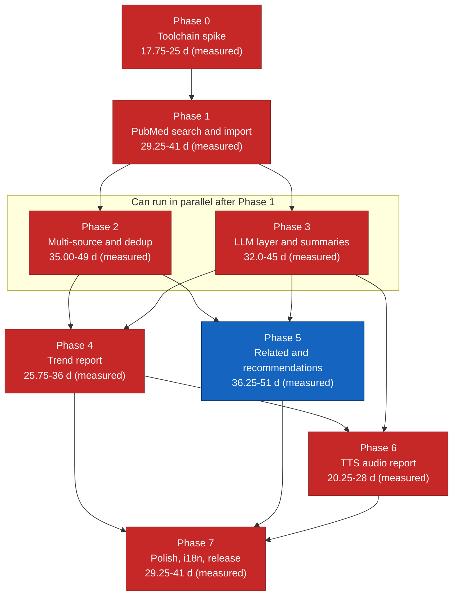

# 11 — Implementation Roadmap

**Project:** `research_helper` — Zotero 10.x plugin (bootstrapped: `manifest.json` + `bootstrap.js`), fully client-side.
**Companion documents:** requirements in `10-requirements-and-user-stories.md`; toolchain, tests, CI and release mechanics in `13-testing-build-and-release.md`; module boundaries in `07-architecture-and-data-model.md`.

**About the estimates.** Every effort figure below is for **one experienced developer** who already knows TypeScript and web APIs but is *new to Zotero plugin development*. They are in **developer-days** (one focused 6-hour day), exclude code review latency, and exclude time spent waiting for third-party API key approvals. Treat them as planning inputs, not commitments.

**How the bands are built (revised 2026-09-09).** Two different constructions, and the difference between them matters more than either number:

- **Phases 0–3 — *measured*.** The low end is the phase's task-card sum from the decompositions in `plan/` (`plan/00-task-index.md` §1 carries the sums and the per-phase reconciliations are in `plan/01`–`plan/04`). The high end is that sum × 1.4 — this document's own ±40% convention — rounded to the nearest whole day. A band rather than a point because the card estimates are themselves estimates. **Phase 4 joined this construction on 2026-10-26**: its 25 cards are in `plan/07-phase-4-trend-report.md` (numbered `07` because `05` and `06` were taken), and its band below is their sum. **Phase 5 joined it on 2026-11-02**: its 32 cards (31 until `P5-T32`, 2026-11-05, `plan/00` §6 item 344(b)) are in `plan/08-phase-5-related-papers.md` (numbered `08` because `05`–`07` were taken), and its band below is their sum.
- **Phases 4–7 — *scaled, not measured*.** *Phases 6–7 since 2026-11-02 (Phases 5–7 from 2026-10-26); the two figures below for them are unchanged.* These phases are not decomposed, so there is nothing to sum. Their low end is the **previous figure's upper bound × 1.50**, where 1.50 is the correction factor observed on Phases 0–3: the Phases 0–3 card sum divided by 52, the top of the old 39–52-day band. The high end is that × 1.4, as above. **These figures — two now, four when this was written — are inference, not measurement**, and each says so in its own entry. Replace each with a card-sum band as soon as that phase is decomposed.

  **The factor has been recomputed twice and held at 1.50 both times.** It was first derived as 80.5 ÷ 52 = 1.548. The two cards Phase 2 gained on 2026-09-09 took the subtotal to 80.5 d without changing that arithmetic, and the `P3-T04` / `P3-T20` re-estimate later the same day takes it to 82.0 d, so the factor recomputes as **82.0 ÷ 52 = 1.577**. Phase 0's own card-sum re-derivation on **2026-09-30** (`P0-T28`, after five cards were discovered mid-phase) takes the subtotal to 84.25 d and the factor to **84.25 ÷ 52 = 1.620**; `P1-T24` on the same day takes it to 84.50 and **1.625**, and the eight cards raised from the four Phase 1 card reports later on 2026-09-30 take it to 88.50 and **1.702**, and `P1-T31`/`P1-T32` on 2026-10-01 to 89.50 and **1.721**, and the five cards raised from the `P1-T19`/`P1-T26`/`P1-T32` card reports on **2026-10-03** to 91.00 and **91.00 ÷ 52 = 1.750**, `P2-T24` on **2026-10-06** to 91.25 and **91.25 ÷ 52 = 1.755**, `P1-T35` on **2026-10-07** to 91.75 and **91.75 ÷ 52 = 1.764**, `P1-T36` the same day to 92.25 and **92.25 ÷ 52 = 1.774**, the seven cards carded from the `P1-T22` and `P1-T34` reports on **2026-10-07** — `P1-T37`–`P1-T42` and `P2-T25` — to 95.50 and **95.50 ÷ 52 = 1.837**, `P1-T43` on **2026-10-08**, carded from an owner decision rather than from a report, to 96.00 and **96.00 ÷ 52 = 1.846**, `P1-T44` the same day to 97.00 and **97.00 ÷ 52 = 1.865** — a preferences pane pulled forward out of Phase 3 because the storage it waits on had already shipped in Phase 1 — `P1-T45` to 97.50 and **97.50 ÷ 52 = 1.875**, the surface `P1-T36` measured itself unable to build inside its own file list, `P1-T46` to 98.00 and **98.00 ÷ 52 = 1.885**, the test-harness correction that gates the phase's sign-off, `P2-T26` on **2026-10-13** to 98.25 and **98.25 ÷ 52 = 1.889** — the first card created under rule 9, because it blocks Phase 2's first finishing condition — `P2-T27` the same day to 98.75 and **98.75 ÷ 52 = 1.899**, the second, because `P2-T02` built the fan-out in a file nothing calls, `P2-T28` the same day to 99.00 and **99.00 ÷ 52 = 1.904**, carded from an owner's decision to extend `docs/07` §4.2, `P2-T29` on **2026-10-14** to 99.50 and **99.50 ÷ 52 = 1.913**, the third rule-9 card, because `P2-T10` built the merge stage in a file whose caller it could not edit, `P2-T30`/`P2-T31` the same day to 100.50 and **100.50 ÷ 52 = 1.933** — the wiring regressed NFR-3 and narrowed the import half, and each blocks a Phase 2 finishing condition — `P2-T32`/`P2-T33` the same day to 101.25 and **101.25 ÷ 52 = 1.947**, because the first new adapter landed unconstructed and the fixture recorder had been broken since the harness moved into Zotero, and `P2-T34`/`P2-T35`/`P2-T36` on **2026-10-15** to 103.25 and **103.25 ÷ 52 = 1.986** — the owner's one-sitting decision on thirty-odd recorded items, carded as six schema extensions, one client change and four behaviour changes, then on **2026-10-20** Phase 3's re-carding (31 → 37 cards, 23.5 → 27.5 d; `plan/04` §3) to 107.25 and **107.25 ÷ 52 = 2.063**, and `P2-T37` the same day to 107.75 and **107.75 ÷ 52 = 2.072** — the re-run fix the owner chose to card after `P2-T16` Part A measured the defect, and `P3-T38` and `P3-T39` later that day to 108.75 and **108.75 ÷ 52 = 2.091** — two cards carded from the owner's decisions on findings of `P3-T05` and `P3-T32` (`plan/00` §6 items 244 and 245), and on **2026-10-23** `P3-T21`'s re-estimate (0.5 → 1.5 d, `plan/00` §6 item 274(d), after the owner ruled for the outline-based IMRaD detector) to 109.75 and **109.75 ÷ 52 = 2.111**, and on **2026-11-10** `P2-T38` (0.75 d, `plan/00` §6 item 362(b), the owner's decision that a paper's reviews and versions merge) to 110.50 and **110.50 ÷ 52 = 2.125**, and later that day `P2-T39` (0.5 d, `plan/00` §6 item 366(b), the owner's decision to add a comparison pass by DOI family) to 111.00 and **111.00 ÷ 52 = 2.135**, and on **2026-11-12** `P2-T40` (0.5 d, `plan/00` §6 item 370(a)–(c), the owner's decision of 2026-11-11 that a paper's attached documents and versions are linked, not merged) to 111.50 and **111.50 ÷ 52 = 2.144**, and later on **2026-11-12** `P3-T40` and `P3-T41` (1.0 d and 1.5 d, `plan/00` §6 item 374, the held-out IMRaD set and the detector improvement measured once on it, the owner's `G-22` follow-up) to 114.00 and **114.00 ÷ 52 = 2.192**. It is **held at 1.50**, and the four Phase 4–7 bands are unchanged, for the reason already applied to the Phase 2 change: moving an inferred figure on the strength of a 1.5-day change to a measured one is false precision. The arithmetic makes the point — the factor moves by 1.9%, which on Phase 4's 11-day base is 0.32 d, an order of magnitude below the rounding these bands are already stated at. Holding at 1.50 also keeps the factor *conservative in the stated direction*: 1.50 is below both 1.548 and 1.577, so the scaled figures understate rather than overstate what the measured phases actually found, which is the safer error for a number R-23 already flags as inference. `plan/05-phases-4-7-outline.md` quotes these four bands and the ×1.50 label; both documents derive the factor the same way and neither is to be changed without the other. **Noted 2026-10-26, when Phase 4's card sum replaced its scaled band:** Phase 4 measured 23.75 d against its old 11-day top, ×2.16, well above the 1.50 still applied to Phases 5–7 — the direction R-23 warns of. The factor is held at 1.50 for Phases 5–7 and is not re-derived here; whether one more measured phase should move it is a decision for the owner (§5's last row), not a by-product of propagating Phase 4. **Decided 2026-10-26 (owner, `plan/00` §6 item 288(b)):** the factor stays 1.50 for Phases 5–7, and each phase's scaled band is replaced by its card sum when it is decomposed. **Noted 2026-11-02, when Phase 5's card sum replaced its scaled band under that decision:** Phase 5 measured 35.75 d against its old 14-day top, ×2.55 (36.25 d and ×2.59 since `P5-T32`, 2026-11-05, `plan/00` §6 item 344(b)), again well above the 1.50 still applied to Phases 6–7. The factor is not re-derived here.

The whole plan now sums to roughly **225.50–316 developer-days**, every phase measured (the per-phase table in §1 is the authoritative sum; **225.25–316** from later on 2026-11-16 until `P6-T17` was re-estimated 1.75 → 2.0 d on **2026-11-17**, `plan/00` §6 item 384; **224.50–315** later on 2026-11-16, until `P7-T32` was added at 0.75 d the same day, `plan/00` §6 item 381; **217.00–304** earlier on 2026-11-16, until Phase 7's card sum replaced its scaled figure later that day, `plan/00` §6 item 380; **212.00–297** from 2026-11-12 until Phase 6's card sum replaced its scaled figure on **2026-11-16**, `plan/00` §6 item 378; **209.50–293** earlier on 2026-11-12, until `P3-T40` and `P3-T41` were added at 1.0 d and 1.5 d later that day, `plan/00` §6 item 374; **209.00–292** from 2026-11-10 until `P2-T40` was added at 0.5 d on **2026-11-12**, `plan/00` §6 item 370(a)–(c); **208.50–292** from 2026-11-10 until `P2-T39` was added at 0.5 d later that day, `plan/00` §6 item 366(b); **207.75–291** from 2026-11-05 until `P2-T38` was added at 0.75 d on **2026-11-10**, `plan/00` §6 item 362(b); **207.25–290** from 2026-11-02 until `P5-T32` was added at 0.5 d on **2026-11-05**, `plan/00` §6 item 344(b); **206.75–289** earlier on **2026-11-02**, until `P4-T23` was re-priced 1.25 → 1.75 d, `plan/00` §6 item 336(d); **205.25–287** earlier that day, until `P4-T22` was re-priced 0.75 → 2.25 d, `plan/00` §6 item 335(g); **190.50–266** from 2026-10-26 until Phase 5's card sum replaced its scaled figure on **2026-11-02**; **183.25–256** from 2026-10-23 until Phase 4's card sum replaced its scaled figure on **2026-10-26**; **182.25–255** from 2026-10-20 until `P3-T21`'s re-estimate on 2026-10-23, **181.25–254** earlier on 2026-10-20, before `P3-T38` and `P3-T39`, and **176.75–247** before that) — at **21 working days per month** (≈252 working days a year ÷ 12), ≈ **11–15 months of full-time work**, or roughly twice that at 50% allocation. **The months band moved for the first time on 2026-09-30, again on 2026-10-20, again on 2026-10-26, again on 2026-11-02, and again on 2026-11-16** (now 225.50 ÷ 21 ≈ 10.7; 316 ÷ 21 ≈ 15.0, each rounded to the nearest month; *re-checked 2026-11-16, later still, `plan/00` §6 item 381: `P7-T32` moves neither end of the months band, which read 224.50 ÷ 21 ≈ 10.7 and 315 ÷ 21 = 15.0*; *updated 2026-11-16, later, `plan/00` §6 item 380: Phase 7's measured 28.50–40 in place of the scaled 21–29 moves both ends of the band, from 10–14 to 11–15, and it read 217.00 ÷ 21 ≈ 10.3 and 304 ÷ 21 ≈ 14.48*; *updated 2026-11-16, `plan/00` §6 item 378: Phase 6's card sum moves neither end of the band, and it read 212.00 ÷ 21 ≈ 10.1 and 297 ÷ 21 ≈ 14.1*; *re-priced again 2026-11-12, `plan/00` §6 item 374: `P3-T40` and `P3-T41` move neither end of the band, and it read 209.50 ÷ 21 ≈ 10.0 and 293 ÷ 21 ≈ 14.0*; *re-priced 2026-11-12, `plan/00` §6 item 370(a)–(c): `P2-T40` moves neither end of the band, and it read 209.00 ÷ 21 ≈ 10.0 and 292 ÷ 21 ≈ 13.9*; *re-priced again 2026-11-10, `plan/00` §6 item 366(b): `P2-T39` moves neither end of the band, and it read 208.50 ÷ 21 ≈ 9.9 and 292 ÷ 21 ≈ 13.9*; *re-priced 2026-11-10, `plan/00` §6 item 362(b): `P2-T38` moves neither end of the band, and it read 207.75 ÷ 21 ≈ 9.9 and 291 ÷ 21 ≈ 13.9*; *re-priced 2026-11-05, `plan/00` §6 item 344(b): `P5-T32` moves neither end of the band, and it read 207.25 ÷ 21 ≈ 9.9 and 290 ÷ 21 ≈ 13.8*; *re-priced again 2026-11-02, `plan/00` §6 item 336(d): the re-pricing of `P4-T23` moves neither end of the band, and it read 206.75 ÷ 21 ≈ 9.8 and 289 ÷ 21 ≈ 13.8*; *re-priced 2026-11-02, `plan/00` §6 item 335(g): the re-pricing of `P4-T22` moves neither end of the band, and it read 205.25 ÷ 21 ≈ 9.8 and 287 ÷ 21 ≈ 13.7* — Phase 5's measured 35.75–50 in place of the scaled 21–29 moves the band from 9–13 to 10–14; it read 190.50 ÷ 21 ≈ 9.1 and 266 ÷ 21 ≈ 12.7 before, when Phase 4's measured 23.75–33 in place of the scaled 16.5–23 had moved the top from 12 to 13, from 183.25 ÷ 21 ≈ 8.7 and 256 ÷ 21 ≈ 12.2; *updated 2026-10-23 for `P3-T21`'s re-estimate, and 2026-10-20 for `P3-T38` and `P3-T39`; neither moves the band from 9–12*), having survived four earlier corrections at ≈ 7–10. **Corrected 2026-10-20:** this sentence read "≈ 8–11 months" on 176.75 ÷ 21 ≈ 8.4 and 247 ÷ 21 ≈ 11.8, while §1 rounded the same 11.8 to 12; both places now round to the nearest month. This supersedes the previous "74–101 developer-days ≈ 4–5 months"; §1's "Why these figures changed" records why, and why nobody should correct them back.

---

## 0. Sequencing principles

1. **Retire platform risk before product risk.** Nothing about summarization matters if the plugin cannot survive a Zotero 10 minor release. Phase 0 exists solely to answer "does the toolchain actually work here".
2. **One vertical slice early.** Phase 1 ships a genuinely usable feature (PubMed search → collection) end to end, so there is always something demonstrable.
3. **Cost and data-egress guardrails ship with the first LLM call**, not after. FR-24/FR-36 are Phase 3 deliverables, not Phase 7 polish.
4. **Each phase retires named risks** from the register in §3. A phase is not done until its risks are demonstrably retired or explicitly re-classified.
5. **The plugin must remain installable and non-broken at the end of every phase.** Feature flags in prefs hide incomplete work rather than leaving broken menu items.

---

## 1. Phases

### Phase 0 — Toolchain spike

**Goal.** Prove that a modern Zotero 10 plugin can be built, hot-reloaded, debugged, and can create a Zotero item — on the actual developer machine, with the actual Zotero 10.0.1 the user runs. Answer every question in the build-vs-verify list (§4) before any architecture is committed.

**Deliverables.**

- A repo scaffolded from [`windingwind/zotero-plugin-template`](https://github.com/windingwind/zotero-plugin-template) (or `zotero-plugin-scaffold` directly), building an XPI.
- `manifest.json` with `applications.zotero.id`, `update_url`, `strict_min_version`, `strict_max_version` set for Zotero 10 (per [Zotero 10 for Developers](https://www.zotero.org/support/dev/zotero_10_for_developers): `strict_max_version` → `10.0.*`).
- `bootstrap.js` implementing `install`/`startup`/`shutdown`/`uninstall`/`onMainWindowLoad`/`onMainWindowUnload` with verified clean teardown.
- One Tools-menu item that, when clicked, creates a `journalArticle` item with a title, an author, a DOI, and an `abstractNote` in a named collection.
- A dedicated development profile with `.env` configured (`ZOTERO_PLUGIN_ZOTERO_BIN_PATH`, `ZOTERO_PLUGIN_PROFILE_PATH`, optionally `ZOTERO_PLUGIN_DATA_DIR`) and `npx zotero-plugin serve` hot-reloading on file save.
- Devtools/debugger attach verified (`server.devtools: true`, which appends `--jsdebugger`).
- One passing unit test in Node, one passing in-Zotero test via the scaffold's Mocha runner.
- A CI workflow that lints, typechecks, unit-tests, and builds an XPI on push.
- A written **spike report** (2–3 pages) answering §4's questions with yes/no/workaround, committed as `docs/spikes/phase-0.md` — the directory, and the immutability and redaction rules that apply to everything in it, are declared in `07-architecture-and-data-model.md` §2.2.1.

**Modules touched.** Repo skeleton only: `manifest.json`, `bootstrap.js`, `src/index.ts`, `src/hooks.ts`, `zotero-plugin.config.ts`, `tsconfig.json`, `.github/workflows/ci.yml`, `test/`.

**Definition of done.**

- `npm run build` produces an installable XPI; dragging it into Zotero 10.0.1 → Tools → Plugins installs it cleanly on Windows.
- Editing a source file reloads the plugin in the running Zotero without a manual restart.
- Disabling the plugin from the Plugins window leaves no menu item, no observer, and no error in the debug log (FR-56).
- CI is green on a clean clone.
- The spike report is committed and every item in §4 is marked verified / worked-around / blocked.

**Effort.** **17.75–25 developer-days** — *measured*: the 35 task cards in `plan/01-phase-0-toolchain-spike.md` sum to 17.75 d; the upper bound is that × 1.4 (17.75 × 1.4 = 24.85 → 25). (Was 17.25–24 over 33 cards, 16–22 over 30, 15.5–22 over 28, and before that 6–9 d.) **Re-derived 2026-09-30 at the close of the phase**, when `P0-T28`'s report found this entry, §4's closing paragraph and `plan/01`'s own reconciliation quoting three different figures, none of them the card sum; the +2.25 d over the 30-card figure is the seven cards `P0-T29`–`P0-T35`, each of which exists because running the code found work no reading of the corpus had — so the growth is `plan/README.md` §5 rule 2 operating as designed, not scope creep. **The last two arrived on 2026-09-30 from `P0-T28`'s own escalation rows**, which is the mechanism catching a defect in the phase that was reporting on itself. Toolchain friction on Windows, profile setup and the first encounter with Zotero's item API still dominate, but the decomposition found that the spikes in §4 only partly collapse into each other and that ~4.75 d of the phase is work listed above as a deliverable and never priced: repository bootstrap, the `docs/07` §2.2 directory skeleton and its dependency rule, the TypeScript/lint configuration, the Tools-menu item, the CI workflow and the spike report itself. See that file's "Estimate reconciliation" for the derivation.

**Risks retired.** R-1 (partly), R-8 (Korean TTS spike, V-10), R-11, R-12, R-13, R-14, R-15 (dry run, V-18), R-19b (feasibility spike, V-8b).

---

### Phase 1 — Search & import from one source (PubMed)

**Goal.** A complete, shippable vertical slice: query → PubMed → preview → Zotero collection with abstracts and provenance.

**Deliverables.**

- Search dialog (query field, result limit, date range defaulting to 3 years, target-collection picker). FR-1, FR-2, FR-3.
- PubMed E-utilities client: `esearch` + `efetch`/`esummary`, XML/JSON parsing, client-side rate limiter, `User-Agent`, optional NCBI key. FR-4, FR-11.
- **Tier-1 `SecretStore` for `source.ncbi` only** — `Zotero.OSKeyStore.encrypt()` → `Services.logins` (`09-security-privacy-and-api-keys.md` §1.7), the startup backend probe, and the `ncbi.keyPresent` / `secretBackend` flags. NFR-16, part of FR-11. **No key-entry UI ships in this phase**, so in Phase 1 the key is absent for every real user and the limiter simply stays on the no-key budget. The reason this rung exists here at all is that the deliverable above requires an *optional NCBI key* and decision **D5** (`00-overview.md` §3) forbids the pref alternative — there is no third place to put it. Tier 2, the degradation dialog and every LLM/TTS secret are **Phase 3**, with the preferences pane; a half-built ladder is worse than one rung. *(Corrected 2026-10-21, owner, `plan/00` §6 item 267: this also named tier 3 and the passphrase file, which do not ship in v1 — gate `G-10`, decided 2026-10-08.)*
- Structured logging through `logLevel`, with unconditional API-key redaction at the logger (`09-security-privacy-and-api-keys.md` §2.1). **Part of FR-54** — FR-4 forces it into this phase, because the transmitted URL must reach both the provenance record and the debug log with keys stripped. The rest of FR-54 (the debug bundle, the "Copy diagnostics" export, and the prefs-pane verbose-logging checkbox) lands in Phases 3 and 7.
- Normalizer: PubMed record → internal canonical record (title, authors, journal, date, DOI, PMID, abstract, MeSH terms).
- Result preview table with per-row selection. FR-5.
- Importer: canonical record → Zotero item, batched in transactions; item-type mapping; identifier placement in `Extra`. FR-6, FR-7.
- Existing-item detection by DOI/PMID → link instead of duplicate. FR-51.
- Provenance note writer + JSON export. FR-8.
- Cancellation and partial-failure handling. FR-9, FR-10.
- Progress UI. FR-53.
- Unit tests for the query builder and normalizer; contract tests against recorded PubMed fixtures.

**Modules touched.** Paths throughout this document are `07-architecture-and-data-model.md` §2.2's, which owns the directory tree: `src/sources/pubmed/*`, `src/model/canonicalWork.ts`, `src/model/ids.ts`, `src/zotero/itemMapper.ts`, `src/zotero/collectionOps.ts`, `src/zotero/notes.ts`, `src/zotero/keychain.ts`, `src/core/provenance.ts`, `src/core/rateLimit/*`, `src/core/http/*`, `src/core/logger.ts`, `src/ui/dialogs/*`, `src/ui/components/*`, `src/zotero/progressWindow.ts`, `addon/locale/*/research-helper/*.ftl`.

**Definition of done.**

- A search for a real term imports ≥ 50 items into a new collection, each with a non-empty `abstractNote` where PubMed provides one.
- NFR-1 measured: 100 pre-fetched records import in ≤ 10 s.
- Cancel mid-search leaves zero items (FR-10).
- Provenance note present and JSON export validates against the schema.
- Re-running the same search links rather than duplicates.

**Effort.** **29.25–41 developer-days** — *measured*: the 46 task cards in `plan/02-phase-1-pubmed.md` sum to 29.25 d; the upper bound is that × 1.4 (29.25 × 1.4 = 40.95 → 41). **Ten of those cards were added on 2026-10-07 and 2026-10-08: eight from execution reports, one from an owner decision, and one from a scheduling error** — `P1-T37`–`P1-T42`, the surfaces `P1-T22` found unrenderable, the test paths two cards reported as missing, and two corrections `P1-T34`'s class of defect made necessary. (Was 28.75–40 over 45 cards, 28.25–40 over 44, 27.25–38 over 43, 26.75–37 over 42, 24.25–34 over 36, 23.75–33 over 35, 23.25–33 over 34, 19.00–27 over 24, 18.75–26 over 23, and before that 9–12 d.) **This headline had gone stale through five propagations — corrected 2026-10-06.** §1's table was re-derived each time the card set grew; this paragraph was not, so it sat at 19.00 d over 24 cards while the phase reached 23.25 d over 34. `plan/README.md` §7 now enumerates every site that has to move together, because its old instruction named three of five. **Re-derived 2026-09-30**, when `P1-T24` was created: `P1-T12` measured that `create src/zotero/itemMapper.ts` cannot literally replace the `P0-T10` spike, because three files import the spike exports and none is in that card's `Files`. The old figure priced this phase as "one adapter plus a dialog", but the "Modules touched" line above commits it to the whole shared core — `core/rateLimit`, `core/http`, `core/provenance`, `core/logger`, `zotero/itemMapper`, `model/canonicalWork`, the progress adapter and the l10n bundles. Nine of the then-twenty-three cards, ≈ 6 d, build machinery that Phases 2–7 consume unchanged and never pay for again; that reuse is why the whole-plan total moves by less than the per-phase numbers do. `plan/00-task-index.md` §5 item 2 proposes splitting this into 1a (core) and 1b (PubMed slice) so the prerequisite stops hiding inside one phase's number; that split is not made here.

**Risks retired.** R-16 (item creation performance), R-17 (abstract availability), part of R-2.

---

### Phase 2 — Multi-source + deduplication

**Goal.** Add Europe PMC, Crossref, Semantic Scholar, arXiv, bioRxiv, medRxiv, and merge their results correctly.

**Deliverables.**

- A `Source` interface plus six additional adapters, each with its own query translator, parser, rate limiter, and fixture set. FR-2, FR-4.
- Semantic Scholar key handling and graceful unauthenticated degradation. FR-2, open question 8 in `10-requirements-and-user-stories.md`.
- Parallel fan-out executor with per-source timeouts, per-source concurrency caps, and independent failure isolation. FR-9, NFR-6.
- Deduplication engine: identifier-first matching, then conservative title+author+year fuzzy matching above a threshold; below-threshold pairs flagged, never auto-merged. FR-50.
- Field-merge policy with documented source priority; merged-record provenance.
- Preprint/published relationship handling per the product decision.
- `preprint` item-type mapping for arXiv/bioRxiv/medRxiv. FR-7.
- Dedup unit-test corpus: ≥ 200 hand-labelled record pairs (true/false duplicates) with a measured precision/recall report. *(Corrected 2026-10-26 (owner, `plan/00` §6 items 284(c) and 288(c)): the label set holds 267 pairs and the owner labels a recorded random sample of 60 of them; the report gives precision and recall with 95 % Wilson intervals, and the blocking test asserts no false merge among the sampled merged pairs.)*
- **"Re-run this search" — FR-12.** The search window opens pre-filled from a collection's stored provenance record (`07-architecture-and-data-model.md` §5.3), optionally advancing the date window to today, and the import reports "already present: N" instead of duplicating. It lands here rather than in Phase 1 because its input — the FR-8 provenance record — ships in Phase 1 while its surface, the multi-source search window, is finished here, and because re-running is only worth the control once more than one source is in play. FR-12 is a `(S)` requirement and had no phase before this entry.
- **Optional Zotero-translator import path** (`01-zotero-plugin-platform.md` §6.3 Strategy B) behind `useTranslators`, which ships **off** (`07-architecture-and-data-model.md` §8.5): per-record identifier lookup with hand-mapping as the fallback, plus the abstract backfill that must follow either path. Phase 1 ships hand-mapping only and does not read the preference.

> **Both of those deliverables now have cards — closed 2026-09-09.** This entry previously warned that FR-12's re-run control and the `useTranslators` import path were listed here as Phase 2 work but were not in `plan/03`'s card set and were not in its 21.5 d sum. They are now **`P2-T17`** (1.5 d — the re-run control, which also ships the first plugin-owned SQLite table, `search_provenance`, because `07-architecture-and-data-model.md` §5.3 makes that row the authoritative copy and the Zotero note only a projection) and **`P2-T18`** (1.25 d — Strategy B behind the preference, with hand-mapping as the per-record fallback). The card sum **at that pass** was **24.25 d** and the band below was re-derived from it; it is **26.50 d** as of 2026-10-03 and the table is the live figure. (Stated in the past tense on 2026-10-03: the present-tense "is" had gone stale twice over, at 25.50 and then 26.50, which is exactly the failure this entry was written to celebrate catching.) No existing card's estimate was changed. This was the same "deliverable the estimate never priced" failure the §1 preamble records for Phases 0–3, caught in advance here rather than discovered afterwards — and the catch worked.

**Modules touched.** `src/sources/{europepmc,crossref,semanticscholar,arxiv,biorxiv}/*` (bioRxiv and medRxiv share one adapter across two servers — `07-architecture-and-data-model.md` §2.2), `src/sources/shared/dedupe.ts`, `src/model/merge.ts`, `src/pipeline/searchImport/stages.ts` (parallel fan-out), `src/ui/components/*` (source chips, duplicate badges).

**Definition of done.**

- A single query across all seven sources returns a merged list where a known cross-indexed paper appears exactly once, with all contributing sources listed.
- Dedup precision ≥ 0.99 on the labelled corpus (a false merge is the expensive error); recall ≥ 0.90.
- One source returning 500 or 429 does not prevent the others from delivering results.
- NFR-2 measured: 4-source search of 100/source completes in ≤ 30 s.

**Effort.** **35.00–49 developer-days** — *measured*: the 40 task cards in `plan/03-phase-2-multi-source-dedup.md` sum to 35.00 d; the upper bound is that × 1.4, rounded (35.00 × 1.4 = 49.0 → 49). (Was 34.50–48 over 39 cards until **2026-11-12**, when `P2-T40` (0.5 d) was added — the owner chose on 2026-11-11 to link a paper's attached documents and an F1000Research article's versions instead of merging them, `plan/00` §6 item 370(a)–(c); was 34–48 over 38 cards until later on **2026-11-10**, when `P2-T39` (0.5 d) was added — the owner chose to compare a paper's documents by DOI family across title blocks and to let the newest F1000Research version win, `plan/00` §6 item 366(b)–(c); was 33.25–47 over 37 cards until **2026-11-10**, when `P2-T38` (0.75 d) was added — the owner chose to change the dedup engine so that the reviews and versions of one paper merge, `plan/00` §6 item 362(b); was 32.75–46 over 36 cards until **2026-10-20**, when `P2-T37` (0.5 d) was added — the owner chose to fix now the re-run duplicate `P2-T16` Part A measured; was 30.75–43 over 33 cards, 30.00–42 over 31, 29.00–41 over 29, 28.50–40 over 28, 28.25–40 over 27, 27.75–39 over 26, 27.50–39 over 25, 26.75–37 over 24, 26.50–37 over 23, 25.50–36 over 20, 24.25–34 over 18, 21.5–30 over 16, and before that 12–16 d, derived as "six adapters at ~1.5 days each plus 4–6 days for dedup and its evaluation corpus".) **Stale until 2026-10-06, for the same reason as Phase 1's above.** The reconciliation that follows is about the **original** 24.25 d pass and is kept as the record of that undercount; the four cards added since (`P2-T19`–`P2-T24`) are accounted for in §1 and in `plan/03`'s roll-up. That original arithmetic held for what it covered: the adapter cards plus preprint mapping come to 9.25 d and the dedup family to 6.5 d. What it never costed is the remaining **8.5 d** — the user-query parser (1.0 d), the parallel fan-out (1.25 d), the abstract-backfill pass (0.75 d), the search-window/results-table work (1.5 d), the card that records and guards the settled "OpenAlex is out of v1" decision (0.25 d), the end-to-end verification run (1.0 d), and the two deliverables the note above closes, `P2-T17` (1.5 d) and `P2-T18` (1.25 d). That is **eight** cards — `P2-T01`, `P2-T02`, `P2-T12`, `P2-T14`, `P2-T15`, `P2-T16`, `P2-T17`, `P2-T18` — and they sum exactly: 24.25 − 9.25 − 6.5 = 8.5. An earlier draft of this sentence hedged the figure with "≈" and named only seven of them, which sum to 8.25 d; the card it omitted was `P2-T15`, the OpenAlex-decision one. Every one of the eight is listed as a deliverable in this entry.

**Risks retired.** R-2, R-18. *Corrected 2026-11-02 (`plan/00` §6 item 184; `plan/reports/phase5-review.md`): read "R-2, R-3, R-18". Phase 2 proved no relatedness fallback, because no adapter implements `findRelated`, so R-3 is retired by Phase 5 (`plan/08` `P5-T28` offline, `P5-T30` live).*

---

### Phase 3 — LLM layer + per-paper summaries

**Goal.** A provider-agnostic LLM client with cost control, plus per-item summary notes.

**Deliverables.**

- Provider abstraction with four adapters: OpenRouter, OpenAI, Google Gemini, Anthropic. FR-29.
- Preferences pane: keys (masked, with reveal), per-provider base-URL override (`<provider>.baseUrl`, `07-architecture-and-data-model.md` §8.5), model selection per task, budget ceilings, language. FR-29, FR-30, FR-32, FR-52.
- **`SecretStore` tier 2, and every key-entry surface.** The session-only fallback, the degradation dialog, the storage-backend badge, and the key fields for all four LLM providers plus NCBI and Semantic Scholar. Phase 1 shipped tier 1 for `source.ncbi` alone and no UI; this is where the ladder is completed and where a user can first enter a key at all. FR-30, NFR-16, decision D5. *(Corrected 2026-10-21, owner, `plan/00` §6 item 267: this read "tiers 2 and 3" and listed "the passphrase-encrypted file" first. Gate `G-10`, decided 2026-10-08: tier 2 is the only fallback and tier 3 does not ship in v1.)*
- "Test connection" action. FR-31.
- Token estimation + cost estimation table (per-model pricing, user-editable, with an "as of" date). FR-24, NFR-5.
- Consent + egress-disclosure dialog, shown before the first job and before every job. FR-36.
- Job engine: bounded concurrency, backoff with jitter, cancellation, resume-by-skipping-completed. FR-23, FR-34, NFR-6.
- Summarizer: input assembly (**full text whenever available — `summary.fullTextMode` ships as `auto` per decision D7**, with the abstract as the recorded fallback), the R-19 extraction quality gate, prompt from `12-prompt-library.md`, structured output parsing, child-note writing with disclaimer header and `research_helper/ai-summary` tag. FR-19, FR-20, FR-21, FR-22.
- IMRaD section-detector validation against the 40-PDF fixture set before this phase ships; `auto` degrades to whole-document chunking until it passes. R-19b, and see `06-summarization-and-trend-report.md` §4.3. *Updated 2026-11-13: validated on a held-out set of new papers (92.94 %), not on the 40-PDF set, which the detector was tuned against (93.61 %, a regression pin only); see R-19b.*
- "Remove generated notes from collection" command. FR-20.
- Usage accounting UI. FR-35.
- Deterministic LLM mocking harness for tests (see `13-testing-build-and-release.md`).

**Modules touched.** `src/llm/types.ts`, `src/llm/{openrouter,openai,gemini,anthropic}/*`, `src/llm/router.ts`, `src/llm/shared/{sse,tokenEstimate,jsonMode,chunking}.ts`, `src/core/jobQueue/*`, `src/pipeline/shared/budget.ts`, `src/pipeline/summarize/*`, `src/zotero/fulltext.ts`, `src/zotero/keychain.ts`, `src/prefs/*`, `src/ui/prefs/*`, `src/ui/dialogs/*`, `src/prompts/*`.

**Definition of done.**

- All four providers produce a summary for the same item using the same internal code path; only the adapter differs.
- A 100-abstract job completes within the NFR-4 budget and reports actual token usage.
- Setting a $0.01 ceiling pauses the job on the first item and asks for confirmation.
- Cancelling at item 87/200 retains ~~86 notes~~ 86 `StoredSummary` rows, and 86 notes when `report.perPaperNotes` is on, and resumes correctly (FR-23). *(Decided 2026-10-23, owner, `plan/00` §6 item 272(c); written here 2026-10-29 by `P3-T29`: notes are opt-in, `10-requirements-and-user-stories.md` §5 question 3.)*
- No key appears in the debug log, in a note, or in copied diagnostics (NFR-16).

**Effort.** **32.0–45 developer-days** — *measured*: the 41 task cards in `plan/04-phase-3-llm-summaries.md` sum to 32.0 d; the upper bound is that × 1.4, rounded (32.0 × 1.4 = 44.8 → 45). (Was 29.5–41 over 39 cards from 2026-10-23 until **2026-11-12**, when `P3-T40` (1.0 d) and `P3-T41` (1.5 d) were added (`plan/00` §6 item 374): the detector measured 68.00 % against the 85 % bar, and the owner chose to improve it and to measure the improvement once on twenty new papers, a held-out set, rather than on the forty labels it is tuned against. Was 28.5–40 from 2026-10-20 until **2026-10-23**, when `P3-T21` was re-estimated 0.5 → 1.5 d (`plan/00` §6 item 274(d)): the owner ruled for the IMRaD detector built on `getStructuredDocumentText`'s section outline, which needed a platform reader the plugin did not have, and the card's agent measured the cost. Was 27.5–39 over 37 cards earlier on **2026-10-20**, until `P3-T38` and `P3-T39` were added the same day, 0.5 d each, from the owner's decisions on `plan/00` §6 items 244 and 245: the HTTP client keeps an LLM 429's body and never retries a parse failure, and the money preferences are stored as whole cents. Was 23.5–33 over 31 cards until the re-carding that morning, 22–31 d over the same 31 cards before that, and before that 12–15 d.) **Re-carded 2026-10-20** (owner decision, `plan/00-task-index.md` §6 item 234; derivation in `plan/04` §3): every card was rewritten against the tree, which shrank six cards by 2.0 d because Phases 1–2 had built part of their work or it moved to another card, grew nine by 2.25 d for callers, migrations, windows and strings they had not priced, and added six cards (`P3-T32`–`P3-T37`, 3.75 d) for prerequisites no card owned: 23.5 − 2.0 + 2.25 + 3.75 = 27.5. The four provider adapters land at 2.75 d, close to the old figure's implied budget — the adapters are not where the overrun is. It is in secret storage (3.75 d across four cards, folded into half of one deliverable line above — **corrected 2026-10-20: 2.5 d across five cards**, `P3-T01`–`P3-T04` and `P3-T37`, after the re-carding), text acquisition (1.5 d for the four-tier ladder and cleaning pass — **corrected 2026-10-20: 1.25 d**, `P3-T18` 0.5 + `P3-T19` 0.75), and 2.75 d of R-19b IMRaD fixture-and-harness work (**3.75 d since 2026-10-23**, with `P3-T21` at 1.5 d) that **post-dates the 12–15 figure**: that risk was created on 2026-09-08 by decision D7, after the estimate was written. **The move from 22.0 d to 23.5 d is two cards, re-estimated on 2026-09-09 and nothing else:** `P3-T04` 1.0 → 1.75 d, because the pane grew to carry the four `<provider>.baseUrl` controls with their write-time validation, the NCBI and Semantic Scholar key fields this entry's own "every key-entry surface" deliverable requires, and six `role="status"` elements, none of which was in its 1.0 d; and `P3-T20` 1.0 → 1.75 d, on a bottom-up reading of what building a 40-PDF fixture corpus across eight publisher families actually costs the developer — the human's sourcing and ground-truth adjudication is gate G-12 in `plan/06-human-gates.md` and is deliberately *not* in that figure, because these are developer-days. Both cards carry their derivation in their own `Notes`; `plan/04` §3 carries the change table.

**Risks retired.** R-4, R-5, R-6 (partly), R-9 (mitigations shipped; retired by design under D5), R-19 (quality gate + cost preview shipped), R-19b (detector validated, or `auto` degraded to whole-document chunking). *Updated 2026-11-13 (`plan/00` §6 item 377): R-19b's first branch is the one met — the detector was validated by measurement, 92.94 % on a held-out set of 15 papers against the 85 % bar (`06-summarization-and-trend-report.md` §4.3, note "Measured 2026-11-13 (held-out)"), on the path without document structure; the outline path is not measured. The phase itself is not done.*

---

### Phase 4 — Trend report

**Goal.** Synthesize per-paper summaries into a cited "recent research trends" report, at any collection size.

**Deliverables.**

- Map-reduce / hierarchical reduction pipeline with a reported pass count. FR-27.
- Report template with fixed sections (scope & method, volume over time, themes, methodological shifts, contradictions & open questions, limitations). FR-25.
- Citation binding: every claim carries markers resolving to collection items; a validator rejects/repairs citations that do not resolve. FR-26.
- Report note writer, tagged `research_helper/trend-report`, with a metadata header (item count, date range, model, prompt-template version, timestamp). FR-25, NFR-15.
- Korean report generation path. FR-28.
- "Export as Markdown" action.
- A small evaluation set: 3 curated collections with human-checked expected themes, used as a regression guard on prompt changes (see `06-summarization-and-trend-report.md`).

**Modules touched.** `src/pipeline/trendReport/*`, `src/llm/shared/chunking.ts`, `src/model/trend.ts`, `src/prompts/trend-report-*.md`, `src/ui/panes/*` (report viewer), `src/zotero/notes.ts`.

**Definition of done.**

- A 400-item collection produces a report without a context-length error, and the header states the number of reduction passes. *(Decided 2026-10-26, owner, `plan/00` §6 item 286: proved offline, by `plan/07` `P4-T22`'s run on a mock provider that enforces the context window and the output ceiling; a live 400-item run happens only if the owner asks for one.)*
- 100% of citation markers in a generated report resolve to items in the collection (validator-enforced).
- The Korean report keeps titles/authors/venues in original script.
- Regenerating with the same inputs and a fixed temperature/seed yields substantively equivalent themes across 3 runs. *(Decided 2026-10-26, owner, item 286: "substantively equivalent" is pairwise co-assignment agreement — the share of paper pairs placed together or apart the same way in two runs — of at least 0.8 for every pair of the three runs, plus the owner's reading of the three runs' theme-name lists; `plan/07` `P4-T24`.)*

**Effort.** **25.75–36 developer-days** — *measured*: the 25 task cards in `plan/07-phase-4-trend-report.md` sum to 25.75 d; the upper bound is that × 1.4, rounded (25.75 × 1.4 = 36.05 → 36). *Re-priced again 2026-11-02 (`plan/00` §6 item 336(d)): `P4-T23` 1.25 → 1.75 d; this read 25.25–35 d. The extra 0.5 d is the per-call usage capture of item 335(k), by the coordinator's judgement after the fact and unmeasured.* *Re-priced 2026-11-02 (`plan/00` §6 item 335(g)): `P4-T22` 0.75 → 2.25 d; this read 23.75–33 d. 0.75 d is the card as drafted, about 0.75 d the first fix (item 327(a), which priced it at "about 0.5–0.75 d, on top of `P4-T22`'s card" and never moved the card), about 0.75 d the second (item 334(a), priced "0.5–1 d more on `P4-T22`, re-priced when built"). Both 0.75 figures are the coordinator's judgement after the fact, unmeasured. `P4-T21`'s scope also grew and its estimate is left unchanged.* **Decomposed on 2026-10-25, reviewed the same day, decided and propagated on 2026-10-26** (`plan/00` §6 items 283(c), 285(c), 286), ahead of `plan/05` §0's schedule at the owner's direction, while Phase 3 waits on labels and keys. The draft summed to 22.5 d over 25 cards; the review raised `P4-T18` 1.5 → 2.0 and `P4-T20` 1.0 → 1.25 for composition-root wiring their files lacked (23.25 d); the owner's decisions on the 35 open lines raised `P4-T03` 0.75 → 1.0, for `CLUSTER_REDUCE_MERGE`, a second new prompt written into `12-prompt-library.md` and shipped beside `THEME_MERGE`, and `P4-T16` 1.0 → 1.25, for the report's own egress notice naming every model a run sends to: 22.5 + 0.5 + 0.25 + 0.25 + 0.25 = 23.75, and the two re-pricings above add 1.5 and 0.5 to make 25.75. The card sum is **56% above the scaled low end it replaces** (25.75 ÷ 16.5 = 1.56; 53% at 25.25 ÷ 16.5 = 1.53, 44% at 23.75 ÷ 16.5 = 1.44) and 12% above its top (25.75 ÷ 23 = 1.12; 10% at 25.25 ÷ 23 = 1.10, 3% at 23.75 ÷ 23 = 1.03), past the ~30% `plan/README.md` §7 treats as the signal to re-estimate this entry rather than shave the cards. The unpriced work is the kind Phases 0–3 found: a localization surface that did not exist (`reportWindow`), a migration with its two pinned tests, a documents-first type reconciliation, two in-Zotero measurements (the citation-processor entry point and the note-HTML whitelist), and new prompt text; `plan/07` §3 names four places the sum is still likely low, by 2–3 d together. *(Was **16.5–23 d, ⚠ scaled, not decomposed**, until 2026-10-26: 11 d, the old band's upper bound, × 1.50, the correction factor observed on Phases 0–3, then × 1.4 for the upper bound, on the assumption that the phase hid unpriced deliverables at the same rate the measured phases did. Phases 5–7 still use that construction.)*

**Risks retired.** R-7, part of R-6.

---

### Phase 5 — Related papers + recommendations

**Goal.** Features 2 and 6: from one seed item, and from a whole collection.

**Deliverables.**

- Seed resolution (DOI/PMID/arXiv → canonical; title-match fallback with a confidence threshold and disambiguation UI). FR-13, FR-14.
- Relatedness gathering: references, citations, and source-provided recommendation endpoints; scoring and reason chips. FR-15, FR-47.
- Related-results review UI with "in library" marking and recency de-emphasis. FR-16, FR-18.
- Optional Zotero *Related* linkage. FR-17.
- Collection profiler: term/MeSH extraction, optional embedding centroids (k, one per sub-topic; 05-related-work-discovery.md §7.2), editable profile UI. FR-44.
- Candidate query generation (LLM-assisted with heuristic fallback) and fan-out reuse from Phase 2. FR-45.
- Owned-item exclusion and dismissed-candidate persistence. FR-46, FR-49.
- Import into a default `<Collection> — recommended <date>` subcollection. FR-48.

**Modules touched.** `src/pipeline/related/*`, `src/pipeline/recommend/*`, `src/model/{related,profile,recommendation}.ts`, `src/sources/*` (citation/reference endpoints), `src/ui/dialogs/*`, `src/ui/viewModels/*` (profile panel). *Corrected 2026-11-02 (`plan/08` §0.4 line 19): read "`src/ui/panes/*` (profile editor)"; the profile is edited in a panel of the search window's recommend mode, not in a pane.*

**Definition of done.**

- From a seed with a DOI, ≥ 20 related candidates are produced with visible reasons, and importing 10 of them creates exactly 10 items (or links existing ones).
- With no Semantic Scholar key, the feature still returns useful candidates and says what a key would add.
- A 30-item collection produces a profile a domain expert judges reasonable, and recommendations exclude everything already in that collection.

**Effort.** **36.25–51 developer-days** — *measured*: the 32 task cards in `plan/08-phase-5-related-papers.md` sum to 36.25 d; the upper bound is that × 1.4, rounded (36.25 × 1.4 = 50.75 → 51). *Re-priced 2026-11-05 (`plan/00` §6 item 344(b)): `P5-T32` added 0.5 d, a Crossref lookup by DOI for what Europe PMC does not answer and the base-mapped venue and year; it read 35.75–50 over 31 cards.* **Decomposed and reviewed on 2026-11-01, its open lines decided the same day, propagated on 2026-11-02** (`plan/00` §6 items 318(c), 320, 321, 323 and 325), ahead of `plan/05` §0's schedule at the owner's direction. The draft summed to 33.25 d over 30 cards; the review raised `P5-T23` 1.5 → 1.75 and `P5-T25` 1.5 → 2.0 for work their neighbours assumed (34.0 d); the decisions raised `P5-T03` 1.0 → 1.5 (a size cap on stored vectors, and work the review had called under-priced), `P5-T04` 1.0 → 1.75 (a keyed Semantic Scholar recording path, and the five request builders moved in), `P5-T14` 1.5 → 1.75 and `P5-T18` 1.25 → 1.5, lowered `P5-T05` 1.0 → 0.75 (its builders moved out), and added `P5-T31` (0.25 d, the owner's keyed recording): 33.25 + 0.25 + 0.5 + 0.5 + 0.75 − 0.25 + 0.25 + 0.25 + 0.25 = 35.75, and `P5-T32` makes it 36.25. The card sum is **73% above the scaled low end it replaces** (36.25 ÷ 21 = 1.73) and 25% above its top (36.25 ÷ 29 = 1.25; 70% and 23% before `P5-T32`), past the ~30% `plan/README.md` §7 treats as the signal to re-estimate this entry rather than shave the cards. The unpriced work is the kind Phases 0–4 found, plus one of its own: four adapter extensions behind a `findRelated` contract no adapter implemented, a fixture pass over a host that refuses anonymous calls, two pipelines with their wiring, the plugin's first item context menu, two new modes of the search window, three migrations with their pinned tests, and a documents-first type reconciliation. `plan/08` §3 names two places the sum is still likely low. *(Was **21–29 d, ⚠ scaled, not decomposed**, until 2026-11-02: 14 d × 1.50, then × 1.4 for the upper bound. Phases 6–7 still use that construction. *Updated 2026-11-16 (`plan/00` §6 item 378): Phase 7 alone now; Phase 6 is measured (`plan/09`).* The opposite-signed uncertainty this entry quoted from `plan/05` §2.4, now `plan/08` §5.4 — a denied key dropping the Recommendations adapter and the SPECTER2 path — no longer applies: the key arrived on 2026-09-30, and item 320 builds both the keyed and the keyless path.)*

**Risks retired.** R-3 (fully). *Corrected 2026-11-02: read "R-3 (fully), R-19". R-19 is PDF full-text extraction, which no Phase 5 deliverable touches (`plan/08` §0).*

---

### Phase 6 — TTS audio report

**Goal.** English and Korean spoken briefings from a trend report, stored in Zotero.

**Deliverables.**

- Gemini TTS client with voice selection and audio-format handling (PCM → WAV/container per `04-audio-report-tts.md`). FR-37, FR-38.
- Spoken-script generation: markdown/citation stripping, number and abbreviation expansion, target-length control; native Korean script generation rather than translation of the English report. FR-39, FR-38. *Decided 2026-11-16 (owner, `plan/00` §6 item 378(a)): when only an English report exists, the Korean script is written from it in one call, as a script newly written in Korean, not a sentence-by-sentence translation.*
- Segmenting long scripts and concatenating audio without artifacts. FR-41.
- Attachment writer: stored-file attachment with a descriptive title; "Save as…" fallback. FR-40.
- Cost estimate by character count; cancellation. FR-42.
- Graceful failure path that saves the script as text when TTS is unavailable. FR-43.

**Modules touched.** `src/tts/geminiTts.ts`, `src/tts/chunk.ts`, `src/tts/audioStore.ts` (WAV assembly/concat and the attachment write), `src/pipeline/audioReport/*`, `src/prompts/audio-script-*.md`, `src/zotero/attachments.ts`, `src/ui/dialogs/*`. *Corrected 2026-11-16 (`plan/09` `P6-T01`; coordinator, under `plan/00` §6 item 313, `plan/09` §0.4 line 22): `src/tts/ssml.ts` is renamed `src/tts/chunk.ts`, because v1.0 sends plain text, never SSML, and the speakable script is written by the script call, so the file only splits it (`07-architecture-and-data-model.md` §2.2's note of that date). `src/tts/pricing.ts` and `src/model/audio.ts` are added there too.*

**Definition of done.**

- A 1,000-word English script produces a single playable file opened from Zotero on Windows and macOS.
- A Korean briefing is judged natural by a native Korean speaker on a 5-point scale (≥ 4 average over 3 samples), with correct pronunciation of English technical terms embedded in Korean sentences.
- Revoking the TTS entitlement produces the FR-43 fallback, not a stack trace.

**Effort.** **20.25–28 developer-days — measured**, the sum of `plan/09`'s 19 cards (20.25 × 1.4 = 28.35 → 28). *Re-priced 2026-11-17 (`plan/00` §6 item 384): `P6-T17` went 1.75 → 2.0 d for the cost dialog's tier question; this read "20.00–28 … (20.00 × 1.4 = 28.0 → 28)", and the card sum is now 35 % above the scaled low end and 4 % below its top.* *Updated 2026-11-16 (`plan/00` §6 item 378): this read "15–21 developer-days — ⚠ scaled, not decomposed. 10 d × 1.50, then × 1.4 for the upper bound … Replace with a card sum when Phase 6 is decomposed." The card sum is 33 % above the scaled low end and 5 % below its top.* Korean quality iteration remains the unpredictable part: no card prices a second round of prompt work if `G-30`'s ratings fall short (`plan/09` §3).

**Risks retired.** R-8.

---

### Phase 7 — Polish, i18n, prefs, release

**Goal.** Ship v1.0.

**Deliverables.**

- Complete `en-US` and `ko-KR` Fluent bundles; no hard-coded strings; `Intl` formatting. FR-55, NFR-11.
- Accessibility pass: keyboard navigation, focus order, accessible names, contrast in light and dark themes, screen-reader smoke test with NVDA and VoiceOver. NFR-13. *Decided 2026-11-16 (owner, `plan/00` §6 item 380, decision 1): NVDA on Windows only for v1.0; VoiceOver is recorded as waived in the release checklist.*
- Preferences consolidation, defaults review, "Clear cache" action, storage cap enforcement. NFR-8.
- Error-message audit against NFR-14; "Copy diagnostics" action and the debug bundle; the verbose-logging checkbox in the prefs pane. **Completes FR-54**, whose redacted-logging half shipped in Phase 1.
- Offline behaviour verification. NFR-9.
- Memory and startup profiling against NFR-7 and NFR-10.
- Security review against `09-security-privacy-and-api-keys.md`; log-redaction audit.
- README, user documentation, screenshots, CHANGELOG.
- Release workflow: tagged build → XPI + `update.json` attached to a GitHub Release; `update_url` verified end to end by installing an older XPI and letting Zotero upgrade it. See `13-testing-build-and-release.md`.
- Manual QA checklist executed on Windows, macOS, and Linux. *Decided 2026-11-16 (owner, `plan/00` §6 item 380, decision 1): v1.0 is checked on Windows; macOS and Linux are marked "untested" in the README and recorded as waived, with the reason, in the release checklist, and are checked in a later release once machines exist (`plan/06` `G-09`).*
- Announcement in the Zotero Forums and submission to the community plugin lists. *Decided 2026-11-16 (owner, item 380, decision 4): at v1.0; posting is the owner's (`G-36`).*
- *Added 2026-11-16 (owner, item 380, decision 2; `10-requirements-and-user-stories.md` §5 Q14):* "Remove all Research Helper content" — the notes, attachments and stored data the plugin created, counted per kind, confirmed, moved to the Zotero trash.

**Modules touched.** All of `src/ui/*`, `src/i18n/*`, `addon/locale/*`, `zotero-plugin.config.ts`, `.github/workflows/release.yml`, `docs/`, `README.md`.

**Definition of done.**

- Every NFR in `10-requirements-and-user-stories.md` §3 has a measured or explicitly waived result recorded in the release checklist.
- A user on a fresh Zotero 10 profile can install, configure a key, and complete a search → summarize → report → audio flow using only the README.
- An in-place update from v0.9.0 to v1.0.0 succeeds via `update.json`.

**Effort.** **29.25–41 developer-days — measured**, the sum of `plan/10`'s 32 cards (29.25 × 1.4 = 40.95 → 41). *Updated 2026-11-16, later still (`plan/00` §6 item 381): `P7-T32` (0.75 d) was added for the owner's answer to `plan/10` §0.4 line 20; this read 28.50–40 over 31 cards (28.50 × 1.4 = 39.9 → 40), 36 % above the scaled low end and 2 % below its top; it is now 39 % above the low end (29.25 ÷ 21 = 1.39) and 1 % above the top (29.25 ÷ 29 = 1.01).* *Updated 2026-11-16 (`plan/00` §6 item 380): this read "21–29 developer-days — ⚠ scaled, not decomposed. 14 d × 1.50, then × 1.4 for the upper bound … Replace with a card sum when Phase 7 is decomposed. Note that this phase is the one where deliverables listed but not priced — the accessibility pass, the redaction audit, the three-platform QA run, the Korean native-speaker review — are hardest to bound in advance, which is exactly the failure mode the correction factor was measured on." The card sum is 36 % above the scaled low end (28.50 ÷ 21 = 1.36) and 2 % below its top (28.50 ÷ 29 = 0.98); against the old 10–14 d it is ×2.04.* The owner's decision to check v1.0 on Windows only (item 380, decision 1) took the three-platform QA run out of v1.0; what the cards price instead is the work around it — a release candidate, a written checklist with every waiver, and two release cycles. Ten of the 31 cards are human-gated, and their calendar time is the owner's (`plan/10` §3).

**Risks retired.** R-10, R-15, R-20, R-22; R-1 moved to ongoing operational handling.

---

### Effort summary

Revised 2026-09-09. Construction of the bands is stated once in the preamble ("How the bands are built") and applied uniformly below; "measured" and "scaled" are not interchangeable.

| Phase | Focus | Effort (dev-days, 1 experienced dev) | Basis | Previous figure |
| --- | --- | --- | --- | --- |
| 0 | Toolchain spike | 17.75–25 | measured — 35 cards | 6–9 |
| 1 | PubMed search & import | 29.25–41 | measured — 46 cards | 9–12 |
| 2 | Multi-source + dedup | 35.00–49 | measured — 40 cards | 12–16 |
| 3 | LLM layer + summaries | 32.0–45 | measured — 41 cards | 12–15 |
| | **Phases 0–3 subtotal** | **114.00–160** | **measured — 162 cards** | 39–52 |
| 4 | Trend report | 25.75–36 | measured — 25 cards | 8–11 |
| 5 | Related + recommendations | 36.25–51 | measured — 32 cards | 10–14 |
| 6 | TTS audio report | 20.25–28 | measured — 19 cards | 7–10 |
| 7 | Polish, i18n, release | 29.25–41 | measured — 32 cards | 10–14 |
| | **Phases 4–7 subtotal** | **111.50–156** | **measured — 108 cards** | 35–49 |
| **Total** | | **225.50–316** | **measured — all phases, 270 cards** | 74–101 |

Totals are the sums of the rows above them; the low ends are exact card sums, so they keep the cards' fractions rather than rounding them away. The Phases 0–3 subtotal is 17.75 + 29.25 + 35.00 + 32.0 = **114.00** low and 25 + 41 + 49 + 45 = **160** high; the Phases 4–7 subtotal is 25.75 + 36.25 + 20.25 + 29.25 = **111.50** low and 36 + 51 + 28 + 41 = **156** high, all four measured, and adding it gives the **225.50–316** total (*re-priced 2026-11-17, `plan/00` §6 item 384*, when `P6-T17` went 1.75 → 2.0 d: the Phases 4–7 subtotal was 111.25–156 and the total 225.25–316; *updated 2026-11-16, later still, `plan/00` §6 item 381*, when `P7-T32` added 0.75 d to Phase 7: the Phases 4–7 subtotal was 110.50–155 and the total 224.50–315; *updated 2026-11-16, later, `plan/00` §6 item 380*, when Phase 7's card sum replaced its scaled 21–29: the Phases 4–7 subtotal was 103.00–144 and the total 217.00–304, and **no figure in this table is scaled any more**; *updated 2026-11-16, `plan/00` §6 item 378*, when Phase 6's card sum replaced its scaled 15–21: the Phases 4–7 subtotal was 98.00–137 and the total 212.00–297; *re-priced again 2026-11-12, `plan/00` §6 item 374*, when `P3-T40` and `P3-T41` added 2.5 d to Phase 3: the Phases 0–3 subtotal was 111.50–156 and the total 209.50–293; *re-priced 2026-11-12, `plan/00` §6 item 370(a)–(c)*, when `P2-T40` added 0.5 d to Phase 2: the Phases 0–3 subtotal was 111.00–155 and the total 209.00–292; *re-priced again 2026-11-10, `plan/00` §6 item 366(b)*, when `P2-T39` added 0.5 d to Phase 2: the Phases 0–3 subtotal was 110.50–155 and the total 208.50–292; *re-priced 2026-11-10, `plan/00` §6 item 362(b)*, when `P2-T38` added 0.75 d to Phase 2: the Phases 0–3 subtotal was 109.75–154 and the total 207.75–291; *re-priced 2026-11-05, `plan/00` §6 item 344(b)*, when `P5-T32` added 0.5 d: the subtotal was 97.50–136 and the total 207.25–290; *re-priced again 2026-11-02, `plan/00` §6 item 336(d)*, when `P4-T23` went 1.25 → 1.75 d: the subtotal was 97.00–135 and the total 206.75–289; *re-priced 2026-11-02, `plan/00` §6 item 335(g)*, when `P4-T22` went 0.75 → 2.25 d: the subtotal was 95.50–133 and the total 205.25–287; *updated 2026-11-02*, when Phase 5's card sum replaced its scaled 21–29: the subtotal was 80.75–112 and the total 190.50–266; *updated 2026-10-26*, when Phase 4's card sum replaced its scaled 16.5–23: the subtotal was the 73.5–102 scaled figure and the total 183.25–256; was 108.75–153 and 182.25–255 from 2026-10-20 until `P3-T21`'s re-estimate on 2026-10-23; 107.75–152 and 181.25–254 earlier on 2026-10-20, before `P3-T38` and `P3-T39`; 103.25–145 and 176.75–247 before that). ~~**Phase 3's figure is now slightly overstated**: `P1-T44` took the pane shell and the two source-credential blocks out of `P3-T04` and that card's estimate was deliberately left at 1.75 d, because re-estimating a card whose scope shrank is the owner's call.~~ **Corrected 2026-10-20:** the owner made that call when Phase 3 was re-carded, and `P3-T04` is now 1.0 d (`plan/04` §3). (Phase 0's low end moved from 16 to 17.25 to 17.75 across 2026-09-30; Phase 1's from 18.75 to 19.00 to 21.75 and Phase 2's from 24.25 to 25.50 on the same day, as the four Phase 1 card reports produced eight new cards; then Phase 1 to 22.75 on 2026-10-01 with `P1-T31`/`P1-T32`, on **2026-10-03** Phase 1 to 23.25 and Phase 2 to 26.50, as the `P1-T19`/`P1-T26`/`P1-T32` card reports produced five more; Phase 2 to 26.75 on **2026-10-06** with `P2-T24`, carded from `P2-T21`'s report; and Phase 1 to 23.75 on **2026-10-07** with `P1-T35`, the card that publishes the search window's host; to 24.25 the same day with `P1-T36`, FR-8's JSON-export control — **the first of these additions to move Phase 1's high end**, 33 → 34, because 24.25 × 1.4 = 33.95; and to 26.75 with `P1-T37`–`P1-T42`, six cards carded from the `P1-T22` and `P1-T34` reports on **2026-10-07**, which moves it again to 37. Phase 2 reached 27.50 the same day with `P2-T25`, the replay-harness card five of its adapter cards depend on, taking its high end 37 → 39; and Phase 1 reached 27.25 on **2026-10-08** with `P1-T43`, **the first card in this history carded from an owner's decision rather than from an execution report** — the owner settled the hide-already-present conflict `P1-T22` escalated — and 28.25 the same day with `P1-T44`, **the first carded from a scheduling error**: a preferences pane sat two phases away behind dependencies that had already been satisfied by other cards; and 28.75 with `P1-T45`, carded from an executing agent's measured refusal to cross its own file list; and 29.25 with `P1-T46`, carded after a third independent measurement of the same flaky suite; Phase 2 reached 27.75 on **2026-10-13** with `P2-T26` and 28.25 the same day with `P2-T27`, the second moving its high end 39 → 40 (28.25 × 1.4 = 39.55) — both created under rule 9 because each blocks a Phase 2 finishing condition — and 28.50 with `P2-T28`, carded from the owner's decision to extend `docs/07` §4.2 (high end unchanged: 28.50 × 1.4 = 39.9); then 29.00 on **2026-10-14** with `P2-T29`, the third rule-9 wiring card, moving the high end 40 → 41 (29.00 × 1.4 = 40.6); and 30.00 the same day with `P2-T30` and `P2-T31`, carded from `P2-T29`'s report, moving it 41 → 42 (30.00 × 1.4 = 42.0); then 30.75 with `P2-T32` and `P2-T33`, carded from `P2-T03`'s report, moving it 42 → 43 (30.75 × 1.4 = 43.05); and 32.75 on **2026-10-15** with `P2-T34`, `P2-T35` and `P2-T36`, carded from the owner's review-page decisions, moving it 43 → 46 (32.75 × 1.4 = 45.85); and 33.25 on **2026-10-20** with `P2-T37`, carded from the owner's decision on the re-run duplicate `P2-T16` Part A measured, moving it 46 → 47 (33.25 × 1.4 = 46.55); and 34.00 on **2026-11-10** with `P2-T38`, carded from the owner's decision on the dedup measurement (`plan/00` §6 item 362(b)), moving it 47 → 48 (34.00 × 1.4 = 47.6); and 34.50 later that day with `P2-T39`, carded from the owner's decisions on `P2-T38`'s report (`plan/00` §6 item 366(b)–(c)), high end unchanged (34.50 × 1.4 = 48.3); and 35.00 on **2026-11-12** with `P2-T40`, carded from the owner's reversal of 2026-11-11 (`plan/00` §6 item 370(a)–(c)), moving it 48 → 49 (35.00 × 1.4 = 49.0). Phase 3 moved for the first time since 2026-09-09 on **2026-10-20**, from 23.5 to 27.5 over 37 cards when every card was re-carded against the tree, moving its high end 33 → 39 (27.5 × 1.4 = 38.5, rounded up), and to 28.5 over 39 cards later the same day with `P3-T38` and `P3-T39`, carded from the owner's decisions on findings of `P3-T05` and `P3-T32`, moving it 39 → 40 (28.5 × 1.4 = 39.9), and to 29.5 on **2026-10-23** when `P3-T21` was re-estimated 0.5 → 1.5 d after the owner ruled for the outline-based detector, moving it 40 → 41 (29.5 × 1.4 = 41.3), and to 32.0 over 41 cards on **2026-11-12** with `P3-T40` and `P3-T41`, carded from the owner's `G-22` follow-up (`plan/00` §6 item 374), moving it 41 → 45 (32.0 × 1.4 = 44.8). **This history list had itself stopped at Phase 1's 21.75 while the subtotal above it was current** — corrected 2026-10-03, and it is the same stale-derived-figure class as `plan/03`'s Effort paragraph and `G-41`'s string counts.)

At **21 working days per month** that is ≈ **11–15 months** of full-time work (225.50 ÷ 21 ≈ 10.7; 316 ÷ 21 ≈ 15.05; 225.25 ÷ 21 ≈ 10.7 before `P6-T17`'s re-estimate on 2026-11-17, `plan/00` §6 item 384, which moved neither end; 224.50 ÷ 21 ≈ 10.7 and 315 ÷ 21 = 15.0 before `P7-T32` later still on 2026-11-16, `plan/00` §6 item 381, which moved neither end; 217.00 ÷ 21 ≈ 10.3 and 304 ÷ 21 ≈ 14.48 before Phase 7's card sum later on 2026-11-16, `plan/00` §6 item 380, which moved both ends; 212.00 ÷ 21 ≈ 10.1 and 297 ÷ 21 ≈ 14.1 before Phase 6's card sum on 2026-11-16, `plan/00` §6 item 378, which moved neither end; 209.50 ÷ 21 ≈ 10.0 and 293 ÷ 21 ≈ 14.0 before `P3-T40` and `P3-T41` later on 2026-11-12, `plan/00` §6 item 374, which moved neither end; 209.00 ÷ 21 ≈ 10.0 and 292 ÷ 21 ≈ 13.9 before `P2-T40` on 2026-11-12, `plan/00` §6 item 370(a)–(c), which moved neither end; 208.50 ÷ 21 ≈ 9.9 and 292 ÷ 21 ≈ 13.9 before `P2-T39` later on 2026-11-10, `plan/00` §6 item 366(b), which moved neither end; 207.75 ÷ 21 ≈ 9.9 and 291 ÷ 21 ≈ 13.9 before `P2-T38` on 2026-11-10, `plan/00` §6 item 362(b), which moved neither end; 207.25 ÷ 21 ≈ 9.9 and 290 ÷ 21 ≈ 13.8 before `P5-T32` on 2026-11-05, `plan/00` §6 item 344(b), which moved neither end; 206.75 ÷ 21 ≈ 9.8 and 289 ÷ 21 ≈ 13.8 before `P4-T23`'s re-pricing later on 2026-11-02, `plan/00` §6 item 336(d), which moved neither end; 205.25 ÷ 21 ≈ 9.8 and 287 ÷ 21 ≈ 13.7 before `P4-T22`'s re-pricing later on 2026-11-02, `plan/00` §6 item 335(g), which moved neither end; 190.50 ÷ 21 ≈ 9.1 and 266 ÷ 21 ≈ 12.7 before Phase 5's card sum on 2026-11-02, which moved both ends; 183.25 ÷ 21 ≈ 8.7 and 256 ÷ 21 ≈ 12.2 before Phase 4's card sum on 2026-10-26, which moved the top from 12 to 13; 182.25 ÷ 21 ≈ 8.7 and 255 ÷ 21 ≈ 12.1 before `P3-T21`'s re-estimate on 2026-10-23; 181.25 ÷ 21 ≈ 8.6 and 254 ÷ 21 ≈ 12.1 earlier on 2026-10-20, before `P3-T38` and `P3-T39`; was ≈ 8–12 on 176.75 ÷ 21 ≈ 8.4 and 247 ÷ 21 ≈ 11.8 before that), against the ≈ 4–5 months this document previously claimed. **The months figure survived four corrections at ≈ 7–10 and moved on the fifth, 2026-09-30.** Its arithmetic had also gone stale: the parenthetical above read "156 ÷ 21 … 217 ÷ 21" long after the total had left 156–217. Earlier history: the two cards Phase 2 gained on 2026-09-09 added 2.75 days, and the `P3-T04` / `P3-T20` re-estimate later the same day added 1.5 more, and ≈ 7–10 months still holds at both ends. Add ~15% — ~~≈ **23–32 developer-days**~~ ~~≈ **27–38 developer-days**~~ ~~≈ **29–40 developer-days**~~ ~~≈ **31–43 developer-days**~~ ~~≈ **31–44 developer-days**~~ ~~≈ **32–45 developer-days**~~ ~~≈ **33–46 developer-days**~~ ≈ **34–47 developer-days** (225.50 × 0.15 ≈ 33.8; 316 × 0.15 = 47.4; *unchanged in days by `P6-T17`'s re-estimate, `plan/00` §6 item 384, where it read 225.25 × 0.15 ≈ 33.8*; *unchanged in days by `P7-T32`, `plan/00` §6 item 381, where it read 224.50 × 0.15 ≈ 33.7; 315 × 0.15 = 47.25*, *updated 2026-11-16, later, `plan/00` §6 item 380*, when it read 217.00 × 0.15 ≈ 32.6 and 304 × 0.15 = 45.6 → 33–46; *updated 2026-11-16, `plan/00` §6 item 378*, when it read 212.00 × 0.15 = 31.8 and 297 × 0.15 ≈ 44.6 → 32–45; *re-priced again 2026-11-12, `plan/00` §6 item 374*, when it read 209.50 × 0.15 ≈ 31.4 and 293 × 0.15 ≈ 44.0 → 31–44; *re-priced 2026-11-12, `plan/00` §6 item 370(a)–(c)*, unchanged in whole days, when it read 209.00 × 0.15 ≈ 31.4 and 292 × 0.15 = 43.8; *re-priced again 2026-11-10, `plan/00` §6 item 366(b)*, unchanged in whole days, when it read 208.50 × 0.15 ≈ 31.3 and 292 × 0.15 = 43.8; *re-priced 2026-11-10, `plan/00` §6 item 362(b)*, unchanged in whole days, when it read 207.75 × 0.15 ≈ 31.2 and 291 × 0.15 = 43.65; *re-priced 2026-11-05, `plan/00` §6 item 344(b)*, unchanged in whole days, when it read 207.25 × 0.15 ≈ 31.1 and 290 × 0.15 = 43.5, an exact half, which rounds up; *re-priced again 2026-11-02, `plan/00` §6 item 336(d)*, when it read 206.75 × 0.15 ≈ 31.0 and 289 × 0.15 ≈ 43.4 → 31–43; *re-priced 2026-11-02, `plan/00` §6 item 335(g)*, unchanged in whole days, when it read 205.25 × 0.15 ≈ 30.8 and 287 × 0.15 ≈ 43.1; *updated 2026-11-02* for Phase 5's card sum, when it read 190.50 × 0.15 ≈ 28.6 and 266 × 0.15 ≈ 39.9 → 29–40; *updated 2026-10-26* for Phase 4's card sum, when it read 183.25 × 0.15 ≈ 27.5 and 256 × 0.15 ≈ 38.4 → 27–38; unchanged in whole days by `P3-T21`'s re-estimate on 2026-10-23, when it read 182.25 × 0.15 ≈ 27.3 and 255 × 0.15 ≈ 38.3, nor by `P3-T38` and `P3-T39` on 2026-10-20, when it read 181.25 × 0.15 ≈ 27.2 and 254 × 0.15 ≈ 38.1; **corrected 2026-10-20**: 23–32 was about 15% of the 2026-09-09 total, 155.5–217, and had not moved with it), on top of the figures above — for unplanned Zotero-version compatibility work over that ~~8–11-month~~ ~~9–12-month~~ ~~9–13-month~~ ~~10–14-month~~ 11–15-month calendar span (*updated 2026-11-02*; *and 2026-11-16, `plan/00` §6 item 380*; the major-version count that follows was not re-derived), which at a 6–10-week Zotero release cadence spans roughly **3–7 major versions** rather than the 2–3 a 4–5-month span implied ([Zotero blog](https://www.zotero.org/blog/a-faster-release-cycle-for-zotero/)).

### Why these figures changed — 2026-09-09

**Read this before "correcting" the numbers back down.**

**What happened.** Phases 0–3 were decomposed into 98 task cards by four agents working independently, none of whom saw the others' numbers (`plan/01`–`plan/04`; `plan/00-task-index.md` §1 carries the sums). All four came out above this document's figure for their phase: **+72%, +56%, +34% and +47%** against the top of each band, and **+50% in aggregate** (77.75 d of cards against a 39–52 d band). Four independent overruns in the same direction are a measurement, not four coincidences.

**Then it happened once more, in the small.** A reconciliation pass later the same day added the two Phase 2 cards this document's own Phase 2 entry had flagged as uncosted deliverables — `P2-T17` and `P2-T18`, 2.75 d between them. Phase 2's card set became **18 cards / 24.25 d**, **+52%** against the top of its old 12–16 d band, and the aggregate **100 cards / 80.5 d**, **+55%**. The mechanism is exactly the one described below: work named in a deliverable list and absent from the estimate. It is worth noting that the flag written into the Phase 2 entry in advance is what made this correction cheap — one re-derivation rather than a mid-phase surprise.

**And a third time, in two cards rather than two deliverables.** Two independent review rounds flagged `P3-T04` and `P3-T20` as knowingly priced below their own steps, and `plan/04` §4 item 9 said so in writing: `P3-T04` had grown to carry four `<provider>.baseUrl` controls, the NCBI and Semantic Scholar key fields and six status elements while its 1.0 d stood still, and `P3-T20` assembles a 40-PDF ground-truth corpus across eight publisher families for the same 1.0 d. The owner decided on 2026-09-09 to **re-estimate them and propagate**, on the ground that this document had just raised its own figures rather than shave cards, and that leaving two cards optimistic would contradict that decision and R-23 at once. Both moved to **1.75 d** with the derivation written into the card, no other card's estimate changed, and Phase 3 is now **31 cards / 23.5 d**, **+57%** against the top of its old 12–15 d band. The aggregate is **100 cards / 82.0 d**, **+58%**. Note the difference in kind from the first two corrections: those found *missing* work, this one re-priced work that was already listed — the first mechanism is a hole in a deliverable list, the second is a card whose estimate never caught up with its own `Do` steps. Both are worth looking for.

**Why the old figures were low.** The cause is the same in every phase, and it is structural rather than random: **each phase's own deliverable list contains work its estimate never priced.** Phase 0 lists the repository bootstrap and the `docs/07` §2.2 skeleton but costed only the §4 spikes; Phase 1's "Modules touched" line commits it to the entire shared core while the figure priced one adapter and a dialog; Phase 2 costed adapters and dedup but not the query parser, fan-out, backfill, results UI or verification it also promises; Phase 3 folded secret storage into half a deliverable line, barely mentioned text acquisition, and predates the R-19b IMRaD work entirely. §4's closing paragraph had already predicted the Phase 0 case in writing.

**What was decided.** The project owner decided on 2026-09-09 to **re-estimate this document from the card sums, and not to shave the cards.** The cards are the measurement; adjusting them to fit a prior estimate would destroy the only evidence available. That pass changed no task card and no task estimate, and neither did the later Phase 2 reconciliation: that phase's sum moved because its card set grew by two, not because any card was re-priced. **Two card estimates have since moved, and only upward:** `P3-T04` and `P3-T20`, described in the paragraph above. The rule the owner set is about direction, not immobility — a card may be raised to match the work it describes, and may not be lowered to match a prior estimate.

**What is measured and what is not.** Phases 0–3 are measured — the low end of each band *is* the card sum — and so, since 2026-10-26, is Phase 4 (`plan/07`, 25 cards), and since 2026-11-02 Phase 5 (`plan/08`, 32 cards), and since 2026-11-16 Phase 6 (`plan/09`, 19 cards) and, later that day, Phase 7 (`plan/10`, 31 cards). *The rest of this paragraph was written of Phases 4–7 and **no longer holds for any phase** (updated 2026-11-16, `plan/00` §6 item 380; it read "now holds for Phase 7 alone", and before that "now holds for Phases 6–7"). It is kept as the record of how the scaled figures were built.* Phases 4–7 are **not decomposed**, so their figures are the old ones scaled by the observed 1.50 factor: inference, resting on the assumption that undecomposed phases hide unpriced deliverables at the same rate the decomposed ones did. They could be worse — Phase 7's audit-and-QA work is the least bounded in the plan — or better, where Phase 1's shared core covers work later phases were separately priced for. Each of the four carries the ⚠ marker. **When a phase is decomposed, replace its figure with the card sum and re-derive both the total here and the critical path in §2.** Until then, plan against the top of the band rather than the bottom. R-23 tracks the residual.

---

## 2. Dependency graph

**Reading the graph.** Red marks the critical path as recomputed below, and **both** P2 and P3 are red because the two routes between P1 and P4 are within noise of each other and either one slips the release; P0 → P1 is additionally a hard serial dependency. The `P3-T04` / `P3-T20` re-estimate of 2026-09-09 narrowed that gap rather than resolving it — P2 still leads P3, but by 0.75 d at the low end and 1 d at the high end instead of 2.25 d and 3 d — so the joint-criticality class assignment stands and is, if anything, better justified than before. **Corrected 2026-10-20:** that margin is no longer 0.75 d / 1 d. Phase 2's cards added since 2026-09-09 widened it, and Phase 3's re-carding narrowed it again; at Phase 2's 35.00–49 against Phase 3's 32.0–45, **P2 leads P3 by 3 d at the low end and 4 d at the high end** (*re-priced again 2026-11-12, `plan/00` §6 item 374*: `P3-T40` and `P3-T41` added 2.5 d low and 4 d high to Phase 3; it read 5.5 d / 8 d at Phase 3's 29.5–41; *re-priced 2026-11-12, `plan/00` §6 item 370(a)–(c)*: `P2-T40` added 0.5 d low and 1 d high to Phase 2; it read 5 d / 7 d at Phase 2's 34.50–48; *re-priced again 2026-11-10, `plan/00` §6 item 366(b)*: `P2-T39` added 0.5 d low and nothing high to Phase 2; it read 4.5 d / 7 d at Phase 2's 34–48; *re-priced 2026-11-10, `plan/00` §6 item 362(b)*: `P2-T38` added 0.75 d low and 1 d high to Phase 2; it read 3.75 d / 6 d at Phase 2's 33.25–47; it was 9.25 d / 13 d on the morning of 2026-10-20, 5.75 d / 8 d after the re-carding, until `P3-T38` and `P3-T39` the same day, and 4.75 d / 7 d until `P3-T21`'s re-estimate on 2026-10-23). The colour classes are left as drawn; whether a 3–4 d lead (5.5–8 d earlier on 2026-11-12) still reads as "jointly critical" is for the coordinator to judge (see the critical-path bullets below). Phase figures carry their basis ("measured" / "scaled") because a path length is only as measured as its weakest node — since 2026-11-16 none of the six on the critical path is scaled (P7 was until later that day; two, with P6, until Phase 6 was measured earlier on 2026-11-16; three until Phase 4 was measured on 2026-10-26). *Updated 2026-11-16, later (`plan/00` §6 item 380): Phase 7's measurement does not move the P2-versus-P3 margin either, because Phase 7 lies on both routes.* *Updated 2026-11-16 (`plan/00` §6 item 378): Phase 6's measurement does not move the P2-versus-P3 margin either, because Phase 6 lies on both routes.* The P2-versus-P3 margin is unchanged by that: Phase 4 lies on both routes. Nor does Phase 5's measurement on 2026-11-02 move it: Phase 5 lies between P1 and P7 on neither of those two routes. *Re-priced 2026-11-02 (`plan/00` §6 item 335(g)): `P4-T22`'s re-pricing does not move it either, because Phase 4 lies on both routes.* *Re-priced again 2026-11-02 (`plan/00` §6 item 336(d)): nor does `P4-T23`'s, for the same reason.*

- Phase 0 → Phase 1 is a hard serial dependency; nothing else can start.
- **Phases 2 and 3 are independently unlockable after Phase 1** and are the natural parallelization point if a second developer joins: Phase 2 is API/data work, Phase 3 is LLM/infrastructure work, and they touch nearly disjoint modules (`src/sources/*` vs `src/llm/*`), meeting only at the canonical record type.
- Phase 4 needs both (summaries from 3, a multi-source collection from 2).
- Phase 5 needs Phase 2's fan-out infrastructure and Phase 3's LLM client (for query generation).
- Phase 6 needs Phase 4's report and Phase 3's provider layer.
- Phase 7 gates the release on everything.

**Critical path (recomputed 2026-09-09 from §1's revised figures, third pass; last recomputed 2026-11-17, for `P6-T17`, `plan/00` §6 item 384):** P0 → P1 → **P2** → P4 → P6 → P7 ≈ **157.25–220 developer-days**, every node measured.

- Low end: 17.75 + 29.25 + 35.00 + 25.75 + 20.25 + 29.25 = **157.25**. High end: 25 + 41 + 49 + 36 + 28 + 41 = **220**. *Re-priced 2026-11-17 (`plan/00` §6 item 384): `P6-T17` went 1.75 → 2.0 d, and Phase 6 lies on this path; it read 157.00–220.* *Updated 2026-11-16, later still (`plan/00` §6 item 381): `P7-T32` added 0.75 d to Phase 7, which lies on this path; it read 156.25–219.* *Updated 2026-11-16, later (`plan/00` §6 item 380): Phase 7's card sum, 28.50–40, replaced its scaled 21–29 on this path, which read 148.75–208.* *Updated 2026-11-16 (`plan/00` §6 item 378): Phase 6's card sum, 20.00–28, replaced its scaled 15–21 on this path, which read 143.75–201.* *Re-checked later on 2026-11-12 (`plan/00` §6 item 374): `P3-T40` and `P3-T41` lie in Phase 3, which is not on this path, so it is unchanged.* *Re-priced 2026-11-12 (`plan/00` §6 item 370(a)–(c)): `P2-T40` (0.5 d) takes Phase 2 to 35.00–49; this read 143.25–200.* *Re-priced again 2026-11-10 (`plan/00` §6 item 366(b)): `P2-T39` (0.5 d) takes Phase 2 to 34.50–48; this read 142.75–200.* *Re-priced 2026-11-10 (`plan/00` §6 item 362(b)): `P2-T38` (0.75 d) takes Phase 2 to 34–48; this read 142.00–199.* *Re-priced again 2026-11-02 (`plan/00` §6 item 336(d)): `P4-T23` 1.25 → 1.75 d takes Phase 4 to 25.75–36; this read 141.50–198.* *Re-priced 2026-11-02 (`plan/00` §6 item 335(g)): `P4-T22` 0.75 → 2.25 d takes Phase 4 to 25.25–35; this read 140.00–196.* **Unchanged by Phase 5's measurement on 2026-11-02**, because the path does not run through Phase 5; the route that does is 9.5 d and 13 d shorter (the float bullet below; *updated 2026-11-16*: it read 4.5 d and 6 d before Phase 6's card sum; *corrected 2026-11-10: this read 5 d and 7 d, the figure from before `P5-T32` on 2026-11-05*; 4.5 d and 6 d before `P4-T23`'s re-pricing, 3 d and 4 d before `P4-T22`'s). **Recomputed on 2026-10-26** for Phase 4's measured 23.75–33 in place of its scaled 16.5–23 (was 132.75–186, which the rest of this bullet derives). **Recomputed on 2026-10-20** for Phase 2's 33.25–47 (`P2-T37`; was 132.25–185). Phase 3's re-carding the same day (23.5–33 → 27.5–39) does not move it, because the path runs through Phase 2, and nor do `P3-T38` and `P3-T39` later that day (27.5–39 → 28.5–40), for the same reason, nor `P3-T21`'s re-estimate on **2026-10-23** (28.5–40 → 29.5–41). **Unchanged by the `P3-T04` / `P3-T20` re-estimate**, because that re-estimate raised Phase 3 and the path runs through Phase 2. **Recomputed twice on 2026-09-30** for Phase 0's 17.25–24 and then its 17.75–25 (was 111.5–155 on 16–22), and again on **2026-10-03** for Phase 1's 23.25–33 and Phase 2's 26.50–37 (was 118.50–166), on **2026-10-06** for Phase 2's 26.75–37 (was 120.00–168), on **2026-10-07** for Phase 1's 23.75–33 (was 120.25–168), again that day for Phase 1's 24.25–34 (was 120.75–168) — **the first of these that moved the high end** — once more on **2026-10-07** for Phase 1's 26.75–37 together with Phase 2's 27.50–39 (was 121.25–169), **the first recomputation in which two phases on the path moved at once**, on **2026-10-08** for Phase 1's 27.25–38 (was 124.50–174), again that day for Phase 1's 28.25–40 (was 125.00–175), once more for Phase 1's 28.75–40 (was 126.00–177), a fourth time that day for Phase 1's 29.25–41 (was 126.50–177), on **2026-10-13** for Phase 2's 27.75–39 (was 127.00–178), again that day for Phase 2's 28.25–40 (was 127.25–178) — the second time the high end moved on a Phase 2 card — a third time that day for Phase 2's 28.50–40 (was 127.75–179), on **2026-10-14** for Phase 2's 29.00–41 (was 128.00–179), again that day for Phase 2's 30.00–42 (was 128.50–180), a third time that day for Phase 2's 30.75–43 (was 129.50–181), and on **2026-10-15** for Phase 2's 32.75–46 (was 130.25–182). Previously 109–152 d via Phase 3, and 52–72 d before the phases were decomposed at all.
- **The path has moved twice and has now stayed put once, and every move is inside the noise.** Under the pre-decomposition figures it ran through Phase 2 (12–16 vs Phase 3's 12–15). The first measured pass moved it to Phase 3 (22–31 vs Phase 2's 21.5–30). Adding `P2-T17` and `P2-T18` moved it back to Phase 2 (24.25–34 vs Phase 3's 22–31) — by 2.25 d at the low end and 3 d at the high end. Raising `P3-T04` and `P3-T20` brings Phase 3 to 23.5–33 against Phase 2's 24.25–34, which **leaves the path where it is but cuts the margin to 0.75 d at the low end and 1 d at the high end** — the two routes are now closer than any previous pass has made them, and both remain far below the precision of either estimate. Do not read any of these swaps as a finding about Phase 2. Treat **P2 and P3 as jointly critical**: the P0 → P1 → P3 → P4 → P6 → P7 route is now ≈ 110.25–154 d against the critical 111–155, and slipping either phase slips the release. On a margin of 0.75 d, "jointly critical" is the only defensible reading; it would take a single further card of 1 d anywhere in Phase 3 to make P3 the longer route outright. **Corrected 2026-10-20:** the figures in this bullet are those of 2026-09-09. Today the P0 → P1 → P3 → P4 → P6 → P7 route is 17.75 + 29.25 + 29.5 + 16.5 + 15 + 21 = **129.00** low and 25 + 41 + 41 + 23 + 21 + 29 = **180** high, against the critical **132.75–186**. That is a margin of **3.75 d at the low end and 6 d at the high end**, so P3 would need about 3.75 d more cards before it became the longer route. *(Updated 2026-11-16, later, `plan/00` §6 item 380: the route is now 17.75 + 29.25 + 32.0 + 25.75 + 20.25 + 29.25 = **154.25** low and 25 + 41 + 45 + 36 + 28 + 41 = **216** high, against the critical **157.25–220** (*re-priced 2026-11-17, `plan/00` §6 item 384: `P6-T17` lies on both routes, so the margin is unchanged; they read 154.00 and 157.00*) (*updated 2026-11-16, later still, `plan/00` §6 item 381: it read 153.25–215 against 156.25–219 before `P7-T32`*): Phase 7 lies on both routes, so the margin stays **3 d at the low end and 4 d at the high end**.)* *(Updated 2026-11-16, `plan/00` §6 item 378: the route was 17.75 + 29.25 + 32.0 + 25.75 + 20.00 + 21 = **145.75** low and 25 + 41 + 45 + 36 + 28 + 29 = **204** high, against the critical **148.75–208**: Phase 6 lies on both routes, so the margin stays **3 d at the low end and 4 d at the high end**.)* *(Re-priced again 2026-11-12, `plan/00` §6 item 374: the route is now 17.75 + 29.25 + 32.0 + 25.75 + 15 + 21 = **140.75** low and 25 + 41 + 45 + 36 + 21 + 29 = **197** high, against the critical **143.75–201**, because `P3-T40` and `P3-T41` lie on this route and not on the critical path — a margin of **3 d at the low end and 4 d at the high end**; it read 5.5 d and 8 d against the same 143.75–201, at 138.25–193.)* *(Re-priced 2026-11-12, `plan/00` §6 item 370(a)–(c): the route is unchanged at **138.25–193**, against the critical **143.75–201**, because `P2-T40` lies on the critical path and not on this route — a margin of **5.5 d at the low end and 8 d at the high end**; it read 5 d and 7 d against 143.25–200.)* *(Re-priced again 2026-11-10, `plan/00` §6 item 366(b): the route is unchanged at **138.25–193**, against the critical **143.25–200**, because `P2-T39` lies on the critical path and not on this route — a margin of **5 d at the low end and 7 d at the high end**; it read 4.5 d and 7 d against 142.75–200.)* *(Re-priced 2026-11-10, `plan/00` §6 item 362(b): the route is unchanged at **138.25–193**, against the critical **142.75–200**, because `P2-T38` lies on the critical path and not on this route — a margin of **4.5 d at the low end and 7 d at the high end**; it read 3.75 d and 6 d against 142.00–199.)* *(Re-priced again 2026-11-02, `plan/00` §6 item 336(d): the route is now 17.75 + 29.25 + 29.5 + 25.75 + 15 + 21 = **138.25** low and 25 + 41 + 41 + 36 + 21 + 29 = **193** high, against the critical **142.00–199** — the same 3.75 d and 6 d margin, because Phase 4 lies on both routes; it read 137.75 and 192 against 141.50–198.)* *(Re-priced 2026-11-02, `plan/00` §6 item 335(g): the route is now 17.75 + 29.25 + 29.5 + 25.25 + 15 + 21 = **137.75** low and 25 + 41 + 41 + 35 + 21 + 29 = **192** high, against the critical **141.50–198** — the same 3.75 d and 6 d margin, because Phase 4 lies on both routes; it read 136.25 and 190 against 140.00–196.)* *(Updated 2026-10-26 for Phase 4's card sum: the route is now 17.75 + 29.25 + 29.5 + 23.75 + 15 + 21 = **136.25** low and 25 + 41 + 41 + 33 + 21 + 29 = **190** high, against the critical **140.00–196** — the same 3.75 d and 6 d margin, because Phase 4 lies on both routes; it read 129.00 and 180 against 132.75–186. Updated 2026-10-23 for `P3-T21`'s re-estimate, 0.5 → 1.5 d; it read 128.00 and 179, a margin of 4.75 d and 7 d. Updated 2026-10-20 for `P3-T38` and `P3-T39`; after the re-carding that morning it read 127.00 and 178, a margin of 5.75 d and 8 d.)*
- Phase 5's float is now ≈ **9.75–13 d** (*re-priced 2026-11-17, `plan/00` §6 item 384*: `P6-T17`'s added 0.25 d lies on the critical path and not on P5's route, so the float grew by 0.25 d at the low end and not at the high end, where Phase 6's top stays 28; it read ≈ 9.5–13 d; *re-checked 2026-11-16, later, `plan/00` §6 item 380*: Phase 7's card sum lies on both the critical path and P5's route, so it cancels out of the subtraction and the float is unchanged; the binding route P0 → P1 → P2 → P5 → P7 is now 17.75 + 29.25 + 35.00 + 36.25 + 29.25 = **147.50** low and 25 + 41 + 49 + 51 + 41 = **207** high, against the critical 157.25–220 (*updated 2026-11-16, later still, `plan/00` §6 item 381: `P7-T32` lies on both, so the float is unchanged; the figures read 146.75–206 against 156.25–219*); *updated 2026-11-16, `plan/00` §6 item 378*: Phase 6's card sum, 20.00–28 against the scaled 15–21, lies on the critical path and not on P5's route, so the float grew by exactly Phase 6's rise, 5 d low and 7 d high; it read ≈ 4.5–6 d; *re-priced again 2026-11-12, `plan/00` §6 item 374*: `P3-T40` and `P3-T41` add 2.5 d low and 4 d high to Phase 3, which is on neither the critical path nor P5's binding route — P5 waits on the longer of P2 and P3, and P2's 35.00–49 still exceeds P3's 32.0–45 — so the float is unchanged; *re-priced 2026-11-12, `plan/00` §6 item 370(a)–(c)*: `P2-T40` adds 0.5 d low and 1 d high to Phase 2, which lies on both P5's route and the critical path, so the float is unchanged; *re-priced again 2026-11-10, `plan/00` §6 item 366(b)*: `P2-T39` adds 0.5 d low and nothing high to Phase 2, which lies on both P5's route and the critical path, so the float is unchanged; *re-priced 2026-11-10, `plan/00` §6 item 362(b)*: `P2-T38` adds 0.75 d low and 1 d high to Phase 2, which lies on both P5's route and the critical path, so the float is unchanged; *re-priced 2026-11-05, `plan/00` §6 item 344(b)*: `P5-T32` adds 0.5 d low and 1 d high to Phase 5, which lies on P5's route and not on the critical path, so the float shrank by exactly that; it read ≈ 5–7 d. *Re-priced again 2026-11-02, `plan/00` §6 item 336(d)*: `P4-T23` 1.25 → 1.75 d also lies on the critical path and not on P5's route, so the float grew by exactly Phase 4's rise, 0.5 d low and 1 d high; it read ≈ 4.5–6 d. *Re-priced 2026-11-02, `plan/00` §6 item 335(g)*: `P4-T22` 0.75 → 2.25 d lies on the critical path and not on P5's route, so the float grew by exactly Phase 4's rise, 1.5 d low and 2 d high; it read ≈ 3–4 d). It **shrank** to that 3–4 d with Phase 5's own measurement (*recomputed 2026-11-02*: it was ≈ 17.75–25 d). P5 depends on **both** P2 and P3, so its earliest start is gated by the longer of the two, which is P2: the binding route is P0 → P1 → **P2** → P5 → P7 = 17.75 + 29.25 + 35.00 + 36.25 + 21 = **139.25** low and 25 + 41 + 49 + 51 + 29 = **195** high, against the critical 148.75–208 — so 148.75 − 139.25 = 9.5 d of float at the low end and 208 − 195 = 13 d at the high end (143.75 − 139.25 = 4.5 d and 201 − 195 = 6 d before Phase 6's card sum on 2026-11-16, 143.25 − 138.75 = 4.5 d and 200 − 194 = 6 d before `P2-T40`, 142.75 − 138.25 = 4.5 d and 200 − 194 = 6 d before `P2-T39`, 142.00 − 137.50 = 4.5 d and 199 − 193 = 6 d before `P2-T38`, 142.00 − 137.00 = 5 d and 199 − 192 = 7 d before `P5-T32`, 141.50 − 137.00 = 4.5 d and 198 − 192 = 6 d before `P4-T23`'s re-pricing, 140.00 − 137.00 = 3 d and 196 − 192 = 4 d before `P4-T22`'s). Phase 5 lies on this route and not on the critical path, so its measurement cut the float by exactly Phase 5's rise, 14.75 d low and 21 d high; about 9.5 d more Phase 5 cards would make this the critical route (4.5 d before Phase 6's card sum on 2026-11-16), and `plan/08` §3 names places its sum is still likely low. *(Recomputed 2026-10-26 for Phase 4's card sum: the route was 122.25 and 171, a float of 17.75–25 d; it was ≈ 10.5–15 d against the critical 132.75–186.)* Phase 4's measurement was **the first change that lay on the critical path and not on P5's route**, so unlike every earlier re-derivation it did not cancel out of the subtraction: the float grew by exactly Phase 4's rise, 7.25 d low and 10 d high. (Recomputed 2026-10-20 for `P2-T37`; the route was 121.75–170 against 132.25–185.) **Phase 0's 2026-09-30 re-derivation left the float itself unchanged** at 10.5–15 d, because Phase 0 lies on both the critical path and the binding route into P5 and cancels out of the subtraction; only the two absolute figures moved (were 101 and 140, then 102.25 and 142, then 103 and 144, then 107 and 149, then 108 and 151, then 109.50 and 153, then 109.75 and 153, then 110.25 and 153, then 110.75 and 154, then 114.00 and 159, then 114.50 and 160, then 115.50 and 162, then 116.00 and 162, then 116.50 and 163, then 116.75 and 163, then 117.25 and 164, then 117.50 and 164, then 118.00 and 165, then 119.00 and 166, then 119.75 and 167, then 121.75 and 170). **That has now held across twenty-three re-derivations** — the sixteenth to eighteenth on 2026-10-13, the nineteenth to twenty-first on 2026-10-14, the twenty-second on 2026-10-15, the twenty-third on 2026-10-20 (`P2-T37`) — because every card added has landed in a phase that lies on both routes. Phase 1 and Phase 2 both lie on the critical path *and* on the binding route into P5, so the five cards added that day cancel out of the subtraction exactly as Phase 0's did. (The P3-gated route quoted by earlier revisions of this bullet, P0 → P1 → P3 → P5 → P7, is now 17.75 + 29.25 + 29.5 + 36.25 + 21 = **133.75** low and 25 + 41 + 41 + 51 + 29 = **187** high, for a float of 142.00 − 133.75 = **8.25 d** to 199 − 187 = **12 d** — re-priced 2026-11-05 (`plan/00` §6 item 344(b); it read 142.00 − 133.25 = 8.75 d to 199 − 186 = 13 d), re-priced again 2026-11-02 (`plan/00` §6 item 336(d); it read 141.50 − 133.25 = 8.25 d to 198 − 186 = 12 d), re-priced 2026-11-02 (`plan/00` §6 item 335(g); it read 140.00 − 133.25 = 6.75 d to 196 − 186 = 10 d), recomputed 2026-11-02 for Phase 5's card sum (it read 118.50 and 165, a float of 21.5–31 d), recomputed 2026-10-26 for Phase 4's card sum (it read 14.25–21 d against 132.75–186), and 2026-10-23 for `P3-T21`'s re-estimate (it read 117.50 and 164, a float of 15.25–22 d), and 2026-10-20 for `P3-T38` and `P3-T39` (it read 116.50 and 163, a float of 16.25–23 d, after Phase 3's re-carding that morning), and before that for the re-carding itself (it read 112.50 and 157 for a float of 14.5–21 d. **Corrected 2026-10-20:** that float was stale; against the critical 132.25–185 it was 19.75–28 d) — it changed on 2026-10-07, **the first time any of these recomputations moved it**, because Phase 2 moved and that route does not contain it; it is the shorter of the two routes into P5 and therefore not the binding one. Both are quoted here because the earlier figure of ≈ 13–18 d was computed on that route, and because an earlier revision of this parenthetical stated its low end as ≈ 99.75, which did not match its own addition.) Phase 5 remains the only phase with any slack, now thin, and that float exists only if a second developer takes P5 in parallel. **Single-developer serial execution makes the whole 225.50–316-day plan the critical path** (*updated 2026-11-16, later still, `plan/00` §6 item 381: it read 224.50–315 before `P7-T32`*; *corrected 2026-11-16, `plan/00` §6 item 380*: this read 208.50–292, the total of 2026-11-10, and had not moved with the five re-derivations since — 209.00–292, 209.50–293, 212.00–297 and 217.00–304 — so it is the same stale-derived-figure class §1's history names; 207.75–291 until `P2-T38` on 2026-11-10, `plan/00` §6 item 362(b); 207.25–290 until `P5-T32` on 2026-11-05, `plan/00` §6 item 344(b); 206.75–289 until `P4-T23`'s re-pricing later on 2026-11-02, `plan/00` §6 item 336(d); 205.25–287 until `P4-T22`'s re-pricing later on 2026-11-02, `plan/00` §6 item 335(g); 190.50–266 until Phase 5's card sum on 2026-11-02; 183.25–256 until Phase 4's card sum on 2026-10-26; 182.25–255 until `P3-T21`'s re-estimate on 2026-10-23; 181.25–254 earlier on 2026-10-20, before `P3-T38` and `P3-T39`; 176.75–247 before that), which is the realistic assumption here (R-21).
- **None of the six nodes on this path carries a scaled figure** since 2026-11-16 (`plan/00` §6 item 380); P7 did until then (two, with P6, until earlier that day; three, with P4, until 2026-10-26). At the low end the path is ~~≈ 58.5 d~~ ~~≈ 80.25 d~~ ~~≈ 104.00 d~~ ~~≈ 105.50 d~~ ~~≈ 106.00 d~~ ~~≈ 106.75 d~~ ~~≈ 107.25 d~~ ~~≈ 107.75 d~~ ~~≈ 127.75 d~~ ~~≈ 156.25 d~~ ~~≈ 157.00 d~~ ≈ **157.25 d** measured (P0 + P1 + P2 + P4 + P6 + P7 = 17.75 + 29.25 + 35.00 + 25.75 + 20.25 + 29.25; *157.00 before `P6-T17`'s re-estimate, `plan/00` §6 item 384*; *156.25 before `P7-T32`, `plan/00` §6 item 381*), with nothing inferred. *Updated 2026-11-16, later: it read 127.75 measured plus 21 inferred (P7) = 148.75.* *Updated 2026-11-16 (`plan/00` §6 item 378): it read 107.75 measured plus 36 inferred (P6 + P7 = 15 + 21) = 143.75.* *Re-priced 2026-11-12 (`plan/00` §6 item 370(a)–(c)): it read 107.25 measured plus 36 inferred = 143.25.* *Re-priced again 2026-11-10 (`plan/00` §6 item 366(b)): it read 106.75 measured plus 36 inferred = 142.75.* *Re-priced 2026-11-10 (`plan/00` §6 item 362(b)): it read 106.00 measured plus 36 inferred = 142.00.* *Re-priced again 2026-11-02 (`plan/00` §6 item 336(d)): it read 105.50 measured plus 36 inferred = 141.50.* *Re-priced 2026-11-02 (`plan/00` §6 item 335(g)): it read 104.00 measured plus 36 inferred = 140.00.* *Updated 2026-10-26: it read 80.25 measured plus 52.5 inferred (P4 + P6 + P7 = 16.5 + 15 + 21) = 132.75.* **Corrected 2026-10-20:** 58.5 was the 2026-09-09 measured figure (15.5 + 18.75 + 24.25) and had not moved since. Re-derive it as each phase is decomposed.

---

## 3. Risk Register

Likelihood and impact are scored **Low / Medium / High**. "Exposure" is a rough product used only for ordering.

| ID | Risk | Likelihood | Impact | Exposure | Mitigation |
| --- | --- | --- | --- | --- | --- |
| **R-1** | **Zotero's rapid release cycle breaks the plugin.** Zotero moved to a ~6–10-week major-version cadence; Zotero 10 already made breaking changes (singular selection getters like `getSelectedCollection()` now throw, `ItemTree#collectionTreeRow` removed, `addCondition()` legacy `required` param throws, `Zotero.CookieSandbox` replaced by `Zotero.HTTP.newCookieContext()`). Each new major version can break the plugin and strand users. | **High** | **High** | 9 | Keep the Zotero API surface behind a thin `src/zotero/*` adapter layer so breakage is localized to a handful of files. Use `zotero-plugin-toolkit` and `zotero-types` and track their releases. Subscribe to the `zotero-dev` list and watch the `zotero_N_for_developers` doc page. Run the in-Zotero integration suite against the Zotero **beta** channel in a scheduled CI job so breakage is found before users hit it. Keep `strict_max_version` at the tested series (e.g. `10.0.*`) and remember that Zotero's own guidance is that when no code change is needed you can *"simply update `strict_max_version` in your plugin's update manifest without releasing a new version"* — so bumping compatibility can be a one-line `update.json` change. Budget ~1 developer-day per Zotero major version, ongoing — **which is now a larger line item than it was**: §1's corrected 7–10-month span crosses roughly 3–7 major versions at a 6–10-week cadence, against the 2–3 the old 4–5-month span implied, and §1's separate ~15% compatibility contingency (≈ 23–32 d) sits on top of that per-version budget rather than inside it. |
| **R-2** | **Literature API terms of service or endpoints change**, or usage limits tighten (NCBI, Crossref, Europe PMC, arXiv, bioRxiv/medRxiv). A source could require registration, forbid automated bulk retrieval, or change response shapes. | Medium | High | 6 | Isolate every source behind the `Source` interface so one adapter can be disabled without touching the rest. Record the ToS/rate-limit terms and their check date in `02-literature-database-apis.md`; re-verify at each release as a QA checklist item. Ship polite-pool identification (`User-Agent`, Crossref mailto) and conservative default rate limits. Never present a source's data as the plugin's own; keep provenance visible. Have a documented "source disabled" UI state rather than a hard failure. |
| **R-3** | **Semantic Scholar rate limits / API key approval delay.** Unauthenticated access is heavily throttled and key issuance can take weeks; relatedness and recommendation quality depend on it. | **High** | Medium | 6 | Apply for the key in **week 1** of Phase 0, before it is needed in Phase 5. §1's re-estimate cuts this exposure rather than raising it: on the corrected figures Phase 5 cannot start before ≈ 58.5–82 developer-days in (P0 + P1 + the longer of P2/P3), ≈ 3–4 months at 21 working days per month, against ≈ 1.5–2 months on the old figures — so the application has more calendar time to clear, provided it is still submitted in week 1. Design relatedness to degrade: Crossref references + Europe PMC citations + lexical similarity must produce usable results with zero Semantic Scholar calls. Cache Semantic Scholar responses aggressively (per NFR-8 caps). Surface a clear "add a key to improve results" affordance rather than failing. Treat Semantic Scholar as an enhancer, never a hard dependency (product open question 8). *Corrected 2026-11-02: question 8 is decided (owner, `plan/00` §6 item 320(a)): no key is required, and without one Phase 5's runs send no Semantic Scholar request at all, because unauthenticated access measured refused rather than throttled (12 of 12, `02-literature-database-apis.md` §6.4; 12 in a row on 2026-10-16). The key arrived on 2026-09-30 (`plan/06` `G-03`); its rotation and entry are `G-26`. Phase 2 did not retire this risk, as §1 and §3.1 used to say: no adapter had `findRelated`. Phase 5 retires it (`plan/08` `P5-T28` offline, `P5-T30` live). The "≈ 58.5–82 developer-days" above is the 2026-09-09 figure; on today's figures P0 + P1 + the longer of P2/P3 is 80.25–113.* |
| **R-4** | **LLM cost overruns on large collections.** A user points the plugin at a 2,000-item collection with full text enabled and a frontier model, and receives a surprise bill. Reputationally fatal. | Medium | **High** | 6 | Mandatory pre-flight estimate with item count, token estimate, model, and USD figure (FR-24). Hard per-job and per-session ceilings that **pause** rather than warn — `run.maxSpendCents` and `run.maxSessionSpendCents` (whole US cents, shown as dollars; *Corrected 2026-10-20, `plan/00` §6 item 245: were ~~`run.maxSpendUSD`~~ and ~~`run.maxSessionSpendUSD`~~*), whose keys, types and defaults are `07-architecture-and-data-model.md` §8.5's and are **not restated here**: as the schema stands both ship **off**, and whether either should ship non-zero is the residual half of `10-requirements-and-user-stories.md` §5 question 6 (gate `G-20`). An earlier draft of this cell named two dollar figures as if they were the shipped defaults; they never were, and §5 question 6 records the same correction on its own side. **Note that decision D7 makes full text the default (`fullTextMode: auto`), which raises this risk**: the compensating control is the mandatory pre-run cost confirmation above `summary.confirmAboveCents` (*Corrected 2026-10-20, item 245: was ~~`summary.confirmAboveUSD`~~*) with a one-click "use abstracts instead" downgrade, plus a higher, distinct ceiling and warning for full-text runs. Live spend counter in the job dialog. Cheap-model defaults for per-paper summarization; the expensive model is used only for the single reduce pass. Refuse to start jobs over a configurable item count without a second confirmation. |
| **R-5** | **LLM pricing table goes stale**, so estimates mislead users. | **High** | Low | 3 | Store pricing in a single data file with an explicit `as-of` date; display that date in the estimate dialog; let users edit prices; prefer provider-returned usage over estimates for the running total; add "verify pricing table" to the pre-release QA checklist. |
| **R-6** | **Summary quality is poor or hallucinated**, especially from abstracts alone; users lose trust. | Medium | High | 6 | Grounding rules in `12-prompt-library.md`; refuse to summarize items with no abstract and no extractable text (FR-21) rather than inventing content; state the input source in every note header; low temperature; structured output with a schema validator that rejects malformed responses; a curated evaluation set as a regression guard before prompt changes ship. Label all output as machine-generated (FR-20). |
| **R-7** | **Trend report citations do not resolve** (fabricated or mismatched references), which is the most damaging failure mode for an academic tool. | Medium | **High** | 6 | Never let the model invent reference strings: pass an enumerated, ID-keyed candidate list and require the model to cite by key. Post-generation validator that resolves every marker against the collection and fails the report (or strips the claim) if any marker is unresolvable (FR-26). Report is regenerated, not silently patched. Reference list is assembled from Zotero data, not from model output. |
| **R-8** | **Gemini TTS availability, entitlement, or Korean quality is inadequate.** The TTS model may be preview-tier, region-restricted, quota-limited, or produce poor Korean prosody for mixed Korean/English academic text. | Medium | Medium | 4 | Spike Korean TTS quality in **Phase 0**, not Phase 6 — a 200-word Korean sample with embedded English terms, judged by a native speaker, before committing to the feature. Abstract the TTS layer behind a `TTSProvider` interface so a second provider can be added in v1.1 without rework. Ship the FR-43 fallback (save the spoken script as text) from day one. Pin the model ID and surface it in the UI so a deprecation is diagnosable. |
| **R-9** | **API key exposure at rest.** Keys are spendable credentials. Stored naively (Zotero prefs) they sit as plaintext in `prefs.js` in the profile directory, readable by any local process or anyone with filesystem access, and swept into backups. | **Low** after mitigation (**High** if prefs storage were used) | Medium | 2 | **Retired by design, not accepted** — decision D5 (`00-overview.md` §3) rules out preference storage outright; Phase 3 only ships the code. Store keys via `Zotero.OSKeyStore.encrypt()` into `Services.logins` — the same path Zotero uses for its own zotero.org API key — so the secret is protected by Windows DPAPI / macOS Keychain / libsecret. No plaintext fallback tier. Residual risk that this does **not** cover, and which must be stated in the prefs pane: any *other* Zotero plugin shares the same privileged context and can decrypt exactly as we do. Also mask keys in the UI; redact in all logs, notes, provenance, and clipboard diagnostics (NFR-16); encourage narrowly-scoped, spend-capped, rotatable keys with provider-side budget caps as the real backstop. Authoritative design: `09-security-privacy-and-api-keys.md`. |
| **R-10** | **Plugin blocks or destabilizes the Zotero UI**, or leaks memory inside Zotero's process, risking user data. | Medium | **High** | 6 | Hard NFR-3 (≤100 ms main-thread tasks) and NFR-7 (memory ceilings) with profiling as a Phase 7 gate. Chunked processing with explicit yields. Streaming parse; discard raw payloads after normalization. All Zotero writes batched in transactions. Never mutate user-authored data (NFR-20). Long jobs run from a modeless dialog, not a modal one. |
| **R-11** | **Toolchain does not work on the developer's Windows environment** (hot reload, profile paths, `--jsdebugger`, headless test runner). The scaffold's built-in headless support is documented as covering Ubuntu 22.04/24.04 only. | Medium | Medium | 4 | Phase 0 exists for this. Fall back to the documented proxy-file method (an extension-ID-named file in the profile's `extensions/` directory containing the absolute source path, plus deleting `extensions.lastAppBuildId` / `extensions.lastAppVersion` from `prefs.js`) if hot reload misbehaves. Run in-Zotero integration tests on `ubuntu-latest` in CI and treat local Windows in-Zotero runs as headed/manual. |
| **R-12** | **`bootstrap.js` teardown is incomplete**, leaving zombie menu items, observers, or timers after disable/uninstall, which Zotero users notice immediately. | Medium | Medium | 4 | Central registry of every registered artifact (menu items, panes, notifiers, timers, windows) with a single `unregisterAll()` called from `shutdown()`. An automated in-Zotero test that installs, enables, disables, and asserts a clean DOM and no listeners. Use `zotero-plugin-toolkit`'s managed registration helpers. |
| **R-13** | **Zotero's HTTP stack constrains outbound requests** (headers, CORS-equivalent restrictions, streaming support) in ways that break provider SDK assumptions. Zotero 10 also tightened its local HTTP server's header requirements. | Medium | Medium | 4 | Phase 0 spike: issue a real POST with custom headers to each of the four LLM providers and to one literature API from inside Zotero. Use `Zotero.HTTP.request` (or `fetch` if verified) rather than any provider SDK; write thin hand-rolled adapters. No provider SDK is bundled. |
| **R-14** | **Streaming responses are unavailable or awkward** inside Zotero, hurting perceived responsiveness for long generations. | Medium | Low | 2 | Verify in Phase 0. If streaming is impractical, design the UI around per-item progress (which is inherently chunked) instead of token-level streaming; the trend report's single long call is the only place streaming would help, and a determinate progress bar over reduction passes is an acceptable substitute. |
| **R-15** | **Update delivery fails** — `update.json` malformed, `update_url` unreachable, hash mismatch — so users never receive fixes. | Low | High | 3 | Generate `update.json` from the build (`build.makeUpdateJson`) rather than by hand. Test an in-place upgrade from the previous version as a release-gate item. Serve the manifest from a stable `release` tag in the repo. Include `update_hash`. Keep a manual XPI download link in the README as a fallback. |
| **R-16** | **Zotero item creation is slower than NFR-1 allows** at 100+ items, making import feel broken. | Medium | Medium | 4 | Measured in Phase 1. Batch inside transactions; avoid per-item UI refresh; defer collection-tree updates until the batch completes; if still slow, chunk into groups of 25 with progress. |
| **R-17** | **Abstract coverage is poor** for some sources (Crossref in particular often lacks abstracts), so summaries degrade. | **High** | Medium | 6 | Prefer sources with reliable abstracts when merging (source-priority in FR-50); backfill abstracts from Europe PMC/Semantic Scholar by DOI when the primary source lacks one; show abstract-coverage percentage in the import summary; skip rather than fabricate (FR-21). |
| **R-18** | **Deduplication makes false merges**, silently losing records — the failure Persona C fears most. | Medium | High | 6 | Auto-merge only on exact identifier match; fuzzy title matches are flagged for review, never merged (FR-50). Labelled evaluation corpus with a precision target of ≥ 0.99. Every merge recorded in provenance and reversible in the preview before import. |
| **R-19** | **PDF full-text extraction is unreliable** — missing attachments, scanned images without OCR, two-column layouts producing scrambled text, ligature/hyphenation artifacts — producing garbage summaries at high token cost. | **High** | **High** | **9** | **Severity raised 2026-09-08.** Full text is now the **default** (`fullTextMode: auto`), so this risk is no longer shielded by an opt-in and its impact rose from Medium to High. Prefer Zotero's existing full-text index (`attachment.attachmentText`) over re-parsing, and Europe PMC JATS over a local PDF where both exist (`fullText.preferJATS`). Apply a quality gate before sending: minimum character count, alphabetic-character ratio, and detected-language check; fall back to the abstract and record the fallback in the note header (FR-22). Never OCR in v1. Report per-job counts of "full text used / fell back to abstract / skipped". **The mandatory cost preview is the backstop**: a garbage extraction that inflates token count becomes visible before the spend, not after. *Corrected 2026-11-02: §1 and §3.1 also listed Phase 5 as validating this risk "at scale"; no Phase 5 deliverable touches full text, so that claim is withdrawn; whether a later phase should validate it at scale is not decided here.* |
| **R-19b** | **The IMRaD section detector is unvalidated** and now sits on the critical path. A mis-labelled section is worse than an unlabelled one, because the summarization prompt trusts the label and will attribute a finding to "Results" that came from the introduction. | **High** | **High** | **9** | **New, 2026-09-08** — created by the decision to default full-text mode on. Spike `getStructuredDocumentText` in Phase 0 (V-8b) to determine whether font geometry is available. Build a **40-PDF fixture set** spanning single/two-column, publisher and preprint layouts, and measure section-boundary accuracy before Phase 3 ships. Until it passes an agreed threshold, `auto` must degrade to whole-document chunking, and the summary prompt must not claim section provenance. Owner decision required if the spike fails: ship whole-document chunking, or flip the default back to abstracts.  *Owner, `G-22`, 2026-11-10 (written 2026-11-12, `plan/00` §6 item 374): measured 68.00 %; whole-document chunking kept, the detector to be improved and measured once on a held-out set (`plan/04` `P3-T40`, `P3-T41`).* *Retired by measurement 2026-11-13 (`P3-T41`, `plan/00` §6 item 377): the improved detector, tuned on the 40-paper set (93.61 % there, a regression pin only), was measured once on the held-out set — **92.94 %** (589 282 of 634 062 characters, 15 papers with IMRaD structure), above the 85 % bar — and that record makes `IMRAD_DETECTOR_VALIDATED` true, so `auto` now passes section labels on. The `G-22` choice above stands only as the fallback. What the measurement does not cover: the outline path (the fixtures are text only); and four families measured on one or two papers each fell below the bar (Nature 78.72 %, Springer 75.63 %, arXiv 74.04 %, US government 69.99 %).* |
| **R-20** | **No official Zotero plugin directory exists**, so distribution and discovery are ad hoc; users may install from an untrusted mirror. | Medium | Low | 2 | Publish GitHub Releases as the single source of truth with checksums. Announce in the Zotero Forums (the current de facto channel, since zotero.org/support/plugins states an official directory is *planned*, not available). Submit to the community lists that are slated to merge into the future official registry. Put the canonical download URL prominently in the README and in the plugin's About text. |
| **R-21** | **Single-developer bus factor / key-person risk** across an 8-phase plan — **over a longer span than previously assumed**: §1's re-estimate puts the plan at ≈ 8–11 months of full-time work rather than 4–5, and §2 notes that serial single-developer execution makes the entire plan the critical path. More calendar months is more opportunity for the one person to become unavailable. | Medium | Medium | 4 | Keep the docs set (`01`–`13`) current as the actual design record; commit the Phase 0 spike report to `docs/spikes/` (declared in `07-architecture-and-data-model.md` §2.2.1, which also fixes that reports there are immutable records rather than living documents — a rewritten report cannot serve this mitigation); keep fixtures and tests in-repo so a second developer can reproduce every finding without re-spiking. The 118 task cards in `plan/` now serve this mitigation too: a replacement developer picks up at a card boundary rather than reverse-engineering intent. If a second developer is ever available, §2 names the parallelization point (P2 ∥ P3). |
| **R-22** | **Korean localization drifts** — new strings ship English-only. | **High** | Low | 3 | CI check that every message key present in `en-US` exists in `ko-KR`, failing the build on missing keys (warn-only until Phase 7, then error). Fluent fallback to English so a gap degrades rather than breaks (FR-55). *Built 2026-11-17 (`plan/10` `P7-T02`, awaiting the owner's review): `scripts/check-l10n.mjs`, run as `npm run l10n:check` by a blocking step of `ci.yml`'s lint job, compares every `en-US` bundle with its `ko-KR` twin (messages, attributes, values on one side only, empty values) and exits 1 on any; there is no warn-only stage left. A hole kept on purpose is passed with `--allow <id>` in that step.* |
| **R-23** | **The effort estimates are systematically low, and half the plan is still unmeasured.** **New, 2026-09-09.** Decomposing Phases 0–3 into 118 task cards found every one of the four phases underpriced — +97%, +90%, +59%, +57%, and **+72% in aggregate** against the top of the old band — with a structural cause: work listed as a phase deliverable but never costed. Phase 2's figure moved twice for that same cause: +34% from its first 16 cards, then +52% once the two deliverables this document had itself flagged as uncosted (FR-12's re-run control and the `useTranslators` import path) became `P2-T17` and `P2-T18`. Phase 3's moved twice as well, and the second move is a second failure mode worth naming: +47% from its 31 cards, then **+57%** when `P3-T04` and `P3-T20` — two cards `plan/04` itself had flagged as priced below their own `Do` steps — were re-estimated on 2026-09-09 from 1.0 d to 1.75 d each. A card can be underpriced even when nothing is missing from the card set, and a review that only looks for missing cards will not find it. §1's Phases 0–3 figures are now derived from the card sums, but **Phases 4–7 are not decomposed**; their figures are the old ones scaled by the observed 1.50 factor, so the same class of unpriced deliverable may still be hiding in them and would not show up until decomposition. Schedule commitments made against these numbers, or against the low end of the bands, will slip. **Updated 2026-10-26:** Phase 4 is decomposed (`plan/07`, 25 cards, 23.75 d) and landed **+44%** above its scaled low end and ×2.16 its old top — the same direction, larger than the 1.50 still applied to Phases 5–7, which stay unmeasured. **Updated 2026-11-02:** Phase 5 is decomposed (`plan/08`, 31 cards, 35.75 d) and landed **+70%** above its scaled low end and ×2.55 its old top — the same direction again and larger still; Phases 6–7 stay unmeasured at 1.50. **Updated 2026-11-05 (`plan/00` §6 item 344(b)):** `P5-T32` makes it 32 cards, 36.25 d, **+73%** and ×2.59. **Updated 2026-11-16 (`plan/00` §6 item 378):** Phase 6 decomposed to 19 cards, 20.00 d — **+33%** above its scaled low end (15) and ×2.00 its old top (10), the same direction again (*re-priced 2026-11-17, `plan/00` §6 item 384: 20.25 d after `P6-T17` went 1.75 → 2.0 d, **+35%** and ×2.03*); Phase 7 alone stays unmeasured at 1.50. **Updated 2026-11-16, later (`plan/00` §6 item 380):** Phase 7 decomposed to 31 cards, 28.50 d — **+36%** above its scaled low end (21) and ×2.04 its old top (14), the same direction a fifth time (*updated 2026-11-16, later still, `plan/00` §6 item 381: 32 cards, 29.25 d, +39 % and ×2.09, after `P7-T32` was added for an owner decision*). **Every phase is now measured**; what is left of this risk is that the measured sums may themselves be low — each decomposition file names the places it is likely low (`plan/07`–`plan/10` §3) — and that actual days are not yet recorded against cards. | **High** | Medium | 6 | §1 was re-estimated from the card sums on 2026-09-09 rather than the cards being shaved — see "Why these figures changed" for the evidence, so the correction is not silently reverted. Decompose each of Phases 4–7 at the end of the phase before it (`plan/05-phases-4-7-outline.md` §0) and **replace its scaled figure with the card sum**, re-deriving §1's total and §2's critical path each time. Record actual days against each card from `P0-T01` onward, so the correction factor becomes a measurement instead of an inference and the 4–7 scaling can be checked before it is relied on. Plan against the **top** of each band. Keep a named scope-reduction list ready so a slip is absorbed by scope rather than by quality or by the release date — the `(S)`-priority requirements in `10-requirements-and-user-stories.md` and the already-deferred OpenAlex adapter (`plan/00-task-index.md` §5 item 3) are the natural first candidates. |

### 3.1 Risk-to-phase mapping

| Phase | Risks it retires or materially reduces |
| --- | --- |
| 0 | R-1 (partly), R-8 (Korean TTS spike, V-10), R-11, R-12, R-13, R-14, R-15 (dry run, V-18), R-19b (feasibility spike, V-8b) |
| 1 | R-16, R-17 (measured), R-2 (partly) |
| 2 | R-2, R-18 *(corrected 2026-11-02: also read "R-3 (fallback proven)"; no adapter implemented `findRelated`, `plan/00` §6 item 184)* |
| 3 | R-4, R-5, R-6 (partly), R-9 (mitigations shipped; retired by design under D5), R-19 (gate shipped), R-19b (detector validated against the 40-PDF fixture set, or `auto` degraded; *updated 2026-11-13: validated on the held-out set instead, 92.94 %, by `P3-T41`*) |
| 4 | R-6, R-7 |
| 5 | R-3 (fully) *(corrected 2026-11-02: also read "R-19 (validated at scale)"; R-19 is PDF full-text extraction, which no Phase 5 deliverable touches)* |
| 6 | R-8 |
| 7 | R-10, R-15, R-20, R-22 |
| Ongoing | R-1, R-2, R-5, R-21, R-23 (partly discharged for 0–3 by the 2026-09-09 re-estimate and for 4 by its decomposition on 2026-10-26; live for 5–7 until each is decomposed) |

---

## 4. Build-vs-Verify-Early List (Phase 0 spikes)

These are the assumptions that, if wrong, invalidate parts of the architecture. **Each must be answered with running code in Phase 0**, before Phase 1 design is frozen. Each is a timeboxed spike; the answer goes into the committed spike report.

### 4.1 Platform and toolchain

| # | Assumption to verify | Why it is load-bearing | Timebox |
| --- | --- | --- | --- |
| V-1 | A bootstrapped plugin built by `zotero-plugin-scaffold` installs and runs on **Zotero 10.0.1 on Windows**, with `strict_min_version`/`strict_max_version` accepted. | The entire toolchain choice. If the current template targets an older series, we need a fork or manual manifest. | 0.5 d |
| V-2 | **Hot reload works** on Windows (`npx zotero-plugin serve`, `ZOTERO_PLUGIN_ZOTERO_BIN_PATH`, `ZOTERO_PLUGIN_PROFILE_PATH`), and the scaffold's Remote-Debugging-Protocol-based reload path functions on Zotero 10. | Development velocity across the whole plan — ~150–210 dev-days on §1's corrected figures, not the ~80 assumed when this row was written, which raises the value of getting it working. Failure means falling back to the proxy-file method and manual restarts. | 0.5 d |
| V-3 | The **debugger attaches** (`server.devtools: true` → `--jsdebugger`) and breakpoints hit plugin code; `-ZoteroDebugText` / debug-output logging is usable. | Debuggability of async network code. | 0.5 d |
| V-4 | **`shutdown()` fully tears down** all registrations with no residue and no console errors, verified by disable/enable cycling 5 times. | FR-56; a leak here is user-visible and reputation-damaging. | 0.5 d |
| V-5 | The scaffold's **in-Zotero Mocha test runner** works (`test` config: `entries`, `mocha`, `timeout`, `startDelay`, `waitForPlugin`, `headless`) and can run in GitHub Actions on Ubuntu. Note the documented headless support covers Ubuntu 22.04/24.04 only. | Determines whether integration tests are automatable or manual-only; changes the whole test strategy in `13-testing-build-and-release.md`. | 1 d |
| V-6 | `zotero-types` type definitions are **accurate for Zotero 10** for the APIs we depend on (items, collections, notifiers, preference panes, `Zotero.HTTP`). | If types lag, we need local augmentation files; cheap to do, expensive to discover late. | 0.5 d |

### 4.2 Networking and providers

| # | Assumption to verify | Why it is load-bearing | Timebox |
| --- | --- | --- | --- |
| V-7 | From inside the Zotero process, we can issue **arbitrary cross-origin POSTs with custom headers** (`Authorization`, `x-api-key`, `anthropic-version`) to all four LLM providers and receive full responses. | The entire client-side, no-backend premise. A CORS-equivalent restriction would force a fundamental redesign. | 1 d |
| V-8 | **Streaming responses** (SSE) are consumable, or are cleanly not. | Determines the trend-report UI design (R-14). | 0.5 d |
| V-8b | **`getStructuredDocumentText` exposes usable font/layout geometry**, or it does not. Extract 5 PDFs (single-column publisher, two-column publisher, arXiv preprint, bioRxiv preprint, scanned) and inspect what the API returns. | Decides whether IMRaD section detection is feasible at all (R-19b). Full text is now the default, so this is no longer optional. If geometry is unavailable, `auto` degrades to whole-document chunking and the summary prompt must drop section provenance. | 0.5 d |
| V-9 | **Request abortion** works (`AbortController` or the Zotero HTTP equivalent) so cancellation is real, not cosmetic. | FR-10, FR-23, FR-42 all depend on it. | 0.25 d |
| V-10 | **Gemini TTS** returns audio for a 200-word **Korean** script containing embedded English technical terms, and the output can be written to a playable file and attached to a Zotero item. Quality judged by a native speaker. | R-8. If Korean quality is poor, Feature 5's headline value evaporates and the provider decision changes. | 1 d |
| V-11 | **Binary/audio response handling** inside Zotero (arraybuffer response type, writing a file to the storage directory, registering it as an attachment) works. | FR-40. Text-only HTTP would block the audio feature entirely. | 0.5 d |

### 4.3 Data and API behaviour

| # | Assumption to verify | Why it is load-bearing | Timebox |
| --- | --- | --- | --- |
| V-12 | Creating **100 Zotero items in a batch** meets NFR-1 (≤ 10 s) without freezing the UI, using transactions. | R-16, and it determines whether an entirely different write strategy is needed. | 0.5 d |
| V-13 | **Abstract availability** measured empirically: for one realistic biomedical query, what fraction of records from each of the seven sources carries an abstract? | R-17. Drives the source-priority and backfill design in Phase 2, and the realistic ceiling on summary quality. | 0.5 d |
| V-14 | **Semantic Scholar** unauthenticated behaviour measured (actual observed throttling, error shape), and a key application submitted. | R-3, and the key's lead time starts now rather than in Phase 5. | 0.25 d + external wait |
| V-15 | **Zotero's existing full-text index** is readable from a plugin for an item with a PDF attachment, and its quality is adequate. | R-19; if yes, we avoid bundling a PDF parser entirely, which is a large scope and bundle-size saving (NFR-18). | 0.75 d |
| V-16 | **OS-keystore secret storage** round-trips an API-key-shaped string: `Zotero.OSKeyStore.encrypt()` → `Services.logins.addLoginAsync` → search → decrypt, on Windows (DPAPI) and, if reachable, macOS/Linux. Also measure what happens when the keystore is unavailable (Linux without libsecret). Separately confirm that non-secret preferences round-trip and that reading a pref costs nothing meaningful in a hot loop. | FR-30, NFR-16, R-9. Decision D5 forbids preference storage for keys, so the keystore path is the *only* path — if it does not work, the whole key-handling design in `09-security-privacy-and-api-keys.md` changes. | 0.5 d |
| V-17 | **Fluent (`.ftl`) localization** works for plugin strings on Zotero 10 including the `ko-KR` bundle, with English fallback for missing keys. Zotero 10 changed FTL registration ("plugin FTL registration consolidated with proper per-locale fallback"). | FR-55, NFR-11, R-22. | 0.5 d |
| V-18 | **`update.json` delivery** works end to end: build v0.0.1, install it, publish v0.0.2 with a generated `update.json` at the `update_url`, and observe Zotero offering the update. | R-15. Cheapest to verify while nothing depends on it. | 0.5 d |

**Total Phase 0 spike time:** ≈ **10.75 developer-days** of listed timeboxes (§4.1 3.5 + §4.2 3.75 + §4.3 3.5).

**This paragraph's earlier prediction came true, and §1 has been re-derived (2026-09-09).** It used to read: Phase 0 is nevertheless estimated at 6–9 days because several spikes collapse into one another — V-1, V-2, V-3 and V-4 all fall out of a single working dev-serve setup, and V-6, V-9, V-14 and V-16 are quick confirmations rather than builds — *"if they do not collapse, Phase 0 runs to the top of its band or past it, and the effort summary in §1 should be re-derived."* Decomposition (`plan/01-phase-0-toolchain-spike.md`) found the collapse to be partial: V-2 and V-3 do collapse into one card, but V-1 needs the template re-baselining before an XPI exists at all and V-4 needs a teardown registry before there is anything to tear down. The 28 cards sum to 15.5 d — the 10.75 d of spikes plus ≈ 4.75 d of unpriced non-spike deliverables. **That was the figure on 2026-09-09; §1 has since been re-derived twice more, and this paragraph is the historical record of the first pass, not the current number.** The card set grew to 30 and then to 33 as measurement discovered work (`P0-T29`–`P0-T33`), and §1's Phase 0 figure is now **17.75–25 d** over 35 cards, re-derived 2026-09-30 by `P0-T28` and moved again the same day when two of that card's own escalations became `P0-T34` and `P0-T35`. When this paragraph and §1 last disagreed it was because this one was not updated with §1 — see `plan/01`'s "Estimate reconciliation" for the full drift record. If V-7 or V-10 fails, stop and re-plan before Phase 1.

### 4.4 Explicit "build without verifying" list

For contrast, these are safe to build on assumption because they are cheap to change or well within ordinary web-development experience: dialog layout, result-table rendering, prompt wording, dedup thresholds, cost-table values, report section ordering, and the exact Fluent key naming scheme. None of these constrain the architecture.

---

## 5. Decision points for the product owner

Chronologically ordered; each blocks the phase named.

| When | Decision | Blocks |
| --- | --- | --- |
| ~~Before Phase 0 starts~~ | ~~Whether to re-estimate §1 from the task-card sums, cut v1 scope, or keep the figures and track against the cards~~ — **decided 2026-09-09: re-estimate §1 from the card sums; do not shave the cards.** Phases 0–3 are now measured (**82–115 d**, after Phase 2 gained `P2-T17` and `P2-T18` and `P3-T04` and `P3-T20` were re-estimated, all on the same day), Phases 4–7 scaled by the observed ×1.50 factor (73.5–102 d, the factor recomputed as 82.0 ÷ 52 = 1.577 and deliberately held at 1.50), whole plan **155.5–217 d ≈ 7–10 months** at 21 working days per month. Derivation and rationale in §1's "Why these figures changed"; residual tracked as R-23. | Scheduling, staffing, and any external commitment made against the old 74–101-day / 4–5-month figure |
| Before Phase 0 ends | ~~Confirm the OS-keystore key storage (R-9)~~ — **decided 2026-09-08: decision D5, `Zotero.OSKeyStore.encrypt()` + `Services.logins`, never `Zotero.Prefs`.** ~~Still open: the Linux-without-libsecret behaviour — session-only, passphrase-encrypted file, or refuse (V-16 measures it)~~ **Decided 2026-10-08 (gate `G-10`): session-only (tier 2) is the only fallback; the passphrase-encrypted file (tier 3) does not ship in v1.** `P3-T03` built it. Still owed: detecting Gecko's `NSSKeyStore` substitute (`P3-T37`). *(Corrected 2026-10-22, `plan/00` §6 item 268: this cell still read "Still open" after the gate was decided.)* | Phase 3 prefs design |
| Before Phase 1 | Confirm the 3-year window is soft (open question 1) | Search dialog design |
| Before Phase 2 | Preprint/published merge policy (open question 2) | Dedup engine |
| ~~Before Phase 3~~ | ~~Default provider~~ — **decided 2026-09-08: OpenRouter.** The two-model split (`summaryModel` / `reportModel`) is settled by `03-llm-provider-integration.md` §16, and both budget ceilings now exist as preferences; what remains open is only whether either ceiling should ship non-zero (open question 6). | Prefs defaults, cost UI |
| ~~Before Phase 3~~ | ~~Abstract-only vs full-text default~~ — **decided 2026-09-08: full text when available (`fullTextMode: auto`)**, gated by a cost-confirmation dialog rather than by content triggers. This raises R-19 and creates R-19b; V-8b must run in Phase 0. | Summarizer input pipeline, cost model |
| ~~Before Phase 3~~ | ~~Summary storage location (open question 3)~~ — **decided: SQLite `summary` table for the machine-readable record (D-06-8, `07-architecture-and-data-model.md` §8.3); the per-paper child note is opt-in and never automatic.** | Data model |
| ~~Before Phase 6~~ | ~~Audio **register** and the Korean-native-script decision (open questions 9, 10).~~ **Decided 2026-11-16:** the register and the native Korean script by the coordinator under `plan/00` §6 item 313 (doc 10 §5 Q9 and Q10 marked that day), the Korean script's source by the owner (item 378(a): one call from the English report when no Korean report exists; `12-prompt-library.md` §19 item 6). Audio *length* is no longer a decision point: it is the `tts.targetMinutes` preference, resolved from the report length by `04-audio-report-tts.md` §12 when left in its auto state. | Script prompts |
| Before Phase 7 | ~~License (open question 18)~~ — **decided 2026-09-08: decision D8, MIT.** ~~Still open: registry-listing timing (open question 20)~~ **Decided 2026-11-16 (owner, `plan/00` §6 item 380): list at v1.0**; with it the OS matrix (Windows only for v1.0), "remove all Research Helper content" (ships) and prompt overrides (not in v1.0); `plan/10` §0.4 | Release |
| At the end of each of Phases 3, 4, 5 and 6 | **Accept or revise the next phase's scaled effort figure once that phase is decomposed.** Phases 4–7 carry inferred numbers (§1); the decomposition replaces each with a card sum, which re-derives §1's total, §2's critical path and the months figure. If a decomposition again lands far above its scaled figure, the decision in front of the owner is scope, not estimates (R-23). **Phase 4, 2026-10-26:** decomposed early at the owner's direction and landed at 23.75–33 against the scaled 16.5–23; the owner decided its open lines and had the estimate propagated (`plan/00` §6 item 286), with no scope cut; on 2026-10-26 the owner accepted 23.75 d and kept the 1.50 factor for Phases 5–7 (item 288(a), (b)). **Phase 5, 2026-11-02:** decomposed early at the owner's direction and landed at 35.75–50 against the scaled 21–29; the owner decided its scope lines with no scope cut (items 320, 321 and 323), and the estimate was propagated. The owner accepted 35.75–50 d on 2026-11-02 (`plan/00` §6 item 326(a)), as item 288(a) did for Phase 4, and Phase 5's float was then 3–4 d (§2). *Re-priced 2026-11-02 (`plan/00` §6 item 335(g)): the float is 4.5–6 d.* *Re-priced again 2026-11-02 (`plan/00` §6 item 336(d)): it is 5–7 d.* *Re-priced 2026-11-05 (`plan/00` §6 item 344(b)): Phase 5's band is 36.25–51 d and the float 4.5–6 d.* **Phase 6, 2026-11-16:** decomposed at the coordinator's brief, with the owner's four decisions of that day (`plan/00` §6 item 378(a)–(d)), and landed at 20.00–28 against the scaled 15–21 (+33 % at the low end, 5 % below the top); the estimate was propagated the same day, Phase 5's float became 9.5–13 d (§2), and `plan/09` §0.4 lists the lines still open. Whether the owner accepts 20.00–28 d is not yet recorded. *Re-priced 2026-11-17 (`plan/00` §6 item 384): Phase 6 is 20.25–28 d after `P6-T17` went 1.75 → 2.0 d; the total is 225.50–316 d, the critical path 157.25–220 and Phase 5's float 9.75–13 d; the months band is unchanged.* **Phase 7, 2026-11-16, later:** decomposed at the coordinator's brief, with the owner's four decisions of that day (`plan/00` §6 item 380(a)), and landed at 28.50–40 against the scaled 21–29 (+36 % at the low end, 2 % below the top); the estimate was propagated the same day, moving the total to 224.50–315 d and the months to ≈ 11–15, with Phase 5's float unchanged (§2); `plan/10` §0.4 lists the lines still open. *Updated 2026-11-16, later still (`plan/00` §6 item 381): the owner answered §0.4's lines 18–23, and line 20 added `P7-T32` (0.75 d), so Phase 7 is 29.25–41 over 32 cards and the total 225.25–316 d; the months and Phase 5's float are unchanged.* Whether the owner accepts 29.25–41 d is not yet recorded. With Phase 7 every phase is measured, so this row has no further phase to apply to. | The ~7–10-month plan, and whether v1 scope still fits it |

---

## Sources

- [Zotero 10 for Developers — zotero.org](https://www.zotero.org/support/dev/zotero_10_for_developers)
- [Zotero 7 for Developers — zotero.org](https://www.zotero.org/support/dev/zotero_7_for_developers)
- [Zotero Plugin Development — zotero.org](https://www.zotero.org/support/dev/client_coding/plugin_development)
- [A Faster Release Cycle for Zotero — Zotero Blog](https://www.zotero.org/blog/a-faster-release-cycle-for-zotero/)
- [Plugins for Zotero — zotero.org](https://www.zotero.org/support/plugins)
- [windingwind/zotero-plugin-template](https://github.com/windingwind/zotero-plugin-template)
- [zotero-plugin-dev/zotero-plugin-scaffold](https://github.com/zotero-plugin-dev/zotero-plugin-scaffold)
- [zotero-plugin-scaffold — Dev Serve documentation](https://zotero-plugin.dev/zotero-plugin-scaffold/serve.html)
- [zotero-plugin-scaffold — Test documentation](https://zotero-plugin.dev/zotero-plugin-scaffold/test.html)
- [zotero-plugin-scaffold — Release documentation](https://zotero-plugin.dev/zotero-plugin-scaffold/release.html)
- [Zotero Plugin Dev Community](https://zotero-plugin.dev/)
- [windingwind/zotero-plugin-toolkit](https://github.com/windingwind/zotero-plugin-toolkit)
- [zotero-types on npm](https://www.npmjs.com/package/zotero-types)
